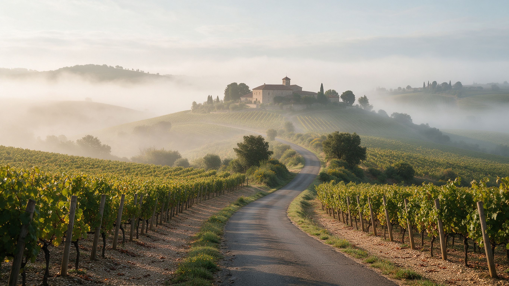

# Give the first sip a moment

Tasting is not an exam, and it is not guessing the price. Its first job is to help you notice what you like, why you like it, and what you want to compare next time. With that purpose, your notes become more specific and your experience accumulates.

Figure: thematic illustration for Give the first sip a moment. Image: AI-assisted illustration generated with Doubao Seedream 5.0 (project-owned); not a photograph of the subject.

## Tasting is not an exam

Many people tasting a drink seriously for the first time worry that they cannot "smell the professional terms". Description does not have to start with terminology. "Like ripe apple", "like freshly baked bread", "like damp wood" are all valid observations. Terms are simply a more precise shared language, not an entry requirement.

Tasting is also not scoring. Scores are comparison tools within a particular system; for everyday drinking you only need to judge whether the structure is balanced, the aroma is clear, the finish is pleasant, and whether you want another sip.

## Preparation: temperature, glass and water

Temperature noticeably changes aroma and palate. Too cold and the aroma is closed; too warm and the alcohol stands out. Different drinks have conventional temperature ranges, but there is no need to chase an exact degree. Put the drink at a temperature you find comfortable, then compare it at different temperatures; that is a useful exercise in itself.

The glass affects aroma concentration and where the liquid lands. Without a specialist glass, choose a clean glass with a slightly narrowed rim. For what shape does, see [choosing a glass](ref:glass).

A glass of water and a little plain food also help. Water cleans the palate so the previous drink does not interfere with the next; bread or soda crackers soften the alcohol. Do not use strongly flavoured food to refresh the palate; it will cover fine aroma.

## Look: colour and clarity

Start with colour, depth and clarity. Colour gives clues but cannot decide quality on its own. White wine moves from pale yellow to gold, red wine from purple-red to brick, with variety, vintage and technique all playing a part; [whisky](ref:whisky) colour is affected by cask ageing and caramel colouring; [beer](ref:beer) colour comes from how the malt is kilned.

Clarity is also only a clue. An unfiltered drink may look slightly hazy without being faulty; sediment may come from age or from a deliberate technique. The purpose of looking is to build a description, not to pass judgment.

## Smell: two passes

Smell twice: a light first pass to let the nose adjust to the alcohol and aroma, then a little closer to identify. A strong drink does not need the nose buried in the glass, or the alcohol will mask the aroma. Move away briefly and come back; the change in aroma becomes clearer.

Start with broad families, then details: fruit, flowers, grain, wood, spice, baking, dairy, minerality. Once the family is clear, ask: fresh fruit or ripe fruit? Citrus or stone fruit? These questions force a more specific observation instead of stopping at "smells nice" or "smells bad".

For [baijiu](ref:baijiu), aroma often involves grain, qu, cellar and age notes; for [huangjiu](ref:yellow-wine), rice aroma, oxidation and sweetness are more common. The vocabularies of different traditions are not fully interchangeable, and using the wrong term causes more confusion than using none.

## The palate: sweet, sour, bitter and texture

After the liquid enters your mouth, notice sweetness, acidity, bitterness and alcohol first, then texture: light or heavy, smooth or coarse, astringent or rounded. Recording these separately is more useful than one overall "nice".

Sweet, sour and bitter do not exist independently. High acidity can make sweetness feel balanced; high alcohol can amplify bitterness; strong tannin makes the palate feel drier. Note the individual elements first, then their relationship, for example "the acidity keeps the sweetness in check" or "the alcohol stands out in the middle".

## The finish and the empty glass

After swallowing or spitting, aroma and taste linger for a while: that is the finish. Its length, cleanliness and evolution are important clues to structure. A short finish is not necessarily bad, since fresh styles are not built for length; a long finish is not necessarily good if what lingers is bitterness or alcohol burn.

The empty glass is worth smelling too. After the drink is gone, the residue on the glass evolves, sometimes revealing detail that alcohol had masked. The empty-glass aroma cannot replace the palate, but it is a useful additional observation.

## A note-taking template

A simple note can include:

- the drink name, type and alcohol content;
- temperature, glass and whether ice was added;
- colour and clarity;
- aroma: two or three specific descriptions;
- palate: sweetness, acidity, bitterness, alcohol and texture;
- finish: length, cleanliness and evolution;
- what you liked or disliked, and what you want to compare next.

The note need not be long. Three to five specific sentences are worth more than a page of adjectives. Photographing the label also helps you check origin, technique and alcohol content later.

## Vocabulary: start with familiar things

Comparing to familiar things is the easiest way to begin. Apple, pear, lemon, bread, honey, pepper, wood, wet stone: these words can all be tested. Ask yourself whether the drink really resembles it, and in what state. That self-questioning makes descriptions more accurate.

Bring in terminology when familiar words are not enough. Terms are valuable for communication, not for showing off. If a set of terms leaves you more confused rather than clearer, set it aside and return to specific aroma and palate.

## Comparing: change one variable at a time

Comparison is the fastest way to improve, provided variables are controlled. To compare temperature, keep the drink, glass and ice the same; to compare glasses, keep temperature and volume the same. Change too much and you cannot tell where a difference comes from.

Start with two drinks in the same style, such as two [wines](ref:wine) or two baijiu of the same aroma type. Smell each once, taste each once, and write one sentence: "what is the biggest difference between them?" That sentence trains judgment better than ten scattered adjectives.

## Common misconceptions

First, treating "I cannot smell the terms" as failing at tasting. Description can start with familiar things, and terms can come later.

Second, treating colour as quality. Colour is affected by variety, vintage, technique and additives and cannot indicate good or bad on its own.

Third, drinking too fast. Aroma and finish need time to unfold; drinking quickly gives only alcohol impact.

Fourth, using strong smells to refresh the palate. Coffee, cigarettes and perfume all interfere with smell; water and mild food suit better.

Fifth, treating one impression as a conclusion. The same drink can differ with temperature, glass and condition; recording the conditions matters more than concluding.

## Boundary

Tasting helps you identify preferences; it does not decide value for you. Alcohol content, origin and technique come from checkable sources, while aroma and palate come from your observation; record the two separately. For the effect of temperature and ice, see [Ice and temperature](ref:ice). This page gives no advice that encourages drinking to excess.

For Give the first sip a moment, begin with what it is, then where it comes from, and finish with how it is used; that order keeps the account grounded.

Read [Baijiu](ref:baijiu) for the reader side of Give the first sip a moment, and [Whisky](ref:whisky) for the route side. Together they locate it.
