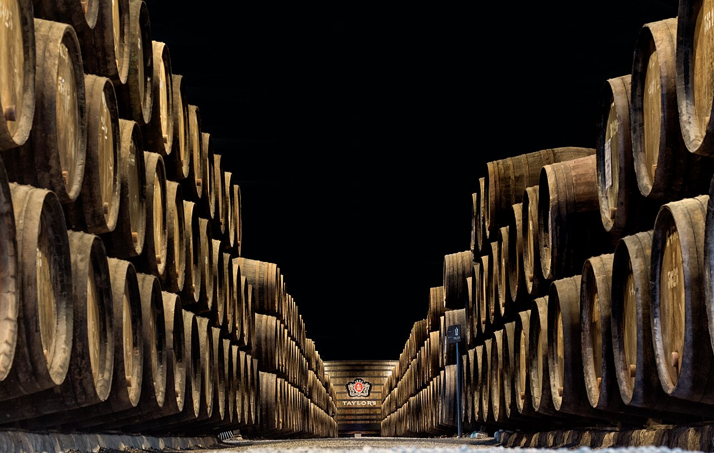
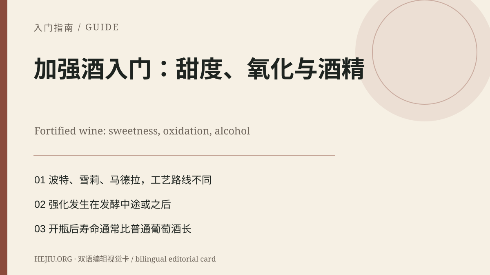

# Fortified wine: Port, Sherry and Madeira

Fortified wine is not one drink. It is a family made by adding alcohol during or after fermentation, then ageing, oxidising or blending. It can be sweet or dry, young or decades old. The common beginner's error is to treat "fortified" as another word for "sweet".

This guide answers four questions: what Port, Sherry, Madeira and Marsala are; how to read sweetness and oxidation; how long an opened bottle keeps; and what to eat with them.

Figure: Taylor's Port wine cellar in Vila Nova de Gaia, showing fortified-wine ageing and stacked storage. Image: Ray in Manila, CC BY 2.0, via Wikimedia Commons ([source page](https://commons.wikimedia.org/wiki/File:Taylor%E2%80%99s_Port_Wine_Cellar,_Vila_Nova_de_Gaia,_Oporto_(48730636822).jpg)).

## Start with four lines

| Type | Core region | When alcohol is added | Typical style | Common sweetness |
| --- | --- | --- | --- | --- |
| Port | Douro Valley, Portugal | During fermentation, preserving sugar | Sweet, full-bodied, long-lived | Sweet to semi-sweet |
| Sherry | Jerez, Spain | After fermentation, then oxidative ageing | Very dry to very sweet, oxidative | Dry to sweet |
| Madeira | Madeira, Portugal | During or after fermentation, with heat and oxidation | High acidity, nut and caramel, very stable | Dry to sweet |
| Marsala | Sicily, Italy | During or after fermentation | Mostly sweet, cooking and drinking | Sweet |

Port's core is adding grape spirit before fermentation ends, killing the yeast and keeping residual sugar, so it is naturally sweet and full. Sherry adds alcohol after fermentation and builds style through oxidative ageing, ranging from bone-dry Fino to very sweet Pedro Ximénez. Madeira's heat and oxidation give it extraordinary longevity. Marsala is Sicily's fortified wine, more often sweet.

## Sweetness and oxidative style

Sweetness and oxidation are independent axes. Do not stop at "sweet" or "dry"; ask whether the wine has been aged oxidatively.

| Style | Typical example | Texture | Occasion |
| --- | --- | --- | --- |
| Dry, lightly oxidised | Fino, Manzanilla | Saline, yeast, sea air | Chilled with olives, seafood, Iberian ham |
| Dry, oxidised | Amontillado, Oloroso | Nuts, caramel, orange peel | Room temperature with cheese, nuts, mushrooms |
| Sweet, oxidised | Pedro Ximénez, Málaga | Raisin, fig, syrup | Pour over ice cream, blue cheese |
| Sweet, aged | Ruby, Tawny, Vintage Port | Black fruit, chocolate, caramel | After dinner, chocolate, hard cheese |
| Sweet, heated and oxidised | Madeira | Caramel, walnut, citrus, high acidity | After dinner, soup, cake |

"Dry Sherry" does not mean tasteless. Fino and Manzanilla are strongly saline and suit chilled savoury snacks; Oloroso is heavier and suits nuts and cheese at room temperature. Port is better in a small after-dinner glass than as a starter to drink in quantity.

Figure: A reference bottle of Port; fortified sweetness and oxidation vary by process. Image: cezzie901, CC BY 2.0, via Wikimedia Commons ([source page](https://commons.wikimedia.org/wiki/File:View_of_Nam_Harbor_from_Busan_Tower.jpg)).

## Port: Ruby, Tawny and Vintage

The common Port categories are Ruby, Tawny, Vintage and Late Bottled Vintage. Ruby stresses fruit and youth; Tawny spends long oxidative years in cask, gaining nuts, caramel and a brown colour; Vintage is declared only in good years, ages in bottle and has the greatest potential; LBV is late-bottled vintage, usually readier sooner.

| Type | Ageing | Flavour | When to drink |
| --- | --- | --- | --- |
| Ruby | Short ageing, fruit-forward | Blackberry, cherry, sweet | Young |
| Tawny | Oxidative cask ageing, often labelled 10/20/30/40 years | Nuts, caramel, dried fruit | Small after-dinner glass |
| Vintage | Single year, bottle-aged | Structured, black fruit, spice | Needs time |
| LBV | Single year, late bottled | Readier than Vintage | Near term |

The "10 years" or "20 years" on Tawny usually describe a target style, not the exact age of one cask; check the region's rules and the label. Vintage Port needs decanting and careful serving temperature and should not be left open for long.

## Sherry and Madeira: oxidation is not a fault

Sherry's oxidative styles come from biological ageing under flor (Fino/Manzanilla) or oxidative ageing (Oloroso). Fino loses freshness quickly after opening; keep it cold and finish it soon. Oloroso and PX keep longer but still need darkness and a seal.

Madeira is heated and oxidised, so it outlasts ordinary wine after opening, though it still changes. It suits after-dinner drinking, soup, cake and nuts; dry Madeira can also pair with clear soup and seafood. Sweet Marsala is often used in cooking and desserts; watch sugar and strength.

## How long after opening

| Type | After opening | Storage |
| --- | --- | --- |
| Fino / Manzanilla | 1–3 days | Refrigerated, sealed |
| Oloroso / Amontillado | 2–4 weeks | Cool, sealed |
| PX / sweet Sherry | 4–8 weeks | Cool, sealed |
| Ruby / LBV | 2–4 weeks | Cool, sealed |
| Tawny | 4–8 weeks | Cool, sealed |
| Vintage Port | 2–5 days | Refrigerated, sealed |
| Madeira | Several months | Cool, sealed |
| Marsala | 2–4 weeks | Cool, sealed |

These are common experiences, not absolute standards. Temperature, strength, residual sugar and headspace all matter. Write the opening date and decant into a smaller bottle to reduce air.

Figure: Fortified wine: sweetness, oxidation, alcohol. Project-generated bilingual editorial card; schematic, not a photograph.

## Buying check and pairing

Before buying, read type, sweetness, vintage or age indication, producer and strength. For Port, check Ruby/Tawny/Vintage/LBV; for Sherry, Fino/Manzanilla/Amontillado/Oloroso/PX; for Madeira, dry/semi-sweet/sweet and age. Prices range from affordable to very high; do not buy on the word "vintage" alone.

With food, Fino suits olives, seafood and ham; Oloroso suits nuts, cheese and mushrooms; PX suits blue cheese and vanilla ice cream; Tawny suits chocolate and caramel desserts; Vintage Port suits hard cheese and dark chocolate; Madeira suits soup, cake and nuts. Fortified wines are usually stronger than ordinary wine; small glasses and slow drinking are better.

Figure: Sherry casks in a Jerez cellar; oxidative ageing is central to Sherry style. Image: Anual, CC BY-SA 4.0, via Wikimedia Commons ([source page](https://commons.wikimedia.org/wiki/File:Lustau_003An2019.jpg)).

## Pair by sweetness and temperature

Fortified wine pairing is not a single rule of "sweet with sweet". Port's sweetness and tannin suit chocolate, blue cheese, nuts and caramel desserts. Tawny Port, aged oxidatively, shows more nut and dried-fruit notes and works with almond tarts, crème caramel and a medium cigar. Vintage Port has more structure and is better with hard cheese and dark chocolate than with a light fruit dessert.

Sherry covers a wider range. Fino and Manzanilla are dry, saline and sea-air fresh, a match for olives, ham, seafood and Spanish tapas. Amontillado and Oloroso add nut and oxidation notes and suit mushrooms, roast meat and hard cheese. Pedro Ximénez is very sweet and works with vanilla ice cream, figs and blue cheese. Madeira's acidity and caramel note can pair with sweeter desserts as well as salted nuts.

On temperature, chill Fino and Manzanilla to 6–8°C; serve Port and Madeira at 14–16°C; sweet Sherry can be 10–12°C. Too cold suppresses aroma, too warm pushes alcohol forward. After opening, Fino and Manzanilla are best within two to three days. Oloroso, Tawny and Madeira can last weeks or longer because of their oxidative style, but still need darkness, cool storage and a tight stopper.

Taste the wine, then the food, and watch whether sweetness, acidity or bitterness is amplified. Fortified wine is not "better when sweeter": a dry Fino's saline savoury note is often a better dinner opener than a sweet bottle.

## Reading fortified-wine labels

Fortified labels carry a few extra signals: vintage, ageing method, sweetness and bottling date. Vintage Port is made from a declared year and continues ageing in bottle; Tawny Port often uses "10, 20, 30 or 40 years" to describe the average age of a blend, not a single harvest. When you see "Vintage", confirm that it is Vintage Port, not merely a wine from a named year.

Sherry labels name the type — Fino, Manzanilla, Amontillado, Oloroso, Pedro Ximénez — and range from bone dry to very sweet. A type may also carry "En Rama" (less clarified, closer to the cask) and an ageing system. Madeira labels use sweetness levels such as Malmsey, Bual, Verdelho and Sercial, and may show a vintage or a "5 years / 10 years" age indication.

Buy in this order: type and sweetness, then vintage or average age, then volume and after-opening storage. Fortified wines are usually 15–22% alcohol, and different bottlings of the same year can differ. A very expensive old bottle is not automatically a daily drink; first decide whether you like oxidative, nutty flavours. Gift boxes and wooden cases are not proof of quality: type, age and production information on the label are.

## A quick match of sweetness and occasion

Dry Fino and Manzanilla open the evening with olives, ham, seafood and salted snacks. Amontillado and Oloroso sit in the middle with mushrooms, roast meat and hard cheese. Ruby and LBV Port close the meal with dark chocolate, blue cheese and nuts. Tawny is for a quieter finish with caramel, dried fruit and almond tart. Pedro Ximénez and Malmsey Madeira suit very sweet desserts in small pours. A practical rule: read the wine's sweetness and oxidation first, the dish's sweetness and salt second, and price last.

## Common questions

**Are all fortified wines sweet?** No. Sherry has bone-dry Fino and Manzanilla, and Madeira can be dry. Read the type and label.

**What is the difference between Port and Sherry?** Port adds alcohol during fermentation and keeps sugar, so it is usually sweet; Sherry adds alcohol after fermentation and builds styles from dry to sweet through oxidative ageing.

**Why does Madeira last so long?** Heat and oxidation make it more stable, so an opened bottle usually outlasts ordinary wine. It still needs darkness, a seal and a cool place.

**Should opened fortified wine be refrigerated?** Dry Sherry, Fino and Vintage Port benefit from refrigeration; Oloroso, Tawny and Madeira can be kept cool, but all need a seal.

**What should I pair with fortified wine?** Dry Sherry with seafood and ham; Oloroso with nuts and cheese; Port with chocolate and hard cheese; Madeira with soup, cake and nuts.

## Common misconceptions

First, fortified means sweet. Sherry and Madeira both have dry styles.

Second, older Port is always better. Vintage Port needs age, but Ruby and LBV are made for earlier drinking.

Third, Sherry only suits Spanish food. Fino works with seafood; Oloroso works with mushrooms and cheese.

Fourth, Madeira never changes after opening. It is stable, not immortal.

Fifth, fortified wine can be drunk like ordinary wine. It is stronger; use small glasses.

## Further reading

- [Port](ref:port): categories, ageing and serving.
- [Sherry](ref:sherry): biological and oxidative ageing.
- [Madeira](ref:madeira): heat, oxidation and longevity.
- [Fortified wine](ref:fortified): the wider category.
- [Oxidation](ref:oxidation): how oxygen shapes Sherry and Madeira.
- [Food pairing](ref:pairing): pairing by weight and intensity.

**Key facts.**

| Item | Detail |
| --- | --- |
| One-line position | Fortified wine is a process family, not a sweet drink; type and oxidation matter more than colour |
| Best for | Drinkers who want after-dinner wines, cooking wines or long-keeping bottles |
| Not for | Anyone treating strength and sweetness as the same thing |
| Buying logic | Read type, sweetness, age indication, producer and strength |

**Sources and scope.** This page's Port, Sherry, Madeira and Marsala information was cross-checked against IVDP, the Jerez-Xérès-Sherry D.O., Madeira wine sources and OIV public information. Prices, batches and import details change; use current official and retail information. The body is project-written; sources are for verification, not copied text.
