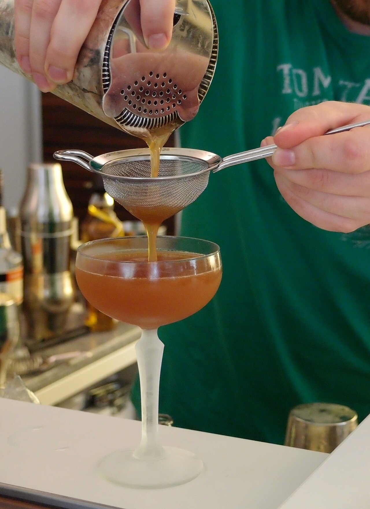
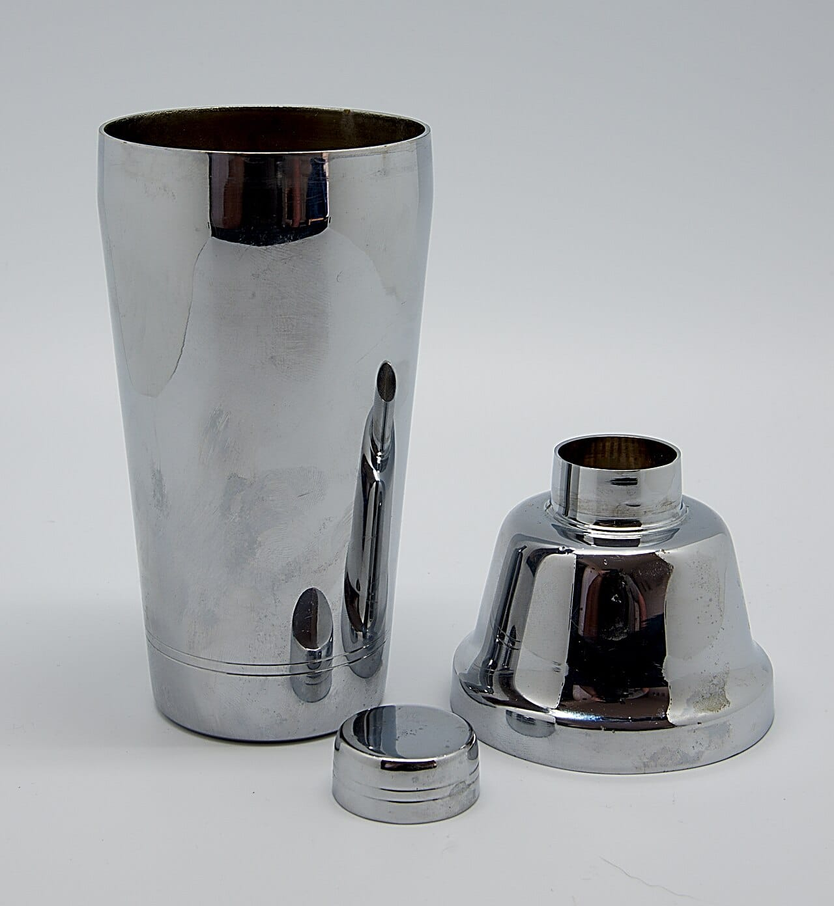
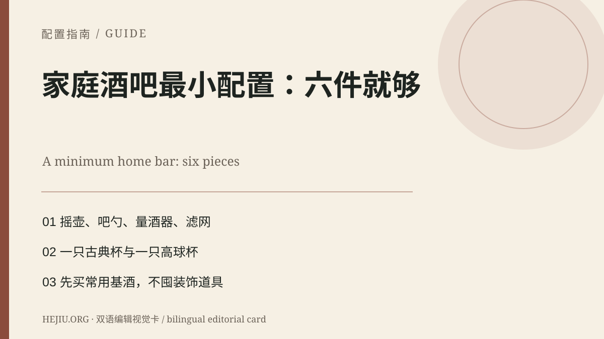
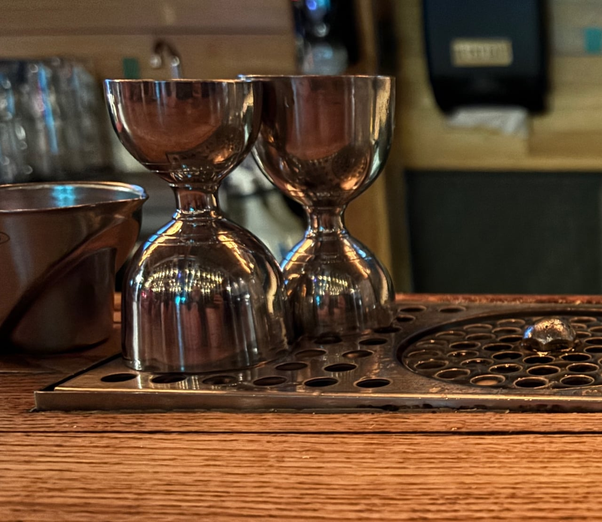

# A minimum home bar: 6 bottles, 8 tools, 1 set of ice

The most common home-bar mistake is buying a shelf of bottles before buying a shaker, ice or fresh lime. The cabinet ends up full, but the only drink you can make is whisky on the rocks.

A better order is to choose five or six drinks you actually want to make, then work backwards to the base spirits, modifiers and tools. This guide offers a minimum kit: six bottles, eight tools, one ice system and three kinds of citrus. The goal is not a professional bar, but a good drink tonight, reliably.

Figure: Double-straining a cocktail; a home bar does not need every gadget, but it does need the key actions done right. Image: SKopp, CC BY 4.0, via Wikimedia Commons ([source page](https://commons.wikimedia.org/wiki/File:Double_straining_a_cocktail.jpg)).

## Choose the menu before the bottles

| Drink | Base spirit | Modifiers | Essential tools |
| --- | --- | --- | --- |
| Gin and tonic | Gin | Tonic, lime | Jigger, bar spoon |
| Daiquiri | White rum | Lime, syrup | Shaker, strainer |
| Whisky sour | Whisky | Lemon, syrup, optional egg white | Shaker, strainer |
| Old Fashioned | Whisky | Sugar, bitters, orange peel | Mixing glass, spoon, strainer |
| Margarita | Tequila | Lime, orange liqueur | Shaker, strainer |
| Negroni | Gin, Campari, sweet vermouth | Orange peel | Mixing glass, spoon |

The table is not a shopping list; it is a decision tool. If you only drink gin and tonic and Daiquiri, gin, white rum, lime, tonic and syrup are enough. If you like Old Fashioned and Negroni, sweet vermouth, bitters and a mixing glass matter more.

## Six minimum bottles

| Slot | Recommended type | What it makes | What not to buy |
| --- | --- | --- | --- |
| 1 | London dry gin | Gin and tonic, Negroni, gin fizz | Over-flavoured, brightly coloured novelty gin |
| 2 | White rum | Daiquiri, mojito, rum highball | “Spiced rum” with no distillery information |
| 3 | Whisky (bourbon or blend) | Whisky sour, Old Fashioned, highball | An expensive single cask only good for neat drinking |
| 4 | Tequila (100% blue Weber) | Margarita, Paloma | “Gold” with no ageing information |
| 5 | Campari or Aperol | Negroni, Aperol spritz | A bottle bought only for decoration |
| 6 | Sweet vermouth | Negroni, Manhattan, Martinez | An old bottle opened half a year ago |

Vodka is optional; add it as a seventh bottle if you often make Moscow mules, Bloody Marys or vodka soda. Orange liqueur (triple sec or Cointreau) is a common modifier for Margarita and Sidecar and can count as half a base spirit. Bitters, syrup, soda and tonic are not “alcohol”, but they are essential to a working bar.

Figure: A cocktail shaker is one of the first tools worth buying for a home bar. Image: Clément Bucco-Lechat, CC BY-SA 3.0, via Wikimedia Commons ([source page](https://commons.wikimedia.org/wiki/File:Shaker_-_2.jpg)).

## Eight tools and one ice system

| Tool | Use | Can it be skipped? |
| --- | --- | --- |
| Shaker | Chill, dilute and integrate | Not recommended |
| Jigger | Control proportions | Not recommended |
| Strainer | Keep crushed ice out | Not recommended |
| Bar spoon | Stir and guide pours | A long spoon can work at first |
| Mixing glass | Stir clear cocktails | A large glass can work at first |
| Citrus press | Juice lime and lemon | Hand-squeezing works but is slow |
| Peeler | Cut orange and lemon peel | A small knife can work at first |
| Ice bucket or box | Keep ice cold | An insulated bag can work at first |

Ice matters more than tools. Home freezer ice is usually small and melts fast; if you often make Old Fashioned or Negroni, buy large cubes or make clear ice. Crushed ice suits highballs and tropical drinks; large cubes suit stirred cocktails.

## Modifiers: sugar, bitters, citrus and bubbles

The minimum modifier list is caster sugar or syrup, Angostura bitters, lime, lemon, orange, soda and tonic. Syrup is easy to make: dissolve sugar and hot water 1:1, cool and refrigerate. Ready-made syrup is convenient, but check shelf life and preservatives.

Citrus should be fresh. Bottled lemon juice is an emergency substitute, but aroma and acidity are weaker than fresh juice. Refrigerate limes and lemons and use cut fruit quickly. Bitters need only a few dashes and last a long time; sweet vermouth should be refrigerated after opening and finished within one to two months.

Figure: A minimum home bar: six pieces. Project-generated bilingual editorial card; schematic, not a photograph.

## Budget and order

| Stage | Budget (RMB, reference) | What to buy |
| --- | --- | --- |
| Week 1 | 300–600 | Shaker, jigger, strainer, bar spoon, ice box |
| Week 2 | 500–900 | Gin, white rum, whisky, lime, syrup, soda |
| Week 3 | 400–800 | Tequila, Campari, sweet vermouth, bitters, orange |
| Later | Replace as consumed | Base spirits, citrus, soda, ice |

Do not buy the whole “set” at once. Start with three bottles and three drinks; confirm that you actually make and drink them, then expand. A home bar is valuable because it can produce a drink on demand, not because it owns the most bottles.

Figure: A double-ended jigger makes recipe ratios repeatable rather than guessed. Image: Topher, CC0, via Wikimedia Commons ([source page](https://wordpress.org/photos/photo/93268b5b84/)).

## Three minimum menus and a buying order

A home bar does not need to be bought at once. Write three menus for what you will actually drink this week, then shop from the menus.

For two, classic: one gin or vodka, one whisky and one dry sparkling wine; tools limited to a shaker, jigger, strainer and bar spoon; fresh lemon, syrup and bitters as modifiers. This covers a gin and tonic, an old fashioned and two glasses of sparkling, for roughly RMB 500–800.

For four, with citrus: add a white rum and a tequila, plus lime, grapefruit and soda; add a citrus peeler and a juicer. The menu expands to a daiquiri, margarita, highball and gin and tonic, at roughly RMB 800–1,200.

For six, a party: add an aged rum or cognac and an Aperol or Campari, plus plenty of ice, soda and tonic; add a large shaker or mixing glass. The menu can cover a Negroni, mojito, long island and a sparkling opener. Plan 300–400 g of ice per person and freeze both large cubes and crushed ice in advance.

Buying order: ice and measuring tools first, base spirits second, modifiers and garnish last. Glasses do not need to match; start with four highball glasses, two rocks glasses and two flutes. On a limited budget, spend on fresh citrus, good ice and one reliable base spirit rather than a drawer of tools you rarely use.

## Ice, syrup and cleaning

The ceiling of a home bar is often set by ice. Cubes from a standard freezer contain air and impurities, melt fast and carry off-flavours. Freeze a large block in a lidded container, then cut it to fit the glass with a knife or ice pick. If you do not have a water filter, freeze filtered or bottled water; wash ice trays regularly so they do not hold odours.

Simple syrup is one part white sugar to one part hot water, stirred until fully dissolved, cooled and bottled in the fridge; it usually keeps two to four weeks. Rich simple syrup uses two parts sugar to one part water, for a heavier texture in an old fashioned. Label the bottle with a date and discard it if it turns cloudy, bubbles or smells off. Citrus juice is best squeezed fresh; pre-squeezed juice should not sit more than 24 hours.

Cleaning matters more than buying more tools. Rinse the shaker, strainer and jigger immediately with warm water so sugar and juice do not dry on; use a small brush for the bar spoon and strainer. Check the tool drawer weekly and throw out anything rusty, bent or losing its coating. Dry glasses completely and store them upside down to avoid water marks and dust.

On a tight budget, buy one reliable shaker, one double-ended jigger, one strainer and one bar spoon; those four cover most home cocktails. Start with the highball and rocks glasses you already own, and add specialised glass only after you know what you actually drink.

## A quick match of budget and menu

Under RMB 500: one gin, one whisky, syrup, bitters, lemon and soda, covering a gin and tonic, old fashioned and highball; start with a shaker, jigger and strainer. Around RMB 1,000: add a white rum and a dry sparkling wine, plus lime, grapefruit and tonic, extending the menu to a daiquiri, margarita and sparkling opener. Around RMB 2,000: add an aged rum, a tequila and an Aperol, plus large ice, a citrus peeler and a mixing glass, covering a Negroni, mojito and party long drinks. Buy what you use, not what looks professional; buy consumables before durables.

## A ten-minute check before opening

Ten minutes before you start, check in order: enough ice, washed citrus, syrup within date, clean tools, and a bin bag and glass cloth within reach. Do not fill a shaker more than two-thirds with ice, or there is no room to shake. Measure syrup before spirits so sticky liquid does not cling to the jigger; lock the strainer and hold it with a finger when pouring. Rinse tools as soon as a drink is finished, which is easier than facing a pile later. Finally, dry the counter before setting down glasses; a wet base slides.

## Common questions

**Do I need a shaker?** If you often make Daiquiri, whisky sour or Margarita, yes. If you only make gin and tonic and Old Fashioned, you can wait.

**Are six bottles enough?** For most homes, yes. Six bottles covering gin, rum, whisky, tequila, a bitter liqueur and sweet vermouth can make more than a dozen classics.

**How long does opened sweet vermouth keep?** Refrigerate and aim to finish within one to two months. Oxidised vermouth loses aroma and weakens Negroni and Manhattan.

**Why does ice matter?** Ice sets temperature and dilution speed. Small ice melts fast, large ice slowly; the same recipe with different ice tastes different.

**Can I skip syrup?** Yes, stir caster sugar with a little water, but syrup is easier to measure and more beginner-friendly.

## Common misconceptions

First, more tools mean more professional. Five core tools making a stable drink beat a drawer of gadgets.

Second, the most expensive base spirit is best. Cocktails need clean, standard flavour, not the priciest single cask.

Third, ice is unimportant. Ice temperature and melt rate directly decide balance.

Fourth, modifiers can be swapped freely. Lime versus lemon, syrup versus sugar, soda versus tonic all change the result.

Fifth, buying everything at once saves money. Make first, buy later, and avoid duplicates and waste.

## Further reading

- [Cocktail basics](ref:basics): shake, stir, build and layer.
- [Ice and temperature](ref:ice): ice types, glass temperature and dilution.
- [Glassware](ref:glass): shapes for different drinks.
- [Negroni](ref:negroni), [Daiquiri](ref:daiquiri), [Old Fashioned](ref:old-fashioned) and [Margarita](ref:margarita): four practice drinks.
- [Shaker](ref:shaker), [jigger](ref:jigger), [bar spoon](ref:spoon) and [strainer](ref:strainer): core tools.
- [Shaking](ref:shaking), [stirring](ref:stirring) and [double straining](ref:straining): three actions.

**Key facts.**

| Item | Detail |
| --- | --- |
| One-line position | A home bar starts with a menu, then six bottles, eight tools and one ice system |
| Best for | Beginners who want to make a few good drinks reliably |
| Not for | Anyone buying bottles before deciding what to drink |
| Buying logic | Tools and ice first, three bottles second, expand only what you use |

**Sources and scope.** This page's ratios, tools and minimum kit were cross-checked against the International Bartenders Association, Difford's Guide, The Oxford Companion to Spirits and Cocktails and The Cocktail DB. Product prices and equipment change; use current official information. The body is project-written; sources are for verification, not copied text.
