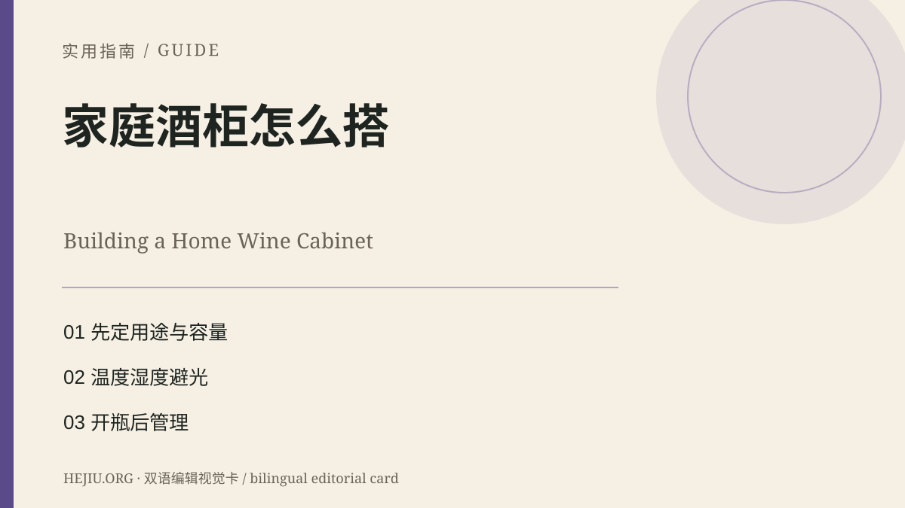

# Building a Home Wine Cabinet

A home wine cabinet can be a temperature-controlled fridge or a dark cupboard; the point is to keep wine stable within the time you need to finish it. Calculate bottles per week, maximum storage and whether any wine needs ageing before buying a cabinet or deciding its size. Do not treat it as a display case: temperature swings, light and vibration matter more than looks.

图：Home wine cabinet bilingual editorial card。Project-created bilingual editorial card for topic identification, not a documentary photograph.

> **Quick verdict**
> **Best for:** drinkers who want stable home storage without buying the wrong cabinet.
> **Not for:** those treating it as a display case or hoarding large amounts at once.
> **One line:** calculate consumption and capacity first, then solve temperature, light and opened bottles.

## Purpose and capacity

Purpose decides equipment: everyday white wine, beer and sake need refrigeration; red wine for short storage needs darkness and stable temperature; long ageing needs stricter temperature and humidity. Calculate bottles per week, maximum stock and whether you plan to age, then choose shelves and zoning. Better slightly small and replenished than a large cabinet left empty.

## Temperature: stability over “lower”

Wine and sake are often stored around 8–14°C, with red slightly higher for short periods; stability matters most, because frequent door opening creates swings. A home fridge can hold wine short-term, but food odours, humidity and vibration can interfere; long-term storage favours a dedicated cabinet. Do not use the freezer, and do not leave white wine at room temperature long-term.

## Humidity, light and vibration

Cork-sealed wine needs some humidity; long dryness can shrink the cork. A home cabinet can show humidity, but extremes are unnecessary. Darkness is mandatory: UV accelerates ageing, so clear doors or windows are unsuitable. Vibration disturbs resting wine; keep the cabinet away from washing machines, speakers and frequently opened doors.

## Placement: flat, zones, labels

Lay cork-sealed bottles flat so wine touches the cork; screw caps can stand. Zone by type: white, sparkling, sake and beer in the cold zone; red and shelf-stable in a slightly warmer zone; leave space for opened bottles. Label each bottle with purchase date and occasion so you do not forget which of two identical bottles is older. Do not keep wine in the fridge door.

## Opened-bottle management

Refrigerate after opening, keep the bottle as full as possible and limit air. White wine and sake are usually finished within days; red can last slightly longer but declines. Vacuum stoppers or inert gas slow, not revive. Sparkling needs a专用 stopper and refrigeration, and should be finished soon; sweet and fortified wine last longer but still need cold. Record opening date instead of judging by smell alone.

## List and budget

Make four categories—everyday, pairing, guests, occasional ageing—with a quantity cap and price band for each. Everyday should dominate; keep only a few expensive bottles. Do not fill the cabinet with wine you do not need. Buy a thermometer and a dark cupboard/cabinet first, then expand; when budget is limited, stable temperature and darkness matter more than display.

## Start with a small cabinet

Measure the space, calculate weekly consumption and maximum stock, then choose a cabinet or dark cupboard that holds stable temperature, blocks light and limits vibration. Put white, sparkling, sake and beer in the cold zone; red and shelf-stable in a slightly warmer zone. Lay cork-sealed bottles flat; screw caps can stand. Refrigerate opened bottles, record dates and finish soon. Use four categories to cap quantity; do not buy wine to fill the cabinet.

## Check before you go

- Calculate weekly bottles
- Set maximum stock
- Choose stable temperature control
- Block light and vibration
- Cold zone for white, sparkling, sake
- Lay cork-sealed bottles flat
- Refrigerate opened bottles and date them
- Use four categories to cap budget

## Limits and next steps

The first question for a home wine cabinet is not "which cabinet" but "how long will I keep this". Wine to be drunk within three months needs only a dark, cool, steady corner; wine meant to rest for three to ten years justifies spending on stable temperature, humidity, low vibration and light protection. Putting short-term bottles in an expensive cabinet, or long-term bottles beside a radiator, both put the money in the wrong place.

Capacity should be calculated from bottle shapes and turnover, not from the seller's "bottle count". Burgundy, Champagne and fortified bottles have different diameters; shelves that are too close force bottles to lie flat or be stacked. Leave about thirty percent empty so you do not have to move a whole row to take one bottle. A setting near 12–14°C is a common range, but stability matters more; low humidity dries corks, while too much humidity brings mould and damaged labels.

A kitchen fridge is short-term turnover only, not long-term storage: compressor vibration, temperature swings from the door and food odours all reach the wine. If the house has no suitable place, renting a professional cellar or sharing storage with friends is often cheaper than buying a small cabinet. Plan for power cuts too: use a temperature strip or a simple alarm, and do not crash-cool the cabinet as soon as power returns.

Finally, keep an inventory with the date in, region, drinking window and approximate price. A cabinet without a list becomes a display you are afraid to open.

## What else to watch

Orientation affects the cork. Wine for long storage should lie flat so the liquid keeps the cork moist; fortified wines, spirits and ready-to-drink sparkling wines can stand, though sparkling wine loses pressure faster upright over years. Do not pack the cabinet so tightly that air cannot move, or bottles near the cooling edge and back wall face bigger temperature swings.

Insure the collection beyond the inventory. High-value bottles should be photographed with batch codes and receipts, and household insurance checked for water damage, power cuts and accidental breakage; renters and humid regions also need mould protection. Spot-check a few bottles now and then; that finds seal failure better than staring at a thermometer.

## References

- International Organisation of Vine and Wine (OIV) — https://www.oiv.int/ (OIV, checked 2026-11-25)
- WSET — wine tasting and label knowledge centre — https://www.wsetglobal.com/ (WSET, checked 2026-11-25)
- The Oxford Companion to Wine — https://global.oup.com/academic/product/the-oxford-companion-to-wine-9780198871316 (Oxford University Press, checked 2026-11-25)
- National standards open system — GB/T 15037-2006 Wine — https://openstd.samr.gov.cn/bzgk/std/newGbInfo (State Administration for Market Regulation and Standardization Administration of China, checked 2026-11-25)

Related entries: [Wine storage](ref:storage), [First wine guide](ref:first), [wine](ref:wine), [white wine glass](ref:glass), [France](ref:france), [Food-pairing guide](ref:pairing), [First tasting guide](ref:tasting), [China](ref:china).
