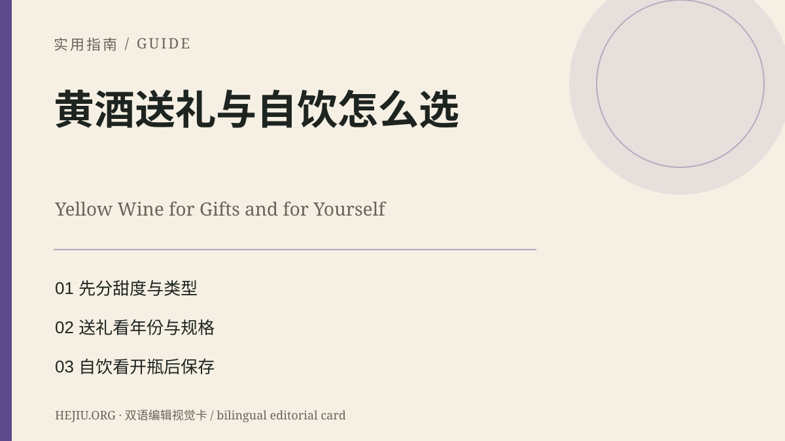

# Yellow Wine for Gifts and for Yourself

Yellow wine is not one drink but a family divided by sweetness, process, origin and age. Gifts are easily led by “ten-year”, “Huadiao” and “handmade winter brewing”, while everyday buyers choose bottles too large to finish. Separate dry, semi-dry, semi-sweet and sweet first, then choose size and packaging by occasion; age is a bonus, not the only criterion.

图：Yellow wine gifts and self-drinking bilingual editorial card。Project-created bilingual editorial card for topic identification, not a documentary photograph.

> **Quick verdict**
> **Best for:** buyers choosing a yellow-wine gift or a bottle for everyday drinking.
> **Not for:** those who only believe “older is better” and ignore sweetness and size.
> **One line:** gifts need a clear type and stable packaging; everyday bottles should be small, suited to taste and finishable.

## Sweetness before age

Yellow wine is commonly divided by total sugar into dry, semi-dry, semi-sweet and sweet. Sweetness determines pairing and serving temperature, and whether the recipient will like it. Dry is fresher and suits seafood, steamed dishes and cold plates; semi-dry balances sweetness and suits home cooking; semi-sweet and sweet suit desserts, nuts or a small glass on their own. Age adds complexity and aged aroma but does not turn sweet wine dry. Ask what the recipient drinks before deciding age, not the reverse.

## Gifts: type, size, packaging

For gifts, prefer mid-to-high-end products with a clear type, traceable origin and producer, and stable packaging. Huadiao, Jiafan and Xiangxue are traditional names that overlap with sweetness and process, so do not judge by name alone; ask whether it is dry or semi-sweet, single or double, boxed or not. Ceramic jars, gift boxes and accessories add weight and shipping cost; for long-distance gifts, confirm the packaging is shock-resistant. Aged bottles suit knowledgeable drinkers; for occasional drinkers, semi-dry or semi-sweet at moderate age in a two-bottle set is safer.

## Everyday: size and after opening

Yellow wine oxidises after opening, so prefer small bottles around 500 ml, or two small bottles drunk in stages. Refrigerate after opening, limit air contact and finish within days; do not leave it beside the stove or in direct sun. Warm according to type and taste, but do not boil; heating changes aroma, and sweet or old bottles should not go too hot. If a bottle cannot be finished, decant into a small full bottle and refrigerate, but flavour will still decline.

## Temperature, vessels and pairing

Yellow wine is often served in small cups or porcelain vessels, from room temperature to warm; match the dish’s temperature and sweetness. Dry pairs with steamed fish, blanched shrimp, cold plates and light vegetables; semi-dry with braised dishes, sauce duck and preserved-meat soups; semi-sweet and sweet with desserts, nuts, dried fruit or alone. Do not pair sweet types with heavy spice; sweet plus heat becomes cloying. Leave space at the rim, sip slowly, and never drive after drinking.

## Buying and storage

Prefer official flagship stores, brand direct shops, large supermarkets and authorised dealers; check type, total sugar, strength, age, origin and production date. For ceramic jars, check seals and leaks; for gift boxes, check liners and bottle fixation. Keep unopened bottles cool, dark and temperature-stable, away from vibration; do not store them long-term in a fridge door. For collection, confirm the producer’s age-labelling rules and do not pay unverifiable premiums for “handmade winter brewing”.

## Two lines: gift and everyday

For gifts, choose clear type, traceable origin, stable packaging and a two-bottle set; put age last. For everyday, choose compatible sweetness, small size, finishable volume and correct pairing; ignore packaging. For occasional recipients, send semi-dry or semi-sweet at moderate age in a small box; for yourself, buy around 500 ml and a type you can finish within days of opening. Either way, keep invoice and batch, refrigerate after opening, avoid light and drink it soon.

## Check before you go

- Ask whether they prefer sweet or dry
- Check type and total-sugar label
- Two-bottle sets are safer gifts
- Choose small bottles for everyday
- Refrigerate after opening and finish soon
- Check ceramic-jar seals
- Check bottle fixation in gift boxes
- Keep invoice and batch

## Limits and next steps

The "vintage" of huangjiu is not the same as that of baijiu: it usually refers to the ageing of base wine and the blend, not the birth year of a single jar. For a gift, read the sweetness type (dry, semi-dry, semi-sweet, sweet) and alcohol level first, then the ageing claim. A bottle that says only "aged" without a year or blend ratio is hard to place. For self-drinking the decision is simpler: semi-dry or dry for meals, semi-sweet for a slow small glass.

Regional style shapes expectations. Shaoxing wine is built on wheat qu, glutinous rice and the Jianhu water system; yuanhong, jiafan, shanniang and xiangxue differ in sweetness and body. Old wines from Shanghai and Jiangsu tend softer, while Fujian red yeast wine shows a red body and a distinct qu aroma. Treating "Shaoxing" as the only standard misses the types that might suit you.

For gifting, separate "open it now" from "store it long". A clay jar with a mud seal and presentation box looks generous but is heavy and fragile; once opened, decant, refrigerate and finish soon. Bottled wine travels across provinces and keeps better at home. If the recipient rarely drinks huangjiu, a small bottle or a semi-sweet type is easier to accept than a large jar.

Opened huangjiu does not keep long. Refrigeration slows oxidation, but the aroma flattens day by day. Warm it gently; do not boil it, or alcohol and aroma leave together. Write the serving temperature, pairing and storage note on a card; it is more useful than the word "good wine".

## What else to watch

Beyond Shaoxing there are northern huangjiu, Fujian red yeast wine and Jimo laojiu. Northern styles lean on millet and a toasted note, Fujian red yeast brings qu aroma and a red body, and Jimo is heavier; ask which one the recipient usually drinks rather than treating Shaoxing as the only answer.

Store bottles upright to avoid long-term seepage; once a clay jar is opened, seal it, refrigerate and finish within about two weeks. For cooking, the remainder can follow a recipe, but do not use clearly sour wine in a clear soup.

## References

- National standards open system — GB/T 13662-2018 Yellow wine — https://openstd.samr.gov.cn/bzgk/std/newGbInfo (State Administration for Market Regulation and Standardization Administration of China, checked 2026-11-25)
- Shaoxing Municipal People’s Government — Shaoxing yellow wine and local culture — https://www.shaoxing.gov.cn/ (Shaoxing Municipal People’s Government, checked 2026-11-25)
- China Alcoholic Drinks Association — https://www.cada.cn/ (China Alcoholic Drinks Association, checked 2026-11-25)
- National standards open system — GB/T 17204-2021 Terminology and classification of alcoholic beverages — https://openstd.samr.gov.cn/bzgk/std/newGbInfo?hcno=B8F9CD37320835EEF17458CBA5962881 (State Administration for Market Regulation and Standardization Administration of China, checked 2026-11-25)

Related entries: [yellow wine](ref:yellow), [Shaoxing](ref:shaoxing), [Food-pairing guide](ref:pairing), [First tasting guide](ref:tasting), [Liquor gift-box guide](ref:box), [China](ref:region), [History of Chinese wine](ref:history), [First baijiu guide](ref:first).
