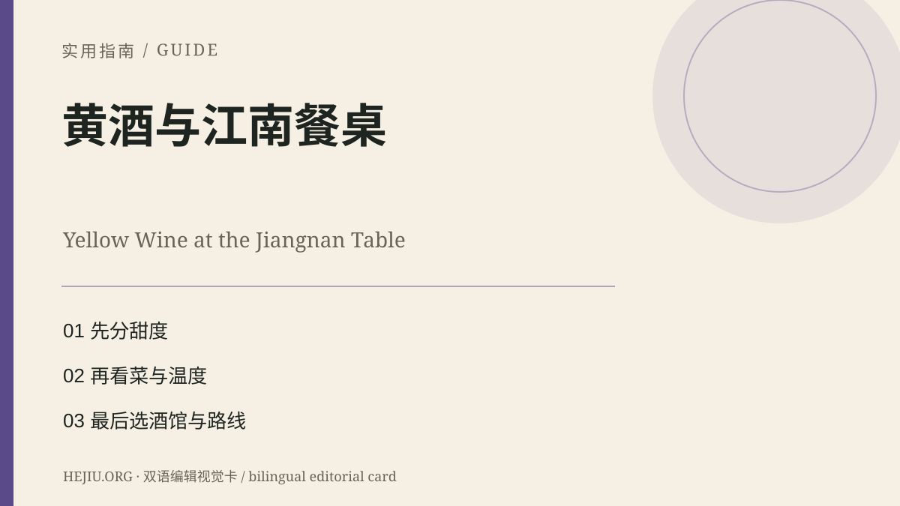

# Yellow Wine at the Jiangnan Table

Yellow wine at the Jiangnan table is neither cooking wine nor something only elders drink. Shaoxing’s preserved greens, drunk chicken and soy duck; Suzhou’s squirrel fish and sizzling eel; Shanghai’s red-braised pork and preserved-meat soup all have a matching type and temperature. Separate sweetness and body first, then the dish’s salt, sweetness and oil, and finally warm or room temperature.

图：Yellow wine and the Jiangnan table bilingual editorial card。Project-created bilingual editorial card for topic identification, not a documentary photograph.

> **Quick verdict**
> **Best for:** diners who want to pair yellow wine with Jiangnan food or visit Shaoxing.
> **Not for:** those who treat all yellow wine as sweet or as cooking wine.
> **One line:** separate sweetness, match the dish’s salt and oil, then set temperature.

## Four types: dry, semi-dry, semi-sweet, sweet

Dry yellow wine is fresh with clear acidity and umami, suiting steamed dishes, blanched seafood and cold plates. Semi-dry balances and suits braised dishes, soy duck and preserved-meat soup. Semi-sweet is rounder and suits sweeter dishes and nuts. Sweet suits dessert or a small glass alone. Do not equate Huadiao with semi-sweet: it is a traditional name, and sweetness is on the label. Read total sugar and type before age.

## Shaoxing: preserved greens, drunk chicken, soy duck

Shaoxing food leans salty, fermented and soy-sauce rich; semi-dry or dry yellow wine is steadiest. Preserved-green steamed pork and pork with preserved greens suit semi-dry, whose acidity cuts oil. Drunk chicken and drunk shrimp suit dry or semi-dry at a lower temperature. Soy duck and soy pork suit semi-dry without too much sweetness. Shaoxing wine has aged and glutinous notes; do not pair with very sweet dishes or they suppress each other.

## Suzhou and Shanghai: sweet umami and red braise

Su cuisine leans sweet and umami: squirrel fish, sizzling eel and cherry pork carry sugar and oil; pair semi-dry or semi-sweet with sweetness slightly below the dish, acidity holding the oil. Shanghai red-braised pork, oil-exploded shrimp and preserved-meat soup: red braise with semi-dry, soup with dry or semi-dry so the umami lifts both. Do not pair sweet wine with heavy sweet dishes, or dry wine with very sweet dishes, which can feel hard and sour.

## Temperature: warm is not hot

Yellow wine can be room temperature, warm or iced, matching the dish. Dry and semi-dry suit around 35–45°C, where aroma opens without sharpness; semi-sweet and sweet should be a little cooler to avoid cloying; summer can be iced, but do not dilute with too much ice. Do not boil, which loses aroma. Leave space at the rim and sip from small cups.

## Wine houses, vessels and ordering

Shaoxing wine houses often sell by age, type and jar; ask whether it is Yuanhong, Jiafan, Huadiao or Xiangxue, then sweetness and temperature. Use small porcelain or yellow-wine cups, not a large glass filled to the brim. Order one warm and one cool for comparison, or ask the shop to match the dishes. Do not judge by “ten-year” alone; try a small cup before buying a jar.

## Regional route and taking bottles home

A Shaoxing yellow-wine route can link a winery, wine museum, old street and restaurant: book the visit, then tasting and lunch, then buy. Taking bottles home means watching glass or ceramic weight and baggage rules; refrigerate after opening and finish soon; do not leave bottles in a car boot overnight. For gifts, choose a clear type and stable two-bottle pack, not just a big jar.

## Pairing order for a Jiangnan table

Start with cold plates and drunk chicken: dry or semi-dry, cooler. Then steamed and blanched dishes: dry, room temperature or lightly warm. Red braise and soy duck: semi-dry at 35–45°C. Sweet dishes and nuts: semi-sweet, a little cooler. Dessert: sweet, in a small cup. Do not use one bottle for the whole table; keep at least a dry and a semi-dry and change with the dish.

## Check before you go

- Read total sugar and type
- Do not use Huadiao as sweetness
- Cold plates with dry
- Red braise with semi-dry
- Sweet dishes with semi-sweet
- Do not boil warming wine
- Small cups, slow sips
- Check baggage and refrigeration

## Limits and next steps

Huangjiu at a Jiangnan table is not one drink for every dish. Its sweetness, acidity and temperature shift with the course: cold plates and river fish suit dry or semi-dry wine at a slightly lower temperature; red-braised pork, soy duck and oil-braised bamboo shoots can take a semi-sweet wine to balance the savoury glaze; hairy crab and huangjiu are a familiar pair, but the roe and paste are rich enough that the wine need not be sweet. Building a line from light to rich is safer than opening a single bottle for everything.

The order of dishes changes the experience. Start with clear soup or a piece of white-cut chicken before the wine; clear the palate with vegetables or tofu between rich courses instead of stacking fat and salt. Shaoxing banquet practice often warms wine to about 40–45°C, but old wine at too high a temperature shows alcohol, while younger wine needs only gentle warming. Iced huangjiu is not mainstream, yet it works with light summer cold plates.

"Vintage" at the table is often used as a reason to toast. What really shapes the experience is oxidation after opening: if the table drinks slowly, the second half turns sour and flat. Refill from a small pot rather than leaving a whole jar open. Refrigerate what remains; it can still cook the next day, but should not star as the banquet wine again.

The heart of a Jiangnan table is rhythm: dishes arrive one by one, wine is sipped slowly. If you can choose only one bottle, a semi-dry Shaoxing wine is usually harder to get wrong than a sweet type.

## What else to watch

Tea and dessert shape the finish. Jiangnan banquets often use green or oolong tea to clear the palate, while dessert can stack sweetness on a semi-sweet huangjiu; put dessert last or finish with a dry wine for freshness. Do not drink strong tea immediately after the meal, as it masks the wine and can affect digestion.

Seasonal dishes set the direction. Spring bamboo, broad beans and river fish suit a light dry style; autumn hairy crab and osmanthus lotus root are sweet, where semi-sweet is steadier; winter red-braised lamb and yanduxian can take a slightly older huangjiu against the richness. Adjust by season rather than fixing one bottle.

## References

- National standards open system — GB/T 13662-2018 Yellow wine — https://openstd.samr.gov.cn/bzgk/std/newGbInfo (State Administration for Market Regulation and Standardization Administration of China, checked 2026-11-25)
- Shaoxing Municipal People’s Government — Shaoxing yellow wine and local culture — https://www.shaoxing.gov.cn/ (Shaoxing Municipal People’s Government, checked 2026-11-25)
- China Alcoholic Drinks Association — https://www.cada.cn/ (China Alcoholic Drinks Association, checked 2026-11-25)
- National standards open system — GB/T 17204-2021 Terminology and classification of alcoholic beverages — https://openstd.samr.gov.cn/bzgk/std/newGbInfo?hcno=B8F9CD37320835EEF17458CBA5962881 (State Administration for Market Regulation and Standardization Administration of China, checked 2026-11-25)

Related entries: [yellow wine](ref:yellow), [Shaoxing](ref:shaoxing), [Zhejiang](ref:zhejiang), [Shaoxing yellow-wine trail](ref:route), [Yellow wine gift and drinking guide](ref:guide), [Food-pairing guide](ref:pairing), [History of Chinese wine](ref:history), [First tasting guide](ref:tasting).
