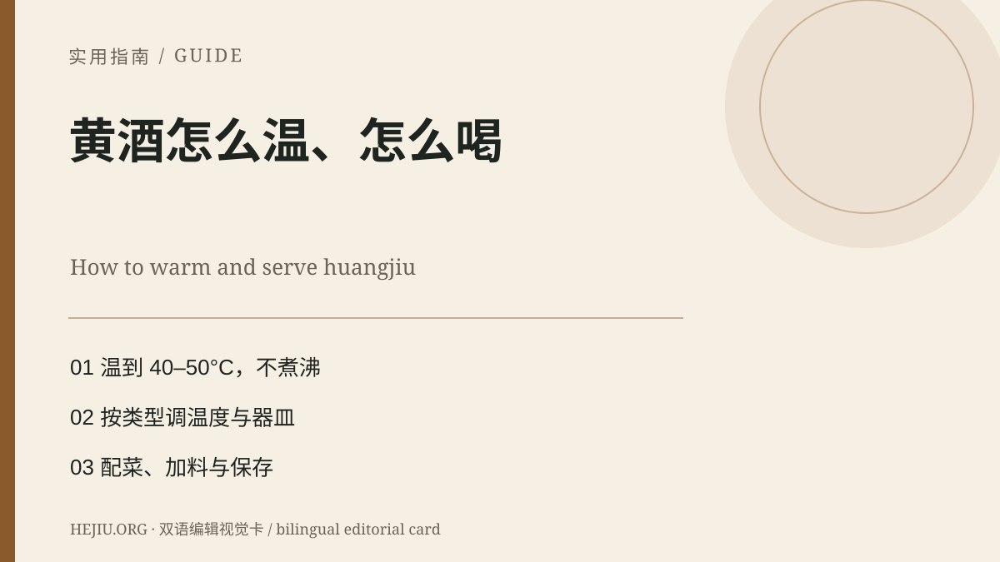

# How to warm and serve huangjiu

“Warming” huangjiu does not mean boiling it. The goal is to soften the body and open the aroma while keeping alcohol and acidity in balance. Too much heat drives off aroma, exaggerates alcohol and can make sweet styles cloying. First identify whether you have a dry, semi-dry, semi-sweet or sweet huangjiu, then choose the temperature and vessel.

Figure: How to warm and serve huangjiu, a project-made bilingual editorial card. It identifies the topic; it is not an on-site photograph.

> **Bottom line**
> **For:** anyone warming huangjiu at home, pairing it with Jiangnan food, or giving it to an elder.
> **Not for:** anyone who thinks warming means boiling, adds a lot of sugar and ginger, or heats it directly in a microwave.
> **Three checks:** keep it around 40–50°C; use a water bath, not direct fire; adjust by style, lower for sweet, slightly higher for dry.

## What temperature?

There is no single number, but most warm-serving contexts sit around 40–50°C: the cup feels warm, a little steam rises, but there are no big bubbles and it does not burn the mouth. Above 60°C, alcohol becomes prominent and the delicate rice and floral notes are pushed back; boiling makes the body thin and the acidity sharp.

| Style | Suggested temperature | Vessel | Food | Note |
| --- | --- | --- | --- | --- |
| Dry huangjiu | 45–50°C | small porcelain or glass cup | steamed fish, blanched shrimp, cold dishes | a little warmer opens the aroma |
| Semi-dry huangjiu | 40–50°C | small porcelain cup | red-braised pork, soy duck, crab | the most common, forgiving choice |
| Semi-sweet huangjiu | 40–45°C | small cup | braises, sweet-and-sour dishes, nuts | too hot tastes cloying |
| Sweet huangjiu | 35–40°C | small cup | desserts, fruit, cheese | can also be served chilled, depending on the wine |

Temperature is only a starting point. Within one style, vintage, strength, sugar and acidity vary; pour a small cup, taste the temperature, then decide whether to warm further.

## How to use a water bath

The safest method is a water bath: pour the wine into a heatproof small pitcher or serving vessel, stand it in a pot or bowl of hot water at about 50–60°C, and warm the wine to roughly 40–50°C. Do not put the bottle directly into boiling water or over a flame; a large temperature shock can crack glass, and alcohol vapour carries a risk.

Without a thermometer, test the pitcher wall with the back of your hand: warm but not burning, with faint steam above the wine. A microwave heats unevenly and can overheat spots; it is not recommended. If you must use one, use short low-power bursts, stir between them, and under-heat rather than overheat.

## Ginger, plum and food

Ginger and smoked plum are regional habits, not universal rules. Ginger amplifies warmth and spice, suiting winter, crab dinners or drier wines; plum adds sweet-sourness, suiting semi-dry or semi-sweet styles but masking rice aroma. Added sugar needs care: sweet huangjiu already has sugar and becomes cloying; dry huangjiu changes balance.

Pair by weight: steamed fish, blanched shrimp and cold dishes with dry or semi-dry; red-braised pork, soy duck and crab roe with semi-dry or semi-sweet; desserts and fruit with sweet. Huangjiu is usually lower in alcohol than baijiu but still alcoholic: do not drink on an empty stomach and never drive after drinking.

## Open bottle and storage

Open huangjiu oxidises quickly; rice and floral notes turn toward acidity and a soy-like edge. Close it, refrigerate, and finish within 1–2 weeks; sweet or stronger huangjiu may last a little longer, but not beyond a month. Room temperature speeds the change, especially in summer.

If you cannot finish a bottle, decant into a smaller bottle to reduce air; do not repeatedly heat the same wine. Heated huangjiu is best finished that day, not cooled, refrigerated and reheated. Read the label for sugar, strength, vintage and producer; for an elder, choose a traceable, gentle semi-dry style.

## Check the label before buying

Check the style and sweetness first: dry, semi-dry, semi-sweet and sweet need different temperatures and food. Then read strength, vintage, origin, producer and storage. For an elder, semi-dry is usually easier to drink than sweet; cooking wine is not the same as drinking huangjiu, so do not substitute it.

Do not buy bulk, unlabelled or unclear “handmade huangjiu”. A complete label, intact seal and clean bottle matter more than a story. Store it dark and cool; after opening, refrigerate and finish soon.
## Common misconceptions

Warmer is not better: burning-hot huangjiu suppresses rice aroma and amplifies alcohol. Sweet huangjiu is not the “highest grade” either; style describes sugar and profile, not quality. Cooking wine is not drinking huangjiu: it has different salt, spice and standards, so do not substitute it. Finally, huangjiu does not always need heating; fresh dry and semi-dry styles can also be chilled, depending on the bottle and season.
## Frequently asked questions

### How warm should huangjiu be?

Most warm-serving contexts are 40–50°C: the cup is warm, a little steam rises, but it does not bubble or burn. Dry styles can go slightly higher, sweet styles lower; above 60°C alcohol masks the aroma. Without a thermometer, test the pitcher wall with the back of your hand and under-heat rather than overheat.

### Can I add ginger, plum or sugar?

Yes, but match the style and occasion. Ginger suits winter, crab dinners and drier wines; plum suits semi-dry or semi-sweet but masks rice aroma; sugar is the easiest to upset the balance, especially in sweet styles. First taste a small cup plain, then decide.

### How long does an open bottle keep?

Refrigerate, close tightly and finish within 1–2 weeks; sweet or stronger huangjiu may last a little longer, but not over a month. Room temperature accelerates oxidation; if it develops sharp acidity, soy-like notes or a film, discard it. Do not repeatedly heat the same bottle.

> **Continue:** Start with [huangjiu](ref:yellow) for the category, then [huangjiu as a gift](ref:gift) and [the Jiangnan table](ref:table); for temperature, compare [temperature and chilling](ref:ice), and for vessels read [choosing a glass](ref:glass). For the region, read [Shaoxing](ref:shaoxing) and the [Shaoxing huangjiu route](ref:route); for a specific producer, see [Guyuelongshan](ref:guyuelongshan).
