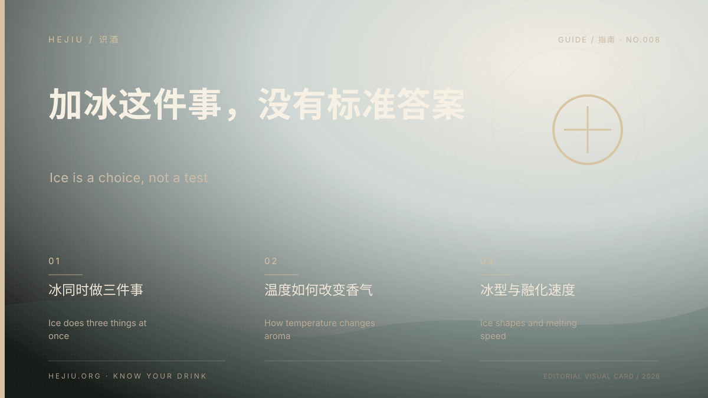

# Ice is a choice, not a test

Adding ice is not a test of how well you drink. Ice does three things at once: it chills, dilutes and changes aroma release. Decide what you want to preserve before choosing how to add it. To keep aroma, do not let the ice melt too quickly; to reduce the burn, bring both temperature and dilution into place; to drink slowly, use large ice that melts slowly.

Figure: thematic illustration for Ice is a choice, not a test. Image: AI-assisted illustration generated with Doubao Seedream 5.0 (project-owned); not a photograph of the subject.

## Ice does three things at once

First, it chills. Cold suppresses the alcohol burn, softens the entry and quiets some of the aroma. Second, it dilutes. Melting ice adds water, which opens certain aromas but also weakens body and sweetness. Third, it changes aroma release. At low temperature volatile aroma does not disperse easily, so the concentration at the rim may be higher, but the layers narrow.

All three happen together; you cannot take only one. To chill without diluting, chill the glass or the bottle; to dilute without chilling, add water directly. Understanding this is how you judge what "adding ice" is actually changing.

## How temperature changes aroma

Aroma molecules volatilise faster as temperature rises. Warmer means more active aroma and more obvious alcohol; colder means quieter aroma and a tighter structure. For [whisky](ref:whisky), ice gathers the aroma and reduces the alcohol burn; for [baijiu](ref:baijiu), ice is not a traditional serve but a personal choice, and the aroma behaves very differently from a traditional warm serve.

Temperature also changes sweetness and acidity. Cold suppresses sweetness and makes acidity seem more prominent; as the drink warms, sweetness returns. The same drink can be balanced quite differently cold and at room temperature, so record the temperature with your notes.

## Ice shapes and melting speed

Surface area determines melting speed. A large block has little surface area, melts slowly and dilutes in a controlled way; crushed ice has a large surface area, chills fast and dilutes fast. Shape also affects stability in the glass: a sphere or large cube does not roll around easily and suits short drinks; crushed ice can be piled high and suits long drinks and recipes that need rapid chilling.

Transparency and texture also affect the experience. Clear ice usually has fewer impurities and melts more evenly; ice with trapped air cracks more easily and melts less regularly. Home ice does not need to be perfectly clear, but it should use clean water and be kept from picking up food odours in the freezer.

## Dilution is not a fault

Many people treat dilution as "the drink being watered down", but a moderate amount of water can open aroma. In a high-strength drink, adding water can make some aroma molecules easier to perceive and reduce the alcohol burn. The question is whether the amount and speed of dilution are controlled.

Large ice lets dilution happen slowly, so you can watch the change as you drink; crushed ice dilutes quickly and suits drinks that should be refreshing from the start. If the recipe already contains a lot of juice or carbonated drink, a large amount of ice will make the whole thin, so reduce the other water or switch to large ice.

## Common temperatures for different drinks

Different drink types have conventional serving temperature ranges, but these are habits, not laws. White [wine](ref:wine) is usually colder than red, and fresh styles colder than full-bodied ones; [sparkling wine](ref:sparkling) needs low temperature to keep bubbles and acidity; the temperature of [beer](ref:beer) affects bitterness and bubbles, with too cold suppressing malt aroma and too warm amplifying bitterness and alcohol.

Spirit serving temperature depends more on personal preference. Neat can be room temperature or slightly chilled; ice keeps chilling and diluting. No one temperature suits everyone; what matters is knowing what temperature is changing and being able to repeat the conditions you like.

## Ways to add ice

Short drinks often use a [rocks glass](ref:rocks), with one large cube, and the chilled liquid strained over it. Large ice provides chilling but melts slowly, which suits slow drinking. Long drinks often use a highball, with more ice and then the spirit and mixer; the ice keeps diluting, so the recipe must leave room for that water.

Chilling the glass first reduces how fast the ice melts against a warm wall. Ice should be dry and clean; wet ice carries surface water and dilutes faster. Use ice tongs rather than your hand.

## Without ice: chilling and adjusting

When you do not want dilution, chill the bottle, the glass or the whole bottle. A chilled glass lowers the entry temperature without changing concentration; a chilled bottle cools the whole drink but takes time and warms up again after it leaves the fridge.

Another method is adding water. A small amount of room-temperature water can open aroma and is easier to control than ice. The difference is that water changes concentration directly, while ice changes both temperature and concentration. To adjust concentration alone, water is more direct.

## A comparison experiment

Choose a drink you know and prepare three equal volumes: one neat at room temperature, one with a large cube, one with a little water. Smell, then taste, recording temperature, dilution, aroma intensity and the change in finish. Repeat after a few minutes and watch what melting ice does.

Keep other conditions as constant as possible: the same glass, the same bottle, the same room temperature. Recording "at which minute" something changed is more useful than writing "better with ice". To understand dilution's role in mixing drinks, see [Cocktail basics](ref:cocktails).

## Common mistakes

First, using ice to hide faults in a poor drink. Ice reduces the burn but cannot repair a fault.

Second, too little or too small ice. Too little ice under-chills and lets dilution run out of control; crushed ice dilutes too fast.

Third, using ice with an odour. Ice picks up freezer smells and carries them straight into the glass.

Fourth, treating neat drinking as the only correct method. Serving style varies by person, and both temperature and dilution can be adjusted.

Fifth, ignoring warming. A drink with ice keeps changing; the last few sips can be completely different from the first.

## Boundary

Whether to add ice is a personal choice, not a proficiency test. Temperature, ice shape and dilution all affect the experience, and recording the conditions is more meaningful than arguing about whether ice is "right". This guide recommends no brands and gives no advice that encourages drinking to excess; drink in moderation and follow local law and safety requirements.

**In brief:** Ice cools, dilutes and changes aroma release; decide what you want to preserve before choosing whether to add it, what ice and how much.

Ice is a choice, not a test is best approached through what it is, then where it comes from, and then how it is used. One check alone will not settle it.

Read [Whisky](ref:whisky) for the reader side of Ice is a choice, not a test, and [Wine](ref:wine) for the route side. Together they locate it.
