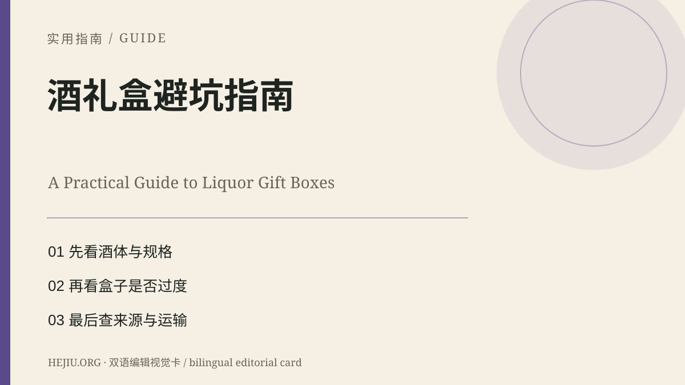

# A Practical Guide to Liquor Gift Boxes

A gift box is not a type of liquor but a sales format: the same bottle can be sold single, double, with accessories or in a bag, and a “development” product may be made only for gift boxes. The price gap can come from liquor, volume, packaging, extras or brand licensing. Read the liquor and size first, the box second; if the box costs more than the liquor, the packaging eats the sincerity.

图：Liquor gift-box pitfalls bilingual editorial card。Project-created bilingual editorial card for topic identification, not a documentary photograph.

> **Quick verdict**
> **Best for:** buyers who need a gift box but fear paying more for packaging than liquor.
> **Not for:** those who judge only box size and freebies, not the producer.
> **One line:** confirm what is in the bottle before deciding whether the box is worth it.

## Liquor: what is in the bottle

A gift box is first a bottle of liquor. Read name, aroma, strength, volume, standard, producer and origin; then identify core brand, commemorative, development or licensed product. Development liquor is not necessarily bad, but source and authorisation must be clear. If the box carries a big brand while the producer is small and untraceable, be cautious. “Gift-box exclusive” describes a channel, not a better liquid.

## Size: single, double, volume

A single-bottle box suits light gifts and individuals; a double suits family dinners, business and the “in pairs” idea; a small set suits tasting but often costs more per ml. Check whether it is 500 ml, 750 ml or a non-standard size, and do not treat “big box, small bottle” as value. If accessories are included, confirm they are food-contact safe and shippable; a freebie is not liquor and does not prove quality.

## Packaging: necessary or excessive

Necessary packaging protects the bottle, carries information and is easy to carry. Excessive packaging uses layers, silk, plastic sculptures and a huge outer carton to create volume. Test it: compare box weight and volume with the bottle; if the packaging is clearly heavier and most of the inside is filler, it is excessive. It raises shipping cost and may conflict with regulation; “simple and recyclable” is not a loss of face.

## Source: brand, licence, channel

Prefer official flagship stores, direct shops, large supermarkets and authorised dealers; check producer, address, standard, production date and anti-counterfeit marks. For development products, check the brand licence chain; for licensed products, check the actual factory. Deep discounts, private transfers and “internal gift boxes” sold only on social platforms should be downgraded. Do not buy a box with no producer, only a “customised” slogan.

## Freebies and “special supply” talk

“Special supply”, “internal supply” and “exclusive supply” create scarcity but do not prove better liquor; regulation restricts such labels. For glasses, tools, lighters and bags, ask whether they are useful and matched to the bottle, and do not pay for useless extras. If a freebie is another brand, confirm authorisation and quality; food-contact items need labelling, and should not be used for hot liquor without confirmation.

## Shipping and the last step

The bigger the box, the harder the shipping: use shock, compression and moisture protection, and add cushioning for glass or ceramic. The carry bag must bear the weight. Before giving, check seal, bottle, box corners and liner, and photograph the batch; do not put the invoice inside. If the recipient may regift, remind them to keep source and shock packaging. For long distance, choose simple replaceable packaging so transport does not ruin the gesture.

## Five questions for a gift box

What liquor is in the bottle, what size and count, is the box heavier than the liquor, who is the producer and licensee, and will it survive shipping. If any answer is unclear, wait. Order the budget as liquor, size, source, packaging, freebies; only pay for the box after the first four are clear.

## Check before you go

- Read liquor and standard first
- Confirm volume and bottle count
- Compare box and bottle weight
- Check producer and licence
- Be wary of special-supply talk
- Judge freebies by usefulness
- Check seal and batch
- Reinforce for long-distance shipping

## Limits and next steps

A gift box is good at creating the impression of expense. Rigid board, flock, a display window, a metal plaque and a booklet all add cost without adding wine. To judge value, put the box down and read the bottle label: alcohol strength, net volume, aroma type, production address and standard. If that information is hidden by decoration or appears only on the outer box, be a little more cautious.

Words such as "internal supply", "special supply" and "exclusive supply" should not be treated as selling points in a legitimate retail channel. They may be printing gimmicks or point to a source that cannot be verified; what can be checked is the production licence number, the batch and the invoice. Corporate buyers should also confirm the invoice title, the purpose of the gift and the budget line before discovering that the box cannot be booked.

Check the structure as well: is the cap loose, does the liner press against the bottle shoulder, is the booklet pressing the bottle, can the handle carry the weight? A two-bottle box often has an off-centre gravity and tilts when lifted; for long shipping, leave cushioning between the outer carton and the liner instead of relying on one sheet of paper. If wine has leaked when the box is opened, photograph it before contacting the seller.

A more complex box is not more respectable. For someone who knows wine, a bare bottle with a region note may be better; for someone who does not drink, a small volume, a lower strength or a tea-and-wine set is easier to accept. Moving budget from the box to the liquid or after-sales service is usually the safer choice.

## What else to watch

Corporate gift boxes often carry a logo, greeting and QR code. Confirm the minimum order, proofing time and who pays for a reprint; the QR code should point to a page that can be maintained, not a temporary campaign link. If the box ships across provinces, run a drop test rather than sending exhibition samples straight out.

Customs and carriage rules matter. A box containing alcohol cannot be posted across borders at will; some countries ban wine imports or require a licence, and domestic flights set strength and packing rules for checked wine. Asking "can it be shipped there" first is cheaper than a return.

## References

- National standards open system — GB/T 17204-2021 Terminology and classification of alcoholic beverages — https://openstd.samr.gov.cn/bzgk/std/newGbInfo?hcno=B8F9CD37320835EEF17458CBA5962881 (State Administration for Market Regulation and Standardization Administration of China, checked 2026-11-25)
- State Administration for Market Regulation — https://www.samr.gov.cn/ (State Administration for Market Regulation, checked 2026-11-25)
- National standards open system — https://openstd.samr.gov.cn/ (State Administration for Market Regulation and Standardization Administration of China, checked 2026-11-25)
- China Alcoholic Drinks Association — https://www.cada.cn/ (China Alcoholic Drinks Association, checked 2026-11-25)

Related entries: [300–800 RMB baijiu gift guide](ref:baijiu-gift), [Yellow wine gift and drinking guide](ref:huangjiu), [baijiu](ref:baijiu), [yellow wine](ref:yellow), [Wuliangye](ref:brand), [China](ref:china), [First tasting guide](ref:tasting), [Food-pairing guide](ref:pairing).
