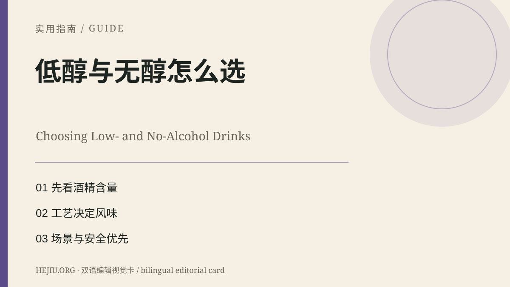

# Choosing Low- and No-Alcohol Drinks

Low- and no-alcohol drinks are growing fast, but labels are not uniform: some say “low alcohol”, some “0.0%”, some are fermented then dealcoholised, some never fermented or are fermentation-inhibited. Read alcohol content and process before judging flavour and occasion. For pregnancy, medication, driving or non-drinkers, choose a product explicitly labelled no-alcohol rather than guessing from taste.

图：Low- and no-alcohol choices bilingual editorial card。Project-created bilingual editorial card for topic identification, not a documentary photograph.

> **Quick verdict**
> **Best for:** people who want less alcohol but still want beer, wine or cocktail flavour and ritual.
> **Not for:** those who treat “no-alcohol” as “safe to drive or drink unlimited”.
> **One line:** read alcohol content and process, then match occasion; no-alcohol still needs moderation.

## Labels: low, no and 0.0

Legal thresholds for “low” and “no” alcohol differ by market; no-alcohol is often labelled 0.0–0.5% abv, while low-alcohol may reach 1.2% or more. Read the alcohol content and the “dealcoholised/not fermented” statement on the back, not just the big “zero” on the front. If a label says only “flavoured drink” without alcohol content, treat it as an ordinary drink and do not assume no-alcohol. Photograph the label, especially for pregnancy or medication.

## Process: dealcoholised, diluted, unfermented

Dealcoholisation usually ferments normally then removes alcohol by vacuum distillation, reverse osmosis or membrane filtration; some aroma is lost and the body can feel thin. Dilution makes a concentrate then adds water and flavour, giving more stable but sometimes sweeter results. Unfermented or fermentation-inhibited “no-alcohol beer/grape drink” is closer to a malt or grape-flavoured beverage. No process is inherently best, but it shapes aroma, sweetness and price. Read ingredients and process, not brand alone.

## Flavour: beer, wine and cocktails

No-alcohol beer often keeps malt and hops but has a shorter aroma and sometimes more obvious bitterness; no-alcohol wine often feels juicy with weak tannin; no-alcohol cocktails use distillates, tea, juice and bitters to mimic structure. Accept that it is not a complete replacement, then judge whether it tastes good. For pairing, choose a version with clear acidity and sweetness, not an overly sweet drink with salty food.

## Occasion: driving, pregnancy, medication, social

Before driving, do not use “low” as a substitute for “no”, and do not judge by feel; the safest choice is no alcoholic drink at all. Pregnancy, breastfeeding, medication and liver disease should be discussed with a doctor, and a no-alcohol drink does not replace medical advice. At social events, choose an explicitly 0.0% product and tell companions in advance; do not accept “just one sip” to fit in.

## Safety: no-alcohol is not unlimited

No-alcohol drinks can still carry sugar, calories, caffeine or additives, and large amounts are a burden; some products below 0.5% are not zero-risk for specific groups. Do not give them to minors as “practice liquor”, and do not drink large amounts while working, driving or operating machinery. If you feel unwell, stop and read the label; check ingredients if you have allergies.

## Buying and drinking advice

Prefer large supermarkets, official brand stores and products with clear labels; check production date, shelf-life, storage and alcohol content. No-alcohol beer and grape drinks often need refrigeration and should be finished soon after opening. For parties, separate “0.0 no-alcohol”, “low-alcohol” and “regular” and label them to avoid mistakes. To reduce alcohol, start with smaller glasses, slower drinking and alternating with no-alcohol rather than replacing all social drinking.

## Three-step choice

First read alcohol content: for absolutely none, look for an explicit 0.0%. Second read process and ingredients: dealcoholised, diluted or unfermented shapes flavour. Third read occasion: driving, pregnancy and medication favour no-alcohol and medical advice; social settings can try low-alcohol in moderation. No-alcohol still has sugar and calories; do not drink unlimited amounts because it says zero.

## Check before you go

- Read alcohol content beyond the front
- Separate dealcoholised from unfermented
- Choose explicit 0.0% for driving
- Ask a doctor for pregnancy or medication
- Check sugar and calories in no-alcohol
- Do not give to minors as practice
- Separate categories at parties
- Refrigerate and finish after opening

## Limits and next steps

Low-alcohol and alcohol-free are not the same label. Low-alcohol usually means less alcohol than the regular product in its class, but it still contains alcohol; alcohol-free means the alcohol has been reduced to a very low level, with the exact threshold set by national rules. Read the declared alcohol strength or alcohol content rather than trusting marketing words such as "light drink" or "zero".

The processes behind alcohol-free beer, wine and spirit alternatives differ widely. The first two often use vacuum distillation, reverse osmosis or arrested fermentation, which can leave sweetness or a grainy note; spirit alternatives more often use maceration, distillation or flavour compounding, so they taste closer to a "drink with a wine flavour". They are not necessarily low in calories or sugar, especially flavoured products; drink enough and the sugar adds up.

Be honest about the use case. People driving, taking medication, pregnant or sensitive to alcohol should choose a product clearly labelled alcohol-free with reliable ingredients; low-alcohol does not mean unlimited, because alcohol still affects reaction time. Treating alcohol-free wine as a "health drink" is also misleading: it lowers one risk factor, alcohol, but does not automatically bring health benefits.

For social occasions, say clearly that it is the alcohol-free version to avoid confusion. For mixing, test in small quantities first, because the sweetness and bitterness of an alcohol-free base often differ from regular spirits. Finally, do not judge quality by "I felt nothing"; ingredients, process and label consistency are more reliable.

## What else to watch

The ingredient list matters more than "0.0%". Some alcohol-free products add sugar, sweeteners or flavouring to rebuild body, so calories can approach a regular drink; anyone sensitive to gluten, sulphites or additives should read the list and allergen notes. Alcohol-free beer may still contain traces of alcohol, and pregnant or medicated drinkers should choose a tested 0.0% product.

Explain the setting in advance. If you bring alcohol-free wine to a party, tell the host or table so it is not poured by mistake or repeatedly explained; when mixing, cut the sugary syrup and balance with bitters, citrus and soda for a result closer to a regular cocktail.

## References

- WHO — Alcohol — https://www.who.int/news-room/fact-sheets/detail/alcohol (World Health Organization, checked 2026-11-25)
- National standards open system — GB/T 17204-2021 Terminology and classification of alcoholic beverages — https://openstd.samr.gov.cn/bzgk/std/newGbInfo?hcno=B8F9CD37320835EEF17458CBA5962881 (State Administration for Market Regulation and Standardization Administration of China, checked 2026-11-25)
- International Organisation of Vine and Wine (OIV) — https://www.oiv.int/ (OIV, checked 2026-11-25)
- Brewers Association — https://www.brewersassociation.org/ (Brewers Association, checked 2026-11-25)

Related entries: [low-alcohol beer](ref:low), [beer](ref:beer), [Beer tasting introduction](ref:intro), [First tasting guide](ref:tasting), [Food-pairing guide](ref:pairing), [fermentation](ref:ferment), [China](ref:china), [wine](ref:wine).
