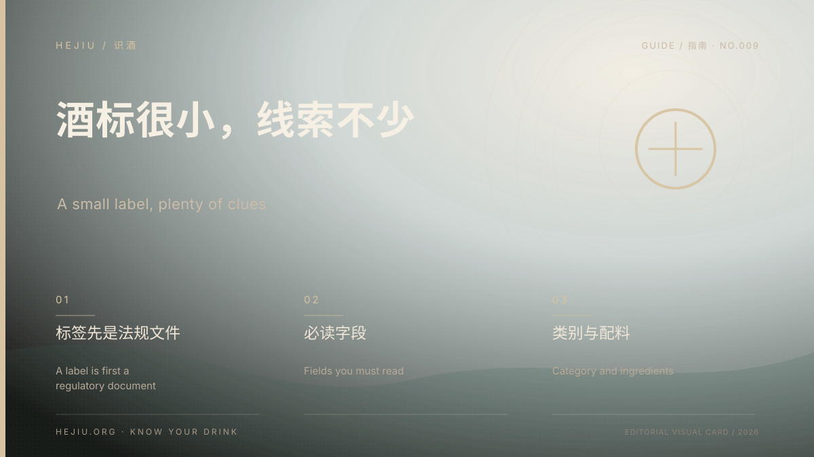

# A small label, plenty of clues

A label is a regulatory document before it is a brand story. Find the checkable facts first, then read the narrative. A label can tell you what the drink is, where it comes from and under which rules it was made, but it cannot decide whether you will like it.

Figure: thematic illustration for A small label, plenty of clues. Image: AI-assisted illustration generated with Doubao Seedream 5.0 (project-owned); not a photograph of the subject.

## A label is first a regulatory document

In most markets, the category name, alcohol content, net volume, ingredients and producer information on a label are bound by regulation. A business can tell a story within what the rules allow, but it cannot freely rewrite these fields. The order for reading a label should therefore be: the regulated fields first, then optional information such as variety, region and vintage, and only then the marketing language.

Rules differ by country, and the same bottle may carry different labels in different markets. Imported drinks usually carry a local-language back label; when the back label and the front label disagree, trust the label lawfully applied by the importer and official channels.

## Fields you must read

Whatever the drink, find these first:

- the product category or drink type name;
- the ingredients or raw materials;
- the alcohol content;
- the net volume;
- the country, region or place of origin;
- the producer, importer or bottler;
- the production date, batch or bottling information.

These fields confirm what you are buying and provide the basis for tracing a problem. The pictures, awards and adjectives on the packaging cannot replace them.

## Category and ingredients

The category name determines which rules apply. [Wine](ref:wine) is usually classified as still, sparkling or fortified; [whisky](ref:whisky) must be distinguished by whether it is made in a specific region and meets local rules; for [baijiu](ref:baijiu), the aroma type and process type should be clear.

The ingredient list gives clues, but labelling requirements differ by market. Some drinks need not list every processing aid, while others must declare additives. A short list such as "water, sorghum, wheat" does not prove there were no other processes; it only shows what the rules require to be declared.

## Alcohol content and net volume

Alcohol content is usually expressed as a percentage by volume, and net volume in millilitres or litres. Together they let you estimate the total alcohol in the bottle. For the same drink type, a higher or lower strength affects palate, storage and serving, but cannot indicate quality on its own.

Note that "alcohol by volume" and "proof" are different expressions. Units differ by country; convert using the legal unit on the label rather than estimating from memory. Check the net volume too, since the same package shape may hold different amounts.

## Origin, producer and bottler

Origin may refer to where the raw material was grown, where the drink was made or where it was bottled; these are not necessarily the same place. A "region" on the label may be a protected geographical indication or a broader description. When you see [terroir](ref:terroir) or a region name, first establish which level of information it refers to.

Producer and bottler are different roles. A drink may be made in one place, bottled in another and sold by a third company. The bottler information helps identify who is actually responsible. If the label names only a distributor and no producer, tracing is harder.

## Wine: variety, region and vintage

Wine labels often show variety, region, vintage and bottler. Variety tells you the main raw material; region tells you the geographical origin and the applicable rules; vintage tells you the year the grapes were harvested, not the year of bottling or release. Different markets require different proportions of variety and region information, so the amount of detail varies.

"Vintage" is not "ageing". A wine labelled with a certain vintage may be released very young; a wine with no vintage may be a blend that has been aged for a long time. Judge ageing by technique and storage, not by the vintage number alone.

## Whisky: age, cask and strength

The age number on a whisky label usually refers to the youngest spirit in the bottle, not the average age or the oldest component. Rules differ by region, so when you see an age statement, first confirm what it means under the applicable regulations.

Cask type, whether it is single malt or a blend, and whether the strength has been diluted are also checkable information. These fields help you understand the direction of the style, but they do not directly prove quality. For the general classification of whisky, see [whisky](ref:whisky).

## Chinese baijiu: aroma type, standard and licence

Chinese baijiu labels often show the aroma type, alcohol content, the standard code and the production licence number. The terminology and classification of aroma types can be checked against GB/T 15109-2021, Terminology of Baijiu Industry; the standard specifies terms used in baijiu production and processes. The standard code corresponds to a specific product standard, and the production licence number relates to the producer.

Words such as "vintage", "aged" and "reserve" on a label need to be read together with the specific standard and the producer's labelling rules; do not judge age from the word alone. If the label and the marketing disagree, trust the regulated label and official channels. For baijiu aroma types and processes, see [baijiu](ref:baijiu) and [GB/T 15109-2021](ref:standard).

## The back label on imported drinks

Imported beverage alcohol usually needs a local-language label applied for the sales market. The back label generally includes the product name, ingredients, alcohol content, net volume, country of origin, importer or distributor, and production date. It is an important basis for consumer claims and tracing.

When the front and back labels disagree, do not judge from the foreign-language front label alone. The front label may use a different category definition or marketing expression, while the back label is the information carrier required by the sales market. Photograph both labels so you can check them later.

## Marketing words are not facts

Words such as "reserve", "special", "masterpiece" and "limited" may have different definitions in different markets, or no legal meaning at all. They indicate brand positioning but cannot prove quality on their own. What is actually checkable is the category, ingredients, alcohol content, net volume, origin, producer and standard code.

Awards and scores are also marketing information. The scope of an award, the composition of the judges and the year all affect what it means, and scoring systems cannot be converted directly into one another. When you see an award, ask what organisation gave it, for which category and in which year, before deciding how much it matters to you.

## A checking routine

- Photograph the front and back labels and keep the full information.
- Find the category, ingredients, alcohol content and net volume to confirm the basic identity.
- Find the origin and the producer or bottler to confirm the responsible party.
- For wine, check variety, region and vintage; for whisky, age and cask; for baijiu, aroma type and standard.
- Check whether the standard code and production licence number are clearly legible.
- Keep marketing words separate from regulated fields; do not treat adjectives as facts.
- Leave uncertain information blank rather than filling it in from memory.

## Boundary

A label gives clues, but it does not replace tasting and cannot guarantee that you will like the drink. Regulations change and label formats change with them; for specific standards and rules, the issuing body's current text prevails. This guide evaluates no specific brand and does not present any label word as a quality grade.

Start with what it is. From there, consider where it comes from, then how it is used. That is how a practical judgment about A small label, plenty of clues is built.