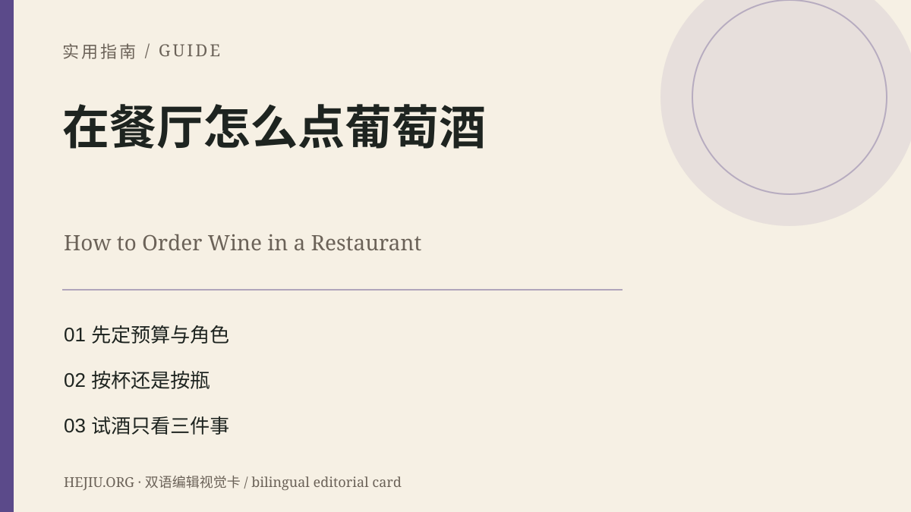

# How to Order Wine in a Restaurant

The common mistake is putting face before function. Decide whether the wine is for the food, for the table or as a gift, then set budget and glass-or-bottle. You do not need to read every line: start with sections, regions and price bands, then choose a wine with a clear style. Tasting is not a performance; check temperature, smell and taste for faults.

图：Restaurant wine ordering bilingual editorial card。Project-created bilingual editorial card for topic identification, not a documentary photograph.

> **Quick verdict**
> **Best for:** anyone facing a restaurant list without a starting point.
> **Not for:** those who only open the most expensive page or refuse to taste.
> **One line:** set role and budget, read the list’s structure, then check only temperature and faults.

## Define the bottle’s role

Before ordering, ask whether the wine is for the main course, the whole table or just the mood. For a main course, match intensity; for the table, choose a middle-of-the-road wine with high tolerance; for mood, sparkling or light-bodied works. Business settings also need brand recognition and transparent pricing. Once the role is clear, the budget makes sense: split it between food and wine instead of starting from the most expensive page.

## Read the list: sections, then price

Lists are usually sorted by type, region or price. Find white, red, sparkling and sweet sections first, then look for a clear style description within the target band. Do not be led by the words “sommelier’s choice”; check whether it fits the food. By glass suits one or two people who want variety; by bottle suits three or more who will finish it. Ask about corkage, service charge and minimum spend before ordering, not at the bill.

## Tasting checks only three things

When the server pours a small amount, check temperature first: warm white feels loose, cold red feels tight. Smell for obvious faults: wet cardboard, vinegar or excessive sulphur can signal a bad bottle. Taste a little to confirm the palate matches the nose and has no obvious sourness. You do not need a long “berry and cedar” speech; just say “the temperature is fine” or “this seems corked, may I have another bottle”. If a knowledgeable guest is present, let them taste first, but the orderer still decides.

## Pairing and temperature

If the dish is heavier than the wine, choose more structure; if lighter, choose freshness. High-acid wines suit fried and creamy dishes; tannic reds suit red meat and hard cheese; sweet wine suits dessert but must be sweeter than the dessert. White is usually colder than red, sparkling coldest; if there is no ice bucket, ask for iced water to cool the bottle. Do not treat “red with meat, white with fish” as law: sauce and cooking method matter more than the ingredient’s colour.

## Leftovers, bill and takeaway

If a bottle is unfinished, confirm whether the restaurant allows takeaway and offers sealing; do not cover the bottle with a wine glass. Check the bill for bottle count, corkage and service charge. If the wine was faulty and raised at tasting, it should normally not be charged. If you ordered a bottle but drank half, ask whether by-glass billing or takeaway is possible, but do not assume consent. Keep the receipt, especially for business expenses.

## The four-sentence method

“How many of us, what is the main course, what is the total budget, and do we want glasses or a bottle.” Then ask the server for two wines at the same price and choose the clearer style. At tasting, check only temperature, faults and palate; if wrong, politely ask for another bottle. You do not need to memorise regions, and ordering does not become an exam.

## Check before you go

- Define the wine’s role
- Choose glass or bottle
- Ask about corkage and service
- Pick within the target band
- Check temperature and faults
- Pair by sauce and cooking
- Confirm takeaway for leftovers
- Check receipt and invoice

## Limits and next steps

At a restaurant, set the budget before reading the list; that works better than hunting for a famous estate page by page. Keeping wine at a quarter to a third of the food spend usually covers a bottle from entry to mid-range; if some guests do not drink, by-the-glass is more flexible. Ask about corkage, service charge and minimum spend in advance; at some restaurants the corkage on a brought bottle approaches the price of a bottle.

The order of a wine list is not the order of price. Lists are often arranged by region, type or glass/bottle, so find the flavour zone you know, then ask the sommelier for a close but better fit. When ordering, give the dishes, budget and preference, for example "mostly steamed fish, I want a white with higher acidity", which is far more useful than "bring me something good".

The tasting ritual is not a performance. Confirm the name, vintage, volume and price, check the cork and bottle for anomalies, and smell for mould or vinegar; if the wine is genuinely faulty, say so politely and ask for a replacement. If it is merely a style you do not like, that is not a return reason, but you can ask for an alternative at the same price. Temperature matters too: reds are often served too warm and whites too cold.

Finally, ordering wine is not an exam. You do not need every region in your head; you need to know what the table is eating, what you will spend and whether you want light or rich. Say those three things and leave the rest to the list and the service.

## What else to watch

Bring-your-own is not always cheaper. Corkage, service and minimum spend can add up to more than a bottle at the same price on the list; call ahead for the rules before deciding. If BYO is allowed, arrive early to open and decant rather than taking service time when the room is full.

Listen to the sommelier, but do not accept everything. State your ceiling, dishes and preference and ask for a recommendation within them; if it goes over, say so. Tipping differs by country, so check local practice and do not pay a service charge twice.

## References

- International Organisation of Vine and Wine (OIV) — https://www.oiv.int/ (OIV, checked 2026-11-25)
- WSET — wine tasting and label knowledge centre — https://www.wsetglobal.com/ (WSET, checked 2026-11-25)
- The Oxford Companion to Wine — https://global.oup.com/academic/product/the-oxford-companion-to-wine-9780198871316 (Oxford University Press, checked 2026-11-25)
- National standards open system — GB/T 15037-2006 Wine — https://openstd.samr.gov.cn/bzgk/std/newGbInfo (State Administration for Market Regulation and Standardization Administration of China, checked 2026-11-25)

Related entries: [wine](ref:wine), [First wine guide](ref:first), [Food-pairing guide](ref:pairing), [Wine storage](ref:storage), [France](ref:france), [China](ref:china), [First tasting guide](ref:tasting), [white wine glass](ref:glass).
