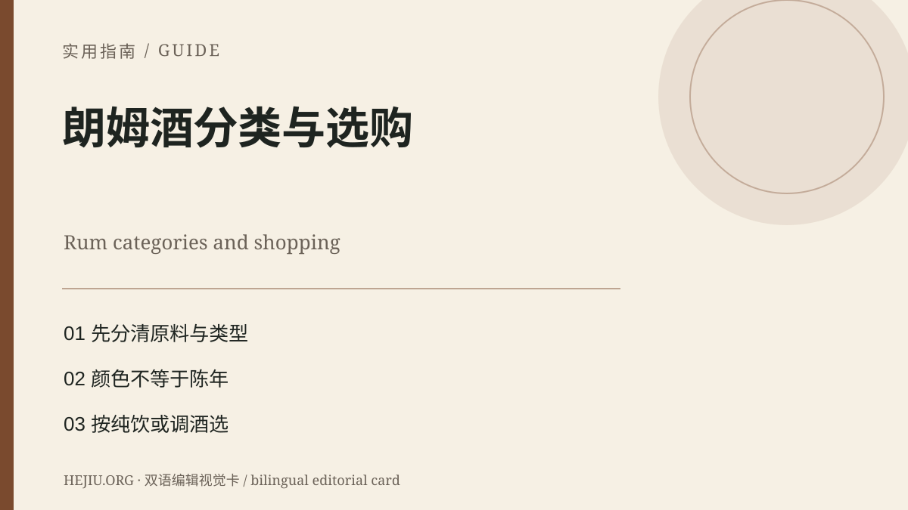

# Rum categories and shopping

Rum is not one flavour but a family of cane-based spirits. White, gold, aged, agricole, navy and overproof rums suit different glasses and occasions. Before buying, ask: is this for mixing, for ice, or for sipping? The answer changes how you judge colour, age and price.

Figure: Rum categories and shopping, a project-made bilingual editorial card. It identifies the topic; it is not an on-site photograph.

> **Bottom line**
> **For:** anyone buying a first rum, or trying to separate white, gold and aged rum.
> **Not for:** anyone judging age by colour alone, or treating “sweet” as a quality grade.
> **Three checks:** is the base molasses or cane juice; is age and origin stated; is the bottle built for mixing or sipping?

## Start with the categories

| Style | Base and process | Typical flavour | Best use | Price band |
| --- | --- | --- | --- | --- |
| White rum | molasses, mostly column still | light, cane, faint fruit | Mojito, Daiquiri, mixing | low |
| Gold rum | molasses, light ageing or colour | vanilla, caramel, soft | ice, mixing, entry sipping | low–mid |
| Aged rum | molasses, tropical ageing | vanilla, caramel, oak, dried fruit | sipping, ice | mid–high |
| Agricole rum | cane juice, French style | grass, cane, spice | sipping, Ti' Punch | mid–high |
| Navy / overproof | molasses, high strength | intense, spicy, alcoholic | Tiki, mixing, small sipping | mid |

“Gold” is not necessarily aged; it can be caramel colour. Colour depth is not an age statement. Check the age claim, origin, strength and whether sugar was added; that is more reliable than colour.

## Colour is not age

Rum colour comes from cask ageing, caramel colour, or both. Tropical ageing in the Caribbean extracts oak and vanilla faster than European ageing, so the same eight years can taste richer. Caramel changes colour, not age; some “gold” rums are white rum with colour, not aged spirit.

If a label says only “gold” or “amber” with no age statement, treat it as a style description, not an age guarantee. For an aged rum, look for “aged X years” or “XO” with origin and bottler information.

## White, gold and aged in use

White rum is the mixing base: Mojito, Daiquiri and other clean, light drinks need a rum without heavy oak. Gold rum can take ice or sweeter cocktails, with more vanilla and caramel. Aged rum is for sipping or a large cube, slowly; do not use it for a sugar-heavy Tiki drink unless that is the style you want.

Agricole rum uses cane juice rather than molasses, with more grass, cane and spice; it suits sipping or Ti' Punch. Navy and overproof rums are strong and intense, better for Tiki or a small pour over ice; beginners should not sip overproof neat.

## Sugar and labels

Rum may be sweetened (dosage), and habits vary by region and brand. Sugar rounds the spirit and can mask distillation and ageing detail; if you buy a “dry” or “brut” style, check the label and ingredients. Sweetness alone is not a quality test, but you should know what style you are buying.

Check the base (molasses or cane juice), origin, distillation (pot or column), age, strength, added sugar and bottler. EU and Caribbean definitions differ; for cross-border purchases, follow the destination rules and the back label.

## Buying order

For a first rum, start with white or a gentle gold: low price, wide use, forgiving. For sipping, move to a clearly aged rum, starting around 5–12 years; for agricole, buy a small bottle first to confirm you like the grassy, spicy style. Navy and overproof come after you know you enjoy intensity.

On a budget, do not pay a premium for “very old but unclear” rum; prefer origin, bottler and batch information. A mixing white rum does not need to be expensive; a sipping aged rum is worth spending a little more on.

## Check the label before buying

Check the base and origin first: molasses or cane juice; Caribbean, Latin America or elsewhere. Then read distillation, age statement, strength, added sugar and bottler. White rum does not need an age claim; aged rum should state its age clearly.

If a label says only “spiced” or “gold” with no base, origin or age, treat it as a flavoured spirit, not an aged or sipping rum. Mixing and sipping are two different paths; decide the use before the style, and beginners should not start with overproof.
## Common misconceptions

Dark colour does not prove age; it may be caramel. Spiced rum is not aged rum: spice and sugar can mask the spirit's detail. White rum is not “flavourless” either; it is lighter and built for mixing. Overproof does not mean “purer”; it means more alcohol and concentrated flavour, so sip with care. Confirm the style and use before discussing price. For a gift, a small card with serving advice is more useful than another layer of packaging. Price is not the only clue; check the style and the source first.
## Frequently asked questions

### White, gold or aged?

White for mixing; gold for ice or entry sipping; aged for serious sipping. Agricole is a separate route, best tried in a small bottle first. Do not choose by colour alone; read the age and base on the label.

### Does darker mean older?

Not necessarily. Colour can come from cask ageing or caramel; a “gold” rum with no age statement is not an age guarantee. Judge age by the label, origin and bottler, not colour.

### Is rum for sipping or mixing?

Both, but by style. White and gold suit mixing; aged and agricole suit sipping; navy and overproof suit Tiki or a small pour over ice. Decide the use first, then the style.

> **Continue:** Start with [rum](ref:rum) for the category, then the [rum introduction](ref:intro); for mixing, read [cocktail basics](ref:cocktail). Compare [navy rum](ref:navy), [overproof rum](ref:overproof) and [spiced rum](ref:spiced); for regional routes, see [Barbados rum trail](ref:barbados) and [Cuba rum trail](ref:cuba).
