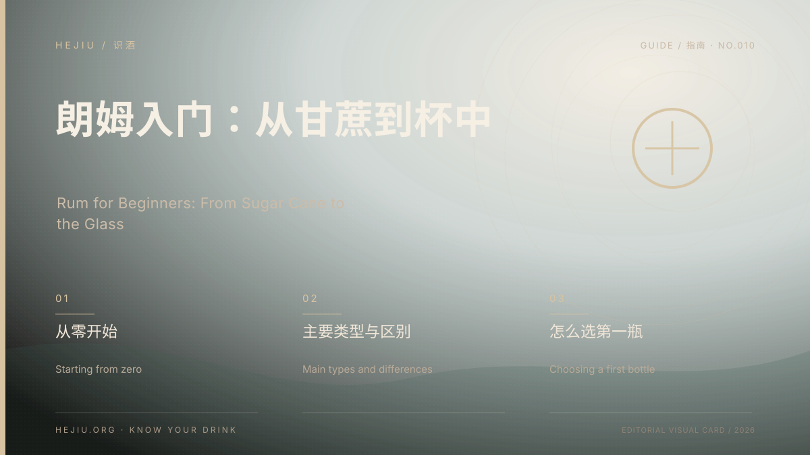

# Rum for Beginners: From Sugar Cane to the Glass

Rum is a distilled spirit that starts from sugar cane or its by-products. Its types differ not only in colour but in raw material, distillation, ageing environment and regional style. A beginner does not need to memorise every category; holding on to the four lines of raw material, distillation, ageing and region is enough to judge the direction of a glass.

Figure: thematic illustration for Rum for Beginners: From Sugar Cane to the Glass. Image: AI-assisted illustration generated with Doubao Seedream 5.0 (project-owned); not a photograph of the subject.

> **Decision checklist**
> Run these three checks before you buy or go.
>
> - **Starting from zero:** Rum has two main raw materials: molasses and cane juice.
> - **Main types and differences:** White or light rum is usually unaged or only briefly aged and filtered, with a pale colour and clean flavour, suited to mixing.
> - **Choosing a first bottle:** Choose the first bottle by purpose.

## Starting from zero

Rum has two main raw materials: molasses and cane juice. Molasses is a by-product of sugar refining, with a deep flavour of caramel and minerals; cane juice is fermented directly and gives a fresher, greener, more herbal profile. After the raw material come fermentation, distillation and ageing, and each step changes the final style.

Distillation decides the weight of the body. Pot distillation usually retains more flavour compounds and gives a heavier, more complex spirit; column distillation is cleaner and lighter, suited to fresh styles. Ageing takes place in oak, and time, cask type and climate all affect colour, aroma and texture.

Rum is made across the Caribbean, Latin America, Asia and the Indian Ocean. Different cane varieties, fermentation habits and stills produce a wide spectrum from crisp to intense. Understanding this stops "rum" from becoming a single flavour in your mind.

## Main types and differences

White or light rum is usually unaged or only briefly aged and filtered, with a pale colour and clean flavour, suited to mixing. Gold or amber rum may be briefly aged or coloured with caramel, and is rounder than white rum.

Aged and dark rums spend longer in oak, bringing vanilla, caramel, dried fruit and wood, with a fuller body. Dark does not automatically mean aged: some products adjust colour with caramel, and real ageing information should come from the label and the producer's notes.

Spiced rum adds spices, fruit or sugar to a base rum, giving a direct, sweet profile; agricole rum is made from cane juice and often shows grass, cane and mineral notes; overproof rum has higher alcohol and concentrated flavour, suited to small sips or mixing; navy rum is usually a blend of several rums with a heavy style.

Regional styles are worth knowing. [Jamaica](ref:jamaica) often produces rums with intense fruit and fermentation notes and a high proportion of pot stills; [Barbados](ref:barbados) is usually more balanced, with fruit and wood together; Cuban-style rum tends to be lighter, and agricole is common in the French Caribbean. These are tendencies, not fixed rules.

## Choosing a first bottle

Choose the first bottle by purpose. For mixing, a clean, clearly aromatic white rum makes classic recipes stable; for sipping, an aged rum with an age statement and a named region has more layers. Do not start with the most expensive or the strongest product; build your own reference points first.

When reading the label, look at raw material, region, age, alcohol content and whether the rum is spiced. An age statement usually refers to time in cask, not time in bottle; rules differ by country, and unclear labels should be checked against the producer's information.

If you want one bottle for both mixing and sipping, a mid-priced aged rum is a reasonable compromise: more aroma than white rum, less forbidding than overproof. A first bottle does not need to be "collector grade"; first confirm whether you like the combination of cane, caramel and wood.

## How to drink and what to use

White rum suits mixing; classics such as the Daiquiri and Mojito are built on it, and attention to sour-sweet balance, ice and dilution matters, as covered in [cocktail basics](ref:cocktails). Aged rum suits sipping: room temperature, a small glass, a small mouthful, letting the liquid cover the tongue and noticing sweetness, wood and [finish](ref:finish).

You can also add one large ice cube or a few drops of water. Ice cools, dilutes and quietens the aroma; water opens the aroma but too much thins the body. Taste a small sip neat first, then decide whether to add ice or water. Do not chill aged rum until it is numb; the aroma closes.

Use a small [rocks glass](ref:rocks) or a tulip glass, with a slightly narrowed rim to gather aroma. Pour about 30–45 millilitres for sipping and take your time; for cocktails, measure according to the recipe. Nose the glass after it has rested, then swirl gently, rather than putting your nose straight into the rim.

## Price and buying

Rum prices vary widely with region, age, distillation, brand and channel; check local market and official channels for current prices. For everyday mixing, a moderately priced white rum is enough; for sipping, choose a product with an age statement and a named region, and do not pay too much for packaging.

Buy from reputable channels and check that the label is complete, the bottle is not leaking and the fill level is normal. For an aged rum, knowing its storage and provenance is more reliable than looking only at the age. After opening, seal it, keep it dark and store at room temperature; flavour will change gradually over months and years.

## Common misconceptions

First, that darker means older. Colour can come from age or from caramel colouring and is not a reliable guide on its own. Second, that spiced rum is superior to plain rum. Spicing is a style choice, not a quality grade.

Third, that all rum is sweet. White and agricole rums can be quite dry; sweetness comes from raw material, ageing and whether sugar has been added. Fourth, that white rum has no flavour. Its aroma is more restrained, but cane, herb and fermentation notes are still there; being suited to mixing does not mean it has no character.

Fifth, that rum is only for cola. Aged rum can be sipped, white rum can be mixed, and agricole can pair with fresh citrus and herbs. Sixth, that alcohol strength equals quality. High-strength rum concentrates flavour but also hides detail; a beginner does not need to start at the highest proof.

## A path forward

First, use one white rum to make two or three classic cocktails and understand sourness, sweetness, dilution and ice. Second, sip an aged rum and note sweetness, wood, dried fruit and finish. Third, compare Jamaican and Barbadian styles and feel the difference between pot and column distillation.

Fourth, try an agricole rum and notice the green, mineral character of cane juice. Fifth, keep your own tasting notes: raw material, region, distillation, age, alcohol and personal impression. Sixth, return to mixing and substitute different rum styles in the same recipe to see how the drink changes. Progress is not buying more expensive bottles but being able to say what you like and why.

## See also

- [Rum](ref:rum): the definition, types and basic production of rum.
- [Jamaica](ref:jamaica): the regional background of intense fruit and pot stills.
- [Barbados](ref:barbados): the regional background of balanced rum.
- [Body](ref:body): body weight and how to drink it.
- [Finish](ref:finish): how to notice the finish when sipping.
- [Sipping](ref:sipping): the motion and pace of sipping.
- [Rocks glass](ref:rocks): glassware for sipping and ice.
- [Cocktail basics](ref:cocktails): the structure of rum-based cocktails.

Start with what it is. From there, consider where it comes from, then how it is used. That is how a practical judgment about Rum for Beginners is built.

Start with [Rum](ref:rum) for reader, then read [Barbados](ref:barbados) for route. Seeing both keeps Rum for Beginners from being confused with a neighbouring idea.

## Quick comparison: four rum styles

| Style | Base and process | Flavour | Best for |
| --- | --- | --- | --- |
| White rum | Cane juice or molasses, short rest | Clean, cane sweetness | Mojito, daiquiri |
| Gold rum | Short oak ageing | Soft, vanilla | Neat or with ice |
| Dark rum | Longer ageing, caramel colour | Rich caramel and spice | Dark cocktails, baking |
| Agricole | Fresh cane juice | Grassy, green, intense | Vivid, punchy flavours |

How to use: narrow by setting first, then adjust for budget and taste; this is a starting table, not a score.
