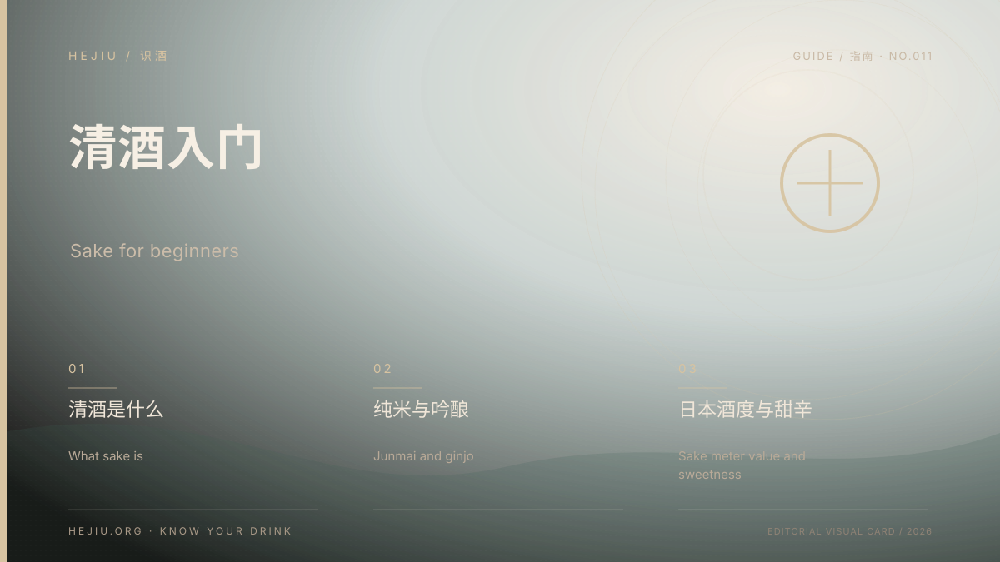

# Sake for beginners

A sake label reads like a technical data sheet: junmai, ginjo, daiginjo, polishing ratio, sake meter value. For a first purchase you do not need all of it. Separate the two dimensions of raw material and polishing, then choose by temperature and occasion, and you can find a bottle that suits you.

Figure: thematic illustration for Sake for beginners. Image: AI-assisted illustration generated with Doubao Seedream 5.0 (project-owned); not a photograph of the subject.

> **Topic guide: sake from grade to table**
> - [Sake intro](https://hejiu.org/en/guides/sake-intro/)
> - [Sake](https://beverages.hejiu.org/en/styles/sake/)
> - [Junmai](https://beverages.hejiu.org/en/styles/junmai-sake/)
> - [Ginjo](https://beverages.hejiu.org/en/styles/ginjo-sake/)
> - [Daiginjo](https://beverages.hejiu.org/en/styles/daiginjo-sake/)
> - [Japanese food with sake](https://hejiu.org/en/pairings/japanese-sake/)
> - [Sake and shochu](https://culture.hejiu.org/en/articles/sake-and-shochu/)

> **Decision checklist**
> Run these three checks before you buy or go.
>
> - **What sake is:** Sake is brewed from rice, water, koji and yeast through saccharification and fermentation; it is not a distilled spirit.
> - **Junmai and ginjo:** "Junmai" means only rice, water, koji and yeast, with no added brewer's alcohol; "honjozo" allows a small amount of brewer's alcohol to adjust aroma and texture.
> - **Sake meter value and sweetness:** The sake meter value (nihonshu-do) is an indicator related to density and sugar; values can be positive or negative.

> **Topic guide: sake from grade to table**
> - [Sake intro](https://hejiu.org/en/guides/sake-intro/)
> - [Sake](https://beverages.hejiu.org/en/styles/sake/)
> - [Junmai](https://beverages.hejiu.org/en/styles/junmai-sake/)
> - [Ginjo](https://beverages.hejiu.org/en/styles/ginjo-sake/)
> - [Daiginjo](https://beverages.hejiu.org/en/styles/daiginjo-sake/)
> - [Japanese food with sake](https://hejiu.org/en/pairings/japanese-sake/)
> - [Sake and shochu](https://culture.hejiu.org/en/articles/sake-and-shochu/)

## What sake is

[Sake](ref:sake) is brewed from rice, water, koji and yeast through saccharification and fermentation; it is not a distilled spirit. Its special feature is parallel fermentation: koji breaks rice starch into sugar while yeast converts sugar into alcohol, both in the same fermentation vessel.

Sake is usually around 15%–16% [alcohol by volume](ref:abv), with some genshu higher; the label governs. It suits cold or warm serving more than most drinks, and its flavour changes noticeably with temperature, an important difference from other categories.

## Junmai and ginjo

"Junmai" means only rice, water, koji and yeast, with no added brewer's alcohol; "honjozo" allows a small amount of brewer's alcohol to adjust aroma and texture. They are style routes, not a hierarchy.

"Ginjo" and "daiginjo" refer to lower polishing ratios and cooler fermentation, usually giving a more floral, fruit-forward aroma. The polishing ratio is the proportion of the rice grain left after milling; a smaller number means more of the grain is removed. Ginjo is commonly 60% or below, daiginjo commonly 50% or below, and honjozo commonly 70% or below.

| Category | Raw material | Polishing ratio | Typical style |
| --- | --- | --- | --- |
| Junmai | Rice, water, koji, yeast | No uniform upper limit | Rice aroma, full body |
| Junmai ginjo | Junmai, cool fermentation | Commonly 60% or below | Fruit aroma, fresh |
| Junmai daiginjo | Junmai, cool fermentation | Commonly 50% or below | Floral, delicate |
| Honjozo | Small amount of brewer's alcohol allowed | Commonly 70% or below | Fresh, crisp |

For a first bottle, start with junmai or junmai ginjo: the former shows rice aroma, the latter is easier to recognise by aroma. Daiginjo usually costs more and suits comparison rather than a first purchase.

## Sake meter value and sweetness

The sake meter value (nihonshu-do) is an indicator related to density and sugar; values can be positive or negative. A higher value usually reads drier, a lower value sweeter, but it is not the only guide: acidity, aroma and temperature all change perception.

For a first purchase, do not chase "dry" or "sweet" alone. The flavour description, rice variety and yeast information are more direct. If unsure, a middle-of-the-road bottle labelled junmai or junmai ginjo is easier to accept than an extreme dry or sweet style.

## Temperature and serving

Sake has a wide temperature range: chilled sake around 5–10°C, room temperature around 15–20°C, and warmed sake around 40–55°C. Temperature changes aroma and sweetness: cold is fresher with more noticeable acidity, warm is softer with more rice aroma. For a first bottle, start at room temperature, then compare chilled and warmed.

The glass need not be elaborate; a small cup or ochoko is enough, and a wine glass can also be used to observe aroma, as covered in [how to choose a glass](ref:glass). Do not fill to the brim; leave room for aroma. Sip slowly rather than swallowing in one go, and pair with sashimi, sushi, grilled fish, tofu and lighter dishes.

## Choosing the first bottle

1. Set the category: junmai or honjozo, choose one direction.
2. Set the aroma: ginjo for fruit, junmai for rice.
3. Set the temperature: plan for room temperature first, then consider chilling or warming.
4. Check the label: category, polishing ratio, strength, rice variety, origin, production date.
5. Choose the channel: a reputable supermarket, specialist shop or official brand channel, with attention to cold chain and light protection.

For a single bottle, junmai ginjo is usually a steady starting point: more aromatic than junmai, without daiginjo's dependence on precise temperature. Brands and prices vary by market, so no figures are listed here.

## Storage and opening

Sake dislikes light, heat and oxygen. Unopened bottles should be kept dark and cool, and unpasteurised and ginjo styles often need refrigeration; after opening, finish quickly, refrigerate the remainder and limit contact with air. Long storage at room temperature accelerates aroma change.

If an opened bottle shows obvious oxidation, sourness or a darker colour, do not force it down. Sake is not better with age; most products suit fresh drinking. "Aged" and "koshu" on a label are separate styles, not proof that ordinary sake keeps well.

## Common mistakes

First, treating junmai as a grade. Second, assuming a lower polishing ratio always tastes better. Third, treating the sake meter value as a sweetness meter. Fourth, warming every sake. Fifth, leaving an opened bottle at room temperature for a long time. Sixth, drinking quickly from a large glass.

**At a glance:** A first-sake guide to junmai, ginjo, daiginjo and honjozo, explaining polishing ratio, sake meter value, serving temperature and how to choose a bottle. 

Sake for beginners is best approached through what it is, then where it comes from, and then how it is used. One check alone will not settle it.

It is tempting to treat Sake as for beginners an advertisement. Its identity and use are separate questions.

The guide's decision table starts with polishing ratio and sake meter value, then moves to ginjo versus honjozo and finally to serving temperature. A bottle marked junmai has no added brewing alcohol, while ginjo and daiginjo refer to polishing; junmai ginjo and junmai daiginjo combine both. The sake meter value tells you whether the wine is dry or sweet, not the grade.

A first bottle should be stored cool and dark, opened within a few months and served in a small glass.

**Key facts.**

| Item | Detail |
| --- | --- |
| In one line | A first-sake guide to junmai, ginjo, daiginjo and honjozo, explaining polishing ratio, sake meter value, serving temperature and how to choose a bottle. |
| Audience | If you want want to try sake but cannot decode junmai, ginjo or polishing ratio. |
| Level | beginner |

**Sources and limits.** The key claims about Sake for beginners are checked against the following sources: Japan Sake and Shochu Makers Association (special-designation sake, polishing ratio and serving temperature), National Tax Agency of Japan (sake labelling rules and category definitions), National Research Institute of Brewing (public research material on sake brewing and quality) and 4 sources in total. Prices, batches and status change; the body is project-written and does not reproduce source text.

## Quick comparison: main sake grades

| Grade | Polishing | Flavour | Best for |
| --- | --- | --- | --- |
| Junmai | No added brewing alcohol | Rice-forward, full | Warm sake, Japanese food |
| Honjozo | Small amount added | Clean, light | Everyday drinking |
| Ginjo | 60% or less | Fruit and floral notes | Chilled, light dishes |
| Daiginjo | 50% or less | Fine, aromatic | Celebrations, on its own |
| Junmai daiginjo | 50% or less, pure rice | Rich and round | Umami-rich food |

Further reading

- [Sake](ref:sake): categories, production and styles.
- [Alcohol by volume](ref:abv): reading the strength on a sake label.
- [The first sip](ref:tasting): look, smell and record.
- [How to choose a glass](ref:glass): how glass shape affects aroma.

## Sources

- Japan Sake and Shochu Makers Association — basic knowledge of sake — https://www.jss.or.jp/
- National Tax Agency of Japan — labelling standards for sake production and quality — https://www.nta.go.jp/
- National Research Institute of Brewing — public material on sake production and quality — https://www.nrib.go.jp/
