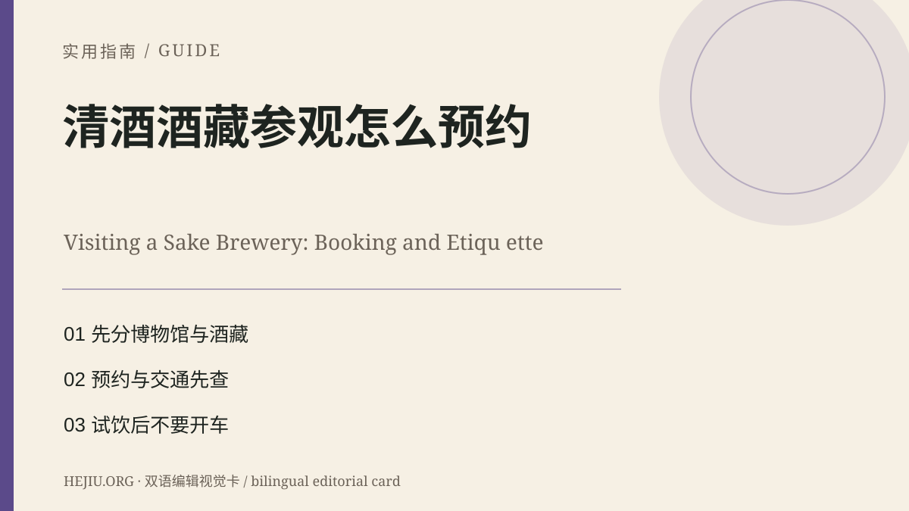

# Visiting a Sake Brewery: Booking and Etiquette

“Kura visit” may mean a museum’s permanent exhibition, a guided brewery tour, a seasonal open-house or simply a shop tasting. Booking, duration and access to production areas differ completely. Read the official “visit/tour” page first, confirm dates, times, language, cost and whether advance booking is required, then plan transport.

图：Sake brewery visit bilingual editorial card。Project-created bilingual editorial card for topic identification, not a documentary photograph.

> **Quick verdict**
> **Best for:** visitors who want a brewery visit without wasting a trip on a missed booking.
> **Not for:** those who treat a kura as a walk-in bar or plan to drive after tasting.
> **One line:** confirm museum or production tour first, then book, check access and arrange a non-driving return.

## Three kinds of “visit”

A museum usually has permanent exhibits, vessels and historic buildings with lighter booking requirements. A brewery tour enters steeping, fermentation, pressing and storage areas with fixed slots and capacity. A seasonal open-house may open only part of the site. If the official page says “tour by reservation”, do not wait at the door; if it says “exhibition free access”, still check closures. Save the confirmation and route.

## Booking: date, time, language

Confirm three things: whether the date overlaps production, whether the slot connects with trains or buses, and whether the commentary is in a language you understand. Many Japanese breweries tour in Japanese, with occasional English or Chinese handouts; do not assume an interpreter. Provide name, party size and contact, and keep the confirmation email. Ask about step-free access, strollers and age limits for tasting.

## Access: the station is not the door

Fushimi, Nishinomiya and Yamazaki brewery areas often require a walk or bus from a JR or private railway station; the station is not the entrance. Check last trains and return intervals, and do not estimate from straight-line map distance. If you have tasted, do not drive or cycle; use rail, taxi or a pre-arranged driver. Allow extra time in rain or winter, when stone lanes can be slippery.

## What to look at: water, rice, koji, casks

The point of a production tour is not photos but understanding how rice, water, koji and yeast become sake: washing, steaming, koji-making, starter, mash fermentation, pressing and storage. Notice the water source, wooden vats and earthen walls, temperature control and the difference between starters and yeasts. Do not touch open vessels, do not use flash in fermentation areas, and follow staff instructions.

## Tasting and buying

Tastings are usually small and ordered from light to rich; smell first, do not gulp. Confirm whether there is a fee, whether the cup is takeaway and the legal drinking age. When buying, read polishing ratio, strength, sake meter value and production date; bottles needing cold storage should not sit in a car boot. For flights, check the carrier’s baggage rules and wrap glass against shock.

## Etiquette and season

A brewery is a production site, not a theme park: keep your voice low, do not run, touch equipment or bring food into fermentation areas. Avoid strong perfume before the visit because it interferes with smelling. Winter is brewing season, when you may see steam and work but also closed areas for safety; summer is often off-season, though exhibits and tastings may remain open. Follow the official notice of the day, not an old blog.

## One-page pre-visit list

Open the official site and identify museum, tour or open-house; check booking, language, cost and duration. Then check the walk or bus from the station, the last train and the return. Arrive 15 minutes early, avoid strong perfume and do not touch equipment; do not drive after tasting. Before buying, check production date and cold-storage needs, and leave shock protection for glass on the way home.

## Check before you go

- Confirm museum or production tour
- Check booking and slots
- Confirm commentary language
- Check station-to-brewery access
- Confirm the last train
- Avoid strong perfume
- Do not drive after tasting
- Check cold storage and shock protection

## Limits and next steps

Sake brewery visits come in two kinds: a working kura where you can see part of the washing, steaming, koji-making, fermentation and pressing; and a museum or archive built around old tools, labels and film. The first usually needs a booking, limits numbers and may close in peak production; the second suits a spontaneous stop. Before going, confirm whether "kengaku" tours are open and whether foreign-language explanation is offered; do not mistake a museum for a factory tour.

Season changes what you can see. From winter to early spring the brewing is on, and some kura let you smell fermenting mash; in summer many are maintaining equipment or resting, so fewer areas open. Do not touch open mash or film fermentation tanks for long; some breweries restrict flash, drones and commercial photography.

Plan transport around the tasting. Kura are often in suburbs or small towns with few buses; if you expect more than three glasses, take a train plus walking, or book a driver in advance. Brewery shops often carry bottles sold only locally; before buying, check whether they can go in cabin baggage, need checking in, and what the duty-free allowance is at your destination.

Finally, treat the visit as a chance to understand process, not a contest to drink something rare. Understanding polishing ratio, yeast and the difference between kimoto and sokujo is more useful than memorising the number of a limited bottle.

## What else to watch

Rice and water are often skimmed over on a tour, yet they explain the flavour. Yamadanishiki, Omachi and Gohyakumangoku differ in shinpaku size and water uptake, and hard versus soft water changes fermentation; note what water the kura uses and how far the rice is polished, which is more useful than memorising the brand.

Taste from light to rich: junmai daiginjo or ginjo first, then junmai and honjozo, and finally aged or genshu. The cups may be small, so do not swallow in one go; hold the sake in the mouth to warm it and the aroma opens. If driving, say so in advance and smell only.

## References

- Gekkeikan Okura Sake Museum — https://www.gekkeikan.co.jp/enjoy/museum/ (Gekkeikan, checked 2026-11-25)
- Hakushika Sake Museum — https://sake-museum.jp/en/visit/ (Hakushika, checked 2026-11-25)
- JR West — West Japan Railway — https://www.westjr.co.jp/global/en/ (West Japan Railway Company, checked 2026-11-25)
- Japan Sake and Shochu Information Center — https://www.jss.or.jp/ (Japan Sake and Shochu Information Center, checked 2026-11-25)

Related entries: [sake](ref:sake), [junmai sake](ref:junmai), [Japan sake brewery trail](ref:route), [Gekkeikan Okura Sake Museum](ref:gekkeikan), [Hakushika Sake Museum](ref:hakushika), [Japan](ref:japan), [Kyoto](ref:kyoto), [First tasting guide](ref:tasting).
