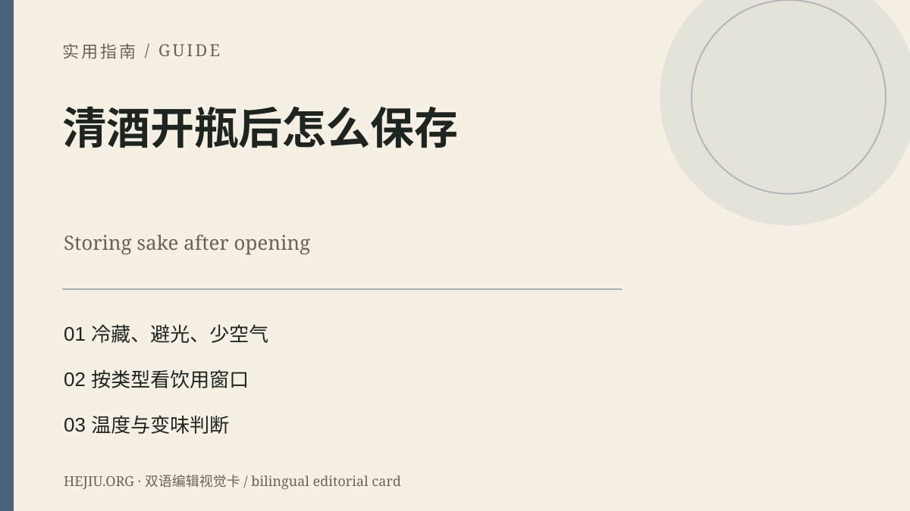

# Storing sake after opening

Sake is even more sensitive than wine to heat, light and air. After opening, aromas move from rice and fruit toward acidity, nuts and “aged” notes. That is not always a fault, but most sake has a short best window. The goal is not to keep it forever; it is to finish it while it still tastes good.

Figure: How to store sake after opening, a project-made bilingual editorial card. It identifies the topic; it is not an on-site photograph.

> **Bottom line**
> **For:** anyone with a 720 ml bottle they cannot finish, or who wants to open a bottle and drink it over several days.
> **Not for:** anyone storing sake in a kitchen, on a balcony or in a fridge door, or assuming “older is always rounder”.
> **Three checks:** refrigerate, keep dark, minimise air; finish junmai and ginjo within roughly 2–4 weeks; unpasteurised, low-alcohol and sparkling sake are shorter.

## Three things to do after opening

First, close the cap tightly to reduce air contact; use the dedicated stopper if there is one. Second, put it back in the fridge immediately, in a stable spot, not the door. Third, keep it away from sunlight and spotlights; sake is sensitive to UV, especially in clear bottles.

If you only drink a small cup at a time, decant into a smaller clean glass bottle to reduce headspace; do not keep it in a plastic bottle long term. Work quickly and cold, and avoid repeated opening and closing.

## How long by style

| Style | Fridge life after opening | Best window | Serving temperature | Note |
| --- | --- | --- | --- | --- |
| Junmai | about 2–4 weeks | first 2 weeks | 10–15°C or gently warmed | rice-rich; turns nutty with oxygen |
| Ginjo / daiginjo | about 2–4 weeks | first 2 weeks | 8–12°C | delicate aroma; hates heat and light |
| Honjozo | about 2–4 weeks | first 2 weeks | 10–15°C | more stable, forgiving |
| Nama / sparkling | about 1–2 weeks | as soon as possible | 5–10°C | unpasteurised or carbonated; changes fast |

These are rules of thumb. Alcohol, pasteurisation, storage temperature and headspace all change the result; the same bottle lasts differently in summer and winter, in a fridge and at room temperature.

## Cold, dark, little air

Sake likes a stable 5–10°C refrigerator; freezing is not recommended. Freezing changes texture, and aroma and mouthfeel can suffer after thawing. If you need quick chilling, use an ice bath with water and ice; do not put the whole bottle in the freezer. Serve by style: ginjo colder, junmai can be gently warmed, nama and sparkling colder.

Do not use “warming” to rescue spoiled sake. Heat can mask some faults but also amplifies acidity and alcohol; if the sake is clearly sour, cardboard-like or off, discard it rather than cooking with it.

## When it has turned

Common signs: aroma moves from rice to soy sauce, nuts, cardboard or acid; the palate becomes thin, bitter or oddly fizzy. A slight change can be used in cooking (poaching fish, marinating meat), but do not drink it; obvious spoilage, abnormal cloudiness or a film means discard.

If the aroma has only become weaker, try serving it colder, in a smaller cup, with richer food; do not add sugar or ginger to mask it. Sake is valued for cleanliness and balance; replacing a bottle is better than hiding a fault.

## Buying and opening checklist

Check the volume first: 720 ml suits two or three people; 300 ml or 180 ml is easier for one person drinking over several days. Then read style, polishing ratio, strength, whether it is nama, origin and storage requirements. Nama and sparkling sake need cold transport; do not leave them at room temperature.

Write the opening date on the bottle or in your phone. After each pour, close it and return it to the fridge immediately. If you cannot finish it, decant into a smaller bottle to reduce air. Do not treat leftover sake as a long-term collection; sake is not a drink that improves indefinitely with age.
## Common misconceptions

The first misconception is that all sake must be served ice-cold. Ginjo and daiginjo usually suit 8–12°C, junmai can be gently warmed, and nama or sparkling sake is colder; temperature follows style, not a blanket “colder is better”. The second is that sake improves with age. Most sake is for drinking fresh; only deliberately aged koshu treats age as a style. The third is judging by a clear bottle. Clear glass looks good but lets in more light; keep the box or store it dark.

An open bottle does not have to be finished at once, but it is not a one-month keeper either. Use a suitably small bottle, stable refrigeration and little headspace to give it a fair window; past that window, the flavour will make the decision for you. A small bottle is a better experiment than a large one, and easier for one person to finish.
## Frequently asked questions

### How long does open sake keep?

Most junmai, ginjo and honjozo keep well for 2–4 weeks if refrigerated, dark and tightly closed; nama, sparkling and low-alcohol styles are shorter, about 1–2 weeks. Time is not a guarantee: once the aroma turns sharply acidic, nutty or cardboard-like, stop drinking it.

### Fridge or freezer?

Fridge, not freezer. A stable 5–10°C is best; freezing changes texture and can damage aroma after thawing. For quick chilling, use an ice bath, not the freezer.

### Can I drink sake that has changed?

Slightly oxidised sake can be used in cooking, but not for drinking; clearly sour, cardboard-like, abnormally cloudy or film-forming sake should be discarded. Do not heat it, add sugar or add ginger to mask spoilage.

> **Continue:** Start with [sake](ref:sake) for the category, then the [sake introduction](ref:intro); to visit a brewery, read [sake kura visits](ref:kura). Compare [junmai](ref:junmai) and [ginjo](ref:ginjo), read [Japan](ref:japan) for regional context, and the [Japan sake kura route](ref:route); for temperature, see [temperature and chilling](ref:ice).
