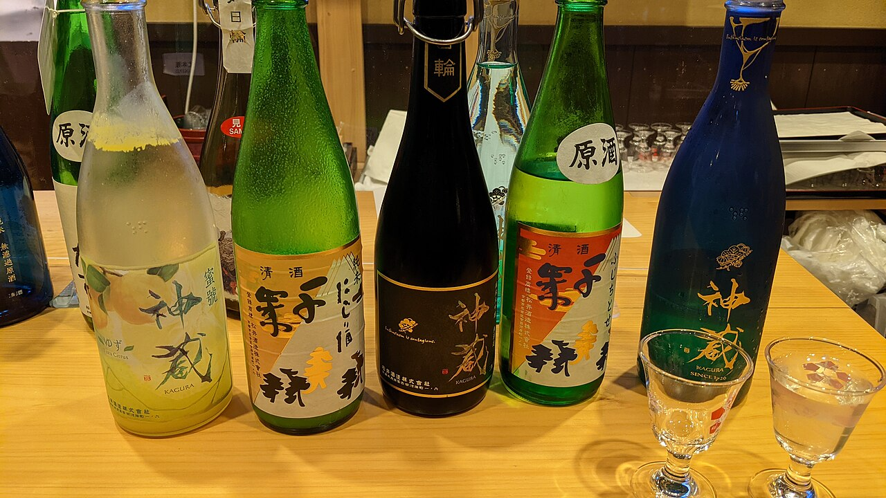
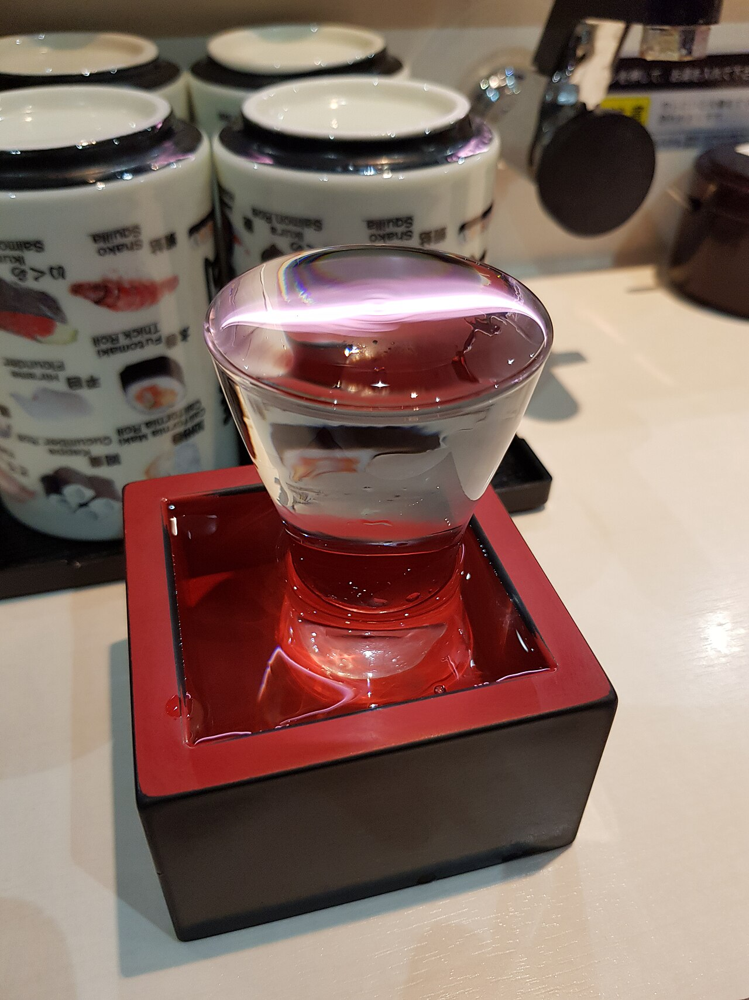
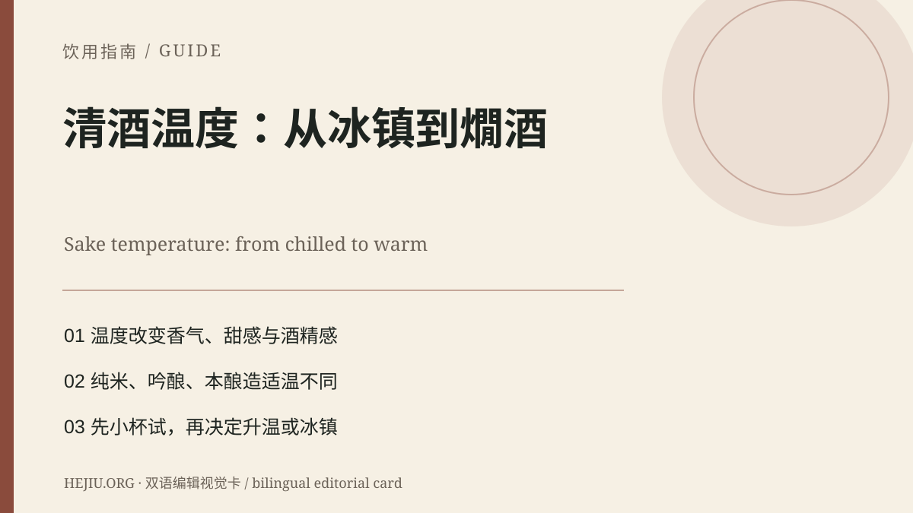

# Sake temperature: from chilled to warm

Sake has a wider serving range than wine: the same bottle can be drunk from 5°C to 55°C, and aroma, sweetness, acidity and the alcohol impression all change. Temperature is not a badge of sophistication; it is a tool for balancing the body.

This guide gives a temperature-band table, a set of style matches and a safe way to warm sake. The aim is not "the most authentic" serving, but "this bottle tastes better now".

Figure: Sake from Matsui Sake Brewery; temperature changes aroma, sweetness and the alcohol profile. Image: Nisiguti, CC BY-SA 4.0, via Wikimedia Commons ([source page](https://commons.wikimedia.org/wiki/File:Matsui_Sake_Brewery%27s_Sake_20211122.jpg)).

## Temperature bands: from chilled to hot

| Band | Common name | Flavour change | Suitable styles |
| --- | --- | --- | --- |
| 5–10°C | Chilled / yuki-rei | Tighter aroma, crisp acidity, low alcohol heat | Ginjo, daiginjo, namazake, sparkling sake |
| 10–15°C | Cool | Fresh, clean, fruity | Ginjo, junmai ginjo |
| 15–20°C | Room temperature / hiya | Balanced aroma, clear rice and acidity | Most junmai, honjozo |
| 35–45°C | Skin-warm / nuru-kan | More rice aroma, sweeter, softer acidity | Junmai, honjozo, full-bodied styles |
| 45–55°C | Hot / atsu-kan | Expansive aroma, stronger alcohol, sharper acidity | Junmai, ordinary sake, winter food |
| 55–65°C | Extra hot / tobi-kan | Strong alcohol and intense aroma | Specific bottles and winter occasions |

These are common ranges; schools, vessels and bottles vary. The rule matters more than the name: cooler temperatures tighten aroma and freshen acidity; warmer temperatures lift rice aroma and sweetness, and increase alcohol heat.

## Matching style and temperature

Junmai usually suits room temperature to warm. Its rice aroma, umami and acidity round out at 40–50°C; a lighter, high-acidity example can also be served at room temperature.

Honjozo is cleaner and lighter, so room temperature or gentle warming is enough; too hot makes the alcohol stand out.

Ginjo and junmai ginjo stress floral and fruit notes and finesse, usually best at 10–15°C or room temperature; heating costs some aroma.

Daiginjo has a lower polishing ratio and more delicate aroma; chilled or room temperature is best. Warming easily blurs the scent.

Namazake and sparkling sake must stay cold; heat costs freshness and bubbles.

Nigori is thick and sweet; chill or warm gently, but too hot makes the sweetness cloy.

Aged and ancient sake is complex; room temperature or gentle warmth suits it, while high heat amplifies oxidation.

Figure: A reference sake serving; temperature and vessel change aroma and sweetness. Image: Intforce, CC BY-SA 4.0, via Wikimedia Commons ([source page](https://commons.wikimedia.org/wiki/File:Overflowing_sake_glass_in_masu.jpg)).

## How to warm sake

The safest method is a water bath: pour sake into a heatproof vessel, stand it in water at 40–55°C, and measure the sake itself with a thermometer. Do not microwave it or heat it over a strong flame. Microwave heating is uneven and can overheat pockets, damaging aroma.

Do not put the whole bottle into hot water or pour sake into a metal pan over direct heat. Sake is low in alcohol; overheating loses aroma and can create a burnt note. At home, use a small pitcher, soup bowl or heatproof glass, keep the water slightly hotter than the target and measure as you go.

Drink warmed sake soon and do not reheat repeatedly. Pour a small amount, warm more when needed; repeated heating and cooling scatters the aroma. Warm the pitcher and cup too, so the sake does not cool abruptly on contact.

## Vessels and temperature

The temperature experience depends on the cup. Thin-walled, small cups change temperature quickly; thick-walled cups hold heat but concentrate aroma. Chilled sake suits small cups or wine glasses; warm sake suits thick small cups or porcelain.

Do not use one cup from chilled to hot; temperatures interfere. Prepare two cups, or change cups between bottles, for a clear comparison. Expensive ware is unnecessary; clean, odour-free and correctly sized is enough.

Figure: Sake temperature: from chilled to warm. Project-generated bilingual editorial card; schematic, not a photograph.

## Pairing: temperature follows the food

Chilled sake suits light, savoury dishes: sashimi, sushi, white fish, tofu and cold plates. Room temperature suits grilled fish, tempura, chicken and rice dishes. Warm sake suits winter stews, hotpot, yakitori, miso soup and heavier dishes.

Food temperature and sake temperature interact: a hot dish warms chilled sake quickly; a cold drink with hot food can suppress aroma. In winter, let the sake stand ten minutes outside the fridge, then adjust to the dish.

## Buying check and storage

When buying sake, read style, polishing ratio, strength, production date and storage requirements. For sake that needs refrigeration, transport and shelf conditions matter more than the label. Sake fears light and heat; refrigerate at home as directed and finish quickly after opening. See [how to store opened sake](ref:storage).

Warming does not turn ordinary sake into good sake. It changes presentation; the body's structure, aroma and acidity remain the foundation.

Figure: Rice is the base material for southern rice-aroma baijiu and semi-solid fermentation. Image: China News Service, CC BY 3.0, via Wikimedia Commons ([source page](https://commons.wikimedia.org/wiki/File:20201102.Hengnan.Hybrid_rice_Sanyou-1.6.jpg)).

## Five situations for a temperature decision

Sake has a wide temperature range, from 5°C cold sake to 55°C hot kan. The same bottle shows different aroma and texture at different temperatures. Rather than memorising a table, decide by situation.

First, a first sake: choose a junmai or honjozo, chill to 10–15°C and try a small cup; if the nose feels closed, lift it toward 20°C room temperature. Second, with sashimi and sushi: keep near 10–15°C so heat does not upset acidity and umami; yamahai or kimoto can go a little higher, 15–20°C, for more rice and savoury notes. Third, with hot pot, yakitori and heavy sauces: warm to 40–45°C for a rounder body that meets fat and sweet-savoury glaze, but do not boil; above 55°C alcohol starts to dominate. Fourth, summer: cold sake at 5–10°C with cold dishes, seafood and light food; winter: warm kan at 40–50°C with oden, tofu soup and braises. Fifth, a gift: if you do not know the recipient, a junmai ginjo with a temperature card is safer than an expensive daiginjo.

To warm sake, use a water bath at 50–60°C, place the flask in it and heat slowly, checking the liquid with a thermometer; a microwave can overheat unevenly. After opening, keep sake cold; junmai and ginjo are usually best within two to four weeks, and unpasteurised or low-alcohol sake sooner.

## Sake temperature and vessel pairing

The vessel changes both temperature and aroma. A thin, small cup suits cold sake, and a narrowed rim concentrates the nose. A ceramic guinomi or tumbler suits warm sake because it holds heat, but it must be dried thoroughly after washing so residual odour does not enter the wine. Wooden vessels such as a masu or a wooden flask add wood aroma; they work at room temperature or warm, not with a very delicate ginjo.

To warm sake, pour it into a flask and stand it in a 50–60°C water bath. Do not put the flask directly over a flame, and do not let the liquid exceed 55°C. Without a thermometer, test the outside of the flask with the back of your hand: warm but not hot is roughly 40°C. Drink warmed sake reasonably soon; repeated heating flattens the aroma.

Vessel size also controls the sip. Sake is usually served in small cups of 30–60 ml; a large cup encourages over-drinking and warms too quickly. With food, use a thin cup for cold sake and a ceramic cup for warm sake, pour a small amount and refill after finishing. Do not switch the same bottle from cold to hot repeatedly; rapid temperature change makes comparison difficult.

For storage, keep opened sake cold and dark and finish within two to four weeks; unpasteurised, cloudy and low-alcohol sake are shorter. Do not park sake in the refrigerator door, where temperature swings with every opening.

## A quick match of temperature and food

Sashimi, sushi and steamed seafood: 10–15°C, with a junmai ginjo or honjozo, so a heavy aroma does not bury the umami. Tempura, fried food and yakitori: 15–20°C or warmed to 40°C, where a slightly fuller body meets the oil. Hot pot, oden and braises: 40–45°C, with junmai or yamahai. Heavy sauces, teriyaki and grilled meat: room temperature to 45°C, so the sauce does not taste sweeter against an over-chilled wine. Dessert: 5–10°C or room temperature, with a sweet sake in a small pour. Keep the order: food first, temperature second, sake type last; do not use temperature to rescue the wrong bottle.

## Final checks before serving

Before serving, confirm three things: the sake is chilled to the intended point, the cup is clean and odour-free, and the food is not at a radically different temperature. Do not pour cold sake into a glass just out of a hot dishwasher, and do not warm sake in a cup that still carries detergent. Cup your hand over the rim; if you smell detergent or dust, wash it again. Warm only the amount you will drink and keep the rest cold; never reheat the same portion repeatedly. Pour 30–40 ml for a guest, then refill, which holds the temperature better than filling the cup at once.

## Common questions

**Must sake always be drunk cold?** No. Ginjo, daiginjo and namazake suit chilling; junmai and honjozo can be room temperature or warm. Match the style.

**Does warming ruin sake?** Excessive heat costs aroma and amplifies alcohol. A 40–55°C water bath with a thermometer is more controlled than direct heating.

**Can daiginjo be warmed?** It can, but it is not recommended. Its aroma is delicate and heat blurs floral and fruit notes; chilled or room temperature preserves detail.

**Can I use a microwave?** Not recommended. Heating is uneven and can overheat spots; a water bath is more controllable.

**Can opened sake be warmed later?** Yes, but the flavour has already changed. Keep it refrigerated, warm only the portion you will drink and avoid repeated heating.

## Common misconceptions

First, colder is always better. Too cold suppresses aroma; not every sake suits ice.

Second, warm sake is a cheap habit. Warming is a way to adjust flavour, not a quality grade.

Third, hot sake sterilises it. Heat does not replace food safety or proper storage.

Fourth, every sake can be heated to 60°C. Aromatic styles lose detail at high heat.

Fifth, expensive warmers are better. Temperature control and clean cups matter more than price.

## Further reading

- [Sake](ref:sake): definition, categories and craft.
- [Junmai](ref:junmai): rice-only style and warmth.
- [Ginjo](ref:ginjo): aromatic style and cool serving.
- [Daiginjo](ref:daiginjo): delicate aroma and temperature.
- [Storing opened sake](ref:storage): refrigeration and freshness.
- [Sake cups](ref:glass): vessel shape and temperature.

**Key facts.**

| Item | Detail |
| --- | --- |
| One-line position | Sake temperature adjusts aroma, sweetness, acidity and alcohol heat; it is not a quality rank |
| Best for | Drinkers who want to understand chilled, room-temperature and warm sake |
| Not for | Anyone who thinks one temperature fits every bottle |
| Buying logic | Style first, polishing ratio second, storage always |

**Sources and scope.** This page's temperature bands, warming method and style matching were cross-checked against the Japan Sake and Shochu Makers Association, the Japan National Tax Agency, Japanese agricultural labelling information and The Oxford Companion to Spirits and Cocktails. The body is project-written; sources are for verification, not copied text.
