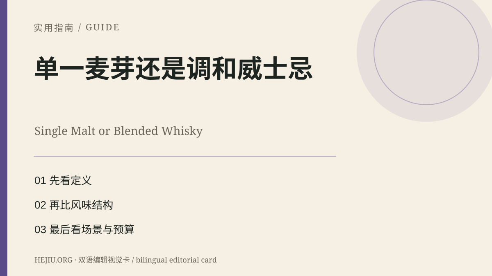

# Single Malt or Blended Whisky

Single malt and blended are not “premium” and “ordinary” tiers but two design goals. Single malt comes from one distillery and highlights place, process and character; a blend combines whiskies from several distilleries with grain whisky for consistency, balance and approachability. Decide whether you are buying “exploration of one distillery” or “a reliable everyday bottle” before discussing price.

图：Single malt versus blended whisky bilingual editorial card。Project-created bilingual editorial card for topic identification, not a documentary photograph.

> **Quick verdict**
> **Best for:** drinkers who want to understand the difference and choose within one budget.
> **Not for:** those who equate “single malt” with “better”.
> **One line:** choose single malt to explore character, a blend for steady balance.

## Definition: one distillery vs several

Under Scotch rules, single malt comes from one distillery, uses malted barley and is distilled there; a blend may combine malt and grain whiskies from several distilleries. Single malt is not “single cask” or “single region”, and a blend is not fake. Both may carry age statements or be no-age-statement; read the category and producer, not the adjectives on the carton.

## Flavour: character vs balance

Single malt is more focused: one distillery’s malt, yeast, distillation and casks create clear signals such as peat, fruit, honey or sea air. A blend aims for balance: malt supplies the frame, grain adds softness and body, and the whole is smoother and steadier. Drinkers who like detail and distillery comparison lean single malt; those who want a consistent bottle for a group lean blend.

## Price: what you pay for

Within a brand, single malt is often more expensive because of output, age and packaging, but not always; old blends can also be costly. With single malt you pay for distillery character, origin story and scarcity; with a blend you pay for a stable recipe, brand and approachability. Do not infer quality from price: a cheap single malt may simply be young with simple cask influence, and an expensive blend may be packaging and brand. Set a budget, then compare within it.

## Occasion: daily, dinner, gift

For daily drinking, choose a blend or an entry single malt with sustainable price and easy palate. For friends, a clearly styled single malt gives something to talk about. For business dinners, choose a recognisable blend or single malt without extreme flavours. For gifts, confirm whether the recipient accepts peat and high strength. Do not send heavy peat to a non-whisky drinker, or a “beautiful box only” bottle to a whisky lover.

## Tasting: compare the same way

Pour both into the same type of glass, smell then taste, add a little water and smell again. Compare sweetness, acidity, bitterness, strength and finish rather than “good or bad”. Water opens single malt aromas; it works for blends too, but do not add too much ice. If possible, taste blind: remove brand and price and look only at flavour, and you will see which category you actually prefer.

## Order of choice

Ask “explore or steady” first, set the budget second, choose the bottle last. For exploration, pick single malt and look at distillery and cask; for steady, pick a blend and look at brand and recipe. Do not force a winner at one price: single malt and blend trade off different things. Taste before buying, and for gifts confirm tolerance for peat, high strength and heavy flavour.

## Check before you go

- Separate single malt from blend
- Do not confuse with single cask
- Compare focus and balance
- Compare within one price
- Match brand recognition to occasion
- Check peat tolerance for gifts
- Taste in the same glass
- Smell again after water

## Limits and next steps

Single malt and blended whisky are not a hierarchy but two design approaches. A single malt comes from one distillery and highlights that distillery's malt, distillation and cask character; a blend combines whiskies from several distilleries to a recipe, aiming for consistency, balance and reproducibility. The first is a solo, the second an arrangement. Price differences come more from volume, age and brand than from "purity".

Read the label carefully: single malt must be 100% malted barley from one distillery; single cask comes from one cask and is usually not diluted; blended malt mixes malt whiskies from several distilleries; blended whisky may include grain whisky. There is no universal ranking; the question is what you want to drink.

Beginners can establish a baseline with a blend, then move to single malts to compare regional styles. Islay peat, Speyside fruit and flowers, and the maritime note of the Highlands and islands all need a reference point; if the first glass is heavy peat, it is easy to mistake unfamiliarity for dislike. Water or ice changes aroma release: sip neat first, then decide whether to dilute.

Collecting and drinking are separate. Single casks, limited editions and discontinued bottles have collectible appeal, but prices swing and authenticity risk is real; daily drinking should focus on oxidation after opening and storage. Do not assume "single malt" means better, and do not look down on "blend".

## What else to watch

Alcohol strength and age statements are often misread. A single malt may be a regular 40% bottling or cask strength, and the latter changes a lot with water; an age statement gives the youngest whisky in the bottle, not the age of every component. No-age-statement (NAS) products rely on the blender's recipe for consistency and are not automatically inferior.

Check the batch code on the bottle or carton before buying to confirm the source and bottling date. "Old version" and "discontinued" carry high premiums in the secondary market, and fakes are common. For daily drinking, a regular release from a reliable channel with transparent pricing is steadier than chasing rare editions.

## References

- Scotch Whisky Association — technical and legal definitions — https://www.scotch-whisky.org.uk/ (Scotch Whisky Association, checked 2026-11-25)
- The Scotch Whisky Regulations 2009 — https://www.legislation.gov.uk/uksi/2009/2890/contents (UK Government, checked 2026-11-25)
- The Oxford Companion to Spirits and Cocktails — https://global.oup.com/academic/product/the-oxford-companion-to-spirits-and-cocktails-9780199311132 (Oxford University Press, checked 2026-11-25)
- William Grant & Sons — Glenfiddich brand page — https://www.williamgrant.com/gb/brands/glenfiddich (William Grant & Sons, checked 2026-11-25)

Related entries: [single malt Scotch](ref:single), [blended Scotch](ref:blend), [whisky](ref:whisky), [Whisky introduction](ref:intro), [Scotland](ref:scotland), [Speyside](ref:speyside), [First tasting guide](ref:tasting), [whisky nosing glass](ref:glass).
