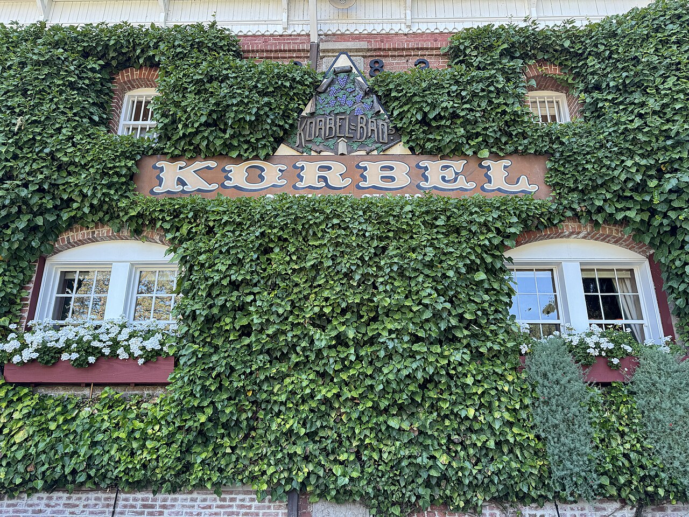
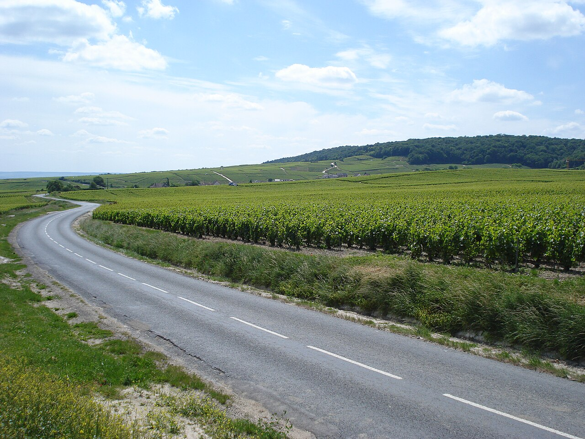
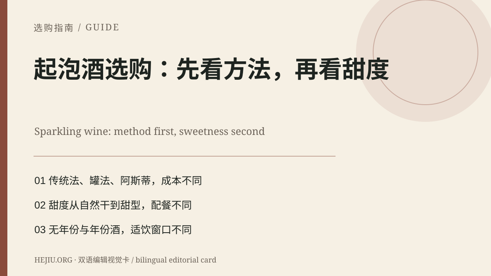

# How to choose sparkling wine: Champagne, Cava, Prosecco and Crémant

The easiest mistake in buying sparkling wine is not budget; it is treating "sparkling" as one style. Champagne, Cava, Prosecco and Crémant all have bubbles, but their regions, grapes, methods and sweetness systems differ. Choose the category first, then the bottle. That is more useful than comparing bubbles on a shelf.

This guide works through four decisions: occasion, budget, sweetness and label. It does not rank brands; it puts a bottle back into the place where it belongs.

Figure: A traditional-method sparkling wine cellar (Korbel, California, shown as a process illustration); buying decisions still rest on the method, sweetness and origin on the label. Image: Missvain, CC0, via Wikimedia Commons ([source page](https://commons.wikimedia.org/wiki/File:Korbel_Champagne_Cellars_-_August_2024_-_Sarah_Stierch_04.jpg)).

## Occasion and budget

Sparkling wine spans a wide price range, from affordable Prosecco to several-thousand-yuan Champagne grand cru. More expensive is not automatically better; the budget should match the occasion. A weekday aperitif, a friends' party, a wedding toast and a business gift ask for different brands, sweetness and packaging.

| Budget band (RMB, reference) | Better occasion | What to prioritise | What not to force |
| --- | --- | --- | --- |
| 100–250 | Weekday aperitif, small gatherings | Dry Prosecco, Cava or Crémant | Famous estate, vintage, gift box |
| 250–500 | Family celebration, birthday, light business | Entry Champagne, aged Cava | Rare vintage, single batch |
| 500–1,000 | Wedding, important client, anniversary | Entry grand-marque Champagne, blanc de blancs or rosé | Old vintage, limited edition |
| Above 1,000 | Collecting, top-level gifting | Vintage Champagne, single vineyard, special disgorgement | Buying packaging without looking at the wine |

These bands are references. One brand may have different sweetness, vintages and bottle shapes; confirm the exact wine before comparing prices.

## Four sparkling categories

| Category | Core region | Typical method | Common style | What to read |
| --- | --- | --- | --- | --- |
| Champagne | Champagne, France | Traditional method, second fermentation in bottle | High acidity, fine bubbles, ageing potential | Vintage or NV, sweetness, disgorgement date |
| Cava | Catalonia, Spain, and other permitted areas | Traditional method in bottle | Dry, fruity, good value | Guarda / Guarda Superior, sweetness |
| Prosecco | Veneto, Italy, and other permitted areas | Mainly tank method | Floral, fruity, easy drinking | DOC / DOCG, sweetness, region |
| Crémant | Several French appellations | Traditional method in bottle | Champagne-like acidity and structure | Appellation, sweetness, producer |

Champagne is a place name: only sparkling wine made in the Champagne region under the rules may be called Champagne. Cava is a Spanish protected designation, Prosecco an Italian one, and Crémant a shared French category for sparkling wines from several appellations. All can use the traditional method, but grapes, climate and ageing requirements differ.

Figure: Vineyard at Trépail on the Montagne de Reims, a typical Champagne landscape of chalk soil and slope aspect. Image: Havang(nl), CC0, via Wikimedia Commons ([source page](https://commons.wikimedia.org/wiki/File:Tr%C3%A9pail,_vignes_au_pied_de_la_Montagne_de_Reims.JPG)).

## Sweetness is the second gate

Sparkling sweetness labels confuse many buyers: Brut Nature, Extra Brut, Brut, Extra Dry, Demi-Sec and Doux are rough residual-sugar bands, not a straight line from "very dry" to "very sweet". Different regions and rules use slightly different terms; the safest method is to read the back label or ask the seller.

| Label (common) | Approximate sweetness | Who it suits | What to pair |
| --- | --- | --- | --- |
| Brut Nature / Non-dosé | Very dry, almost no added sugar | People who like acidity and minerality | Oysters, steamed fish, aperitif |
| Extra Brut | Dry | Everyday drinking, food | Seafood, white meat, salad |
| Brut | The dry mainstream | Most occasions | Cantonese food, French food, weddings |
| Extra Dry | Slightly sweet | Newcomers to sparkling wine | Fruit, desserts, brunch |
| Demi-Sec | Clearly sweet | Desserts, spicy food | Cake, fruit tart, mild heat |
| Doux | Very sweet | Dessert or specific occasions | Desserts, ice cream |

"Brut" is often translated as "dry", but residual sugar varies between brands. For a gift where you are unsure of taste, Brut or Extra Brut is safer; for dessert, Demi-Sec can be the better choice.

## Vintage, disgorgement and bottle

Non-vintage Champagne blends base wines from several years for consistency; vintage Champagne uses one year, usually ages longer and costs more. Cava's Guarda and Guarda Superior classify by time on the lees; Prosecco's DOC and DOCG carry different regional and style rules.

The disgorgement date is important information on Champagne and some traditional-method sparkling wines. It tells you how long the wine spent on the yeast and when it was disgorged before release. Not every bottle carries it; when it does, prefer a recent disgorgement and reliable storage.

Bottle shape affects the experience: a slender bottle is good for presentation, while a wider white-wine glass releases more aroma. A Champagne glass is not better simply because it is larger, and colder is not always better; over-chilling suppresses aroma.

Figure: Sparkling wine: method first, sweetness second. Project-generated bilingual editorial card; schematic, not a photograph.

## Buying checklist

1. Identify the category: Champagne, Cava, Prosecco and Crémant are different and not interchangeable.
2. Read sweetness: Brut is mainstream, but Extra Dry or Demi-Sec can suit newcomers or desserts.
3. Read grapes and style: blanc de blancs is usually leaner and more acidic; blanc de noirs has more structure; rosé brings colour and fruit.
4. Read vintage and disgorgement: vintage Champagne and long lees ageing usually cost more; a recent disgorgement is usually fresher.
5. Read channel and storage: sparkling wine fears light, heat and vibration; upright storage is better for bottle pressure than lying it down long term.

## Opening, pouring and pairing

Open slowly: chill to 6–8°C, remove the foil, loosen the wire cage while keeping a hand on the cork, turn the bottle rather than the cork and let pressure escape. Do not point the bottle at people or cut the glass mouth with a knife.

Pour a little first, let the foam settle, then fill to about two-thirds. This preserves bubbles and aroma. With food, Brut suits oysters, steamed fish, white-cut chicken and savoury dim sum; rosé suits ham, salad and mild heat; Demi-Sec suits fruit tarts, cake and mild spice.

The most expensive bottle is not automatically the right wedding bottle. A wedding toast needs reliable supply, opening service and glassware; a weekday aperitif does not need Champagne. Spend on a reliable channel, the right sweetness and enough glasses rather than chasing a famous name.

Figure: A Champagne flute, a common sparkling-wine glass whose narrow bowl helps retain bubbles. Image: Taken on September 22, 2005, CC BY 2.0, via Wikimedia Commons ([source page](https://commons.wikimedia.org/wiki/File:Champagne_flute_and_bottle.jpg)).

## Build a short sparkling list for the occasion

The most common sparkling-wine mistake is not the region but the occasion. An opener needs freshness, fine bubbles and lifting acidity; Champagne, Cava, Crémant and dry Prosecco can all do that. A sparkling wine in the middle of a meal must follow the food: steamed seafood and white meat suit dry, low-sweetness bottles, while fried and creamy dishes can take a little more body and bubble. For a celebration, put the budget into one distinctive Champagne or vintage release rather than three forgettable bottles.

Estimate bottles by people: 100–120 ml per person per round, so a 750 ml bottle gives about one glass to six to eight people. If sparkling is the only wine, plan two to three glasses per person. Chill to 6–8°C before opening; that controls the bubble better than room temperature. Do not shake the bottle to "let gas out": open slowly and pour down the side of the glass for a more stable foam.

A simple budget split is RMB 100–300 for everyday and friends, RMB 300–800 for a formal dinner or gift, and above RMB 800 for anniversaries, weddings or a named Champagne. A higher price does not automatically pair better: aged Champagne with toast and nut notes can overwhelm steamed fish, where a younger, dry, lively wine is safer.

Check the label for sweetness, alcohol, volume and disgorgement date. Non-vintage Champagne aims at a consistent house style; vintage Champagne records a particular year. Gift boxes, glass shapes and promotions are not evidence of quality: look at the liquid and the source first, then decide whether to pay for packaging.

## Storage and opening details

Sparkling wine fears heat, light and vibration. Unopened Champagne and quality sparkling wine can lie flat or stand in a dark place at 10–15°C with stable humidity; everyday Prosecco and entry Cava are better drunk soon than cellared for years. A fridge works for short storage, but not the freezer, and not pressed against strongly scented food.

Chill for three to four hours before opening rather than adding ice at the last minute. Hold the base, turn the bottle slowly and let the cork ease out; do not press your thumb on the cork while it shoots upward. Pour in two stages: a third of the glass first, wait for the foam to settle, then top to seven-tenths. Tilt the glass to reduce overflow.

If you drink only half a bottle, seal it with a sparkling stopper and refrigerate; finish within one to two days. A bottle that has lost its bubbles can be used for cooking, but it is no longer a guest wine. For a wedding, promotion or party, count bottles by guests and glasses before opening, so you do not open more than you can finish.

## Common questions

**What is the relationship between Champagne and sparkling wine?** Champagne is one kind of sparkling wine, but only wine made in the Champagne region under the rules may use the name. Cava, Prosecco and Crémant are other categories.

**What is the difference between Cava and Champagne?** Both use the traditional method, but regions, grapes, ageing requirements and prices differ. Cava is usually better value; Champagne carries more brand premium and ageing style.

**Is Prosecco always sweet?** No. Prosecco comes in Brut, Extra Dry and other sweetness levels; read the label. Its typical style is floral, fruity and easy, not a fixed sweet wine.

**Can sparkling wine age?** Yes, depending on type and body. Vintage Champagne and quality Cava Guarda Superior can age; ordinary Prosecco and entry NV sparkling wine are better fresh.

**How long does an opened bottle keep?** Bubbles disappear quickly; finish it if possible. If not, use a sparkling-wine stopper, refrigerate and drink within one to two days; do not leave it at room temperature.

## Common misconceptions

First, sparkling wine means Champagne. Champagne is only one protected category.

Second, more bubbles are better. Bubble size, persistence, body, temperature and glass all matter.

Third, Brut must be very acidic. Brut is a sweetness band, not an acidity grade; regions and grapes vary.

Fourth, sparkling wine is only for dessert. Dry sparkling wine works with savoury food, seafood and fried food; sweeter styles suit dessert.

Fifth, a bigger gift box is more premium. Packaging is not quality; read category, sweetness, vintage and channel.

## Further reading

- [Sparkling wine](ref:sparkling): definitions, methods and styles.
- [Champagne](ref:champagne-region): region, grapes and rules.
- [Cava](ref:cava): traditional-method ageing categories.
- [Champagne as a wine](ref:champagne): a specific bottle rather than the category.
- [First wine](ref:first-wine): placing sparkling wine in a beginner's order.
- [Food pairing](ref:pairing): seafood, fried food and dessert.
- [Reading a label](ref:label): sweetness, region, vintage and strength.
- [Dosage](ref:dosage): the final sweetness adjustment.
- [Residual sugar](ref:sugar): what the sweetness label measures.
- [Glass choice](ref:glass): which glass for sparkling wine.
- [Restaurant wine](ref:restaurant): ordering sparkling wine at a table.
- [Wine as a gift](ref:gift): budget and occasion.

**Key facts.**

| Item | Detail |
| --- | --- |
| One-line position | Sparkling wine is a family of methods; choose category first, then sweetness and vintage |
| Best for | Buyers who cannot tell Champagne, Cava, Prosecco and Crémant apart |
| Not for | Anyone buying only the packaging and ignoring sweetness or region |
| Budget logic | Everyday 100–250, celebration 250–500, gifting above 500 |

**Sources and scope.** This page's regions, methods and labelling information was cross-checked against Comité Champagne, D.O. Cava, Consorzio Prosecco DOC and OIV public information. Prices, batches and import details change; use current official and retail information. The body is project-written; sources are for verification, not copied text.
