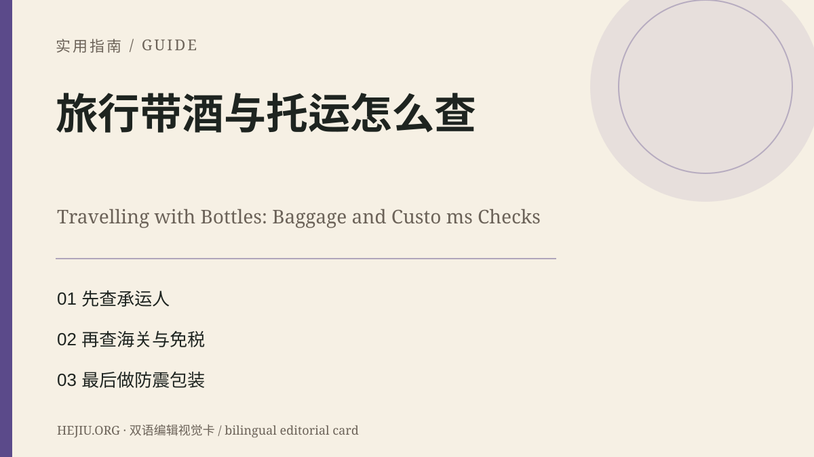

# Travelling with Bottles: Baggage and Customs Checks

Travelling with bottles involves three layers: the airline (carry-on, checked, fees and weight), customs (duty-free allowance, declaration and duty) and destination (whether allowed and whether a permit is needed). Check all three before buying; do not rely on “a friend said it was fine”. Pack glass for shock, leaks and pressure, and confirm the case can bear weight and handling.

图：Travelling with bottles bilingual editorial card。Project-created bilingual editorial card for topic identification, not a documentary photograph.

> **Quick verdict**
> **Best for:** travellers who want to bring bottles home without being stopped at the airport.
> **Not for:** those who check only that the destination sells wine, not the carrier and customs.
> **One line:** check carrier liquid rules, then customs allowance and declaration, then pack for shock.

## Layer one: the carrier

Most airlines ban liquids over 100 ml in carry-on; alcohol usually must be checked. Checked volume, piece count, weight and packaging vary by carrier, and low-cost airlines may charge extra. Read the operating flight’s dangerous-goods/baggage page, confirm strength limits, glass acceptance and original packaging. Codeshare flights follow the operating carrier, not just the booking platform.

## Layer two: customs and duty-free

Inbound alcohol has duty-free allowances and declaration duties; excess may be taxed or returned, according to the customs administration and port notices. Do not break duty-free sealed bags, carry for strangers or hide bottles. Personal use, gifting and resale are judged differently, and volumes clearly beyond reasonable personal use invite questions. Keep receipts and duty-free documents; declaring is safer than being found.

## Layer three: destination rules

Countries differ on alcohol import, strength, origin and labelling; some ban specific regions or brands, and some require permits. Check the destination customs site and airline page before departure, not an old blog. If transiting a third country, check transit liquid and security rules too; duty-free purchases may need to be checked at the transit point.

## Packing: shock, leak, pressure

Wrap glass in bubble wrap or foam, then place in a hard case; cushion bottle against bottle and leave no empty space. Seal the neck and body in a leak-proof bag so liquid does not reach clothes. The checked case must bear stacking; do not use a soft bag. Mark “fragile/this side up” outside. For ceramic jars or gift boxes, keep the original packaging and add an outer carton, not just a paper bag.

## Quantity and value

Buy within a reasonable personal-use quantity; do not carry excess for resale or proxy purchasing. Keep receipts and provenance for high-value bottles and declare if required. Splitting bottles across cases does not avoid the rules and increases loss and breakage. A commemorative bottle still cannot go in carry-on if liquid rules forbid it; check it and reinforce it.

## Arrival checks and claims

Inspect the case at baggage claim for wet marks, odour and damage. If a bottle breaks, photograph immediately and contact the carrier’s baggage service; keep boarding pass, baggage tag and purchase receipt. Do not leave the airport before claiming. Treat wine-stained clothes quickly and clear glass carefully. If declaration is needed, follow the red channel, not the nothing-to-declare lane.

## Four checks before departure

Check the carrier: carry-on liquid limit, checked volume/weight/fees and packaging. Check customs: duty-free allowance, declaration and duty. Check destination and transit: permission and permits. Check packing: hard case, cushioning, leak bag and fragile mark. Buy only after all four; inspect on arrival and photograph damage immediately for a claim.

## Check before you go

- Check carrier liquid rules
- Confirm checked weight and fees
- Check customs duty-free allowance
- Confirm declaration duty
- Check destination and transit rules
- Hard case plus cushioning
- Seal neck and body
- Inspect on arrival and claim damage

## Limits and next steps

When travelling with wine, separate cabin from checked baggage first. Most airlines ban liquids over 100 ml in the cabin, so wine usually has to be checked; duty-free purchases may be allowed to the gate in a sealed bag with the receipt, but a transfer security check can still require re-checking. Look up the current rules of the airline and both airports rather than relying on last time.

For checked bags, pressure and leakage are the issues. The original carton is not pressure-proof: wrap the bottle in clothing or bubble wrap, keep it upright and put it in a sealed bag; leave some cushion in the case so nothing hits hard during handling. For long or multi-transfer routes, use a dedicated wine shipper or hard case; declare a value for expensive bottles, but that is not full compensation, so keep the receipt and photos.

Customs allowances are easier to overlook than airline rules. China limits the quantity and value of wine an inbound traveller may bring, and the excess must be declared and taxed; the US, EU, Japan and Singapore each set their own duty-free allowance. If you transfer through a third country, check whether the transfer point requires another security check or baggage pickup.

Finally, "can bring" is not "worth bringing". The same wine may be cheaper at the destination, and the weight and breakage risk of glass are real costs. For a souvenir, a small bottle or a local limited release is easier than moving a whole case.

## What else to watch

Rail, cruise and cross-border coach rules differ. China's high-speed rail allows a certain quantity of sealed wine, but high strength or excess volume can be refused; cruise lines often let you check wine at boarding but have separate rules for port purchases and onboard drinking; coach security follows the destination country. Check the carrier's baggage terms, not only airline experience.

Keep a record for insurance and customs. High-value bottles deserve separate cover or a trackable courier; keep receipts and orders when declaring, so the duty is not assessed at the highest rate. If a bottle breaks in transit, photograph it, keep the packaging and claim from the carrier.

## References

- Civil Aviation Administration of China — https://www.caac.gov.cn/ (Civil Aviation Administration of China, checked 2026-11-25)
- General Administration of Customs of China — http://www.customs.gov.cn/ (General Administration of Customs of China, checked 2026-11-25)
- IATA — dangerous goods and baggage — https://www.iata.org/ (International Air Transport Association, checked 2026-11-25)
- WHO — Alcohol — https://www.who.int/news-room/fact-sheets/detail/alcohol (World Health Organization, checked 2026-11-25)

Related entries: [First wine guide](ref:first), [300–800 RMB baijiu gift guide](ref:gift), [wine](ref:wine), [baijiu](ref:baijiu), [China](ref:china), [Japan](ref:japan), [Wine storage](ref:storage), [First tasting guide](ref:tasting).
