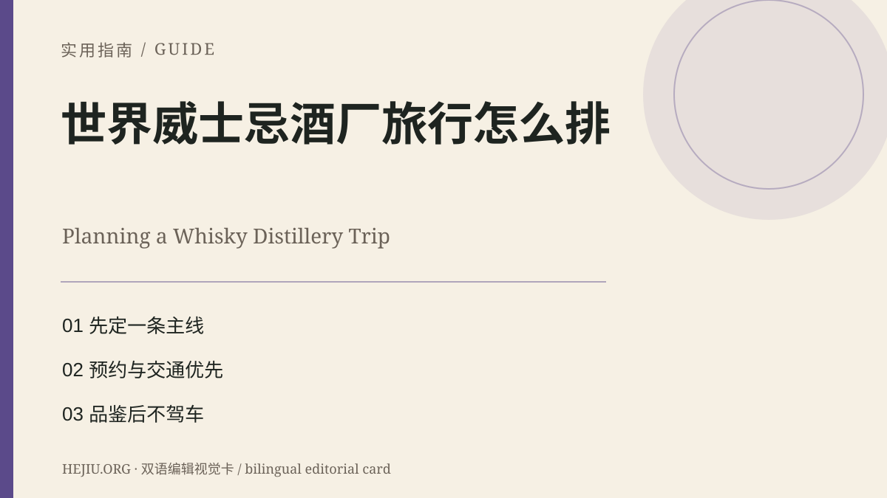

# Planning a Whisky Distillery Trip

A whisky distillery trip is not a checklist. Scotland’s islands and Highlands often need ferries and long drives; Japanese distilleries cluster along railways but bookings are tight; US and Irish sites are more dispersed. Choose one main line—Islay, Speyside, Yamazaki–Yoichi—then fit two to four distilleries around transport and bookings, leaving time for tasting and buying.

图：Whisky distillery travel bilingual editorial card。Project-created bilingual editorial card for topic identification, not a documentary photograph.

> **Quick verdict**
> **Best for:** travellers who want to see two to four distilleries properly in one trip.
> **Not for:** those trying five in a day or driving after tasting.
> **One line:** one main line, two to four sites, booking and transport first.

## Choose one main line

Islay suits peat and sea air but ferries are weather-sensitive; Speyside is dense with short drives and suits a first trip; the Highlands are spread out and need more driving; Japan’s Yamazaki, Yoichi and Hakushu each have rail and booking rhythms; Kentucky and Ireland are more dispersed. Choose one line, not Islay plus the Highlands at once. The line decides bases, car hire and booking order.

## Transport: ferries, trains, last services

For islands, check ferry times and cancellation policy before booking distilleries; for the Highlands, check single-track roads and fuel stops; for Japan, check JR and bus connections—Yamazaki is a walk from JR Yamazaki, Yoichi needs a transfer from Sapporo. Do not treat 60 km as an hour: hills, ferries and waits double it. Do not drive after tasting; book a taxi or stay near the distillery.

## Booking: distilleries are not walk-in

Most tours need advance booking, and popular sites and weekend slots fill early. Check the official tour types—basic, in-depth, tasting class—and confirm language, duration, cost and age limits. Leave transport buffer and do not schedule two tours in the same hour. If you must rely on walk-ins, prepare backup distilleries and visitor centres.

## What to see: mash, stills, casks

A good tour explains malting, fermentation, double or triple distillation, cut points and cask ageing. Notice still shape, condensers, cask provenance and warehouse type; these explain flavour more than an age number. Do not only photograph the exterior; mash tuns, stills and warehouses are where distilleries differ. If photography is allowed, ask which areas are restricted.

## Tasting and buying

Tastings are usually small and ordered light to heavy; smell, add water, then taste—do not gulp. Confirm fees, whether samples can be taken away and purchase discounts. When buying, read strength, cask type, age or no-age, bottler and shipping needs; wrap glass for checked baggage, as carry-on liquids are restricted. Check carrier rules before buying too much at the last stop.

## Season, lodging and etiquette

Scottish winter has short daylight and weather cancellations; autumn and spring are easier. Japanese distillery bookings tighten in peak season, and snow needs buffer. Stay near the distillery or a rail station to avoid driving after tasting. On tour, turn off flash, do not touch equipment or wear strong perfume; do not drive after tasting or be loud inside.

## Four-step itinerary

Choose a main line and two to four distilleries; check ferry, rail, last services and lodging; book the official tour with buffer; put tasting and buying last and arrange a non-driving return. If any step is unconfirmed, do not put the distillery in that day. Better one site fewer than missing a booking in a rush.

## Check before you go

- Choose one main line
- Keep two to four distilleries
- Check ferry/rail/last services
- Book tours with buffer
- Do not drive after tasting
- Check baggage rules for bottles
- Check winter cancellations
- Stay near distillery or station

## Limits and next steps

The easiest mistake in whisky distillery travel is overestimating how many you can visit in a day. Distilleries in Scotland, Ireland, Japan and the US sit in different terrain, many are a walk from the station, and a tour lasts about sixty to ninety minutes; with tasting and the shop, half a day disappears. Two per day with a third as backup is more realistic than four stops where you only photograph the sign.

Bookings and season go together. Production in autumn and winter shows more of the process, but some areas close; summer brings crowds and popular tours sell out early. Many distilleries require an online booking, a few take walk-ins, and some open only the shop rather than the production line. Confirm the language, whether children are allowed, accessibility, and whether the driver gets a non-alcoholic option.

Drinking and driving do not mix. Country roads in Scotland and Ireland are narrow with fast-changing limits, and tastings usually include one or several drams; if self-driving, the designated driver should take the non-alcoholic option or spit. In Japan and the US, many distilleries need a car or hired driver, public transport is sparse, and the last bus matters.

Luggage and borders count too. Distillery-only releases are often dearer than airport duty-free but more distinctive, and glass weight eats an allowance quickly; on a multi-country trip, check the next country's inbound limit. Finally, do not turn the trip into a pin-collecting map. Half a day for one deep tour usually gives more than three rushed stops.

## What else to watch

Festivals and open days reshape a trip. Scotland's whisky festivals, the Islay music festival and limited open days in Japan raise lodging prices and clog roads; popular distillery tickets can sell out months ahead. If a distillery-only release is the goal, check the sale rules, queue method and per-person limit before booking travel.

Ferries and last transport are hidden variables. Island distilleries depend on ferries, and weather cancellations are common; leave one sailing of slack rather than putting the last boat after a tour. When hiring a car, confirm overnight parking at distilleries and the one-way drop-off fee.

## References

- Scotch Whisky Association — technical and legal definitions — https://www.scotch-whisky.org.uk/ (Scotch Whisky Association, checked 2026-11-25)
- The Scotch Whisky Regulations 2009 — https://www.legislation.gov.uk/uksi/2009/2890/contents (UK Government, checked 2026-11-25)
- The Oxford Companion to Spirits and Cocktails — https://global.oup.com/academic/product/the-oxford-companion-to-spirits-and-cocktails-9780199311132 (Oxford University Press, checked 2026-11-25)
- William Grant & Sons — Glenfiddich brand page — https://www.williamgrant.com/gb/brands/glenfiddich (William Grant & Sons, checked 2026-11-25)

Related entries: [Islay whisky trail](ref:islay), [Campbeltown whisky trail](ref:campbeltown), [Scotland Highlands trail](ref:highlands), [Japan whisky trail](ref:japan), [single malt Scotch](ref:single), [blended Scotch](ref:blend), [Scotland](ref:scotland), [Whisky introduction](ref:intro).
