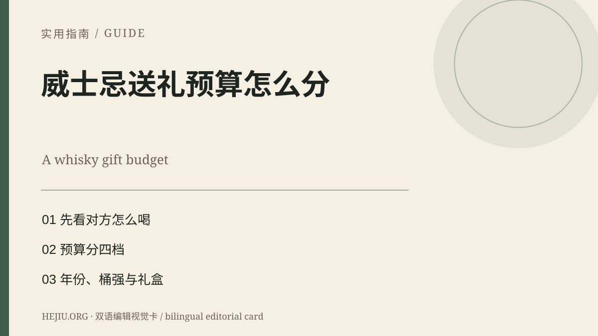

# A whisky gift budget

Whisky is a relatively safe present: recognisable brands, a wide price range and mature packaging make it easy for almost anyone to understand. Safe is not the same as suitable. A 300 RMB blend, a 3,000 RMB single malt, a cask-strength bottle and a travel-retail gift set speak to different recipients. Start with how they drink, then choose the budget and style.

Figure: How to split a whisky gift budget, a project-made bilingual editorial card. It identifies the topic; it is not an on-site photograph.

> **Bottom line**
> **For:** anyone who wants to give whisky but is unsure between single malt, blended or a gift set.
> **Not for:** people who choose only by “older is more expensive” and never check the recipient's habits.
> **Three checks:** do they drink it neat, with ice or in cocktails; which price band fits; does the box crowd out the whisky budget?

## Four budget bands

| Budget | Best for | Look for | Avoid |
| --- | --- | --- | --- |
| 300–800 RMB | everyday visits, colleagues and friends | a brand's main blend, an entry single malt, a two-bottle set | “commemorative” boxes with no distillery information |
| 800–1500 RMB | important clients, elders | 12–18 year single malt, a flagship blend | “aged” with no age statement or distillery |
| 1500–3,000 RMB | main business gift, wedding | older single malt, cask strength, limited batch | “duty-free special” from an unauthorised channel |
| Above 3,000 RMB | collections, top-level gifts | rare distillery, single cask, complete wooden box and certificate | auction bottles or “story wine” with no provenance |

A price band is not a quality grade. One brand may have 12-year, 18-year, cask-strength and travel-retail versions; identify the exact bottle before comparing price. A two-bottle set or “miniature plus glass” often looks more complete, but the whisky itself should still own most of the budget.

## Single malt or blended

Single malt highlights one distillery's character: peat, fruit, sherry, wood. The differences are clear and rewarding for someone who likes to compare. Blended whisky aims for consistency and balance; it is easier with ice, in cocktails, or when the recipient's taste is unknown. For a first whisky, a blend is usually safer; for a friend who already has a shelf, a single malt or single cask gives more to talk about.

Do not send the opposite of a style the recipient already likes. If they like sherry casks, choose a sherry-led expression; if they like peat, look at Islay; if you truly do not know, choose a gentle 40–46% single malt or a good blend rather than cask strength.

## Age and cask strength

Age states only the minimum time in cask; it does not guarantee a better drink. Older whisky can be softer and more complex, but it can also be over-oaked; younger whisky is not automatically rough. For a gift, 12–18 years is the safe zone for most people, with understandable price and flavour. For an experienced drinker, a single cask, cask strength or specific batch means more than a high age number.

Cask strength is high in alcohol and concentrated; it needs water or slow sipping and is not the only gift for a complete beginner. If you give cask strength, add a card with how much water to add and which glass to use. Glasses, miniatures and certificates are bonuses, but they do not replace source and batch information.

## Gift sets, miniatures and shipping

A gift box delivers completeness and presentation, not proof of quality. Check three things: the bottle is held securely, the seal is official, and the box gives distillery and batch information. Miniatures are useful for a tasting set or as a companion to a full bottle, but they cannot prove the quality of the full bottle. If a set contains only miniatures and no full bottle, confirm that this is the intended format.

Whisky is fragile and temperature-sensitive. For a gift sent elsewhere, confirm carrier restrictions, insurance and damage cover; summer heat speeds oxidation and winter cold can weaken seals. On arrival, store it upright, away from light, in a cool place; do not keep it in a domestic fridge long term. An open bottle is usually stable for 6–12 months, faster as the fill level drops.

## Channel and authenticity

Prefer the brand's official flagship store, authorised distributors, large supermarkets and duty-free shops that issue receipts. Do not trust “internal channel”, “customs seizure” or “special channel”. On arrival, check the seal, batch code, anti-counterfeit mark and bottle finish, and verify through the brand's official system if needed. A “limited edition” far below market price is usually more risk than opportunity.

For a business gift, keep the invoice and purchase record. For cross-border travel, check the duty-free allowance and airline rules in advance. Do not put bottles in checked luggage without protection, and do not leave them in a hot car.

## Frequently asked questions

### Single malt or blended for a gift?

If the recipient's taste is unknown, choose a good blend or a gentle single malt. If they already know whisky, choose a single malt, single cask or specific batch. Single malt has more character; blended is more consistent. Match the gift to their stage, not your own preference.

### Is older always better for a gift?

Not necessarily. Older whisky is rarer and more expensive, but can be more woody and restrained; a beginner may not enjoy it. 12–18 years is usually the safe zone; cask strength and single cask suit experienced drinkers. On a limited budget, get the whisky right before paying for age.

### Is a bigger box more impressive?

No. Check the bottle, seal, distillery and batch first, then the box. Packaging can be arranged later; do not buy an elaborate box from an unclear source. A small card with serving advice is more useful than another layer of packaging.

> **Continue:** Start with [whisky](ref:whisky) and [Scotch whisky](ref:scotch) for the category frame, then the [whisky introduction](ref:intro); to separate styles, read [single malt vs blend](ref:smvb). For a distillery trip, read [whisky distillery travel](ref:travel); for packaging, read [alcohol gift boxes](ref:box). For specific bottles, see [Glenfiddich](ref:glenfiddich) and [Macallan](ref:macallan).
