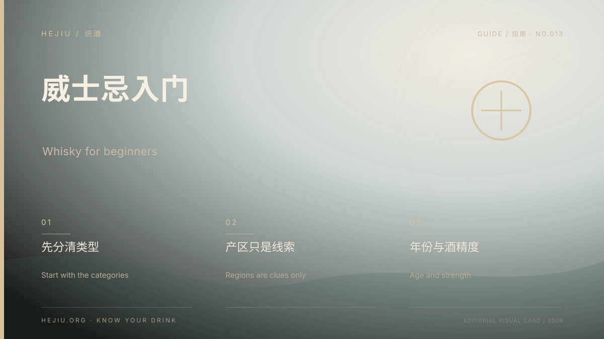

# Whisky for beginners

The difficulty of starting with whisky is not that it is hard to drink, but that there are too many words: single malt, blended, age, region, cask. Understand the levels behind those words, then filter by occasion and flavour preference, and the first bottle is not hard to choose.

Figure: thematic illustration for Whisky for beginners. Image: AI-assisted illustration generated with Doubao Seedream 5.0 (project-owned); not a photograph of the subject.

> **Decision checklist**
> Run these three checks before you buy or go.
>
> - **Start with the categories:** Whisky is a spirit made from grain through mashing, fermentation, distillation and maturation in oak.
> - **Regions are clues only:** Scotland is a major whisky origin, with commonly cited areas including Speyside, Highland, Lowland, Islay and Campbeltown.
> - **Age and strength:** An age statement such as 12 or 18 years means the youngest whisky in the bottle is at least that old; it is not an average age, nor extra maturation after blending.

## Start with the categories

[Whisky](ref:whisky) is a spirit made from grain through mashing, fermentation, distillation and maturation in oak. By origin and raw material, the common categories include Scotch, Irish, American and Japanese whisky; by composition, Scotch whisky is divided into single malt, blended malt and blended Scotch.

"Single malt" means malt whisky from one distillery, not "one variety of barley"; "blended" means whisky combined from several distilleries. Single malt emphasises distillery character, while blending emphasises consistency and balance. Neither is superior; they are different routes.

## Regions are clues only

[Scotland](ref:scotland) is a major whisky origin, with commonly cited areas including Speyside, Highland, Lowland, Islay and Campbeltown. Speyside often shows fruit and malt, Islay often shows peat and sea air, but these are tendencies, not guarantees for every bottle.

A regional label helps narrow the field but cannot replace distillery and cask information. Two distilleries in the same region can differ greatly, and one distillery can differ by vintage and cask. For a first purchase, read the type and flavour description before the region.

## Age and strength

An age statement such as 12 or 18 years means the youngest whisky in the bottle is at least that old; it is not an average age, nor extra maturation after blending. A whisky without an age statement is not inferior; it may be a consistent blend of different ages.

[Alcohol by volume](ref:abv) is commonly 40%–46%, with some versions higher. At 40% the entry is softer; above 46% the aroma is more concentrated and the heat stronger. For a first bottle, do not chase high strength; start at 40%–43% to judge preference more easily.

| Preference | Direction | Reference bottle | Serving |
| --- | --- | --- | --- |
| Fruit, soft | Speyside single malt | [Glenfiddich 18 Year Old](ref:glenfiddich) | Neat or a little water |
| Sherry, dried fruit | Sherry-cask style | [The Macallan](ref:macallan) | Neat, small sips |
| Easy, everyday | Irish blend | [Jameson](ref:jameson) | Neat or on the rocks |
| Clean, delicate | Japanese single malt | [Yamazaki](ref:yamazaki) | Neat or a little water |

## Process and flavour sources

Single malt uses malted barley, goes through mashing, fermentation and pot still distillation, then into [oak maturation](ref:oak-ageing). Bourbon casks bring vanilla, honey and woody sweetness; sherry casks bring dried fruit, peel and spice. Cask material, new or used status and time in cask shape a large part of the flavour.

Peat flavour comes from burning peat when drying malt, and not every whisky has it. If you are unsure about peat, start with an unpeated or lightly peated bottle before moving on. Do not treat "heavier peat" as "higher quality".

## Choosing the first bottle

1. Set the budget: buy one mainstream bottle first, not several.
2. Set the type: single malt or blended, choose one direction.
3. Set the flavour: fruit, sherry or peat, according to preference.
4. Set the strength: 40%–43% suits a first purchase.
5. Check the label: brand, distillery, age, type, strength, net volume, importer details.

For a single bottle, Speyside [Glenfiddich 18 Year Old](ref:glenfiddich) is a reference for the fruit route; sherry-cask style can look at [The Macallan](ref:macallan); everyday easy drinking can look at [Jameson](ref:jameson); the Japanese route can look at [Yamazaki](ref:yamazaki). They represent directions, not a ranking.

## How to drink

Neat is the most direct method: room temperature, a small glass, small sips. A little water opens the aroma but also changes balance; taste neat first, then add a few drops for comparison. Ice lowers temperature and dilutes aroma; it suits personal preference but makes detail harder to judge.

The glass need not be elaborate; a slightly narrowed rim helps gather aroma, as covered in [how to choose a glass](ref:glass). Smell at rest, then swirl gently; let the liquid cover the tongue and note sweetness, bitterness, wood and finish, recording with [the first sip](ref:tasting).

## Common mistakes

First, treating single malt as the only premium category. Second, assuming older always tastes better. Third, treating a region as one uniform style. Fourth, assuming heavier peat is better. Fifth, treating a missing age statement as inferior. Sixth, drinking fast from a large glass.

## Budget and buying

For a first purchase, a reputable channel and a mainstream bottle are enough. Prices vary with age, batch and channel, so no figures are given here. For gifting, consider gift boxes and packaging; for everyday drinking, put the budget into the liquid. After opening, store away from light, upright and cool to reduce aroma loss.

Start with what it is. From there, consider where it comes from, then how it is used. That is how a practical judgment about Whisky for beginners is built.

[Whisky](ref:whisky) and [Oak ageing](ref:oak-ageing) answer different questions about Whisky for beginners: reader and route. Read them as a pair, not as alternatives.

**At a glance:** A beginner's route into whisky, starting with single malt versus blended Scotch, a decision table for a first bottle, and notes on age, strength, serving and common myths. 

A common misreading treats Whisky for beginners as an advertisement. The correction is to ask what it is, then what the specific source says, and keep the answers apart.

The guide separates single malt from blended Scotch and explains that age is the youngest whisky in the bottle, not an average; a 12-year-old blend can contain much older whisky.

**Key facts.**

| Item | Detail |
| --- | --- |
| In one line | A beginner's route into whisky, starting with single malt versus blended Scotch, a decision table for a first bottle, and notes on age, strength, serving and common myths. |
| Audience | If you want want to start drinking whisky but are put off by regions and age statements. |
| Level | beginner |

**Sources and limits.** The key claims about Whisky for beginners are checked against the following sources: Scotch Whisky Association (Scotch whisky categories, regions and legal requirements), UK Government (the rules for single malt, blended whisky and age statements), William Grant & Sons (the Glenfiddich distillery and its Speyside origin) and 4 sources in total. Prices, batches and status change; the body is project-written and does not reproduce source text.

For Whisky for beginners, this guide was last checked in 2026; prices, batches and availability change, so confirm them against the sources below.

## Quick comparison: five whisky families

| Type | Main grain | Typical flavour | Where to start |
| --- | --- | --- | --- |
| Scotch single malt | Malted barley | Malt, peat, fruit | Begin with low peat |
| Irish whisky | Barley | Soft, grainy sweetness | Good if you dislike harshness |
| Bourbon | Corn | Vanilla, caramel, oak | For a sweeter profile |
| Japanese whisky | Barley | Clean, precise, fruity | For a softer style |
| Rye whisky | Rye | Pepper, spice, dry finish | For spice lovers |

Further reading

- [Whisky](ref:whisky): whisky categories and basic production.
- [Scotland](ref:scotland): regions, rules and style background.
- [Oak maturation](ref:oak-ageing): the effect of bourbon and sherry casks.
- [Alcohol by volume](ref:abv): the difference between 40% and stronger versions.
- [The first sip](ref:tasting): smell, taste and record.
- [How to choose a glass](ref:glass): how glass shape gathers aroma.

## Sources

- Scotch Whisky Association — https://www.scotch-whisky.org.uk/ (Scotch Whisky Association)
- The Scotch Whisky Regulations 2009 — https://www.legislation.gov.uk/uksi/2009/2890/contents (UK Government)
- William Grant & Sons — Glenfiddich — https://www.williamgrant.com/gb/brands/glenfiddich (William Grant & Sons)
- The Oxford Companion to Spirits and Cocktails — whisky entries (Oxford University Press)
