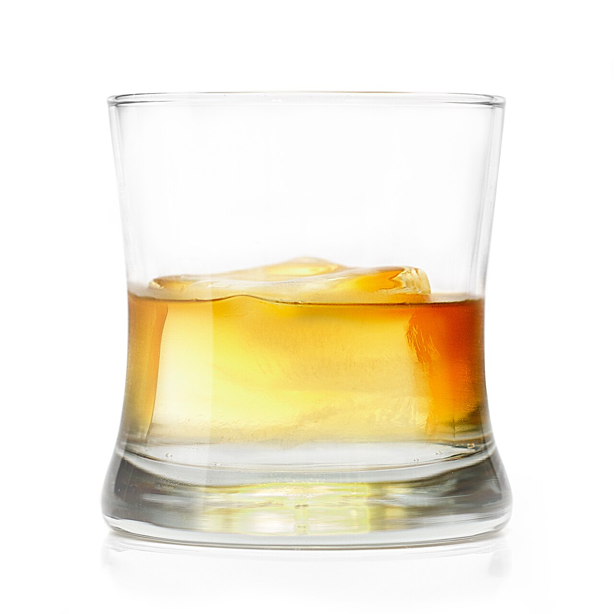
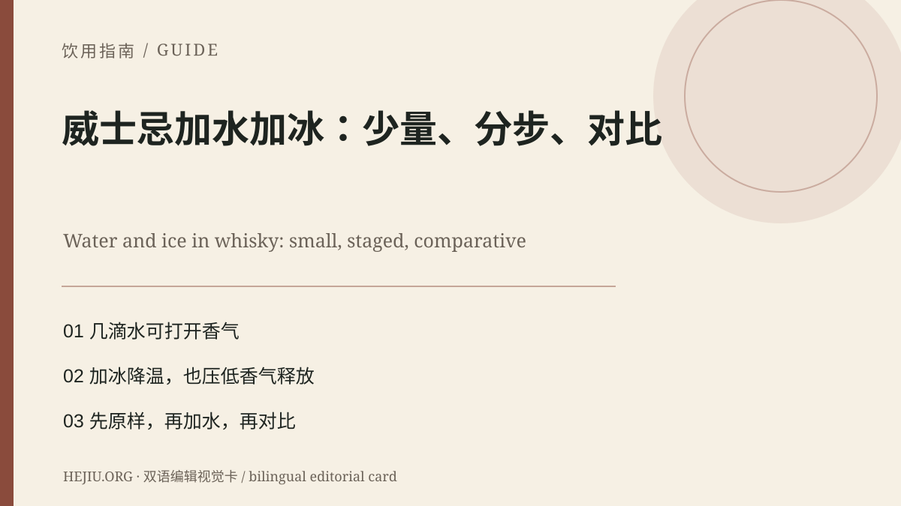
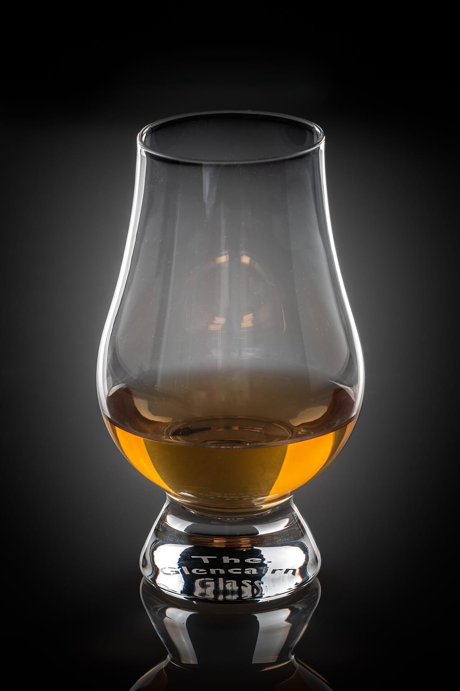

# Whisky with water and ice: small, staged, comparative

Adding water or ice to whisky is not a test of toughness. It is a way to change aroma, texture and the alcohol impression. The useful question is not "should I add water?" but "how much, in what order, and what changed?"

This guide covers strength, water, ice, mizuwari and highball, and a tasting order that lets you compare the same whisky neat, with water and with ice.

Figure: Whisky on the rocks; low temperature suppresses aroma release and shifts the sweet-bitter balance. Image: Benjamin Thompson, CC BY 3.0, via Wikimedia Commons ([source page](https://commons.wikimedia.org/wiki/File:A_Glass_of_Whiskey_on_the_Rocks.jpg)).

## Strength first, then water

Strength decides how much water a whisky can take. A 40% bottle is already diluted; a cask-strength whisky at 55–60% has more room. The table below is a starting point, not a rule.

| Strength | Typical bottle | Starting point | What to watch |
| --- | --- | --- | --- |
| 40–43% | Standard blend or single malt | Neat, then 2–3 drops if needed | Is aroma blocked by alcohol? |
| 46–50% | Single malt, entry cask strength | 5–10 drops, gradually | Do floral and fruit notes open, or does the body thin? |
| 50–60% | Cask strength, single cask | 1:10 to 1:5 water | Balance between heat and aroma |
| Above 60% | High-strength cask | Start at 1:10, add drop by drop | How much water before it opens? |

Add water in small steps and taste after each. A few drops can open aroma; too much can flatten texture and make the finish watery. If the whisky is already 40%, water is optional; if it is cask strength, water is often part of the intended experience.

## What water

Use clean, low-mineral water at room temperature. Heavily mineral water can add its own taste; ice-cold water can close aroma. A teaspoon or pipette gives control. Add to the glass, not to the bottle.

The classic ratio for cask strength is roughly 1:10 to 1:5 water to whisky, but the right ratio is the one that balances heat and aroma for that bottle. Do not treat a ratio as a test; treat it as a starting point.

Figure: A reference whisky; water and ice change aroma release and texture. Image: Guinnog, CC BY-SA 3.0, via Wikimedia Commons ([source page](https://commons.wikimedia.org/wiki/File:Whiskyhogmanay2010.jpg)).

## Ice: size and order

Ice cools the whisky and dilutes it as it melts. A large, clear cube melts slowly and gives more control; crushed ice chills fast and dilutes fast. For tasting, prefer a large cube or no ice; for a long drink, ice is part of the design.

Put the cube in a rocks glass, pour the whisky over it and wait a minute. The first sip is cold and tight; as the ice melts, aroma may open, then flatten. Notice the direction, not just the first impression.

## Mizuwari and highball are not the same

Mizuwari is a Japanese style: whisky, water and often ice, stirred to a balanced, lower-strength drink. A highball is whisky topped with sparkling water or soda in a tall glass, with ice and often citrus. Both dilute, but the texture and carbonation differ.

For a highball, use a chilled tall glass, plenty of ice, and pour sparkling water down the side to preserve bubbles. Stir once, gently. For mizuwari, stir longer to integrate water and chill. Do not shake either unless the recipe says so.

Figure: Water and ice in whisky: small, staged, comparative. Project-generated bilingual editorial card; schematic, not a photograph.

## Tasting order: neat, water, ice

Start neat with a small amount. Note aroma, sweetness, acidity, bitterness and finish. Add two or three drops of water and compare. Then add a large ice cube and compare again. The point is not to find one "correct" version, but to see what each preparation does.

If the whisky is high strength, the neat sip may be sharp; water may reveal grain, fruit or smoke. Ice may suppress aroma but make the drink refreshing. Choose the version you actually enjoy, not the one that sounds more serious.

## Pairing and occasions

Neat or with a little water suits quiet tasting, dark chocolate, nuts and aged cheese. Ice and highball suit warmer weather, salty snacks, fried food and long conversation. Peated whisky can stand up to smoked food; a light whisky suits lighter dishes.

Alcohol strength matters: a highball may taste soft but still contains alcohol. Pace the drink, keep water nearby and do not drive. Whisky is not a substitute for hydration.

Figure: A Glen Cairn nosing glass, whose tapered rim concentrates whisky aroma. Image: Pjt56, CC BY-SA 4.0, via Wikimedia Commons ([source page](https://commons.wikimedia.org/wiki/File:Glencairn_Glass-pjt.jpg)).

## Water and ice plans by whisky style

Adding water is not "diluting" but opening aroma and reducing alcohol sting with a small amount. Start from strength: a 40% whisky can be tasted neat first, then given 2–5 drops; 46–50% can take 5–10 drops; cask strength at 55–65% can begin at one part water to three to five parts whisky, then adjust. Do not pour half a glass of water at once; dilution is irreversible.

Single malt works neat first, then with water, then with ice. Bourbon and rye show more sweet grain and oak; one or two cubes can clarify the sweetness. For a blended whisky highball, the usual ratio is one part whisky to two or three parts soda: ice first, then whisky, then soda down the side of the glass to save bubbles. Ice cools and dilutes continuously; a larger cube melts more slowly, and clear old ice suits neat drinking better than crushed ice.

Mizuwari is the Japanese method, commonly one part whisky to two or three parts water, stirred to chill before ice; it is not the same as a soda highball, which relies on bubbles and acidity. For tasting, start neat, record aroma and texture, add water to observe change, and add ice last. If you start with ice, the low temperature hides much of the detail.

With food, a highball suits fried food, grills and salted snacks; neat whisky suits dark chocolate, nuts and hard cheese. Whatever the method, start small and drink slowly: how much you can drink is not the same question as what you tasted.

## Cask strength, single cask and dilution ratios

Cask strength whisky is bottled without added water, close to the strength at which it left the cask, usually 50–65%. Single cask means one cask, with a stronger individual character, though different bottles from the same cask can still vary. Do not sip cask strength at the pace of a 40% bottle: nose a small amount first, then add water with a dropper.

A reproducible starting point: at 60% alcohol, one part water to four parts whisky brings the strength to roughly 48%; one to three brings it to roughly 45%. That is arithmetic, not a recipe; the aromatic sweet spot is found by adding small amounts. Add two or three drops, swirl, wait 30 seconds and nose again. Do not add a spoonful at once.

Single-cask differences come from cask type, cask number, warehouse environment and bottling batch; two single casks from the same distillery can be completely different. When buying, look for cask number, bottling date, strength and volume. If a seller only says "single cask" without batch information, the premium is not well supported. Cask strength still changes after opening; aim to finish within six to twelve months, and decant into smaller bottles to reduce oxygen.

For ice, a large cube melts more slowly and suits neat drinking; a highball can use crushed or cubed ice, but chill the glass thoroughly before adding whisky and soda. Do not crush ice and leave it in the drink for a long time: fast dilution flattens the aroma.

## A quick match of strength and method

Everyday 40% whisky: neat first, then 2–5 drops of water in the middle. 46–50%: 5–10 drops, or one large ice cube. Cask strength above 55%: start at one part water to three to five parts whisky, then find the point where aroma is clearest. Blended whisky at 40–43%: a highball at one part whisky to two or three parts soda, ice first. Rye and bourbon: ice or a little water clarifies the sweet grain and oak. A simple diagnosis: if the entry is only alcohol sting, add water; if aroma is closed and the texture dull, warm it or use a larger glass; if the flavour is washed out, use less water next time.

## Taste one whisky in three states

Set out three glasses of the same whisky, marked neat, water and ice. For neat, record aroma, entry and finish. After water, wait 30 seconds and note whether the nose opened and the alcohol softened. With ice, observe the first two minutes and the five-minute mark. Do not drink all three at once: neat first, then water, then ice, rinsing with water between. Use specific words such as grain, vanilla, caramel, smoke, citrus or wood rather than "good" or "bad". Decide which version you prefer at the end, not according to someone else's order.

## Common questions

**Should I add water to every whisky?** No. A 40% bottle may need none; cask strength often benefits. Add in small steps and judge by aroma and texture.

**Does ice ruin whisky?** It changes it. Ice lowers temperature and dilutes as it melts; some whiskies become tighter and less aromatic, others become more refreshing. It is a preference, not a fault.

**What water should I use?** Clean, low-mineral water at room temperature. Add with a teaspoon or pipette so you can control the amount.

**Is mizuwari the same as highball?** No. Mizuwari is still water and whisky, often stirred; a highball uses sparkling water or soda and is usually served in a tall glass.

**How much water for cask strength?** Start around 1:10 water to whisky, then adjust. The right amount balances alcohol heat with aroma, not a fixed number.

## Common misconceptions

First, water is for weak drinkers. Water is a tasting tool; many cask-strength whiskies are designed to be adjusted.

Second, ice makes whisky "cheap". Ice is a legitimate way to serve and changes temperature and dilution.

Third, more water always opens more aroma. Too much water flattens the body and shortens the finish.

Fourth, a highball is just whisky and soda. Proportions, ice, carbonation and glass shape all matter.

Fifth, whisky can replace water. Alcohol dehydrates; drink water alongside.

## Further reading

- [Whisky](ref:whisky): definitions, traditions and categories.
- [Cask and strength](ref:cask): how wood and alcohol shape flavour.
- [Ice](ref:ice): temperature and dilution.
- [Glassware](ref:glass): shapes for tasting and serving.
- [Alcohol strength](ref:abv): what the percentage means.
- [Nosing](ref:nosing): concentrating aroma in the glass.

**Key facts.**

| Item | Detail |
| --- | --- |
| One-line position | Water and ice adjust aroma, texture and alcohol heat; the right amount depends on strength and the bottle |
| Best for | Drinkers who want to compare neat, water and ice without dogma |
| Not for | Anyone treating strength or ice as a macho test |
| Buying logic | Strength first, then cask and style, then serving method |

**Sources and scope.** This page's strength, water and ice guidance was cross-checked against the Scotch Whisky Association, the Scotch Whisky Regulations 2009, The Oxford Companion to Spirits and Cocktails and distillery serving guidance. The body is project-written; sources are for verification, not copied text.
