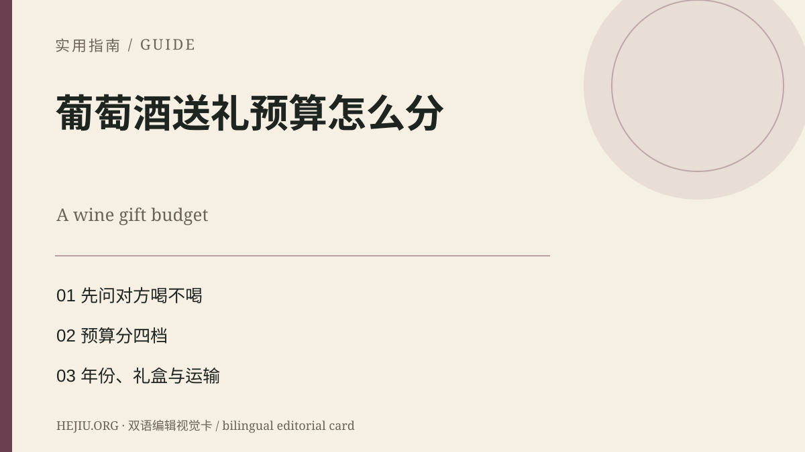

# A wine gift budget

Wine looks lighter than baijiu, but gifting is not necessarily easier: region, vintage, variety, decanting and food pairing can all become a burden. If the recipient rarely drinks wine, an expensive Bordeaux may be less useful than a delicious sparkling wine opened that evening. If they know wine, the accuracy of region and producer matters more than the box. Ask “do they drink?” before talking budget.

Figure: How to split a wine gift budget, a project-made bilingual editorial card. It identifies the topic; it is not an on-site photograph.

> **Bottom line**
> **For:** anyone giving wine who is unsure between red, white, sparkling, region and price.
> **Not for:** people who only recognise “France/Bordeaux” and ignore the recipient's habits and transport.
> **Three checks:** do they drink wine; do they have a fridge or wine cabinet; when will the bottle be opened?

## Ask whether they drink

If the recipient rarely drinks, a red wine that needs decanting, food and long storage adds work. Sparkling wine, fresh dry white or off-dry white is easier to open and share, and fits celebrations. If they have a wine cabinet and eat out often, red wine and famous regions have more room.

Occasion matters too. Weddings, housewarmings and business gifts need a complete-looking box; friends and family dinners suit a single fine bottle or a two-bottle comparison. On a limited budget, buy one traceable bottle at its drinking peak rather than two heavily packaged bottles with incomplete information.

## Four budget bands

| Budget | Best for | Look for | Avoid |
| --- | --- | --- | --- |
| 200–500 RMB | everyday visits, friends | a clear-region dry white, sparkling, village red | “French red wine” with no producer or bottler |
| 500–1000 RMB | important family meals, colleagues | a known region, village or cru bourgeois, gift box | over-packaged “reserve” with no vintage |
| 1000–3,000 RMB | business, weddings, elders | classified growth, second wine of a famous estate, regional fine wine | “famous estate” from an unauthorised channel |
| Above 3,000 RMB | top-level gifts, collections | grand vin, rare vintage, complete provenance | auction bottles or “story wine” with no provenance |

A price band is not a quality grade. One region and one estate can vary widely by vintage and product line; identify the exact wine, vintage and bottler before comparing price. A box can be added later; the wine's information cannot.

## Region, variety and vintage

When the recipient's taste is unknown, choose an easy-to-understand combination: fresh dry white, sparkling, or a round Merlot-led red. If they like structure, look at left-bank Bordeaux and Cabernet blends; if they like finesse, Burgundy and Pinot Noir; if they like sweetness, a sweet white or fortified wine. “Bordeaux” is not one style; it varies widely inside.

Vintage depends on region and wine, and older is not always better. Most ordinary dry whites and sparkling wines are for drinking within 1–3 years; structured reds may go 5–15 years; sweet whites and fortified wines can last longer. Check the drinking window before giving, so you do not hand over a bottle past its peak or one that needs another decade.

## Gift boxes and transport

A wine gift box should hold the bottle securely, show the seal and give source information. Wood, leather and two-bottle cases add completeness, but cannot replace the estate, vintage, bottler and importer. For cross-border or long-distance gifts, check carrier restrictions, insurance and temperature control; summer heat and winter freezing can damage wine.

If the recipient will not drink it soon, remind them to store it upright or lying down as the closure requires, away from light, in a cool, stable place. An open bottle keeps 3–5 days in the fridge; sparkling wine needs a stopper and should be finished within about two days. Do not keep wine in a kitchen or on a balcony long term.

## Channel and authenticity

Prefer brand official shops, authorised importers, large supermarkets and wine specialists that issue invoices. Do not trust “customs seizure”, “internal special supply” or “famous-estate clearance”. On arrival, check the seal, front and back labels, batch and importer; famous estates may also offer authentication or batch records. A “grand vin” far below market price is usually more risk than opportunity.

For business gifts, keep the invoice and purchase record; for cross-border travel, check the duty-free allowance and airline rules. Wine is fragile: pack against pressure and avoid hot cars and repeated handling.

## A five-minute check before buying

Before paying, run five checks: does the recipient drink wine; red or white lately; do they have a wine fridge or ordinary fridge; when will the bottle be opened; does the budget include the box and shipping. If any answer is unclear, do not start with a famous estate. Choose a traceable bottle at its drinking peak.

For an elder, prefer off-dry or fresh dry white over heavily tannic or high-alcohol reds. For business, choose a bottle with complete region, estate and back-label information. A gift is not an exam; you do not need the most obscure wine to prove taste.
## Frequently asked questions

### Red, white or sparkling?

If you do not know whether they drink, choose sparkling or fresh dry white: easy to open and widely liked. If they drink red often, choose a structured red. For weddings and celebrations, sparkling is usually more fitting than an expensive red.

### Does vintage matter?

Yes, but it is not the only thing. Vintage reflects regional weather and harvest; ordinary dry whites and sparkling wines are not for long ageing, while structured reds need vintage context. Check the drinking window rather than chasing “old”.

### How do I transport wine safely?

Use a trackable, insured service with pressure-resistant, light-blocking, heat- and frost-protected packing. In summer, choose cold chain or next-day; in winter, protect from freezing. On arrival, store upright or lying down in a cool place and do not open a bottle that has been in the sun.

> **Continue:** Start with [wine](ref:wine) for the category, then the [first wine](ref:first); for restaurant choices, read [ordering wine](ref:restaurant). For storage, read [wine storage](ref:storage); compare [Bordeaux](ref:bordeaux) and [Burgundy](ref:burgundy). For a famous estate, see [Lafite](ref:lafite); for packaging, read [alcohol gift boxes](ref:box).
