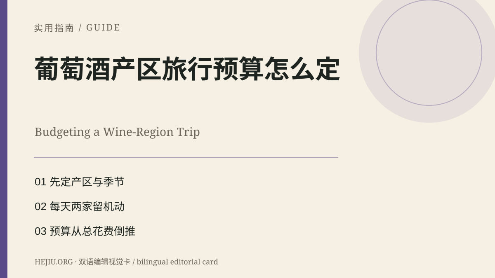

# Budgeting a Wine-Region Trip

The cost difference in wine travel is often not airfare but transport, tasting fees, lodging and purchases. Tuscany, Bordeaux, Napa, Barossa, Margaret River and Marlborough differ in season, car costs and tasting policies. Choose region and season, plan two wineries a day with a half-day buffer, then budget backwards from the total instead of booking flights first and discovering tasting fees later.

图：Wine-region trip budgeting bilingual editorial card。Project-created bilingual editorial card for topic identification, not a documentary photograph.

> **Quick verdict**
> **Best for:** independent travellers who need to control a wine-region budget.
> **Not for:** those comparing only airfare and leaving no room for tasting or buying.
> **One line:** choose region and season, plan two visits a day, and budget backwards from the total.

## Region and season first

For a first trip, choose a region with concentrated wineries and easy public transport or car hire: Chianti Classico in Tuscany, Bordeaux’s Left Bank, Napa, Barossa, Margaret River and Marlborough each have a rhythm. Harvest (September–October north, March–April south) is busy and bookings tight but shows the work; shoulder season is cheaper but some wineries shorten hours. Check peak season and local holidays before dates.

## Transport: car, rail, driver

Wine regions usually have weaker public transport than cities; wineries often need a car or driver. Car hire must include insurance, fuel, one-way fees and a plan for not driving after tasting; a driver is charged by hour or day and suits two to four people. Rail works point-to-point (Bordeaux, around Florence), but the last mile still needs a taxi. Do not treat 20 km as 20 minutes.

## Tasting fees and booking

More wineries charge tasting fees by tier: basic, in-depth tour, food pairing. Confirm cost, duration, language, whether it offsets purchases, and whether children or pets are accepted. Do not schedule four in a day: tasting needs smelling and conversation, and rushing creates fatigue. Two a day with a half-day buffer is a steadier rhythm.

## Lodging and food

Lodging near wineries is often pricier and limited; a small town or region centre within 20–40 minutes of several wineries is usually better value. Allocate a simple lunch and a proper dinner, and avoid heavy spice before tasting. If a winery offers food, read the menu and price; do not assume “tour includes meal”. Keep lodging and food separate so a package price does not hide the real cost.

## Wine purchases, baggage, insurance

Budget wine purchases separately: regional wine may be cheaper than at home, but shipping, duty and breakage count. Wrap glass for checked bags; carry-on liquids are restricted; check carrier and customs allowances first. Keep receipts and provenance for high-value bottles. Confirm travel insurance covers baggage and wine, and car insurance covers gravel roads and undercarriage.

## Budget backwards from the total

Write the total first, then allocate transport 25–35%, lodging 20–30%, tasting 10–15%, food 15–20%, wine 10–20%, insurance and buffer 5–10% (adjust by destination). Lock flights and car first, add tasting fees from bookings, and cap purchases. If the total is tight, fewer wineries is more effective than cutting lodging safety.

## One budget sheet

Write total budget and days, then six lines: transport, lodging, tasting, food, wine, insurance. Schedule only two wineries a day with a half-day buffer. Put tasting fees in the sheet at booking and cap purchases. If over budget, cut winery count and buying before insurance or safe lodging. Check baggage and customs so the last bottle does not destroy the budget.

## Check before you go

- Choose region and season
- At most two wineries a day
- Cost the full car or driver
- Confirm tasting fees at booking
- Stay in a region centre
- Budget wine separately
- Check baggage and customs
- Keep a 10% buffer

## Limits and next steps

The budget for wine-region travel is usually pushed up not by tasting fees but by transport, accommodation and last-minute decisions. Remote regions lack dense public transport, and a hired car or driver often costs more per day than the tastings; mountain roads sit between estates, and three visits a day is already a ceiling. Fix the transport mode first, then choose lodging along the route; that is cheaper than booking estates and then hunting for a car.

Tasting fees vary widely. Old European regions often charge by the set of wines, from about ten to several tens of euros; some estates in the US, Australia and New Zealand charge more but deduct it from a purchase; booked private tours and barrel tastings are extra. Ask whether the fee includes tasting, whether a group can share, whether booking is required and what the cancellation policy is.

Season and exchange rates change the total. Harvest from August to October tightens lodging and raises prices, while some estates shorten hours in winter; the southern and northern hemispheres run opposite seasons. Cross-border trips also carry exchange-rate swings, card fees and cash withdrawal fees. Split the budget into transport, lodging, tasting, food and wine purchases, and keep ten percent for contingencies; that is steadier than a single daily figure.

Finally, do not buy too much wine to "get your money back". Keep purchases in a separate line and consider checked-baggage weight, inbound allowances and breakage risk; some wines are cheaper at home. The point of the trip is to understand a region, not to fill a suitcase.

## What else to watch

Group size changes how costs split. Cars, tastings and rooms are priced per vehicle or per room, so a small group pays more per person; four or more often makes a hired car cheaper than public transport plus taxis, but confirm luggage space and child seats. Restaurant tips, service charges and whether tasting fees include tax belong in the budget as separate lines.

Tax refunds and shipping are another ledger. Some countries refund consumption tax if you keep receipts and process it on departure; shipping wine home can bring duty and breakage risk, and an airport duty-free purchase may be simpler. Keep the wine budget separate from the travel budget so you do not overbuy for a refund.

## References

- International Organisation of Vine and Wine (OIV) — https://www.oiv.int/ (OIV, checked 2026-11-25)
- WSET — wine tasting and label knowledge centre — https://www.wsetglobal.com/ (WSET, checked 2026-11-25)
- The Oxford Companion to Wine — https://global.oup.com/academic/product/the-oxford-companion-to-wine-9780198871316 (Oxford University Press, checked 2026-11-25)
- National standards open system — GB/T 15037-2006 Wine — https://openstd.samr.gov.cn/bzgk/std/newGbInfo (State Administration for Market Regulation and Standardization Administration of China, checked 2026-11-25)

Related entries: [Bordeaux Left Bank route](ref:bordeaux), [Tuscany Chianti Classico route](ref:tuscany), [Napa Valley wine route](ref:napa), [Barossa wine trail](ref:barossa), [Margaret River wine route](ref:margaret), [Marlborough wine trail](ref:marlborough), [France](ref:france), [First wine guide](ref:first).
