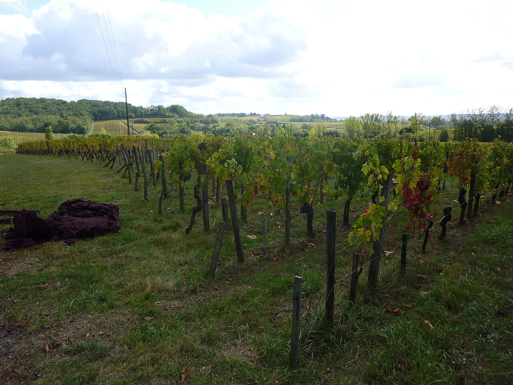
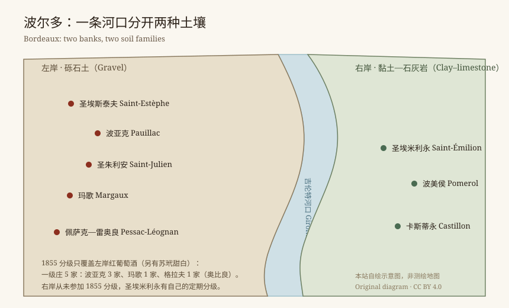
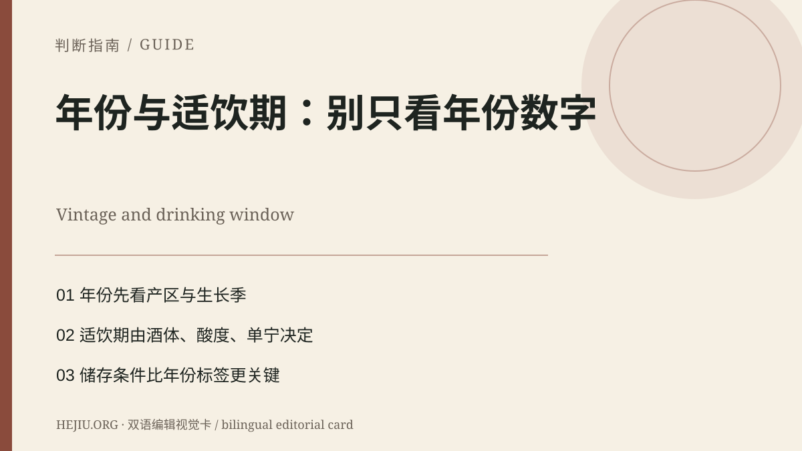
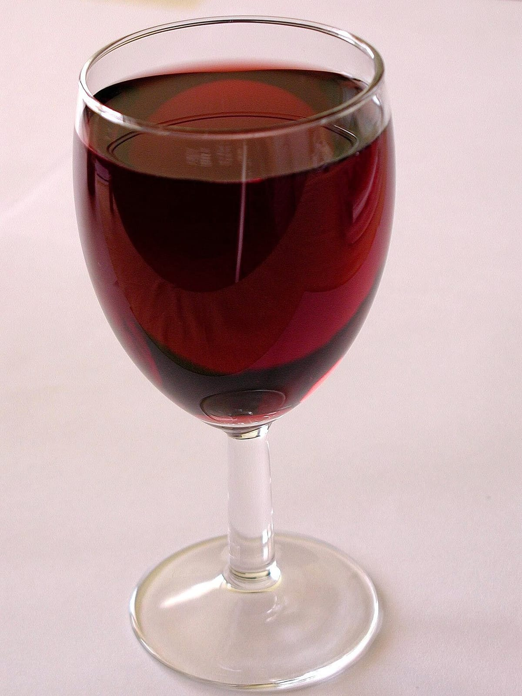

# Vintage and drinking window: beyond the year on the label

Vintage is often read as a quality score: good year, higher price; bad year, lower price. What it actually records is the weather, ripeness, yield and winemaking choices of that year. It shapes style and drinking time, but does not directly mean "good" or "bad" in the glass.

The drinking window matters more: is this bottle ready now, will it improve, or has it started to decline? This guide does not offer a universal vintage chart; it offers an order of judgment.

Figure: A vineyard in Bordeaux, where vintage variation begins with growing-season weather and the harvest window. Image: davitydave, CC BY 2.0, via Wikimedia Commons ([source page](https://commons.wikimedia.org/wiki/File:Vineyard_in_Bordeaux.jpg)).

## What vintage actually records

Vintage is the year of harvest. For a single vineyard, estate wine or vintage Champagne, the label means the wine comes mainly from that year; for non-vintage Champagne, NV sparkling wine and most blended wines, vintage is not the main character.

Differences between years in one region come mainly from growing-season temperature, rain, light, disease pressure and harvest timing. A hot year can bring higher alcohol and riper fruit; a cool year can keep higher acidity and a lighter body. But picking, sorting, fermentation and ageing can amplify or correct those differences.

A vintage chart is an average of regional experience, not a verdict on every bottle. Two estates in the same region can make completely different wines in the same "poor" year. Read vintage together with producer, site, wine type, strength and storage.

## Wine type before drinking window

| Wine type | Typical window | Key variables | Common mistake |
| --- | --- | --- | --- |
| Fresh white | 1–4 years | Acidity, residual sugar, strength | Assuming all white wine should age |
| Structured white | 3–8 years | Acidity, oak, body | Reading vintage without the producer |
| Light red | 2–5 years | Tannin, acidity, fruit | Assuming older red is always better |
| Structured red | 5–15 years | Tannin, acidity, concentration | Assuming every famous estate lasts 30 years |
| Sweet wine | 5–30 years | Sugar, acidity, oxidation | Thinking sweet wine is only for dessert |
| Vintage Champagne | 5–15 years | Acidity, lees ageing, body | Believing Champagne must always be fresh |
| Non-vintage sparkling | 1–3 years | Freshness, storage | Treating sparkling wine as immortal |

These windows are rough ranges, not guarantees. Storage temperature, humidity, light and cork condition move the window earlier or later. A bottle kept two years in a 30°C warehouse cannot be judged by the estate's printed window.

Figure: Schematic of Bordeaux: gravel soils on the left bank (Saint-Estèphe, Pauillac, Saint-Julien, Margaux) and clay-limestone on the right bank (Saint-Émilion, Pomerol). Project-generated schematic, not a photograph.

## Three signals of readiness

First, structure. High tannin, high acidity and concentration usually tolerate time better than a light wine; but structure must be balanced. A wine with heavy tannin and too little fruit will only become drier with age.

Second, condition. After opening, does the aroma unfold, is fruit still present, does acidity support the body, are tannins rough? If fruit has gone, acidity sticks out and tannins feel dry, "waiting longer" is usually not the answer.

Third, storage. Constant temperature, darkness, suitable humidity and an intact cork give ageing meaning. An old wine with unknown storage carries far more risk than reward. For old bottles, provenance, fill level, label and warehouse history matter more than vintage.

## How to use a vintage chart, and how not to

A vintage chart is good for horizontal comparison: within one region and wine type, which years were hotter, cooler or wetter, and which suited early- or late-ripening varieties. It is bad for vertical verdicts: a "average" year does not condemn every estate, and a "great" year does not bless every bottle.

| Use | What it helps with | What it cannot do |
| --- | --- | --- |
| Buying different vintages of one estate | Compare style and price | Judge the current condition of the bottle |
| Restaurant choice | Avoid clearly unsuitable years | Replace a sommelier's decanting judgment |
| Collecting | Understand regional climate | Guarantee the bottle's storage history |
| Gifting | Explain vintage variation | Guarantee the recipient's taste |

For everyday drinking, choose recent vintages with reliable storage. For structured reds and sweet wines, judge by producer, type and storage. For old wine, confirm provenance and fill level before discussing vintage.

Figure: Vintage and drinking window. Project-generated bilingual editorial card; schematic, not a photograph.

## After opening: decanting and waiting

Decanting is not "the longer the better". A young, tannic red may need one to two hours; an old wine may need only fifteen to thirty minutes, or no long decant at all. White wine and sparkling wine usually do not need extended decanting; too much air costs aroma.

If the wine is closed after opening, pour a glass and wait twenty to thirty minutes before judging. If the aroma is already oxidised and the fruit fading, more decanting will not rescue it. The core question is whether the wine is balanced now, not whether it might be worth more later.

## Buying checklist

1. Confirm wine type and producer: vintage means different things across types and estates.
2. Read region and vintage reports as background, not as the only conclusion.
3. Check strength and body: high alcohol with low acidity usually does not reward long keeping.
4. Check storage and provenance: for old wine, fill level, label, warehouse and transport matter more than vintage.
5. Check the drinking window: producer, merchant or trusted critic windows are references; the open bottle is the final judge.

Figure: A glass of red wine; drinking-window judgment returns to body, acidity and tannin. Image: Paolo Neo, Public domain, via Wikimedia Commons ([source page](https://commons.wikimedia.org/wiki/File:Red_wine_in_glass_in_restaurant.jpg)).

## Waiting strategies by wine type

A vintage records the year of harvest, not the year the wine is ready. Drinking windows depend on wine type, structure, storage and personal taste. Cabernet-dominated left-bank Bordeaux can need 8–15 years in a good vintage; Merlot-led right-bank wines soften earlier and may open at 5–10 years. Red Burgundy changes faster: village wines often 3–8 years, while premier and grand crus can go longer, but not every Burgundy is a long-ageing wine.

Whites depend more on acidity and body: simple dry whites 1–4 years, racy Riesling and Chardonnay 3–8 years, and sweet or botrytised wines 10–30 years because sugar and acidity hold them. Non-vintage Champagne is designed to drink on release; vintage Champagne and top cuvées can wait another 5–15 years. Sparkling wine is not better simply because it is old: bubbles and freshness decline.

Before opening, ask three questions: does the structure support waiting, has storage been stable, and do you prefer freshness or tertiary notes? If you have only one bottle and no backup, choose a wine already in its window for an important occasion; leave "a few more years" for a case you can open in stages.

When ordering an old wine in a restaurant, confirm the return policy and decanting service first. The cork, fill level and transport history all affect performance. Do not treat "older" as automatically "better", and do not dismiss a wine merely because it is not yet at its peak.

## Reading the vintage on the label

The vintage on a label is the harvest year, not the bottling year, and older is not automatically better. Climate differences between years change acidity, sugar and tannin ripeness; within the same year, estates differ because of picking dates, selection and winemaking. When you see a year, first ask which region, which variety and which level, then decide whether it is worth waiting for.

For everyday wine, vintage is mostly a freshness clue: whites and light reds are usually drunk within two to five years. For long-ageing wine, vintage is part of the structure judgment, but estate, batch and storage still matter. An "old vintage" on a restaurant list may already be past its window; ask about the return policy and decanting before ordering.

Do not use one vintage chart to score every wine. A chart compares the general climate of one region and one style; it does not transfer across regions, and a "great" year does not make every estate great. The reliable order is: confirm the type and structure, check the estate's harvest report for that year, then judge with your own tasting.

## Common questions

**Is older always better?** No. Only wine with enough structure and good storage repays ageing; most everyday wine is better within two to five years.

**Do all estates perform the same in one vintage?** No. Site, variety, picking and winemaking make large differences within one region.

**Can I buy directly from a vintage chart?** Use it as regional background, not as a substitute for producer, wine and storage judgment. For old wine, provenance and fill level are essential.

**Does non-vintage Champagne need a vintage?** NV Champagne is blended across years, so vintage is not the label's focus; vintage Champagne is the one that stresses a single year.

**How long does an opened bottle keep?** Red usually one to three days, white one to two, sparkling best the same day; sweet and fortified wines last longer. Refrigerate and seal everything.

## Common misconceptions

First, a poor vintage means a cheap wine. Price also reflects estate, region, yield and brand.

Second, all red wine can last ten years. A light red may pass its window in three to five years.

Third, old wine is automatically complex. Badly stored old wine may offer only oxidation and dryness.

Fourth, longer decanting is always better. Over-decanting can let the aroma disappear.

Fifth, vintage Champagne is always better than NV. Vintage expresses a single year; NV aims at consistency and blending.

## Further reading

- [Red wine](ref:red): structure, tannin and ageing.
- [White wine](ref:white): freshness and acidity.
- [Sparkling wine](ref:sparkling): vintage and non-vintage.
- [Vintage](ref:vintage): the meaning of a year.
- [Storage](ref:storage): temperature, light and bottle condition.
- [Bordeaux](ref:bordeaux): a region where vintage variation is closely studied.

**Key facts.**

| Item | Detail |
| --- | --- |
| One-line position | Vintage records a year's weather and choices; the drinking window depends on structure, condition and storage |
| Best for | Buyers choosing between vintages or deciding when to open a bottle |
| Not for | Anyone using a vintage chart as a universal quality score |
| Buying logic | Type and producer first, vintage second, storage always |

**Sources and scope.** This page's vintage, ageing and drinking-window information was cross-checked against OIV, Bordeaux official wine information, Comité Champagne and Decanter vintage reporting. Vintage conditions and prices change; use current official and critical information. The body is project-written; sources are for verification, not copied text.
