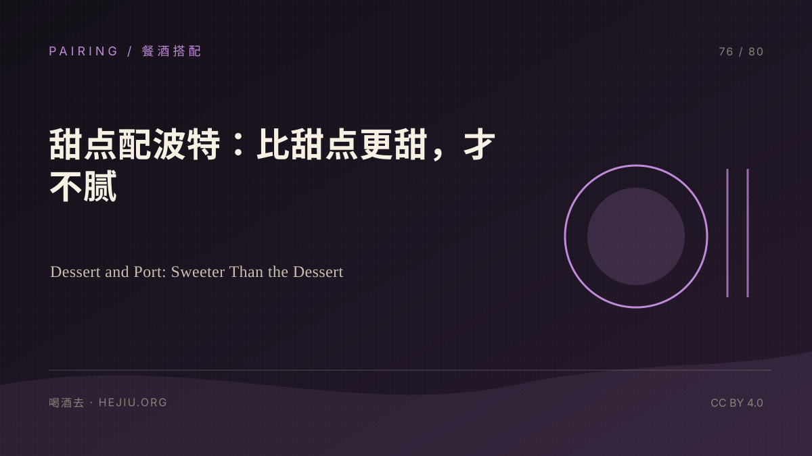

# Dessert and Port: Sweeter Than the Dessert

The most common failure in dessert and sweet wine pairing is that the wine is less sweet than the dessert. When the dessert has more sugar than the wine, the wine tastes sour, thin, even bitter; when the wine is slightly sweeter than the dessert, the sweetness has somewhere to land. Port is a fortified wine with several layers of sweetness, acidity and oxidative flavour, so look at the dessert first, then at the type of Port.

Figure: thematic illustration for Dessert and Port: Sweeter Than the Dessert. Image: AI-assisted illustration generated with Doubao Seedream 5.0 (project-owned); not a photograph of the subject.

## Pairing principles: sweetness, acidity and intensity

The first principle is sweetness. The wine should be at least as sweet as the dessert, ideally a little sweeter. If it is not sweet enough, the dessert's sugar pushes the wine's fruit into the background and leaves only acidity and alcohol. The second is acidity. Desserts often carry cream, butter and sugar, and acidity cuts the fat and refreshes the palate; a sweet wine without acidity becomes cloying by the second spoon.

The third is flavour intensity. Dark chocolate, caramel and nuts are strong and need an aromatic, concentrated Port; fruit tarts and cream puddings are lighter and suit a fresher Tawny or White Port. When intensity is mismatched, either the wine overwhelms the dessert or the dessert buries the wine.

The fourth is fat. Cream, butter, chocolate and egg-based sauces add weight to the palate and need acidity and a sense of lift to clean it. Port has no bubbles, so it relies on acidity and the warmth of alcohol to balance.

The fifth is spice. Ginger, cinnamon, clove and pepper amplify the burning of alcohol; desserts with these spices suit a Port with slightly higher sweetness and moderate alcohol, drunk slowly from a small glass.

## Specific matches and why

| Dessert | Port direction | Why |
| --- | --- | --- |
| Dark chocolate | Ruby or LBV | Cocoa bitterness contrasts with red berries and sweetness |
| Dried fruit and nuts | Tawny | Oxidative nut and caramel notes echo the ingredients |
| Berry tart | Ruby | Red fruit and acidity support the berries |
| Caramel, coffee | Tawny | Caramel, nuts and oxidative notes align |
| Blue cheese | Vintage Port or Ruby | Salt, pungency and sweetness form a contrast |
| Cream pudding | Tawny or White Port | Cream fat needs acidity and a clean finish |
| Fruit tart | Chilled White Port | Light, moderately sweet, does not overwhelm fruit |
| Spice cake | Ruby or Tawny | Spice and sweetness support each other |

Ruby styles are marked by red berries, sweetness and relatively little oxidation, and suit chocolate, berries and blue cheese; Tawny has spent longer oxidative ageing and brings nuts, caramel and dried fruit, suiting nut, caramel and coffee desserts; White Port is lighter and, chilled, suits fruit and delicate cream desserts. Vintage Port has strong structure and suits concentrated desserts, not a light fruit tart.

Blue cheese with Port works because salt and sweet, pungency and fruit form a contrast, but the cheese portion should be small or the salt overwhelms the wine. Chocolate with Ruby is a common match, but the higher the cocoa content, the more bitter the dessert, and the more sweetness and fruit the wine needs to balance it.

## Serving order and temperature

Port usually comes after the dessert or alongside it. If a meal has several desserts, serve the light fruit and cream first, then chocolate and nuts, and finally blue cheese; the wine can move from White Port to Ruby, then Tawny or Vintage Port, avoiding a heavy wine at the start.

Temperature: Tawny about 14–16°C, Ruby about 16–18°C, White Port about 8–10°C. Port does not need icing, and over-chilling closes the aroma; White Port can be briefly chilled to make its freshness clearer. Let the dessert come to room temperature rather than serving it straight from the fridge.

## Portions and glassware

Pour about 50–75 millilitres of Port and keep the dessert portion modest. Sweet wine is easy to drink more of than intended; a small glass controls the pace and lets each mouthful be noticed. If several desserts are served, pour small amounts in stages rather than filling the glass once.

Choose a small tulip or Port glass, with a slightly wide bowl and a narrowed rim to gather aroma. Do not use an oversized red wine glass; sweet wine's aroma is concentrated and disperses too quickly in a large glass. White Port can use a small white wine glass.

## Combinations to avoid

First, a very sweet dessert with a dry wine: the wine tastes sour and thin, and the dessert's sugar buries the fruit. Second, a light citrus fruit tart with Vintage Port: the wine's body and aroma are too heavy and the fruit's freshness disappears. Third, a very sweet Port with a very sweet dessert: sugar stacks up, the palate tires quickly, and the acidity cannot clean it.

Fourth, chocolate with a high-acid, low-sweetness dry wine: cocoa bitterness and acidity add up and taste sharp. Fifth, blue cheese with a high-tannin red: salt and tannin can turn metallic, while Port or a sweet wine is safer. Sixth, treating Port as "the older the better". Different Port types have different drinking windows, and an old bottle is not automatically right for the dessert in front of you.

## Common misconceptions

First, that Port is only for drinking after dinner. Its sweetness and acidity can pair with desserts, blue cheese and nuts. Second, that all Port is equally sweet. Ruby, Tawny and White Port differ clearly in sweetness, acidity and oxidation.

Third, that a sweet wine is better the sweeter it is. Sweetness must match the dessert: too much is cloying, too little is sour. Fourth, that an opened bottle of Port keeps indefinitely. Fortified wine is more durable than ordinary wine, but it still oxidises after opening; finish it within a few weeks and keep it chilled. Fifth, that Vintage Port is ready as soon as it is opened. Structured Port needs decanting and room, and its intensity must be considered when pairing with dessert.

## See also

- [Fortified wine](ref:fortified): the production and types of fortified wine.
- [Porto](ref:porto): the Port region and its style framework.
- [Residual sugar](ref:sugar): how sweetness shapes pairing.
- [Acidity](ref:acidity): how acidity cleans the fat of a dessert.
- [Oxidation](ref:oxidation): oxidative flavour and the character of Tawny.
- [Finish](ref:finish): how the length of a sweet wine's finish matches a dessert.
- [Look at the plate first, then the glass](ref:food-pairing): general pairing principles.
- [How to choose a glass](ref:glass): sweet wine glasses and aroma gathering.

**In brief:** The core of dessert and Port pairing is that the wine must not be less sweet than the dessert; choose Ruby, Tawny or White Port by the dessert's sugar, fat and intensity, with acidity and oxidative notes deciding whether the finish stays clean. 

Start with what it is. From there, consider where it comes from, then how it is used. That is how a practical judgment about Dessert and Port is built.
