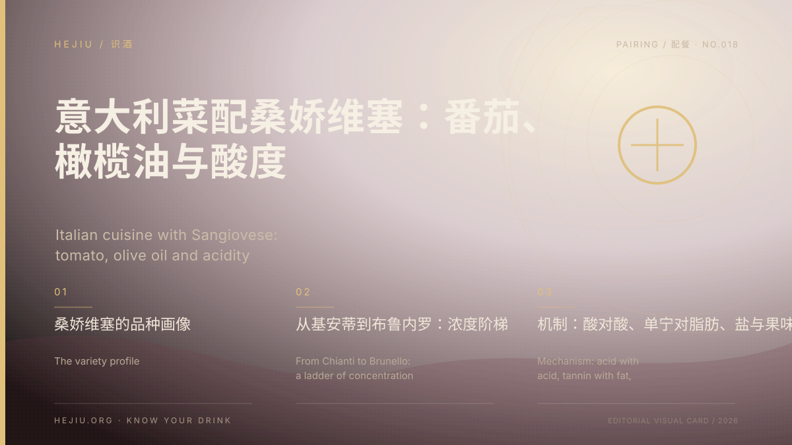

# Italian cuisine with Sangiovese: tomato, olive oil and acidity

The most common sauce on an Italian menu is not meat gravy but tomato: fresh, tinned, paste, sun-dried, ranging from bright acidity to concentration. [Sangiovese](ref:sangiovese) is one of [Italy](ref:italy)'s most important red varieties, and its high acidity and dry tannin were made for this kind of acid-led cooking. The first premise to accept is that in Italy acidity is not a defect but structure.

Figure: thematic illustration for Italian cuisine with Sangiovese: tomato, olive oil and acidity. Image: AI-assisted illustration generated with Doubao Seedream 5.0 (project-owned); not a photograph of the subject.

## The variety profile

Sangiovese has relatively thin skins and ripens late, with high acidity and medium-to-high, dry tannin. Typical aromas are sour cherry, red plum, dried herbs, violet and earth, turning to leather, tobacco and dried fruit with age. The colour is not deep, the body medium, and the tannin feels dry and firm when young.

Those features set the direction of pairing: high acidity needs food with matching acidity to align with, dry tannin needs fat and protein to soften it, and fruit needs salt and umami to stand out. Summing it up as "[red wine](ref:red-wine) with red meat" would miss its finer relationship with tomato, olive oil and hard cheese.

## From Chianti to Brunello: a ladder of concentration

Chianti Classico requires at least 80% Sangiovese, with other permitted varieties allowed in the remainder; Brunello di Montalcino requires 100% Sangiovese and a longer period of ageing. An ordinary Chianti Classico is usually fresh with bright acidity; the Riserva level requires longer ageing and has a more complete structure.

These legal numbers are not a quality ranking but a ladder of concentration: Chianti Classico suits tomato pasta and pizza, the Riserva suits roast meat and hard cheese, and Brunello suits long-braised meat and aged cheese. Brunello has thicker tannin and a fuller body, and can be closed when young, needing decanting or further bottle age.

## Mechanism: acid with acid, tannin with fat, salt with fruit

The first mechanism is aligning [acidity](ref:acidity). Tomato, vinegar and lemon raise the mouth's sense of acidity; if the wine lacks acidity, the dish turns sharp and the wine flat. Sangiovese's high acidity runs alongside tomato's, letting fruit reappear after the acid.

The second is [tannin](ref:tannin) and fat. Olive oil, butter, hard cheese and red meat coat tannin and reduce dryness, while tannin binds protein and clears the palate. Sangiovese's dry tannin looks coarse beside dishes without enough fat, such as simply sautéed vegetables or white fish.

The third is salt and umami. Parmesan, cured meat, olives and anchovy amplify the wine's fruit and sweetness, and also its bitterness. Salty dishes need softer tannin and riper fruit; intensely savoury dishes such as long-cooked ragù need higher acidity and a tighter structure.

## Tomato dishes: pasta, pizza and bread soup

Tomato pasta is the most direct match. A marinara of tomato, garlic, basil and olive oil has bright acidity and moderate fat, and suits a young Chianti Classico with clear fruit. Bolognese has more fat and umami and suits a Riserva or Brunello, but tomato's acidity still demands acidity in the wine, or it will taste dull.

Margherita pizza combines tomato, mozzarella and basil: acid, fat and herb. The charred crust and cheese fat need both tannin and acidity to cleanse, and Sangiovese is the natural choice. Pappa al pomodoro, a tomato and bread soup, has acidity and a starchy texture that suit ripe fruit and soft tannin; a tight young wine exaggerates the dryness of the bread.

## Fat and hard cheese: bistecca, Parmesan and olive oil

Bistecca alla Fiorentina is the classic Sangiovese partner: thick-cut, bone-in and rich in fat, with salt and charcoal that need tannin and acidity for balance. Brunello or a Riserva Chianti Classico is a common choice; but if the steak is overcooked and dry, the tannin feels more astringent, and cooking matters more than the label.

Hard cheeses such as Parmigiano Reggiano, with their salt and crystalline texture, suit a more complete structure and higher acidity. Cheese fat softens tannin and salt amplifies fruit; but blue cheese's strong salt and spice bury Sangiovese's cherry and herbal notes and is usually a poor match.

## Seafood, vegetables and heat

Sangiovese has a tense relationship with seafood. White fish, shellfish and squid need little tannin, and the wine's dry tannin amplifies metallic and fishy notes; if pairing is unavoidable, choose riper fruit, softer tannin and moderate acidity, and avoid heavily macerated versions.

Among vegetables, roast aubergine, roast pepper, mushrooms and olive oil suit a medium-bodied Sangiovese with earthy notes; simply sautéed greens and asparagus tend to clash with tannin. Spicy dishes such as arrabbiata amplify alcohol and tannin, and suit lower-alcohol, sweeter-fruited wine rather than a high-tannin Brunello.

## Pairings that fail

First, steamed seafood with Brunello. Dry tannin clashes with the seafood's metallic note, and the wine's weight overwhelms the ingredient.
Second, creamy mushroom pasta with a young Chianti Classico. Cream needs acidity and body for support, and the young wine's acid turns sharp.
Third, blue cheese with Sangiovese. Salt and spice cover cherry and herb, and the tannin turns bitter.
Fourth, very hot tomato sauce with high-tannin wine. Capsaicin amplifies the heat of alcohol and tannin.
Fifth, dessert with dry Sangiovese. The wine's acid and tannin make the dessert cloying, and the dessert makes the wine bitter.
Sixth, asparagus with high-tannin wine. The vegetable's green note combines with tannin to produce a marked metallic taste.

## Temperature, decanting and glassware

Sangiovese is usually served just below room temperature. Too warm makes alcohol and tannin bitterness obvious; too cold closes the aroma. Young Chianti Classico can take a short decant; young Brunello may need longer, while old bottles should be decanted briefly to avoid losing perfume.

Choose a medium-sized tulip glass that concentrates aroma without pushing alcohol forward. Avoid very small glasses and oversized ones; Sangiovese needs moderate concentration.

## Non-alcoholic alternatives

Without alcohol, cold-brewed black tea can replace the drying feel of tannin, tomato juice with sparkling water can replace acidity and refreshment, and an olive-oil and herb infusion can replace fat and herbal notes. The point is to keep tomato's acidity and hard cheese's salt, not to hide them under a sweet drink.

**At a glance:** The tomato, olive oil, herbs and hard cheese of Italian cooking suit the high acidity, cherry fruit and dry tannin of Sangiovese; the match is made by aligning acidity, not by seeking the heaviest tannin.

**Key facts.**

| Item | Detail |
| --- | --- |
| In one line | The tomato, olive oil, herbs and hard cheese of Italian cooking suit the high acidity, cherry fruit and dry tannin of Sangiovese; the match is made by aligning acidity, not by seeking the heaviest tannin. |
| Food | Italian cuisine |
