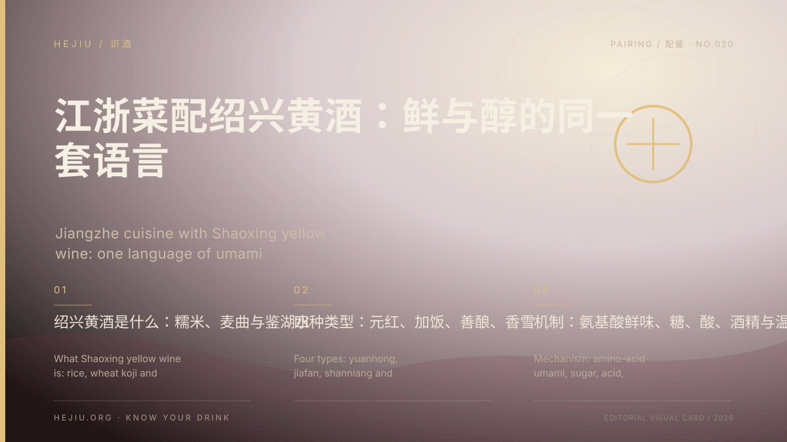

# Jiangzhe cuisine with Shaoxing yellow wine: one language of umami

Beside a Jiangnan stove there is often a bowl of [yellow wine](ref:yellow-wine): a spoonful goes into the pan to remove fishiness, and a warmed pot goes on the table with the meal. These are not two uses but one material divided between two stages. Shaoxing yellow wine ferments glutinous rice with wheat koji; amino acids bring umami, residual sugar brings sweetness, and alcohol and acidity provide structure. Jiangzhe cooking prizes freshness, softness and a balance of sweet and salt, and the two share exactly that language.

Figure: thematic illustration for Jiangzhe cuisine with Shaoxing yellow wine: one language of umami. Image: AI-assisted illustration generated with Doubao Seedream 5.0 (project-owned); not a photograph of the subject.

> **Topic guide: yellow wine at the Jiangnan table**
> - [Jiangzhe food with Shaoxing yellow wine](https://hejiu.org/en/pairings/jiangzhe-shaoxing/)
> - [Yellow wine](https://beverages.hejiu.org/en/styles/yellow-wine/)
> - [History of yellow wine](https://culture.hejiu.org/en/articles/history-of-yellow-wine/)
> - [China Yellow Wine Museum](https://atlas.hejiu.org/en/places/china-yellow-wine-museum/)
> - [Shaoxing yellow wine trail](https://atlas.hejiu.org/en/routes/shaoxing-yellow-wine-trail/)
> - [Choosing your first wine](https://hejiu.org/en/guides/first-wine/)

> **Topic guide: yellow wine at the Jiangnan table**
> - [Jiangzhe food with Shaoxing yellow wine](https://hejiu.org/en/pairings/jiangzhe-shaoxing/)
> - [Yellow wine](https://beverages.hejiu.org/en/styles/yellow-wine/)
> - [History of yellow wine](https://culture.hejiu.org/en/articles/history-of-yellow-wine/)
> - [China Yellow Wine Museum](https://atlas.hejiu.org/en/places/china-yellow-wine-museum/)
> - [Shaoxing yellow wine trail](https://atlas.hejiu.org/en/routes/shaoxing-yellow-wine-trail/)
> - [Choosing your first wine](https://hejiu.org/en/guides/first-wine/)

## What Shaoxing yellow wine is: rice, wheat koji and Jian Lake water

Shaoxing yellow wine belongs to the wheat-koji rice category, using glutinous rice as the main material, saccharified and fermented with wheat koji and a yeast preparation, then pressed, clarified, heat-treated and aged. Water from Jian Lake is a defining origin factor: it is relatively soft with moderate minerals, which helps fermentation and a gentle texture.

The finished wine is usually between 14% and 20% alcohol, ranging in colour from pale amber to deep brown, with rice, wheat-koji, nut and caramel aromas and a texture from dry to sweet. Ageing deepens colour and oxidative aroma, but also reduces fruit and increases weight.

## Four types: yuanhong, jiafan, shanniang and xiangxue

Shaoxing yellow wine is often grouped by sugar and process. Yuanhong is dry, low in sugar and refreshing, suiting steamed river fish and vegetables. Jiafan is semi-dry: more rice and less water are used, giving a [fuller body](ref:body) and more umami, and it is the most common table wine. Shanniang is semi-sweet, made by using wine instead of water, with obvious sweetness, suiting braises and sweet-savoury dishes. Xiangxue is sweet, high in both sugar and alcohol, suiting desserts and the end of a meal.

These four are style coordinates, not brand grades. Jiafan has the widest range, yuanhong suits light dishes, and shanniang and xiangxue suit sweet and heavy dishes. Read the type, sugar and strength on the label rather than only the vintage.

## Mechanism: amino-acid umami, sugar, acid, alcohol and temperature

The first mechanism is amino-acid umami. Glutamate, aspartate and peptides in the wine stack with the umami of stock, soy sauce, bamboo shoots and river fish; moderate umami makes the wine rounder, while very strong umami from heavy soy and MSG makes it taste bitter.

The second is sugar. Residual sugar balances salt and acid and makes the body feel fuller, but a sweet wine with steamed fish covers the fish's sweetness, while with red-braised pork it can catch the sweet-salt sauce. The third is acidity. Yellow wine has moderate acidity that refreshes and cuts grease but is not enough to cut heavy fat the way white wine does; oily dishes therefore need a fuller body for balance rather than more acid.

The fourth is alcohol and temperature. At 14% to 20% it is stronger than wine and weaker than baijiu; temperature changes aroma and texture markedly. [Warming](ref:ice-and-temperature) to about 40 to 45 degrees Celsius opens rice aroma and sweetness and suits jiafan and shanniang, while room temperature or chilling suits yuanhong and lighter dishes.

## Steamed river fish

Steamed perch, white fish, mandarin fish and river shrimp are the baseline of Jiangzhe cooking. The fish is delicate and suits yuanhong or a light jiafan served a little below room temperature; rice aroma holds the fish, acidity refreshes, and the fish's sweetness is not covered. Steamed-fish soy sauce amplifies both the wine's umami and its alcohol, so avoid high-strength examples.

River shrimp and drunken shrimp are sweeter and crisper and suit yuanhong or light jiafan. Crab roe tofu and crab-yellow dumplings are richer and fattier and suit jiafan; but crab roe's fishy note clashes with oxidative aroma, so choose a younger, fresher wine.

## Braises and fat: Dongpo pork, pork belly and soy duck

Dongpo pork is a Jiangzhe signature: belly pork slowly braised with yellow wine, soy sauce and rock sugar, rich but not greasy, with a thick sweet-salt sauce. It suits jiafan or shanniang: the wine's umami echoes the sauce, residual sugar catches the rock sugar, and alcohol and acidity cut the fat. Yuanhong is too thin for Dongpo pork, while xiangxue is too sweet.

The same applies to braised pork belly, soy duck and braised pork knuckle. Soy duck is saltier with more spice and suits jiafan; knuckle has the thickest collagen and fat and suits shanniang or aged jiafan. The thicker the braising sauce, the fuller and sweeter the wine should be, rather than a crisp light style.

## Drunken crab, drunken shrimp and raw marinades

Drunken crab and drunken shrimp are raw-marinated with yellow wine, soy sauce and spices, so wine aroma meets seafood sweetness directly. They suit jiafan or shanniang, but note that raw marinades are high in salt and carry microbial risk; the alcohol is not enough to sterilise, and "drunken" must not be treated as preservation. Eat small amounts slowly and choose reputable products.

Raw crab has rich, fatty roe and suits shanniang's sweetness and weight; drunken shrimp is lighter and suits jiafan. Xiangxue with raw marinade would cover the seafood's freshness with sugar and amplify salt with alcohol.

## Bamboo shoots, beans and vegetables

Oil-braised bamboo shoots, with soy sauce, sugar and the shoot's own savour, suit jiafan; salted-pork and fresh-pork soup with bamboo shoots is rich and savoury and suits jiafan or shanniang. Stir-fried pea shoots, Indian aster and shepherd's purse are light and suit yuanhong; fermented tofu and preserved mustard greens are strong and suit jiafan or aged wine.

Vegetable pairing is often overlooked, but Jiangzhe vegetables usually carry oil, sauce and savour, so "light" is not a safe assumption. Judge by fat, salt and the weight of umami.

## Sweet dishes and the end of the meal

Sweet Jiangzhe dishes such as osmanthus lotus root, fermented-rice dumplings and eight-treasure rice suit shanniang or xiangxue. Xiangxue's sugar and alcohol can carry the dessert, but the dessert is already sweet and more sweetness becomes cloying; a higher-acid shanniang, or a small amount of xiangxue with one bite, works better.

Drinking yellow wine after the meal is a Jiangnan habit, but temperature and quantity matter. Warming opens the aroma, while overheating pushes alcohol forward; small cups sipped slowly beat large glasses drunk quickly.

## Regional differences: Shaoxing, Hangzhou, Ningbo, Shanghai

Shaoxing is the home of the wine, with salty, fermented and soy-led food: drunken crab, preserved mustard greens and fermented tofu are representatives. Hangzhou cooking is cleaner and sweeter, and West Lake fish in vinegar or Longjing shrimp suit yuanhong or light jiafan. Ningbo food is salty with plenty of seafood and suits jiafan. Shanghai cooking is rich, dark and sweet, and red-braised pork and soy duck suit shanniang or jiafan.

These differences remind us that Jiangzhe food is not one flavour but three lines: salty-savoury, sweet-savoury and clean-fresh. For [pairing](ref:food-pairing), decide which line a dish belongs to before choosing type and temperature.

## Pairings that fail

First, steamed perch with xiangxue. Sweetness covers the fish's freshness and alcohol amplifies fishiness.
Second, Dongpo pork with yuanhong. The wine is too thin and the fat covers its aroma.
Third, drunken crab with strong baijiu. Alcohol amplifies salt and fishiness and the yellow wine's umami disappears.
Fourth, dessert with dry yuanhong. The wine's acid and alcohol make the dessert cloying.
Fifth, fermented tofu with light yuanhong. The fermented flavour covers the rice aroma.
Sixth, ice-cold yellow wine with red-braised pork. Cold congeals the fat and the dish turns greasy.

## Non-alcoholic alternatives

Without alcohol, rice broth can replace the rice aroma and weight of yellow wine, light soy sauce with stock can replace umami, sour plum drink can replace acidity and refreshment, and non-alcoholic fermented rice can replace shanniang's sweetness. The point is to keep the structure of umami at the base and sweet-salt balance.

Further reading: [Guyuelongshan Huadiao](ref:c-extra-1).
