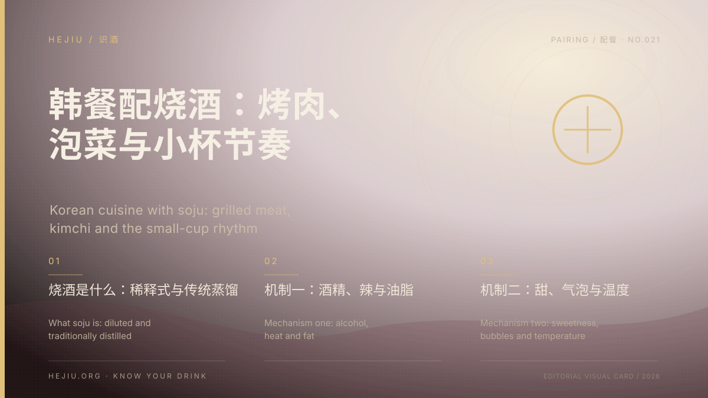

# Korean cuisine with soju: grilled meat, kimchi and the small-cup rhythm

In a [Seoul](ref:south-korea) barbecue restaurant, every table has a charcoal grill in the middle, kimchi, pickled radish, lettuce and dipping sauces around the edge, and a green glass bottle standing at the corner. [Soju](ref:soju) is poured into very small cups, one mouthful at a time, and refilled only after the cup is empty. That scene explains the pairing: this is not the Western logic of one dish with one wine, but a whole rhythm of eating — grill, wrap, dip, drink, grill again.

Figure: thematic illustration for Korean cuisine with soju: grilled meat, kimchi and the small-cup rhythm. Image: AI-assisted illustration generated with Doubao Seedream 5.0 (project-owned); not a photograph of the subject.

## What soju is: diluted and traditionally distilled

Korean soju falls into two broad groups. Diluted soju is made from neutral alcohol, water, sweeteners and flavourings, then filtered; it is clean, slightly sweet, inexpensive and the type most often seen in barbecue restaurants and convenience stores. Traditional distilled soju is fermented from grain or potato and then distilled; it is rougher, stronger, made in smaller quantities and more expensive.

Both are called soju, but they [pair](ref:food-pairing) differently. Diluted soju wins on not competing with food and on being easy to keep drinking, which suits a long shared meal. Traditional distilled soju rewards small sips and stands up to stronger fermented foods. Read the back label: if the ingredients mention neutral alcohol or diluted alcohol, it is almost certainly the diluted type.

## Mechanism one: alcohol, heat and fat

Chilli heat comes from capsaicin. Capsaicin binds to TRPV1 receptors on the oral mucosa and produces burning and pain; it is not a taste but a mixture of pain and temperature sensation. Alcohol stimulates the same receptors, and the stronger the drink, the stronger the burn. This is why a high-strength spirit with very hot food often does not "put out the fire" but stacks burning on burning until the mouth goes numb.

Fat is the best solvent for capsaicin. The fat in pork belly, beef rib and sesame-oil dip forms a film in the mouth, reducing contact between capsaicin and receptors and lowering the heat. That is the physiological reason Korean barbecue wraps meat in lettuce with garlic and sesame oil: fat, fibre and fresh aroma together pull the irritation of chilli and alcohol back into a tolerable range.

The lower strength of diluted soju matters here. It irritates less on entry and can coexist with heat without letting the burn run away, but its sweetness makes people underestimate the alcohol, and drinking quickly and heavily gets them drunk quickly too.

## Mechanism two: sweetness, bubbles and temperature

Diluted soju often carries a slight sweetness. Sweetness temporarily masks alcohol heat and bitterness and makes chilli feel rounder, but it does not reduce the concentration of capsaicin; it only moves attention. Some products are carbonated, and the bubbles lightly irritate the mouth, raise freshness and also amplify the sting of heat.

Temperature matters as much. Ice-cold soju goes down more easily and its aroma is muted; at room temperature alcohol is more obvious and sweetness more prominent. Barbecue restaurants chill soju and pour it straight so that rich, salty food is easier to swallow, not so that the aroma can be appreciated. To sense the layers of traditional distilled soju, serve it a little warmer than ice-cold and sip from a small cup.

## Grilled meat: pork belly, beef rib and pork neck

Pork belly is the classic. Thick slices are grilled until the edges are crisp and the fat has rendered, then wrapped in lettuce and perilla with garlic, green chilli and ssamjang, followed by a mouthful of soju. The alcohol and bubbles cut the fat, the lettuce fibre and freshness cleanse the palate, and the fermented savour of the paste plays against the soju's slight sweetness.

Beef rib has finer fat and a deeper meat flavour, and suits a slightly stronger or traditionally distilled soju; the sweetness of soju amplifies the char of the beef, but also exposes the absence of tannin. Soju has no tannin to bind with protein the way red wine does, so its role is to refresh rather than to build structure.

Pork neck has even fat distribution and a crisp, springy texture, and suits a clean diluted soju with sour side dishes. Note that barbecue dipping sauces tend to be salty and sweet, and salt amplifies the heat of alcohol; the more sauce you use, the more slowly you should drink.

## Kimchi and soup: fermented acidity working both ways

Kimchi's lactic fermentation brings acidity and umami. [Acidity](ref:acidity) stimulates saliva and appetite and keeps soju's sweetness from cloying, but the salt, chilli and garlic in kimchi also amplify alcohol irritation. Young kimchi is sharper and hotter and suits a clean soju; well-fermented kimchi has rounder acidity and more umami and suits traditional distilled soju.

Kimchi stew, soybean-paste stew and army stew are another setting. The soup is hot, salty and savoury, and the cold soju in small cups cools the mouth; but hot soup plus strong alcohol doubles the irritation of throat and stomach, so the pace should slow. Army stew's ham, sausage and cheese bring fat and salt; soju's sweetness balances the salt and also encourages more drinking.

## Fried chicken, seafood and regional differences

Fried chicken with beer is the modern Korean combination, but soju is just as common. The crisp crust and oil need bubbles and acidity, and soju's carbonation and lower strength can do part of that work; however the salt in fried chicken makes the alcohol more obvious, and sweet-sour pickled radish does the job better.

Coastal regions centre on seafood: raw fish, grilled shellfish and seafood stew in Busan suit a clean diluted soju; salted and fermented seafood is heavy in salt and umami and suits traditional distilled soju. Jeolla Province is known for rich fermented foods and stronger flavours, which gives more pairing room; Seoul's barbecue and bar culture tends towards speed, lower strength and ice-cold service.

## Pairings that fail

First, a strong spirit with extreme chilli heat. Alcohol and capsaicin both stimulate TRPV1, and the burn stacks into numbness until neither dish nor drink can be tasted.
Second, a sweet cocktail with raw marinated seafood. Sweetness hides the seafood's freshness while alcohol amplifies any fishiness.
Third, very salty dip with a lot of soju. Salt raises alcohol heat and dehydrates the mouth.
Fourth, scalding soup with ice-cold soju. Alternating hot and cold makes people drink too fast.
Fifth, aged traditional soju with delicate white fish. The depth and aroma of the spirit overwhelm the sweetness of the fish.

## Non-alcoholic alternatives

Without alcohol, Korean food offers natural partners: barley tea cleanses the palate, unsweetened corn tea brings a light sweetness, and sweet rice punch is sweet without being cloying and suits grilled and spicy food; sparkling water with lemon replaces soju's bubbles and refreshment. Fermented milk drinks soothe heat but are too sweet for raw marinated seafood.

## Glassware, temperature and pace

The small soju cup is not about toughness but about controlling the dose per mouthful: one cup at a time makes the speed of alcohol visible. Pouring is usually done by someone else at the table, and the empty cup is passed over, so social relations regulate the rhythm. Ice-cold service, small cups and refills rather than full pours are the three most practical rules for soju with Korean food.

Further reading: [Body](ref:c-extra-1).

**Short definition:** The fermented heat, grilled fat and shared-table style of Korean food suit the lower strength, slight sweetness and small cups of diluted soju; the key is rhythm, temperature and the order of dishes, not drinking volume. 
