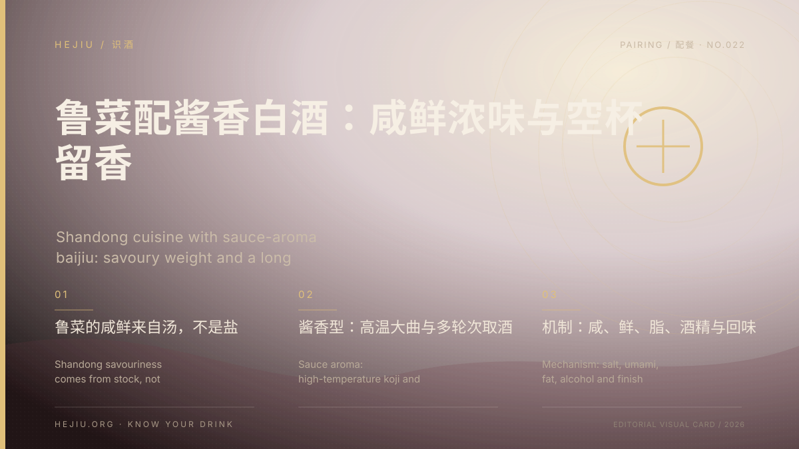

# Shandong cuisine with sauce-aroma baijiu: savoury weight and a long finish

Shandong cooking first reads as "salty", but its real skeleton is stock. Clear stock is drawn from chicken, duck and pork knuckle; milky stock is boiled hard until fat and protein form an emulsion; braises, scallion dishes and steamed dishes all gain flavour from stock. Salt is the final stroke. This structure of savouriness carrying salt can talk to [sauce-aroma baijiu](ref:baijiu), whose high-temperature koji and multiple distillation rounds create a complex aroma, provided the dish is not pushed into excess salt.

Figure: thematic illustration for Shandong cuisine with sauce-aroma baijiu: savoury weight and a long finish. Image: AI-assisted illustration generated with Doubao Seedream 5.0 (project-owned); not a photograph of the subject.

## Shandong savouriness comes from stock, not salt

Shandong is a northern cuisine that values heat control and stock technique. Clear stock is repeatedly skimmed and clarified until it is clean and savoury; milky stock is boiled hard to emulsify fat and protein for a thick texture. The scallion oil of braised sea cucumber, the sweet-sour sauce of nine-turn intestine and the glaze of sweet-and-sour carp all follow the same pattern: umami at the base, salt at the finish.

This means pairing cannot look only at saltiness but at the weight of umami and fat. Dishes with clear, light stock, such as clear bird's-nest soup or milky soup with cattail shoots, need a clean aroma and restrained alcohol; thick, fatty sauces such as braised sea cucumber or pork belly can carry the roast aroma and weight of sauce-aroma baijiu.

## Sauce aroma: high-temperature koji and multiple rounds

The process is marked by high-temperature koji, high-temperature stacking, multiple fermentation rounds and repeated distillation. The traditional approach represented by [Maotai in Guizhou](ref:guizhou) is often summarised as eight fermentation rounds and seven distillation draws; each round has its own character, and the final style is built by blending. Take [Maotai](ref:moutai) as an example: common products are around 53% vol.

High-temperature koji and stacking generate many Maillard products, bringing roast, nut, toast and sauce notes; multiple rounds give both an explosive top note and a mellow depth. These aroma molecules overlap heavily with scallion oil, caramel, soy sauce and stock in Shandong food, so the two can resonate, but can also bury each other when both are too concentrated.

## Mechanism: salt, umami, fat, alcohol and finish

The first mechanism is salt. Salt suppresses bitterness and amplifies sweetness and fruit, and also amplifies alcohol heat. If a Shandong dish is too salty, the alcohol of sauce-aroma baijiu turns sharp; at a moderate level of salt, the wine's finish feels sweeter.

The second is umami. Glutamate and nucleotides from stock, sea cucumber, scallop and soy sauce increase the drink's sense of body and also its bitterness and roast-bitterness. The stronger the umami, the more acidity or freshness is needed for balance, but sauce-aroma baijiu is not high in acidity, so the dish should not chase "concentration" for its own sake.

The third is fat. Scallion oil, lard and pork-belly fat wrap alcohol and tannin, reducing irritation and softening the aroma; too much fat dulls the mouth and hides the drink's layers. The fourth is [finish](ref:finish): the empty-cup aroma and long finish of sauce-aroma baijiu suit dishes with their own aftertaste, such as the scallion echo of braised sea cucumber or the sweet-sour tail of nine-turn intestine.

## Braised sea cucumber: the limit of matching weight with weight

Braised sea cucumber is a Shandong signature: the sea cucumber itself is mild and gains flavour from scallion oil, stock and soy sauce, with a thick, fatty sauce. It suits sauce-aroma baijiu because the collagen and scallion oil can carry the roast aroma; but the sea cucumber's umami is delicate, and a coarse or strongly alcoholic drink will wipe out its soft, slippery texture.

The safer approach is a complete but gentle sauce-aroma baijiu, sipped from a small cup, letting the liquid rest in the mouth before the next bite. Do not use high strength to "blast" the sea cucumber, and do not add a salty dip; the balance point is scallion and stock, not salt.

## Nine-turn intestine and sweet-and-sour carp: the sweet-sour problem

Nine-turn intestine is boiled, fried, then braised with sugar, vinegar, soy sauce, cardamom and cinnamon; it is sweet, sour, salty and aromatic at once, and the intestine is fatty. Sweet-sour flavours amplify alcohol heat and make bitterness more obvious; the roast notes of sauce-aroma baijiu can echo the cinnamon and cardamom, but a very sweet version makes the drink taste dry.

Sweet-and-sour carp has a sweeter, sharper glaze, and the fish's freshness is covered by sugar and vinegar. Such dishes do not suit high-alcohol, heavily roasted baijiu; a cleaner, higher-acid drink is better. If sauce-aroma baijiu is required, choose a softer, less sweet example and control the amount of sauce.

## Pork belly, quick-fried kidney and barbecue

Pork belly is a Jinan street dish: belly pork slowly braised with soy sauce and spices, rich but not greasy, served with rice. The fat and salt suit sauce-aroma baijiu, but collagen and soy make alcohol more obvious, so small cups and slow drinking are essential. Quick-fried kidney is cooked over fierce heat with strong wok aroma; its gamey note and savoury sauce need enough aroma to cover them, and the roast notes of baijiu can do that, though a coarse spirit should be avoided.

Barbecue with sauce-aroma baijiu is common in northern China. Charcoal, cumin, chilli and fat need aroma and alcohol to press down smoke and gaminess; but chilli amplifies alcohol heat, and the hotter the skewers, the lower the entry strength of the drink should be.

## Kong family cuisine, Jinan and Jiaodong

Kong family cuisine is formal and ceremonial, with refined dishes and many soups, suiting a complete but gentle baijiu. Jinan cooking leans on stock and sauce, with scallion braises, steamed dishes and nine-turn intestine as representatives. Jiaodong cooking is seafood-led: steamed fish, sea intestine and scallops are delicate, and their freshness clashes with the roast notes of sauce-aroma baijiu, so a cleaner drink is usually better.

Regional difference is a reminder that Shandong food is not one flavour but three lines: stock, sauce and seafood. Decide which line a dish belongs to before choosing the weight of the drink, rather than applying "Shandong food with sauce aroma" as a blanket rule.

## Small cups, temperature and pace

Sauce-aroma baijiu is usually served in small cups, a little at a time, sipped slowly. Room temperature is best; too cold suppresses roast notes, too warm pushes alcohol forward. When [pairing](ref:food-pairing), take a bite of food, then a sip, letting savouriness and roast aroma alternate in the mouth rather than drinking in rapid toasts.

With strong spirits, pace matters more than the bottle. Shandong dishes are generous and fatty and encourage fast drinking; small cups, frequent bites and water between sips are the three most practical rules.

## Pairings that fail

First, steamed seafood with heavily roasted sauce-aroma baijiu. Roast bitterness covers the seafood's sweetness and alcohol amplifies fishiness.
Second, sweet-and-sour carp with strong spirit. Sweet-sour and alcohol stack, and heat overcomes the fish.
Third, an over-salted sauce with strong spirit. Salt amplifies irritation and the mouth dehydrates quickly.
Fourth, clear bird's-nest soup with a coarse spirit. Off-flavours destroy the cleanliness of the stock.
Fifth, very spicy food with sauce-aroma baijiu. Capsaicin and alcohol stimulate together and the roast aroma disappears.
Sixth, dessert with sauce-aroma baijiu. Sweetness makes the drink bitter and the roast aroma makes the dessert cloying.

## Non-alcoholic alternatives

Without alcohol, mushroom stock can replace the umami and weight of sauce-aroma baijiu, roasted tea or barley tea can replace roast notes and a sweet finish, and sparkling water with a little soy sauce and lemon can replace savouriness and acidity. The aim is not to imitate alcohol strength but to keep the structure of umami at the base and salt at the finish.

**Short definition:** The savoury saltiness, scallion aroma and thick sauces of Shandong cooking meet the roast, floral and long finish of sauce-aroma baijiu; the match is made by equal palate weight, not by making the dish saltier. 
