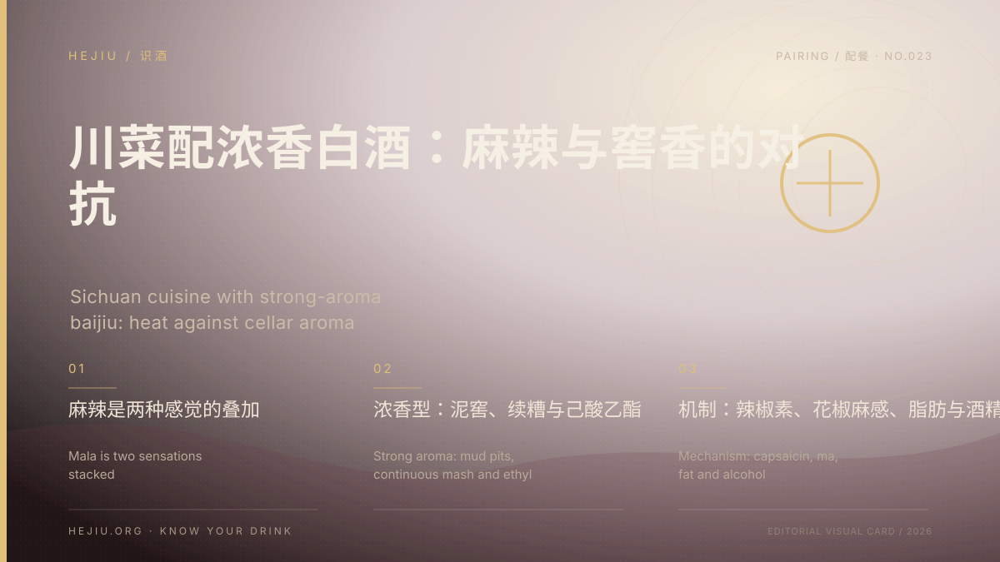

# Sichuan cuisine with strong-aroma baijiu: heat against cellar aroma

[Sichuan](ref:sichuan) "mala" is often treated as one word, but it is two sensations. Capsaicin produces burning and pain, while hydroxy-alpha-sanshool from Sichuan pepper creates a tingling vibration of roughly fifty cycles per second, called ma in Chinese. Stack the two, add fat, salt and fermented savour, and you have the intensity of Sichuan food. The cellar and grain aroma of strong-aroma baijiu can either catch that intensity or be completely buried by it.

Figure: thematic illustration for Sichuan cuisine with strong-aroma baijiu: heat against cellar aroma. Image: AI-assisted illustration generated with Doubao Seedream 5.0 (project-owned); not a photograph of the subject.

## Mala is two sensations stacked

Capsaicin binds to TRPV1 receptors on the oral mucosa, producing heat and pain; it does not dissolve in water but does in fat and alcohol. The tingling of Sichuan pepper comes from hydroxy-alpha-sanshool, which acts on touch nerves and creates a vibration-like sensation. Heat is pain, ma is touch, and when both appear the mouth's attention is fully occupied.

This explains why pairing Sichuan food cannot look only at how hot it is. Two dishes of equal heat but different ma produce entirely different results, and the amount of fat and salt changes the irritation of alcohol. Judge a dish by four dimensions, fat, salt, ma and heat, before looking at its name.

## Strong aroma: mud pits, continuous mash and ethyl hexanoate

[Strong-aroma baijiu](ref:strong-aroma) is characterised by solid-state fermentation in mud pits, continuous mash replenishment and mixed steaming and boiling; fermentation time and pit age directly shape flavour. Its main aroma component is ethyl hexanoate, giving a composite note of pineapple, apple and cellar mud, alongside ethyl lactate and ethyl butyrate, together producing the style described as rich cellar aroma with soft sweetness. Common products are around 52% vol.

The microbial community in the mud pit is the category's core asset. After long cultivation, old pit mud forms a stable community of caproic-acid bacteria and methanogens that yields more complex aroma. This is the technical basis of the saying that old pits make good liquor, not merely a vintage marketing story.

## Mechanism: capsaicin, ma, fat and alcohol

The first mechanism is capsaicin plus alcohol. Alcohol itself stimulates TRPV1, and the stronger the drink the stronger the burn; capsaicin dissolves in alcohol and spreads the heat across a wider area of the mouth. Strong baijiu with very hot food often does not extinguish the fire but stacks pain until the mouth goes numb.

The second is fat. Fat dissolves capsaicin and reduces contact with receptors; pork belly, beef, red oil and sesame oil all lower the heat. But fat also coats alcohol, making it softer on entry and encouraging people to underestimate how much they are drinking.

The third is the tingling of Sichuan pepper. Ma changes perception of texture and temperature and makes sweetness more obvious, but when it is very strong the aroma detail of the drink disappears. The fourth is salt and fermentation. Salt amplifies alcohol heat, while fermented [acidity](ref:acidity) and umami echo the cellar aroma of strong-aroma baijiu and can also make it taste more bitter.

## Hotpot: the trap of drinking more as it gets hotter

Hotpot is the most typical setting for Sichuan food and baijiu, and the easiest to get wrong. The red-oil broth is hot, thick with fat and high in capsaicin, so alcohol and capsaicin stimulate together and the burn accumulates quickly. Many people use ice-cold beer or strong baijiu to "cut the heat", but cold only cools briefly and alcohol makes the burn worse.

A safer method: first take a mouthful of the dipping oil with garlic and sesame oil so fat forms a protective film; then sip a little baijiu and let it rest in the mouth rather than swallowing straight away; between sips, drink water or clear broth to lower the mouth's temperature and capsaicin concentration. With hotpot, a soft, sweet-fruited strong-aroma baijiu works better than a fiery, explosive one.

## Garlic pork, twice-cooked pork and mapo tofu

Garlic pork is a cold dish: thin slices of pork belly with even fat, dressed with garlic, soy sauce, red oil and ground Sichuan pepper, giving salt, savour, ma and heat. The fat carries alcohol and the garlic pungency and soy savour amplify cellar aroma; but if the red oil is too hot, alcohol heat covers the meat's sweetness. A soft, sweet-fruited strong-aroma baijiu in small sips is the better choice.

Twice-cooked pork combines broad-bean paste, sweet bean paste and garlic sprouts for salt, sweet, savour and heat. The fermented savour of the paste echoes cellar aroma, and the sweet bean paste amplifies the drink's sweetness; but the drier the pork is fried, the less fat remains and the more obvious the alcohol, so the strength of the drink should come down.

Mapo tofu brings ma, heat, scalding temperature, savour, crispness and softness at once, which makes it the hardest dish in the cuisine to pair. The soft texture is easily damaged by alcohol heat, the ma amplifies irritation, and the savour of broad-bean paste and minced beef competes with cellar aroma. Choose a low-intensity, soft-entry baijiu in small quantity, not a high-strength aromatic one.

## Light dishes and soup: boiling-water cabbage

Sichuan food is not only mala. Boiling-water cabbage is the representative clear soup dish: the broth is as clear as water but intensely savoury, built from chicken, duck, ham and scallop. Such a dish needs a clean aroma and low alcohol; cellar aroma and alcohol overwhelm the delicacy of the soup. If pairing is unavoidable, choose a restrained, soft drink and take only a small sip.

The same applies to simply sautéed vegetables, steamed egg and quick-fried liver. The light line of Sichuan cooking reminds us that we [pair](ref:food-pairing) with a specific dish, not with the label "Sichuan cuisine". Applying hotpot logic to clear soup almost always fails.

## Chengdu, Chongqing, Zigong and Leshan

Chengdu cooking is gentler, with sweetness inside the heat and an emphasis on composite flavour; Chongqing is more direct, with beef-fat hotpot and robust dishes; Zigong salt-gang cooking is known for well salt, fresh heat and fierce stir-frying, with a sharper edge; Leshan leans towards sweet heat and snacks. Salt, heat, ma and fat ratios differ by region, and the drink should adjust.

Chongqing beef-fat hotpot has the thickest fat and suits a soft, sweet-fruited baijiu; Zigong cooking is saltier and hotter and suits a clean, low-alcohol drink; Chengdu's cold dishes and snacks are moderate and leave more room. Regional difference is not academic detail but the variable most often missed in real pairing.

## Rhythm, palate cleansing and temperature

Strong-aroma baijiu is usually served at room temperature in small cups. Too cold suppresses cellar aroma, too warm pushes alcohol forward. With Sichuan food, rhythm matters more than the bottle: after a few bites, take a sip of water or clear broth; do not toast continuously; do not use spirit to "blast" the heat.

Palate cleansers include chilled sour plum drink, unsweetened soy milk, rice broth, cucumber sticks and white radish sticks. Their common function is to remove capsaicin and fat from the mouth rather than mask them with sweetness. Sweet drinks relieve heat briefly but make the baijiu taste more bitter.

## Pairings that fail

First, very hot hotpot with a fiery high-strength baijiu. Capsaicin and alcohol stack and the burn quickly runs out of control.
Second, mapo tofu with a high-alcohol spirit. The ma amplifies irritation and the tofu's delicacy vanishes.
Third, boiling-water cabbage with strong-aroma baijiu. Cellar aroma and alcohol cover the soup's savour.
Fourth, garlic pork with a coarse spirit. Garlic pungency and off-flavours stack into bitterness.
Fifth, sweet-hot dishes with a dry, high-acid wine. Sweetness makes the wine thin and acid, and heat makes it burn.
Sixth, ice-cold spirit with scalding hotpot. The temperature gap numbs the mouth and no detail can be tasted.

## Non-alcoholic alternatives

Without alcohol, chilled sour plum drink, unsweetened soy milk, rice broth and sparkling water all cleanse and cool; sour plum's acid and sweetness ease heat, soy milk's protein and fat wrap capsaicin, and rice broth's starch protects the oral lining. The principle is cooling, coating and dilution, not fighting stimulation with more stimulation.

Further reading: [Body](ref:c-extra-1).
