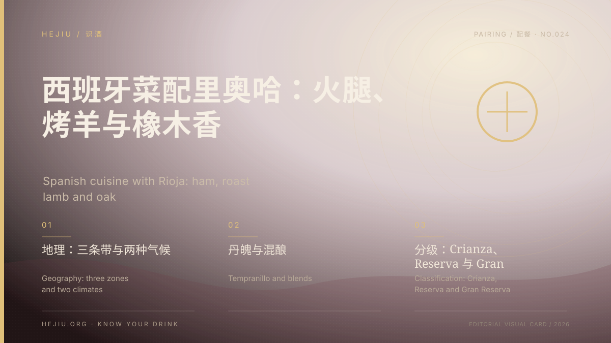

# Spanish cuisine with Rioja: ham, roast lamb and oak

A Rioja label carries a line of time information beyond the producer and vintage: Crianza, Reserva or Gran Reserva. This is not a marketing grade but a legal minimum for total ageing and for time in oak. Understanding that timetable is more useful than remembering "Spanish red with ham", because Riojas of different ageing levels suit entirely different dishes.

Figure: thematic illustration for Spanish cuisine with Rioja: ham, roast lamb and oak. Image: AI-assisted illustration generated with Doubao Seedream 5.0 (project-owned); not a photograph of the subject.

## Geography: three zones and two climates

Rioja lies in northern [Spain](ref:spain), crossed by the Ebro, and is broadly divided into Rioja Alta, Rioja Alavesa and Rioja Oriental. Rioja Alta is higher and more Atlantic-influenced, giving fresher wine and higher acidity; Alavesa's limestone soils and small plots often give finer tannin; Oriental is warmer and drier, with riper fruit and a fuller body.

The implication is that one Rioja is not another: Alta reds suit ham, mushrooms and poultry, while Oriental reds suit roast lamb, stews and heavier sauces. Reading the sub-zone and vintage is more effective than reading only the word Rioja.

## Tempranillo and blends

[Tempranillo](ref:tempranillo) dominates Rioja, bringing red cherry, plum, tobacco and leather, with medium acidity and medium tannin that suit [oak ageing](ref:oak-ageing). Traditional Rioja blends in Garnacha for body and fruit, Graciano for aroma and acidity, and Mazuelo for tannin and colour.

White Rioja is mainly Viura, ranging from citrus and white flower to hazelnut, butter and honey after oak and long ageing. White Rioja is often overlooked: it works with seafood, ham and cheese, and is one of the most practical wines in Spanish cooking.

## Classification: Crianza, Reserva and Gran Reserva

The ageing rules for [red Rioja](ref:red-wine) set clear minimums. Crianza requires at least 24 months in total, with at least 6 months in oak; Reserva requires at least 36 months, with at least 12 months in oak; Gran Reserva requires at least 60 months, with at least 24 months in oak. Whites and rosés have different, usually shorter, requirements.

These numbers shape the style. Crianza is fresher in fruit with firmer tannin and suits everyday mid-weight dishes; Reserva is rounder with more complex aroma and suits roast poultry and stews; Gran Reserva has spent long enough for fruit to turn to dried fruit, leather and tobacco, with soft tannin, and suits deeper dishes and aged cheese.

## Mechanism: salt, fat, tannin, oak and acid

The first mechanism is salt. Spanish ham, cured olives, anchovy and Manchego are high in salt, which amplifies fruit and sweetness but also alcohol heat. Salty dishes need higher acidity and lower alcohol, not heavier tannin.

The second is fat. Ham fat, roast lamb fat and cheese fat wrap tannin and make the wine rounder, while tannin binds protein and clears the palate. Gran Reserva's softer tannin suits finely marbled ham and cheese; young Crianza's firmer tannin suits fattier roast meat.

The third is oak. American oak brings vanilla, coconut and sweet spice, French oak brings cedar, graphite and fine tannin. Rioja traditionally uses American oak, so the wines often show obvious vanilla and sweet spice; these notes echo the char of roast lamb and the nuttiness of ham, but also cover delicate seafood.

The fourth is acidity. Spanish cooking uses vinegar, tomato, olives and lemon, so acidity is often high; Rioja's medium acidity can seem flat beside a sharply acidic dish such as vinegar-marinated seafood. In that case choose Rioja Alta or white Rioja rather than an old Gran Reserva.

## Ham, cheese and olives

Iberian ham is one of the classic Rioja matches. Its nuttiness, salt and fat answer Tempranillo's red fruit, tobacco and oak vanilla, and the soft tannin of a Reserva or Gran Reserva does not overwhelm its delicacy. The thinner the slices and the more even the fat, the better an older wine works.

Manchego's salt and sheep's-milk flavour suit Crianza or Reserva; aged Manchego's crystalline texture and nuttiness suit Gran Reserva. Cured olives and anchovy are salty snacks that need higher acidity and a lighter body, not a heavily oaked Gran Reserva.

## Roast lamb, meat and mushrooms

Roast lamb is the traditional Rioja partner: fat, charcoal char, rosemary and garlic need both tannin and acidity. The ripe fruit of Rioja Oriental and the oak of a Reserva can carry it; but if the lamb is overcooked and dry, tannin turns astringent, and cooking matters more than the wine.

Suckling pig, oxtail stew and Spanish morcilla also suit Rioja red. Morcilla's irony note and spice need ripe fruit; oxtail's collagen and sauce need acidity and tannin. Mushrooms such as grilled oyster mushrooms and chanterelles, with their earthy notes, match Tempranillo's tobacco and leather and suit a Rioja Alta Reserva.

## Paella and white Rioja

Paella combines saffron, tomato, seafood and the crisp rice crust. Spaniards traditionally serve white wine or cava rather than heavily oaked red; white Rioja's citrus, nuts and acidity carry the seafood and do not cover the saffron.

If red is required with paella, choose a fresh-fruited, soft-tannin Crianza rather than a Gran Reserva; red tannin clashes with the metallic note of seafood, especially shellfish and squid. The crust and char can take a little oak, but avoid heavily oaked wines.

## Pairings that fail

First, heavily oaked Gran Reserva with oysters. Oak vanilla and tannin clash with the oyster's metallic note.
Second, sharply acidic vinegar-marinated seafood with old Rioja. The wine lacks acidity and tastes flat.
Third, blue cheese with Gran Reserva. Salt and spice cover the wine's dried fruit and tobacco.
Fourth, very spicy food with high-alcohol Rioja. Capsaicin amplifies the heat of alcohol and tannin.
Fifth, dessert with dry Rioja. The wine's acid and tannin make the dessert cloying.
Sixth, delicate white fish with high-tannin red. Tannin amplifies fishiness and metallic notes.

## Temperature, decanting and glassware

Rioja red is usually served just below room temperature; Gran Reserva's softer tannin can take a slightly higher temperature, but not above room. Young Crianza can take a short decant, while Gran Reserva usually needs little, to avoid losing perfume.

Choose a medium-sized tulip glass that concentrates aroma without pushing oak forward. Serve white Rioja in a smaller glass to hold temperature and acidity.

## Non-alcoholic alternatives

Without alcohol, cold-brewed black tea can replace the drying feel of tannin, tomato juice with sparkling water can replace acidity and freshness, and roasted nuts and mushroom stock can replace oak and earth. The point is to keep the salt of ham and the fat of roast lamb, not to hide them under a sweet drink.

Further reading: [Look at the plate before the glass](ref:c-extra-1).

For Spanish cuisine with Rioja, begin with what it is. Then look at where it comes from, and finally ask how it is used. The answers point to different choices, not to a single score.

The comparison with [Spain](ref:spain) and [Oak ageing](ref:oak-ageing) runs through food and drink. Each answers a different question.
