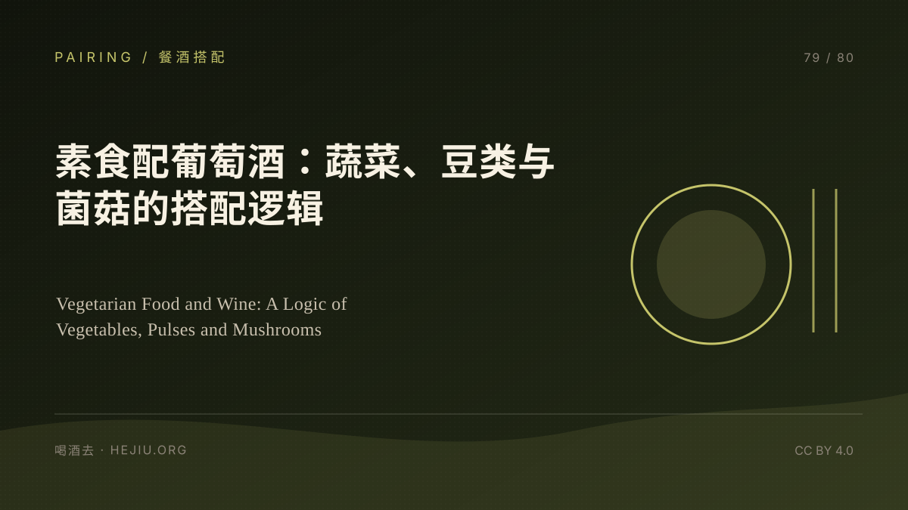

# Vegetarian Food and Wine: A Logic of Vegetables, Pulses and Mushrooms

Vegetarian food is not one uniform flavour. Steamed vegetables, roasted roots, tomato and bean stews, mushrooms, tofu, tempeh and spicy curries differ widely in intensity, acidity, bitterness and umami. When pairing, first ask what kind of ingredient is on the plate, then look at the wine's acidity, tannin and body; that is more reliable than the blanket statement that vegetables go with white wine.

Figure: thematic illustration for Vegetarian Food and Wine: A Logic of Vegetables, Pulses and Mushrooms. Image: AI-assisted illustration generated with Doubao Seedream 5.0 (project-owned); not a photograph of the subject.

## Pairing principles: intensity, acidity, bitterness and umami

The first principle is flavour intensity. Steamed leafy greens, silken tofu and cucumber are mild and suit a light white with a clean aroma; roasted roots, mushrooms, tomato and bean stews and curries are stronger and can take a medium-bodied white or a light red. When intensity is mismatched, the wine overwhelms the food or the food buries the wine.

The second is acidity. Vegetables, pulses and grains often bring starch and fibre, and acidity lifts the palate and cuts fat. Tomatoes are themselves acidic, so a high-acid red balances them more easily; lemon, vinegar and capers add more acidity, so the wine should be more restrained.

The third is sweetness. Sweetness softens heat and bitterness, but vegetarian food is rarely sweet, and a sweet wine can feel abrupt. Spicy vegetarian dishes can take a semi-dry white or a sparkling wine with a little residual sugar, using a small amount of sweetness to balance the heat.

The fourth is fat. Cheese, cream, avocado, nuts and fried tofu add fat and need acidity or bubbles to clean the palate; steamed and boiled vegetables do not need a powerful wine.

The fifth is bitterness and umami. Kale, rocket and endive amplify the astringency of tannin; mushrooms, tomatoes, soy sauce and miso amplify the wine's acidity and saltiness. Bitter greens suit high-acid white wine, while umami-rich dishes should avoid high-tannin red.

## Specific matches and why

| Vegetarian type | Common examples | Wine direction | Why |
| --- | --- | --- | --- |
| Mushrooms | Shiitake, oyster mushrooms, porcini | Light red or medium-bodied white | Earthiness and umami echo light tannin and nutty notes |
| Roasted roots | Carrot, beetroot, pumpkin | Medium-bodied white or light red | Caramelisation and sweetness need a little structure |
| Tomato dishes | Tomato and bean stew, tomato sauce | High-acid red or dry white | Tomato acidity and wine acidity balance each other |
| Pulses | Lentils, chickpeas, white beans | Medium-bodied white or light red | Starch and fibre need acidity to lift them |
| Tofu, tempeh | Pan-fried tofu, tempeh | Light red or dry white | Plant protein is more compatible with low tannin |
| Bitter greens | Kale, rocket, endive | High-acid dry white | Acidity counters bitterness and avoids tannin astringency |
| Spicy vegetarian | Curry, spicy pulses | Semi-dry white or sparkling | A little sweetness and bubbles soften the heat |
| Eggs and cheese | Steamed egg, cheese-baked dishes | White or light red | Fat and protein need acidity |

Mushrooms with light red wine are one of the most reliable vegetarian matches: the earthy, umami notes of mushrooms meet the light tannin and red fruit of a Pinot Noir style. Tomato dishes with high-acid Italian reds are also common, and the reason is the balance of acidity and umami, not the idea that Italian food must have Italian wine.

The key with tofu and tempeh is to avoid high-tannin, high-alcohol wine. Plant protein clashes less with tannin than red meat does, but high tannin still makes tofu feel dry. Bitter greens are the opposite: tannin amplifies bitterness, and a high-acid dry white is safer.

## Serving order and temperature

A vegetarian meal usually moves from light to rich: steamed vegetables, tofu, mushrooms, roots, tomato and bean stew, curry. The wine can move from light to full as well: dry white, light red, medium-bodied white, a red with more structure. Do not start with a heavy red, or the lighter dishes that follow will taste of nothing.

Temperature: white wine about 8–12°C, light red about 14–16°C, sparkling about 6–8°C. Do not overheat red wine, or the alcohol overwhelms the vegetables' delicacy; do not chill white wine until it is numb, or acidity and aroma are both closed.

## Portions and glassware

Keep vegetarian portions moderate and pour about 60–100 millilitres of wine. Vegetarian meals can easily lead to eating a lot and drinking little, or the reverse; small glasses poured in stages keep the pace. If the meal is mostly vegetables, treat the wine as part of the seasoning rather than the centrepiece.

Choose the glass by wine type: a white wine glass, a light red glass or a sparkling glass. A slightly wide bowl with a narrowed rim gathers aroma; do not use one glass for several wine types, because residual fat and vegetable juice affect the aroma.

## Combinations to avoid

First, high-tannin red with bitter greens: tannin and bitterness add up and the palate feels dry and astringent. Second, high-alcohol red with steamed vegetables or silken tofu: alcohol buries the delicate plant aroma. Third, heavily oaked white with light vegetables: vanilla and smoke cover the vegetables' own sweetness.

Fourth, sweet wine with salty fermented soy dishes: sweet and salt pile up and become cloying. Fifth, very high-acid white with a heavily vinegar-dressed salad: the acidities add up and taste sharp. Sixth, spicy vegetarian food with high-alcohol red: heat and burning are amplified together.

## Common misconceptions

First, that vegetarian food only goes with white wine. Mushrooms, roasted roots and tomato and bean stews can all go with light red. Second, that lighter food needs a lighter wine in every sense. Light dishes need clean aromas, not a wine with no flavour.

Third, that red wine belongs only to meat. Red wine's tannin can work with plant protein, mushrooms and tomatoes, as long as bitter greens and high tannin are kept apart. Fourth, ignoring the cooking method. Steaming, roasting, frying and stewing change fat and caramelisation, so look at the method, not only the ingredient.

Fifth, treating "organic" or "vegetarian-friendly" as a pairing standard. How a wine is produced and how it pairs are two different things; look first at acidity, tannin and body.

## See also

- [White wine](ref:white): the acidity and fresh profile of white wine.
- [Red wine](ref:red): the structure and tannin of red wine.
- [Sparkling wine](ref:sparkling): how bubbles clean fat and heat.
- [Acidity](ref:acidity): the role of acidity in vegetarian pairing.
- [Tannin](ref:tannin): the clash between tannin and bitter greens.
- [Body](ref:body): matching body to vegetable cooking methods.
- [Italy](ref:italy): the background of high-acid reds with tomato dishes.
- [Look at the plate first, then the glass](ref:food-pairing): general pairing principles.

**In brief:** Vegetarian food is not one flavour but a group of very different ingredients; choose wine by intensity, acidity, bitterness, umami and fat, which is more reliable than the idea that vegetables only go with white wine.

For Vegetarian Food and Wine, begin with what it is. Then look at where it comes from, and finally ask how it is used. The answers point to different choices, not to a single score.
