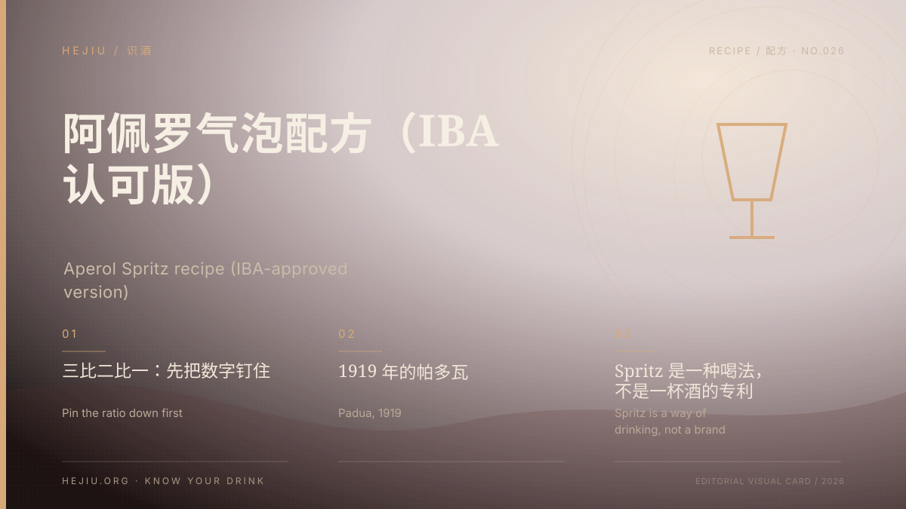

# Aperol Spritz recipe (IBA-approved version)

This is a sourced version of the [Aperol Spritz](ref:cocktail): 90 ml of Prosecco, 60 ml of Aperol and 30 ml of soda water, built over ice in a large stemmed glass and finished with a slice of orange. The ratio is three parts to two to one, which is why the drink is usually just called 3-2-1. What follows sets out the numbers, the order of assembly and the job each step does, so that a drink which turns out too sweet, too thin or too flat can be diagnosed instead of guessed at.

Figure: thematic illustration for Aperol Spritz recipe (IBA-approved version). Image: AI-assisted illustration generated with Doubao Seedream 5.0 (project-owned); not a photograph of the subject.

> **Quick verdict**
> **In one line:** This recipe helps you make Aperol Spritz recipe (IBA-approved version), and shows where the method usually fails.
>
> - **Best for:** Anyone who wants to make Aperol Spritz recipe (IBA-approved version) step by step and knows where it usually goes wrong.
> - **Not for:** If you want will not measure ingredients or follow the order of steps.
> - **Check first:**
>   - In north-eastern Italy, especially the Veneto, the spritz is a habit rather than a single recipe: wine or a bitter liqueur lengthened with sparkling water into a low-strength glass.
>   - 90 ml Prosecco, 60 ml Aperol, 30 ml soda water: 180 ml in total, before any ice melts.

## Pin the ratio down first

90 ml Prosecco, 60 ml Aperol, 30 ml soda water: 180 ml in total, before any ice melts. The brand's own recipe page labels this build as approved by the IBA and writes it as three parts, two parts and one part. The IBA entry page could not be opened directly during this check, so the quantities here follow the public IBA list together with that approved version.

There is an inconsistency inside the official material, and it is worth naming. The brand's Italian FAQ says a standard Aperol Spritz should contain 50 ml of Aperol under the IBA standard, while the recipe page in the same brand's other language versions says 60 ml and expresses the build as three to two to one. Both statements come from the producer. This recipe uses 60 ml because it matches the parts language and because it is what most bars actually pour. The 50 ml figure is not an error, only a different set of numbers.

The ratio is not law. Some bars pour 100 ml Prosecco against 70 ml Aperol; others lift the soda to 60 ml. The first is richer and sweeter, the second lighter and longer. What they share is the structure: sparkling wine takes the largest share, the bitter takes the second, and soda takes a small remainder. Break that order of magnitude and the glass stops being a spritz.

## Padua, 1919

Aperol was created in Padua in 1919 by Luigi and Silvio Barbieri. The brothers took over the liqueur company their father had opened in 1880, began experimenting around 1912 and launched the drink seven years later. Brand material describes it as an infusion of more than thirty herbs and spices, including bitter and sweet orange, at only about 11% alcohol at a time when spirits were generally far stronger.

Those two facts explain why the recipe looks the way it does. First, the orange note runs on two tracks, bitter peel and sweet peel, which is exactly why an orange slice is a sensible garnish. Second, at 11% the liqueur can be diluted with a large volume of sparkling wine without collapsing, which is what makes 3-2-1 work at all. Substitute a stronger, more bitter spirit and the same ratio produces a completely different drink.

It is worth separating brand narrative from historical research. The year, the family and the continuity of production are checkable corporate history. A claim that the recipe has never changed is the company asserting its own lineage, which outside researchers cannot verify. Treat the first as fact and the second as brand story.

## Spritz is a way of drinking, not a brand

In north-eastern Italy, especially the Veneto, the spritz is a habit rather than a single recipe: wine or a bitter liqueur lengthened with sparkling water into a low-strength glass that can be nursed before dinner. The function of the [aperitif](ref:aperitif) is concrete here. Bitterness stimulates saliva and appetite, bubbles and cold make the drink refreshing, and the low strength leaves room for the meal ahead.

The most repeated origin story involves nineteenth-century Austro-Hungarian soldiers stationed in northern Italy who found the local wine too strong and diluted it with water or soda. It is quoted everywhere and documented almost nowhere, so this recipe treats it as legend. What can be said is that the spritz is a regional habit rather than a single invention: the Select version in Venice, the Aperol version in Padua and the white-wine versions elsewhere all belong to the same family of practice.

That distinction matters when ordering. Ask for a spritz and you may not get Aperol at all. Ask for an Aperol Spritz and you will. In the other direction, an Aperol Spritz is not the only legitimate spritz, merely the most famous branch.

## Ice first, then Prosecco

The official sequence is ice, then Prosecco, then Aperol, then soda. It is not decorative; it manages temperature, carbonation and mixing at the same time.

Ice goes in first so the walls of the glass drop in temperature immediately. Carbon dioxide stays dissolved more readily in a cold liquid, so the colder the glass, the longer the bubbles last. A warm glass warms the wine on contact and half the gas is gone before the first sip. The ice also occupies volume, so the wine that follows runs down over the ice rather than hitting the bottom of the glass.

Prosecco before Aperol is about density. Aperol carries sugar and is denser than the wine, so poured second it sinks and does part of the mixing under its own weight. Reverse the order and the syrup sits at the bottom: without stirring, the first mouthful is thin and the last is sweet. Soda comes last because it is the most fragile element and needs only the gentlest top-up.

Pour down the side of the glass, or over the ice, so the drop is short and the agitation small. This is also why the drink is built rather than shaken: a shaker would knock the carbonation out of it completely. For more on serving temperature and bubble retention in sparkling wine, see [Sparkling wine](ref:sparkling).

## Soda water is not decoration

At 30 ml, the soda is one sixth of the drink and looks optional. In practice it sets the length. Prosecco supplies bubbles and acidity, Aperol supplies sweetness, bitterness and orange, and the soda supplies dilution: it stretches a concentrated 150 ml build to 180 ml, keeps the sugar from coating the tongue and gives the bitterness somewhere to retreat to.

Its second job is carbonation, and only its second. Most of the gas comes from the Prosecco; the soda's bubbles are finer and shorter-lived, and their role is to lift the aroma rather than to make the drink fizzy. That is why the soda must be cold and fresh. Warm soda, or a bottle opened days ago, adds nothing but flat sweet water.

Do not substitute casually. Still mineral water removes the lift; tonic adds quinine bitterness on top of Aperol's own; lemonade adds sugar and pushes the drink over. If you want it lighter, the correct move is more soda and more ice, not more water.

## Aperol against Campari: bitter and sweet

Both are Italian bitter aperitifs, but they behave differently. Aperol is about 11% alcohol, sweeter, softer in bitterness, bright with orange and lighter in colour. Campari is usually above 20%, drier, with a longer and harder bitterness and a deeper red. Treating them as a one-for-one swap is the most common misjudgement in this drink.

The difference is magnified in the glass. Replace the Aperol with 60 ml of Campari and the bitterness runs over the bubbles, the sweetness drops and the drink turns hard. The usual correction is to cut the bitter to 40 or 45 ml or to increase the soda. Going the other way, pouring Aperol quantities of Campari into a Campari Spritz gives a drink that is bitter to the point of tightness.

Sugar is the underrated variable. Sugar masks bitterness and adds viscosity, which is why Aperol reads as round and Campari reads as sharp. Once that is clear, adjusting the drink becomes a matter of choosing which side to move: for more bitterness, you can add bitter or remove sugar; for more sweetness, adding syrup damages the bubble structure, so a sweeter sparkling wine is the more natural lever.

## The glass: why a goblet is an approximation

The official wording is a large wine glass or a stemmed balloon glass. The library has no entry for a balloon wine glass; the closest is the [goblet](ref:vessel), usually 300 to 450 ml depending on the product, so that is the glass reference used here. It is an approximation, and a reasonable one.

A wide bowl does three things. It leaves room for ice and liquid: 180 ml of drink plus ice occupies roughly 220 to 240 ml, which a narrow glass cannot hold without overflowing or skimping on ice. It gives the orange and the wine an open surface to release aroma, so the first impression is not pure carbon dioxide. And it shows the colour, which is part of how the drink is recognised.

The stem keeps the hand away from the bowl. Cupping a stemless glass warms the liquid noticeably within ten minutes and the bubbles go with it. A rocks glass works in a pinch, but hold it near the rim. A Champagne flute is the cautionary example: elegant, but too narrow for ice and too closed for aroma. For more on choosing glassware, see [Choosing a glass](ref:glass).

## The orange slice: express, do not crush

The orange slice is the only garnish the official recipe specifies. It works on two levels: it confirms visually that this is the Aperol version, and it puts fresh peel oil on the surface of the drink. Aperol itself is built on bitter and sweet orange, so fresh peel reconnects that thread and makes the first sip feel complete.

Express first, then place. Turn the skin towards the liquid, give it one short, sharp squeeze so the oil lands on the surface, then set the slice on the rim or float it on the ice. Do not crush the flesh: the juice adds sugar and a little bitterness, and it clouds the drink. Cut about 5 mm thick; thinner slices dry at the edge, thicker ones eat up the rim.

Freshness matters more than variety. A slice cut hours ago has a dry edge, releases almost no oil and tastes of fibre. Better to skip the garnish than to use one. Blood orange gives a redder colour and a slightly different aroma, which is a style choice rather than a fault.

## Low alcohol does not mean slow

At 11%, 60 ml of Aperol contributes about 6.6 ml of pure alcohol and 90 ml of Prosecco about 9.9 ml, roughly 16.5 ml in total. Across 180 ml of liquid that is about 9% alcohol, dropping to around 7.5% once 40 ml of ice has melted. A glass therefore contains something close to one standard drink, far less than a Negroni.

The problem is volume and speed. Low strength means no burn, and a large glass means more liquid disappears in the same amount of time. Two glasses already exceed two standard drinks. Low strength also carries a psychological message: since it is not strong, it can be refilled. The number that matters is not the strength of the drink but how many glasses and how many millilitres went into them.

The occasion matters too. This is designed as a pre-dinner drink to be sipped with salty snacks while the appetite opens, not as something to finish quickly on an empty stomach and replace. Carbonation is widely associated with faster drinking, a point long discussed in beer; the same rhythm applied to a spritz produces the classic "not drunk, but already over" evening. Water, food and putting the glass down do more than remembering the percentage.

## Where this recipe fails

First, Prosecco that is not cold enough. The wine starts losing gas the moment it meets a warm glass, and the orange aroma closes up with it.

Second, wine before ice. The ice drops through the liquid, knocks carbonation out, foams over the rim and leaves a drink that goes flat quickly.

Third, stirring hard with a bar spoon. The colour evens out and the bubbles do not survive; one or two lifts is the whole technique.

Fourth, too much Aperol. Past a third of the total, the syrup texture covers the bubbles and the drink turns cloying towards the end.

Fifth, too little ice. The drink never gets cold, the sugar feels sticky and the gas escapes faster.

Sixth, too much ice and a slow drinker. The second half becomes pale orange water. That is a pacing problem, not a recipe problem.

Seventh, a narrow flute. No room for ice, a closed nose and an unstable garnish.

Eighth, stale soda. A bottle opened days ago has almost no gas and merely dilutes.

## Variations

Swap the Aperol for Campari and you have a Campari Spritz: more bitter, darker, usually with less of the bitter component. The Select Spritz of Venice uses Select, which is sweeter and gentler. Replacing part of the Prosecco with still white wine gives a lighter, less fizzy drink; blending the whole thing with ice gives a frozen version with a texture closer to a slush and far less control over dilution. Tonic instead of soda adds quinine bitterness and starts another branch entirely.

Alcohol-free versions usually combine a bitter non-alcoholic aperitif with soda and sparkling water. The structure is similar, but without the weight of alcohol the sweet-sour balance has to be rebuilt. Whatever the change, the name should say what was replaced: swapping the Aperol out and still calling it an Aperol Spritz tells the listener that nothing changed. For the general principles of building a drink, see [Cocktail basics](ref:basics); for ice and temperature, see [Ice and temperature](ref:ice).

## See also

- [Aperol Spritz](ref:cocktail): the identity, the origin stories and the style.
- [Aperitif](ref:aperitif): what a pre-dinner bitter is for.
- [Sparkling wine](ref:sparkling): bubbles, acidity and serving temperature.
- [Goblet](ref:vessel): what a wide bowl and a stem actually do.
- [Choosing a glass](ref:glass): how shape changes aroma, ice and gas.
