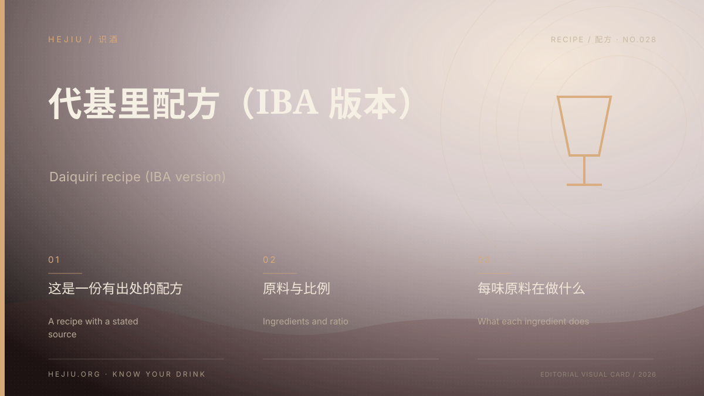

# Daiquiri recipe (IBA version)

This is one [Daiquiri](ref:cocktail) recipe with a stated source. Its structure is extremely simple: rum, lime, sugar. Precisely because there are only three ingredients, any imbalance in acidity, dilution or temperature shows at once, with nothing else to cover it. This recipe records the public IBA version and explains the purpose of each step.

Figure: thematic illustration for Daiquiri recipe (IBA version). Image: AI-assisted illustration generated with Doubao Seedream 5.0 (project-owned); not a photograph of the subject.

## A recipe with a stated source

The public IBA (International Bartenders Association) recipe uses 60 ml Cuban white rum, 20 ml fresh lime juice and two bar spoons of fine sugar, stirred first to dissolve the sugar and then shaken with ice, strained into a chilled cocktail glass, with no garnish in the official version. This recipe follows that version and explains the purpose of each step.

The recipe version is recorded separately from the cocktail identity so that it stays traceable. Bars make Daiquiris differently: some use syrup, some shift the lime-to-sugar ratio, some add fruit and blend with ice, some use aged rum. These differences are not about who is "authentic"; they are different versions and should carry their own sources.

## Ingredients and ratio

- Cuban white rum: 60 ml
- Fresh lime juice: 20 ml
- Fine sugar: 2 bar spoons
- Ice: as needed

The ratio is about 3:1:1 (rum: lime: sugar, with sugar measured in bar spoons). It leans towards the rum, so the acidity is clear without being sharp. The ratio is not the only answer: some prefer more acid, some more sweetness, some use syrup; changing the ratio makes a different version.

Quantities are a starting point, not a law. The strength of the rum, the acidity of the limes, the grain size of the sugar and the amount of ice all change the result. Make the first drink to the numbers here, then adjust to the balance on the palate, changing one variable at a time.

## What each ingredient does

[White rum](ref:rum) is the body: it supplies cane sweetness and the alcoholic frame. Being filtered, it is light in flavour, which lets the lime-sugar balance read clearly; aged rum carries more barrel flavour and pushes the drink in another direction.

Fresh lime juice supplies acidity, brightness and freshness. Bottled lime juice usually differs in aroma and acidity, so squeeze fresh when you can. Lime acidity varies with variety and ripeness, so 20 ml is only a starting point; judge by the balance on the palate.

Fine sugar supplies sweetness and balances the acid. It must dissolve before ice goes in, or grains may remain after shaking and the last sips turn suddenly sweet. If you use syrup, reduce the other water accordingly so the drink does not become thin.

## Method

First put the white rum, lime juice and fine sugar in a shaker and stir without ice so the sugar dissolves fully. The order is part of the recipe: if you add ice and stir at the start, the sugar may still be undissolved while the ice has already begun to melt, and dilution runs out of control.

Once the sugar has dissolved, add ice, shake until the shaker is clearly cold, and strain into a chilled cocktail glass. Keep the shaking steady; too long dilutes heavily, too brief fails to chill and combine. For the general principle, see [shaking](ref:technique) and [cocktail basics](ref:cocktails-guide).

## Shaking and dilution

A Daiquiri is a short drink: it needs to be cold enough without being over-diluted. The water from shaking depends on the amount and shape of the ice and on the shaking time; large, dry ice gives controllable dilution, while crushed or wet ice dilutes faster and can make the acidity taste sharp.

Once strained into a chilled glass, the drink slowly warms. Rising temperature changes both acidity and sweetness: acidity reads stronger when cold, sweetness more obvious as it warms. Record temperature along with your notes rather than writing only "good" or "not good". For more, see [ice and temperature](ref:ice).

## Glass and temperature

The IBA recipe serves the drink in a chilled cocktail glass. The glass should gather aroma, let you hold it without transferring heat and show the clear liquid. If the glass is not cold, the drink warms quickly and both acidity and aroma change.

Without a dedicated glass, use another with a slightly narrowed rim and moderate capacity. Pre-chilling, suitable capacity and a rim that is not too wide are what matter. For glass choice, see [martini glass](ref:vessel) and [choosing a glass](ref:cocktails-guide).

## Garnish

The IBA version has no garnish, and that is deliberate: with only three ingredients, a garnish interferes with judging the balance and the rum aroma. For visual recognition you can set a lime slice on the rim, but that is a change, not part of the original recipe.

No garnish also means the drink must present itself through the liquid alone. Whether the glass is clean, the drink clear and free of ice shards all affect the impression. Strain through a fine mesh to remove the ice shards produced by shaking.

## Common mistakes

First, not dissolving the sugar first. Shaking with ice can leave grains, and the last sips turn too sweet.

Second, using bottled lime juice. Aroma and acidity both differ and the drink tastes flat.

Third, shaking for an arbitrary time. Too long over-dilutes; too short fails to chill and combine.

Fourth, using a warm glass. The drink warms quickly and the sweet-sour direction shifts.

Fifth, casually adding a garnish or juice. That is already another version and should be labelled as one.

## Version differences and variations

Replacing fine sugar with syrup changes dissolution and sweetness control; adding fruit or juice makes a different variation; aged rum brings barrel flavour; a blended version changes dilution and texture; shifting the lime-to-sugar ratio changes the sweet-sour direction; replacing rum with another spirit makes a different sour cocktail.

## Limits

This recipe records one source version only. It does not rank brands and does not present one ratio as the only correct answer. The strength of the drink depends on the [alcohol by volume](ref:abv) of the rum, the amount of sugar and the dilution from shaking, not on the recipe numbers alone. Drink in moderation, avoid drinking quickly on an empty stomach, and do not drink while driving, taking medication or pregnant; follow local law.

**At a glance:** 60 ml Cuban white rum, 20 ml fresh lime juice and two bar spoons of fine sugar, stirred to dissolve the sugar and then shaken with ice, strained into a chilled cocktail glass with no garnish in the IBA version; this recipe explains each step of a very simple structure.
