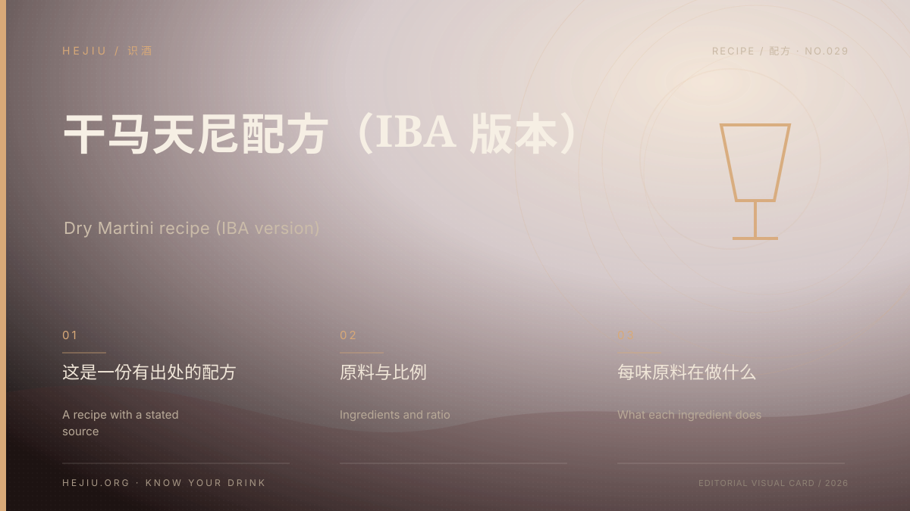

# Dry Martini recipe (IBA version)

This is one [Dry Martini](ref:cocktail) recipe with a stated source. "Dry" refers to the proportion of vermouth, not to the brand of spirit or the shape of the glass: with the same motions, a little more or less vermouth sends the drink in a completely different direction. This recipe records the public IBA version and explains the ratio, the stirring and the pre-chilling.

Figure: thematic illustration for Dry Martini recipe (IBA version). Image: AI-assisted illustration generated with Doubao Seedream 5.0 (project-owned); not a photograph of the subject.

## A recipe with a stated source

The public IBA (International Bartenders Association) recipe uses 60 ml gin and 10 ml dry vermouth, stirred over ice and strained into a chilled glass, garnished with lemon peel or a green olive. This recipe follows that version and explains the purpose of each step so that a problem at home can be traced to a specific stage.

The recipe version is recorded separately from the cocktail identity so that it stays traceable. The Martini has been made very differently over the decades: some ratios are close to 2:1, some add vermouth only as a rinse of the glass; some shake and some stir; some use lemon peel and some an olive. These differences are not about who is "authentic"; they are different versions.

## Ingredients and ratio

- Gin: 60 ml
- Dry vermouth: 10 ml
- Ice: as needed
- Lemon peel: 1 piece (or 1 green olive)

The ratio is 6:1. That sits towards the dry end but still lets the wine and spice of the vermouth show. A lower ratio (less vermouth) moves the drink towards chilled gin; a higher ratio makes the wine character clearer and the texture rounder.

Quantities are a starting point, not a law. The strength of the gin, the sweetness and oxidation of the vermouth, the amount of ice and the stirring time all change the result. Make the first drink to the numbers here, then adjust to taste, changing one variable at a time.

## What each ingredient does

[Gin](ref:gin) is the body: it supplies juniper and botanical aroma and most of the alcohol. Gins differ greatly in their botanical recipe, some leaning citrus and some towards pine and spice; changing the gin clearly changes the drink, while the structure stays the same.

Dry vermouth is a wine-based aromatised drink that supplies acidity, a savoury edge and layers of spice. It keeps the gin from being too sharp and gives the drink complexity. Vermouth oxidises slowly after opening, so how it is stored also affects the finished drink.

Ice is not a listed ingredient, yet it is part of the recipe: it sets the speed of chilling and the amount of dilution. Lemon peel or olive sets the aromatic and textural direction: peel is brighter, olive is savoury. Neither changes the structure, but each changes the first impression.

## Method

Chill the martini glass first, either in the freezer or buried in crushed ice. If the glass is not cold, the drink warms again within a minute and both aroma and acidity change; this step matters more than many people expect.

Put plenty of ice in a mixing glass, pour in the gin and dry vermouth, and stir well with a bar spoon until the outside of the glass is clearly cold. Keep the motion steady rather than alternating fast and slow; the aim is to chill, lightly dilute and mix evenly. Then strain into the chilled glass and express the lemon peel or add the olive. For the general principle, see [stirring](ref:technique) and [cocktail basics](ref:cocktails-guide).

## Ice and dilution

A Martini is a short drink, but without ice a short drink chills very slowly. The amount, shape and stirring time together decide dilution: plenty of dry, large ice chills fast with controllable dilution, while little ice, wet ice or crushed ice dilutes faster and less predictably.

Some prefer the drink extremely cold with almost no dilution; others prefer a little more dilution to open the aroma. Both preferences are valid, but they should be recorded, or the same recipe will produce different results in different hands.

The real strength of the drink depends on the [alcohol by volume](ref:abv) of the gin, the share of vermouth and the dilution from stirring, not on the millilitres alone. For more on ice shapes, see [ice and temperature](ref:ice).

## Glass and temperature

Traditionally the drink is served in a [martini glass](ref:vessel): conical, stemmed and slightly narrowed at the rim. The cone gathers aroma, the stem lets you hold the glass without touching the body and so reduces heat transfer, and the narrowed rim concentrates the aroma. The glass is not part of the definition, but it does shape the experience.

Without the proper glass, choose another with a slightly narrowed rim and a moderate capacity; pre-chilling and suitable capacity matter most. Too small a glass will not hold the recipe; too large a glass lets the aroma disperse. Whether the glass is pre-chilled often decides the first sip more than its shape does.

## Garnish

Lemon peel supplies citrus oil; expressed over the rim and the surface, it shapes the aroma. It adds no noticeable acidity. A green olive supplies salt, oil and texture and makes the entry rounder. The two are not interchangeable in a casual way; they point in different directions.

The garnish should be finished just before drinking. Lemon peel left standing dries out and loses its oil; an olive left in the drink releases more salt and oil. One olive is usually enough; more covers the detail of the gin and vermouth.

## Common mistakes

First, using a room-temperature glass. The drink warms quickly and both aroma and texture suffer.

Second, under-stirring. The drink is not cold enough, the entry feels sharp and the aroma stays closed.

Third, over-stirring. Too much dilution thins the body and washes out the detail of the vermouth.

Fourth, reading "dry" as "no vermouth at all". Without vermouth the structure is just chilled gin; it is no longer the same drink.

Fifth, piling on garnish. Olive and lemon peel together easily cover the main aroma.

## Version differences and variations

Replacing gin with vodka gives a Vodka Martini; adding olive brine gives a Dirty Martini; garnishing with a pearl onion gives a Gibson; using less vermouth gives a drier version; using more gives a "wetter" one; shaking instead of stirring gives more aeration and dilution.

## Limits

This recipe records one source version only. It does not rank brands and does not present 6:1 as the only correct dryness. A recipe is a starting point, not a law; any change should be labelled as a difference. A Martini is strong; sip it slowly and drink water alongside. Do not drink while driving, taking medication or pregnant, and follow local law.

For Dry Martini recipe (IBA version), begin with what it is. Then look at where it comes from, and finally ask how it is used. The answers point to different choices, not to a single score.

Put [Dry Martini](ref:cocktail)'s formula next to [Stirring](ref:technique)'s steps; the difference marks the boundary.
