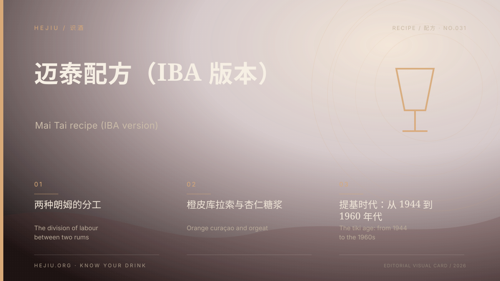

# Mai Tai recipe (IBA version)

The Mai Tai is a calling card left by the tiki age, but it did not appear in the 1960s: in 1944, Trader Vic mixed it at his Oakland bar and named it with a word said to come from Tahiti. What turned it into a global symbol was the postwar American imagination of the South Pacific, the crushed ice and pineapple piled into a small mountain, and the tiki bars that opened everywhere in the 1950s and 1960s. Disputes followed: the recipe was simplified into "juice with rum", orgeat was replaced with sugar water, and the two rums were merged into one. This recipe returns to the IBA Contemporary Classic version, with 30 + 30 ml of two rums, 15 ml orange curaçao, 15 ml orgeat, 30 ml lime juice and 7.5 ml sugar syrup as its coordinates.

Figure: thematic illustration for Mai Tai recipe (IBA version). Image: AI-assisted illustration generated with Doubao Seedream 5.0 (project-owned); not a photograph of the subject.

> **Quick verdict**
> **In one line:** This recipe helps you make Mai Tai recipe (IBA version), and shows where the method usually fails.
>
> - **Best for:** Anyone who wants to make Mai Tai recipe (IBA version) step by step and knows where it usually goes wrong.
> - **Not for:** If you want will not measure ingredients or follow the order of steps.
> - **Check first:**
>   - The IBA version uses two rums, not one.
>   - Orange curaçao provides orange aroma, sweetness and part of the alcohol.

## The division of labour between two rums

The IBA version uses two rums, not one. Amber Jamaican rum usually carries molasses, banana and spice with a fuller body, and it supplies weight and darker aroma. Martinique molasses rum adds another layer of molasses flavour and thickness so the drink is not a single straight line. Together they total 60 ml — clearly the body of the glass.

The pairing is not showing off; it is building layers. Even a very good single rum tends to concentrate its aroma in one register, while two styles overlap and the flavour moves from the front of the sip to the back. Merge them into one rum and the drink still works, but that movement is gone, so the substitution should be recorded as a variation.

The IBA page adds a note: the Martinique molasses rum Trader Vic used was not an agricole rhum but a molasses-based, "rummy" style. That helps explain the original flavour, but this recipe does not use it to infer particular brands; the choice of bottling still follows the official IBA version and what is available locally.

## Orange curaçao and orgeat

Orange curaçao provides orange aroma, sweetness and part of the alcohol. It is an orange liqueur with a fair amount of sugar and a bright profile; 15 ml carries the orange through the whole glass without covering the rum. It also contributes sweetness, so the lime has to keep up or the drink tips towards sugar.

Orgeat is the most recognisable part of a Mai Tai. It supplies almond sweetness and a soft texture, and it is both sweet and aromatic; 15 ml builds a clear almond outline, while more turns the drink into an almond sweet and less loses the Mai Tai's character. It also adds water and sugar and affects the overall balance, so it is not merely a flavouring.

The two are complementary rather than interchangeable. Curaçao gives a bright citrus direction; orgeat gives a round almond direction. One pushes the aroma outward, the other draws the texture inward. Lime cuts between them, giving the sweetness an edge and letting the rum stay audible.

## The tiki age: from 1944 to the 1960s

Tiki culture was not native to Hawaii; it was an American fantasy of the South Pacific — bamboo, grass skirts, fake volcanoes, fire, and drinks that stacked several juices on top of rum. The Mai Tai appeared early in that fantasy and became a global symbol as tiki bars expanded through the 1950s and 1960s. Its name, garnish and glassware are all part of that visual system.

The system had a side effect: the later it went, the more the recipe was "visualised". A bigger pineapple, more crushed ice and a brighter colour made a drink look more like a Mai Tai while the body grew thinner. The IBA version keeps the two rums at 60 ml in total, which is exactly a correction against that dilution.

The point of knowing the tiki background is not to reproduce the whole decoration but to know where the drink's centre of gravity sits. It sits in the rum-and-orgeat frame; juice and garnish are the coat. The coat can change; the frame cannot collapse.

## Shaking, crushed ice and pouring with the ice

This recipe uses [shaking](ref:shaking). Four of the six ingredients carry sugar or juice, and shaking chills fast, mixes thoroughly and dissolves the sugars. Stirring cannot fully combine viscous orgeat with juice and does not suit a drink that needs fast chilling.

The IBA method pours the shaken drink with its ice into the glass rather than straining it. The ice stays in the cup, keeps chilling and dilutes slowly, so the drink opens up as it is consumed. Straining gives a clearer, shorter drink, but both the temperature curve and the dilution rate change, so it should be recorded as a variation rather than as another way of writing the same step.

Crushed ice belongs with that pour. Its large surface area chills quickly and dilutes quickly; if the glass is filled with crushed ice, the drink goes thin fast and should be finished promptly. Large cubes chill and dilute more slowly and suit a longer drink, but that already leaves the IBA pour-with-ice method.

The IBA specifies a double rocks glass or a highball glass; the [rocks glass](ref:vessel) registered on this site is the former, though the exact vessel still follows the official IBA version. The glass must hold both the liquid and the ice; too small a cup pushes the ice to the rim and makes the first sip all meltwater. The actual strength depends on the [alcohol by volume](ref:abv) of the two rums and the volume of liqueur and syrup, not on the recipe millilitres alone.

## What 7.5 ml of syrup adjusts

The syrup is only 7.5 ml, and it is not the main sweetener; it is a little roundness between the acid and the orgeat. Without it the drink is drier and sharper, with lime acid straight at the front; double it and the sugar covers the rum and the layers disappear.

That figure also shows the Mai Tai is not a sweet drink with juice filled to the top. Its sweetness comes mainly from curaçao and orgeat, with syrup as the final trim; if you need syrup to make it sweet, the first two are out of proportion or below quality, and the syrup is not the problem.

Syrup strength changes the result. The IBA does not prescribe a sugar-to-water ratio, and a 1:1 syrup and a 2:1 rich syrup differ at the same 7.5 ml. Taste the finished drink when you change syrup; if needed, lower the syrup to 5 ml or raise it to 10 ml, and record that adjustment.

## Garnish: pineapple, mint and lime peel

The garnish carries the drink's identity. A pineapple spear gives a visual sign and fruit aroma, mint leaves add a cooling note, and lime peel adds citrus; the combination is almost shorthand for "tiki". The IBA writes all three into the recipe, which says the garnish is not a random piece of fruit on the rim.

The garnish also shapes how the drink is experienced. A spear cut too thick takes up rim space and makes the nose read pineapple rather than rum; mint leaves added early are soaked, turn black and taste grassy; lime peel squeezed too hard puts pith bitterness into the liquid.

The right routine is to add everything just before serving: stand the pineapple spear against the rim rather than sinking it, slap the mint once to release aroma and rest it on the ice mound, and express only the skin of the lime peel. The garnish should point at the drink, not hide it.

## Common mistakes

First, too little rum. Juice and syrup take over, the drink becomes a sweet tropical beverage, and the aroma and body of the rum vanish. Second, too much orgeat: the drink turns into an almond sweet, sugar covers acid and rum, and it cloys after a few sips. Third, too little lime: the sweetness of curaçao and orgeat has no acid to hold it and the entry feels loose.

Fourth, straining after shaking. The IBA pours with the ice, and straining changes the temperature curve and dilution rate, so it belongs in a variation note. Fifth, too little ice: the drink warms quickly, the rum aroma fades and the texture goes flat. Sixth, garnish left too long: pineapple, mint and lime peel soaked in the glass lose their aroma and can add unwanted bitterness.

Seventh, ignoring syrup strength. 7.5 ml looks precise, but syrup concentration varies a great deal; changing syrup without tasting again easily produces "I followed the recipe and it is sweet".

## Variations and the "original" argument

Replacing the two rums with a single rum changes the layers and the body; that is a base-spirit variation and should state the difference. Cutting the orgeat and raising the lime makes the drink sharper and shorter; raising the orgeat makes it sweeter and softer. Replacing orange curaçao with another orange liqueur changes sweetness and orange intensity.

Straining or adding ice is another branch. Straining gives a clearer, shorter version; extra crushed ice in the glass gives a colder, faster-diluting one. Both can be called a Mai Tai, but their temperature and dilution curves differ and should be recorded separately.

The "original" argument mostly circles around the type of rum and whether orgeat belongs. Differences between historical recipes and modern bar practice are usually not copying errors but changes in what is available and what people prefer. This recipe records only the IBA version and does not rank one as more authentic; a reader comparing them should state each source and each substitution.

## See also

For the general structure of a cocktail, read [cocktail basics](ref:cocktails-guide); for ice shape, temperature and dilution, read [ice and temperature](ref:ice); for the action and rhythm of shaking, read [shaking](ref:shaking). For rum styles, see [rum](ref:rum); for the Jamaican background, see [Jamaica](ref:jamaica); for the drink itself, see [Mai Tai](ref:cocktail); for the glass, see [rocks glass](ref:vessel). This recipe records one sourced version and evaluates no specific brand. Drink in moderation and follow local law and safety requirements.
