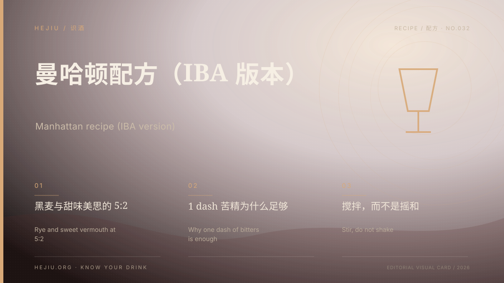

# Manhattan recipe (IBA version)

The Manhattan entered print earlier than most cocktails: American manuals and newspapers of the late nineteenth century already carried the name, though the formulas disagreed — some said whiskey and vermouth, some used cherry brandy instead of sugar, and some wrote the ratio vaguely as "one part to one". What those old texts leave is not a standard but a traceable line: the drink took shape between New York clubs and bars, stitching "strong" and "soft" together with rye whiskey and sweet vermouth. This recipe uses the IBA Unforgettable version: 50 ml rye whiskey, 20 ml sweet vermouth, 1 dash of Angostura bitters, stirred and strained into a chilled cocktail glass.

Figure: thematic illustration for Manhattan recipe (IBA version). Image: AI-assisted illustration generated with Doubao Seedream 5.0 (project-owned); not a photograph of the subject.

> **Quick verdict**
> **In one line:** This recipe helps you make Manhattan recipe (IBA version), and shows where the method usually fails.
>
> - **Best for:** Anyone who wants to make Manhattan recipe (IBA version) step by step and knows where it usually goes wrong.
> - **Not for:** If you want will not measure ingredients or follow the order of steps.
> - **Check first:**
>   - Fifty millilitres of rye and twenty of sweet vermouth come to roughly 5:2.
>   - One dash of bitters barely changes the volume of 70 ml of liquid and does not noticeably change sweetness, but it changes the shape of the aroma.

## Rye and sweet vermouth at 5:2

Fifty millilitres of rye and twenty of sweet vermouth come to roughly 5:2. The point of the ratio is not precision but direction: whiskey must be the body and vermouth the modifier. Reverse it and the drink becomes fortified vermouth, sweet and without a frame.

The rye matters. A high-rye whiskey brings pepper, grain and dried fruit, which connects easily with the herbal spice of sweet vermouth; bourbon is sweeter and rounder, Canadian whisky lighter and softer. The IBA page says rye whiskey, not whiskey in general, so changing the base spirit is a version change and should be stated.

Sweet vermouth supplies more than sweetness. It brings a wine base, herbal spice and a little bitterness that make the high-strength whiskey drinkable; its water also dilutes, so raising the vermouth makes the drink not only sweeter but thinner. That is why 5:2 is not casually rewritten as 1:1.

## Why one dash of bitters is enough

One dash of bitters barely changes the volume of 70 ml of liquid and does not noticeably change sweetness, but it changes the shape of the aroma. Angostura carries cinnamon, clove, gentian and citrus peel, and a dash links the grain sweetness of the whiskey with the herbal notes of the vermouth, turning two layers into one.

"One dash" is a starting point, not a seasoning spoon. Too much bitters covers the base spirit and the vermouth, especially the pepper of the rye, and the drink starts to taste like a spiced medicinal wine. Bars often use a dash as three or four drops shaken out of the bottle, which is a different intensity and should be noted.

Bitters also give sweetness a boundary. The Manhattan's sugar comes from vermouth with no acid to oppose it, and a small amount of bitterness cuts the finish so the drink does not cloy. That is why the recipe needs neither syrup nor lemon and still has structure.

## Stir, do not shake

This recipe uses [stirring](ref:stirring). The Manhattan is mostly spirit and vermouth, with no juice, egg white or dairy; stirring chills gently, controls dilution and keeps the drink clear. Shaking adds air and ice shards, clouds the drink and lets the vermouth's aroma fade faster.

The aim is temperature and dilution, not a vortex. The bar spoon should reach the bottom and push steadily along the wall so ice and liquid stay in contact; moving too fast only makes noise and shards while cooling less efficiently. The ideal rhythm is continuous, even and without obvious pauses.

Stirring time depends on ice quantity, ice shape and room temperature. Too little ice chills slowly and dilutes little, leaving the drink strong and closed; too much ice with a long stir over-dilutes and thins the body. Again the test is the glass wall: when it is fully cold and the hand feels the chill, the drink is usually ready.

## Cherry, glass and the first sip

The cocktail cherry is the Manhattan's visual signature. It takes no part in the liquid ratio but decides the first impression: its sweet aroma contrasts with the grain of the whiskey, and its deep red gives a clear liquid a focal point. Cherry quality varies widely, and soaking time changes both sweetness and texture.

Add the garnish just before serving rather than steeping it. A cherry left in the drink seeps syrup into the liquid, changing sweetness and colour, and loses its own aroma. Whether it sits at the bottom or on the rim depends on the glass, but it should never block the drink.

The IBA specifies a cocktail glass; the [martini glass](ref:vessel) registered on this site belongs to that family, though the exact vessel still follows the official IBA version. A wide, shallow glass gathers aroma slowly and suits a short drink; chill the glass, but do not freeze it until it frosts, or the low temperature will suppress the rye's spice. For the general structure, read [cocktail basics](ref:cocktails-guide).

## Controlling dilution: a sense of time

Whether a Manhattan is good depends heavily on dilution. Under-stirred, it stays strong and the vermouth never opens; over-stirred, the body thins and the rye's spice is washed out. The window between them is narrow, especially in a warm room or with little ice.

Three levers control it. The first is ice quantity: plenty of ice chills fast and keeps dilution controllable, while little ice chills slowly and forces a longer stir, which is more likely to over-dilute. The second is ice shape: hard, large cubes melt slowly, crushed ice melts fast and dilutes noticeably in a short time. The third is glass temperature: a pre-chilled glass reduces the stirring needed for chilling.

One more variable is the water in the vermouth. Sweet vermouth is high in water, so raising its share naturally thins the drink; stir longer on top of that and you get a drink that tastes right but reads watery. Adjust the ratio and the stirring time separately, one change at a time. The actual strength depends on the [alcohol by volume](ref:abv) of the rye and the sweetness and strength of the vermouth, not on the recipe millilitres alone.

## The freshness of vermouth

Sweet vermouth oxidises after opening. Left too long, it loses sweetness and aroma, sometimes picking up a vinegary edge; used in a Manhattan, it makes the drink dull no matter how accurate the ratio. This is a failure the numbers cannot explain.

Storage slows oxidation. Refrigerate after opening, minimise the air in the bottle and keep it out of direct sun, and the flavour lasts longer; even so, vermouth several weeks open rarely returns to its best. Bars mark opening dates, and a home mixer can buy smaller bottles.

To judge whether vermouth is still usable, smell and taste it: are the herbal and citrus layers still there, is the sweetness clean, does the finish turn bitter or sour? If only sweet water remains, the problem is the ingredient, not the recipe, and it should be replaced rather than masked with more bitters.

## Common mistakes

First, too little ice. Stirring chills slowly and dilutes little, the drink stays strong and the vermouth's aroma never opens. Second, over-stirring: too much ice melts, the body thins, and both the rye's spice and the vermouth's herbs are washed out. Third, too much bitters: one dash already provides aroma and bitterness, and more covers the base spirit and the vermouth.

Fourth, an unchilled glass. A short drink warms quickly in a room-temperature glass and loses its chill after the first sip. Fifth, stale vermouth: opened too long, it oxidises and both sweetness and aroma go dull, changing the direction of the drink in a way the ratio cannot explain. Sixth, garnish added too early: a cherry soaked for a long time pushes sweetness into the liquid and loses its own aroma.

Seventh, a base spirit that does not match the label. Serving bourbon while describing a rye ratio and profile makes the drink sweeter; that is not a failure but an inaccurate record, and a reader cannot reproduce it.

## Variations: Perfect and Dry Manhattan

Replacing rye with bourbon makes the drink sweeter and rounder; Canadian whisky makes it softer and lighter. Replacing sweet vermouth with a drier or more bitter one changes sweetness and aroma structure; replacing Angostura with orange bitters shifts the citrus direction.

The "Perfect Manhattan" uses both sweet and dry vermouth, usually in equal parts, for a drier, clearer, more herbal drink; it is not a wrong version but a branch with a stated replacement logic. Cutting the vermouth moves towards a "Dry Manhattan", with the whiskey more prominent.

Another branch adds cherry juice or a little syrup for a sweeter, redder drink; that changes the source of sweetness and should be labelled. When recording a variation, say which ingredient changed and how the ratio moved, or the same name will describe very different drinks. This recipe records only the IBA version; other approaches should carry their own sources.

## See also

For the general structure and balance of a cocktail, read [cocktail basics](ref:cocktails-guide); for the action and rhythm of stirring, read [stirring](ref:stirring); for rye and whiskey styles, read [whisky](ref:whisky); for the role of sweet vermouth, read [vermouth](ref:vermouth); for the American background, read [USA](ref:usa). For the drink itself, see [Manhattan](ref:cocktail); for the glass, see [martini glass](ref:vessel). This recipe records one sourced version and evaluates no specific brand. Drink in moderation and follow local law and safety requirements.
