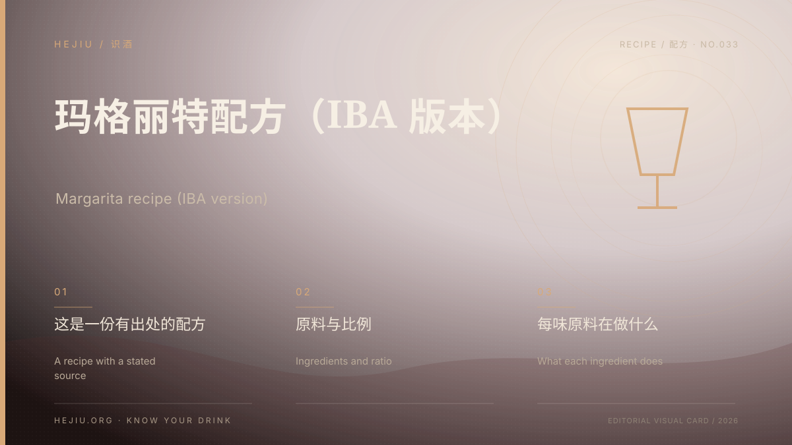

# Margarita recipe (IBA version)

This is one [Margarita](ref:cocktail) recipe with a stated source. Its structure is "spirit plus orange liqueur plus fresh sour", and the sweet-sour ratio decides whether it works; the salt rim is not a decorative slogan but part of the flavour structure. This recipe records the public IBA version and explains the balance, the shaking and the salt rim.

Figure: thematic illustration for Margarita recipe (IBA version). Image: AI-assisted illustration generated with Doubao Seedream 5.0 (project-owned); not a photograph of the subject.

## A recipe with a stated source

The public IBA (International Bartenders Association) recipe uses 50 ml 100% agave tequila, 20 ml orange liqueur and 15 ml fresh lime juice, shaken over ice and strained into a chilled glass, with an optional half salt rim. This recipe follows that version and explains the purpose of each step so that a problem at home can be traced to a specific stage.

The recipe version is recorded separately from the cocktail identity so that it stays traceable. Margaritas are made very differently in different regions: some add syrup for sweetness, some use agave syrup; some add juice and blend with ice; some salt the whole rim, some none at all. These differences are not about who is "authentic"; they are different versions.

## Ingredients and ratio

- 100% agave tequila: 50 ml
- Orange liqueur: 20 ml
- Fresh lime juice: 15 ml
- Ice: as needed
- Fine salt: as needed (optional, for a half rim)

The ratio is about 50:20:15. The orange liqueur supplies both sweetness and citrus aroma; the lime juice supplies acidity and freshness. This ratio is not the only answer: the acidity of limes varies with ripeness, and orange liqueurs differ in sweetness, so the millilitres are only a starting point.

Quantities are a starting point, not a law. Glass type, ice amount and shaking time all change the result. Make the first drink to the numbers here, then adjust to the balance on the palate, changing one variable at a time so you can tell where a change came from.

## What each ingredient does

[Tequila](ref:tequila) is the body: it supplies vegetal aroma, a mineral edge and the alcoholic frame. "100% agave" means all the sugar comes from agave, giving a fuller flavour; mixed tequilas may add other sugar sources and taste different. Changing the base spirit clearly changes the drink.

Orange liqueur supplies sweetness and citrus aroma and connects the two sides of the balance. Too little leaves the drink sharp; too much lets sweetness cover the tequila. It also affects strength and body, so it is not merely "sweetener".

Fresh lime juice supplies acidity, brightness and freshness. Bottled lime juice usually differs in aroma and acidity, so squeeze fresh when you can. Lime acidity varies with variety and ripeness, so 15 ml is only a starting point. Fine salt is for the rim: it boosts the savoury impression and changes the acidity on entry.

## Method

Chill the glass first. For a salt rim, moisten the outside of the rim with lime juice and dip it in fine salt, covering only half; do not let salt fall into the glass. Finish the rim before shaking, or moisture on the rim will seep and spoil the look.

Put the tequila, orange liqueur and fresh lime juice in a shaker, add ice and shake until the shaker is clearly cold. Strain immediately into the chilled glass so the drink does not keep sitting in melt water. For the general principle, see [shaking](ref:technique) and [cocktail basics](ref:cocktails-guide).

## Shaking and ice

A Margarita is normally shaken rather than stirred: fresh juice needs to mix fully with the spirit, and shaking chills, dilutes and aerates quickly, giving a lighter texture. Shake too long and the drink is over-diluted; shake too briefly and it is neither cold enough nor fully combined.

Ice quality directly shapes the result. Large, dry ice melts slowly and makes dilution controllable; crushed or wet ice chills fast but dilutes fast too. Strain immediately after shaking, or the ice keeps melting in the glass and washes out the balance within minutes.

The real strength of the drink depends on the [alcohol by volume](ref:abv) of the tequila, the sweetness of the orange liqueur and the dilution from shaking, not on the millilitres alone. For more, see [ice and temperature](ref:ice).

## The salt rim

The salt rim is optional; the IBA recipe specifies a half rim. Salt boosts the savoury impression, suppresses bitterness and changes the acidity on entry. Too much salt covers the detail of tequila and lime; too little does almost nothing.

A half rim lets the drinker choose a salted or unsalted entry. Use fine salt rather than coarse, moisten the outside of the rim and dip lightly, and keep salt out of the liquid. Strain the drink after the rim is finished so the rim stays clean.

## Glass and temperature

The IBA recipe serves the drink in a chilled cocktail glass. The glass should gather aroma and let you hold it without transferring heat. A wider, shorter Margarita glass is also traditional, but the glass is not part of the definition; pre-chilling, suitable capacity and a rim that is not too wide are what matter.

Without a dedicated glass, use a small glass with a slightly narrowed rim. If the glass is not cold, the drink warms quickly and both acidity and aroma change. For more on glass and temperature, see [martini glass](ref:vessel) and [choosing a glass](ref:cocktails-guide).

## Common mistakes

First, using bottled lime juice instead of fresh. Aroma and acidity both differ and the drink tastes flat.

Second, salting the whole rim. A full rim makes every sip too salty; half is more controllable.

Third, letting salt fall into the glass. It keeps dissolving in the liquid, so the drink gets saltier as you go.

Fourth, shaking for an arbitrary time. Too long dilutes heavily; too short fails to chill and combine.

Fifth, using a warm glass. The drink warms quickly and the balance shifts.

## Version differences and variations

Using a different orange liqueur changes sweetness and citrus direction; adding juice makes a longer drink; a blended version changes dilution and texture; replacing tequila with another spirit makes a different variation. A salted rim, a sugared rim or no rim at all also changes the entry.

## Limits

This recipe records one source version only. It does not rank brands and does not present one style of salt rim as the only correct choice. A recipe is a starting point, not a law; any change should be labelled as a difference. Drink in moderation, avoid drinking quickly on an empty stomach, and do not drink while driving, taking medication or pregnant; follow local law.

**Short definition:** 50 ml 100% agave tequila, 20 ml orange liqueur and 15 ml fresh lime juice, shaken and strained into a chilled glass with an optional half salt rim; this recipe explains how the sweet-sour balance, the salt rim and dilution decide the drink.
