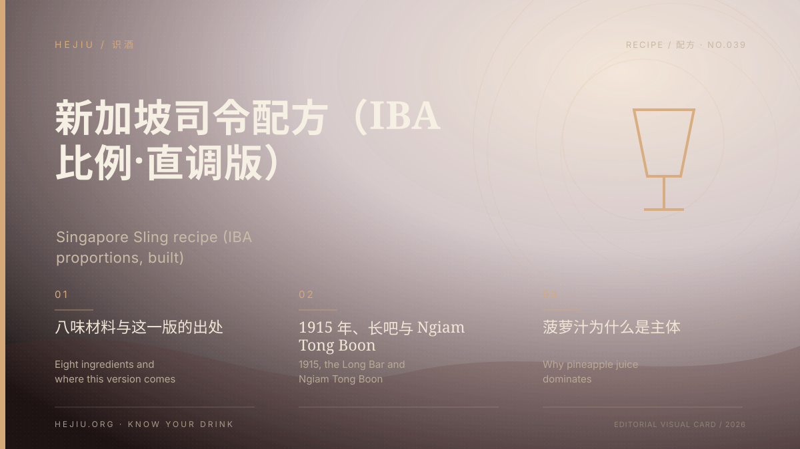

# Singapore Sling recipe (IBA proportions, built)

This recipe takes the eight-ingredient proportions of the [Singapore Sling](ref:cocktail) from the public IBA entry: 30 ml gin, 15 ml cherry brandy, 7.5 ml Cointreau, 7.5 ml Bénédictine, 120 ml pineapple juice, 15 ml lime juice, 10 ml grenadine and 1 dash of Angostura bitters. The ingredients follow the IBA record exactly; the technique is built in the glass rather than shaken and strained into a second vessel.

Figure: thematic illustration for Singapore Sling recipe (IBA proportions, built). Image: AI-assisted illustration generated with Doubao Seedream 5.0 (project-owned); not a photograph of the subject.

> **Quick verdict**
> **In one line:** This recipe helps you make Singapore Sling recipe (IBA proportions, built), and shows where the method usually fails.
>
> - **Best for:** Anyone who wants to make Singapore Sling recipe (IBA proportions, built) step by step and knows where it usually goes wrong.
> - **Not for:** If you want will not measure ingredients or follow the order of steps.
> - **Check first:**
>   - The liquid is about 205 ml, and with ice and melt the drink is best somewhere between 4 and 8 degrees Celsius at the lips.
>   - The public IBA page lists the drink among the contemporary classics, with gin, cherry liqueur (written as Cherry Sangue Morlacco), Cointreau, DOM Bénédictine, fresh pineapple juice.

## Eight ingredients and where this version comes from

The public IBA page lists the drink among the contemporary classics, with gin, cherry liqueur (written as Cherry Sangue Morlacco), Cointreau, DOM Bénédictine, fresh pineapple juice, fresh lime juice, grenadine syrup and a little Angostura bitters. Its method is to shake everything with ice, strain into a hurricane glass and garnish with pineapple and a maraschino cherry.

The ingredient table here matches the IBA list; the method says build. The next section explains why: building is the traditional long-bar serve, and it is the easier route to control in a drink of more than 200 ml. Keeping proportions and technique apart lets a reader see which part comes from the official entry and which from tradition.

The ratio itself is clear. The four spirits total 60 ml, while juice and syrup total 145 ml, so the split is close to 1:2.4. This is not a strong drink with a splash of juice; it is a long drink built on juice, with spirits holding the frame.

## 1915, the Long Bar and Ngiam Tong Boon

The official Raffles account dates the drink to 1915, at the [Long Bar](ref:raffles) in Singapore, and credits the Hainanese bartender Ngiam Tong Boon. The hotel's version is that he made a drink that looked like fruit juice but contained gin and liqueurs, so that women, who could not comfortably drink in public at the time, could order something that looked like a soft drink.

That story travels widely, but the details are not settled. Some accounts place the drink's ancestor before 1915; others treat the "fruit juice in disguise" story as later embellishment, with 1915 coming from later menus and hotel records. Whether Cointreau and Bénédictine were in the recipe in 1915 is also disputed, with some accounts treating them as later additions. This recipe therefore writes "commonly traced to" and "some accounts hold", not archival fact.

What is solid is the bond between the drink and the Long Bar, which has lasted more than a century and made the drink a symbol of Singapore. The bar still serves it, and today's recipe is not identical to the 1915 version. The history and the current recipe are two lines that a reader does not need to force into alignment.

## Why pineapple juice dominates

120 ml of pineapple juice is close to sixty percent of roughly 205 ml of liquid. That is not an arbitrary number: it sets the volume, the sweet-sour frame and the texture.

First, it supplies volume. The four spirits are only 60 ml; without a large amount of juice the result would be a short, strong drink and would not belong to the sling family. Second, it supplies acidity and fruit aroma. Pineapple is sharper than orange juice and more tropical, which supports the sweetness of the cherry brandy and the herbal liqueurs. Third, it supplies texture. Fresh juice carries pulp and enzymes, so shaking builds a fine foam, and even a built version keeps a slight cloud that stops the drink tasting thin.

Bottled juice lowers both acidity and aroma, and the drink easily turns into sweet water. If only bottled juice is available, choose an unsweetened pure juice and raise the lime juice to 20 ml to bring the acidity back. That is a substitution, not the original recipe.

## What each of the four spirits does

[Gin](ref:gin) is the frame. At 30 ml in a 205 ml drink it is not much, but its juniper and citrus cut through the fruit sugar and decide whether the drink reads as a sling at all. London dry is the safest choice; old tom is softer and sweeter, and the result will be rounder.

The 15 ml of cherry brandy is the fingerprint. It brings cherry, almond and a faint kernel bitterness, plus a deep red colour, and it is the main source of the drink's cherry note. More than 15 ml and the whole glass turns syrupy; 15 ml is already near the ceiling.

Cointreau at 7.5 ml supplies orange peel oil and a bright citrus top note so the pineapple sweetness does not collapse into one flat mass. Bénédictine at 7.5 ml supplies honey, herbs and spice, and is where the complexity comes from; it is sensitive to temperature, disappearing under the juice if there is too little and turning medicinal if there is too much. Both are [liqueurs](ref:liqueur), but one goes bright and the other goes rich, and the structure loses half its shape without either.

## Grenadine is there for colour first

10 ml of grenadine carries roughly 5 to 6 g of sugar, which is not much in a 205 ml drink. Its main job is colour: it turns the yellow of the juice into a rose red and gives the drink its recognisable look. Second, it adds a little red-fruit sweetness that makes the cherry brandy taste continuous.

Its sweetness is not the point. Raise it to 20 ml and the colour goes too deep and the sugar overwhelms the lime, so the drink tastes like syrup; leave it out and the drink is yellow, looks unlike a sling, and the acidity reads sharp. 10 ml is the band where the colour is right and the sweetness does not take over.

If the pineapple is very ripe and sweet, the grenadine can drop to 7.5 ml. If the limes are very sharp, do not fix it by adding more syrup; add 5 ml of lime juice or 5 ml of syrup, choose one, and record the change.

## What one dash of bitters is holding back

One dash of Angostura is only about 1 ml, yet it decides whether the finish is clean. Its clove, cinnamon and allspice cut through the sugar of the juice and syrup, and its bitterness gives the sweetness a boundary. Without it the first few sips are pleasant and the second half turns cloying.

The bitters also change the aromatic layering. Left on the surface, the first sip smells of spice before pineapple; stirred in, the spice moves into the middle and meets the herbal note of the Bénédictine. Both work; the difference is whether aroma comes first or structure does.

Keep the dose modest. Two dashes are already noticeable in 205 ml, and three let clove cover the cherry. Swapping to Peychaud's pushes the drink toward anise and cherry, closer to New Orleans than to Singapore.

## Building it: dissolve the syrups in an empty glass

The most common building mistake is to tip everything into a glass of ice and stir twice. Grenadine and Bénédictine are denser than juice, so if they go in last they sit at the bottom: the first sip is thin and the last is sweet.

The order is: grenadine, Bénédictine, Cointreau, cherry brandy and lime juice into the empty glass, stirred together; then the pineapple juice and gin, stirred gently twice; then ice to eight-tenths full and 12 to 15 lifts of the bar spoon from the bottom. The lifting motion turns the lower layer over, which is what distributes the syrup.

Leave room for the ice to move. A highball is usually 300 to 400 ml (check the actual product), so 205 ml of liquid plus 4 or 5 large cubes fits with space to stir. Fill it to the brim and you cannot stir; use too little ice and the drink neither chills nor dilutes enough.

## Shaken versus built

The public IBA page specifies shaking: all ingredients with ice, shaken well, strained into a hurricane glass. Shake for 10 to 12 seconds and the pineapple juice foams, the drink chills faster, dilution lands around 20% to 25%, and the texture is rounder and more uniform. The cost is a slightly cloudy drink from foam and ice shards, and a little aromatic lift lost to agitation.

The built version stirs instead, chilling through the spoon and the ice in the glass. Dilution is slower and easier to control, the drink stays clearer and the juice reads in layers; the cost is slower integration, so the first sips can taste separated until you stir again. Both are valid; the choice is between a fine, unified texture and a bright, distinct one.

For the shaken version, double-strain out the ice shards, pour into a chilled highball and add one or two large cubes. For the built version, do not fill the glass with crushed ice, or the drink will thin within minutes. See [shaking](ref:shaking) for the principle.

## Sling glass, hurricane glass, highball

The IBA writes hurricane glass, and the drink is traditionally served in a sling glass. The vessel reference on this recipe is the [highball](ref:highball), because the capacities are close, a highball is easy to find, and its straight sides make a built drink easy to stir.

Glass shape affects aroma and temperature, not authenticity. A highball has a moderate opening that holds aroma and takes large cubes well; a hurricane narrows at the waist and flares at the rim, which looks more tropical but is harder to clean and stir; a sling glass sits between them. A capacity of 300 to 400 ml is comfortable: smaller will not hold 205 ml plus ice, larger lets the aroma escape.

Chill the glass. A warm glass makes the first sip taste lukewarm and the juice sweetness sticky; a cold one sharpens the acidity and, if you add soda, keeps the bubbles longer.

## Ice, temperature and a drink over 200 ml

The liquid is about 205 ml, and with ice and melt the drink is best somewhere between 4 and 8 degrees Celsius at the lips. Warmer and the sweetness grows while the acidity dulls; colder and the aroma shuts down and the pineapple disappears.

Use 4 or 5 large cubes rather than crushed ice. Large cubes have less surface area, melt slowly and dilute the drink gradually over 20 to 30 minutes; crushed ice chills fast but turns the drink into weak juice within minutes and leaves the outside of the glass covered in condensation. For more on ice and temperature, see [ice and temperature](ref:ice).

If you want the first part colder without fast dilution, chill the glass thoroughly and refrigerate the liquids, then use large ice. That works better than piling in more ice.

## Failure points: why yours is sweet and weak

- Too little pineapple juice, or juice with added sugar. The first makes the drink strong and disjointed, the second makes it sweet beyond control.
- Too much grenadine. The colour goes dark and the sugar covers the acid, so it drinks like syrup.
- Syrups not dissolved first. The first sip is thin and the last is sweet, as if two different drinks shared a glass.
- Bitters left out or overdone. Without them the drink is cloying; too many and it tastes medicinal.
- A glass packed with crushed ice. It dilutes within five minutes and the aroma is gone.
- Cherry syrup used in place of cherry brandy. Sweeter, thinner and a completely different drink.

## Variations and the limits

Common variations include topping with soda water for more sparkle, replacing part of the pineapple juice with orange juice, using another orange liqueur instead of Cointreau, or blending the whole thing with ice. Each changes the sweet-sour balance or the texture, and each should be recorded as a variation.

Cutting the pineapple juice to 60 ml and adding 60 ml of soda gives a lighter, more spirit-forward drink, but it is no longer the IBA proportion. Doubling the four spirits while leaving the juice alone gives a much stronger drink that should not carry the same name.

The identity of the [Singapore Sling](ref:cocktail) and this recipe are two separate things: the identity can hold several sourced versions, while a recipe page is responsible for one of them. For the general structure of a cocktail, see [cocktail basics](ref:basics).

## Jigger, bar spoon and the order of assembly

The kit is short: a jigger with an accurate 7.5 ml mark, a bar spoon, a highball glass, and a strainer if you make the shaken version. The built version needs no shaker, but it does need a long spoon to reach the bottom of the glass and lift the syrup.

This recipe uses millilitres and does not convert to ounces; 1 dash is about 1 ml and varies with the bottle. Make the recipe once as written, note the ice size, the number of lifts and the serving temperature, and only then adjust. Fix the variables first, or you cannot tell whether you changed the recipe or the execution.

## See also

- [Singapore Sling](ref:cocktail): the identity and history of the drink.
- [Gin](ref:gin): how the base spirit shapes the result.
- [Highball](ref:highball): capacity, shape and aroma.
- [Shaking](ref:shaking): the shaken version and its dilution.
- [Long Bar](ref:raffles): where the drink is said to have begun.
