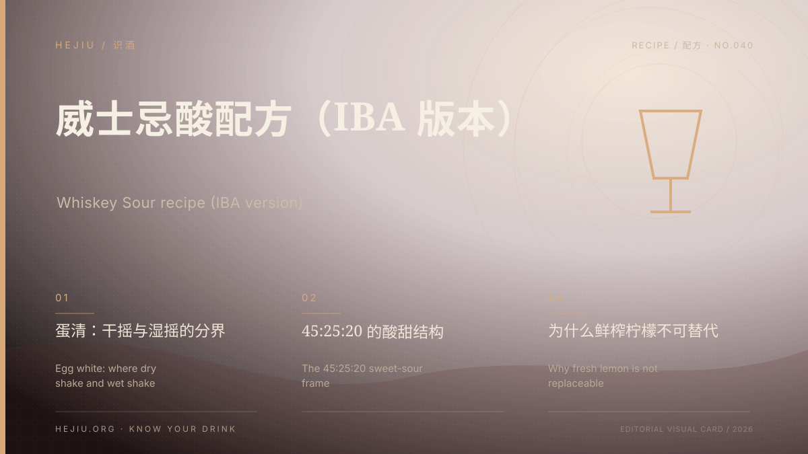

# Whiskey Sour recipe (IBA version)

The Whiskey Sour did not come from one bar's signboard. It grew out of a family of "sours" served in nineteenth-century American port towns, where sailors mixed spirit, lemon and sugar with whatever was at hand to break the monotony of ship rations and to keep scurvy away. Who first wrote the combination down, and in which year egg white joined it, is still disputed. This recipe does not settle that argument; it uses the IBA version as a citable position: 45 ml bourbon, 25 ml fresh lemon juice, 20 ml sugar syrup, egg white optional.

Figure: thematic illustration for Whiskey Sour recipe (IBA version). Image: AI-assisted illustration generated with Doubao Seedream 5.0 (project-owned); not a photograph of the subject.

> **Quick verdict**
> **In one line:** This recipe helps you make Whiskey Sour recipe (IBA version), and shows where the method usually fails.
>
> - **Best for:** Anyone who wants to make Whiskey Sour recipe (IBA version) step by step and knows where it usually goes wrong.
> - **Not for:** If you want will not measure ingredients or follow the order of steps.
> - **Check first:**
>   - The criterion is not a count of shakes but the temperature and feel of the tin.
>   - The IBA specifies a cobbler glass; for the on-the-rocks version, fill a large rocks glass with ice and strain into it.

## Egg white: where dry shake and wet shake divide

Egg white is not a decorative cap in this drink; it is a layer of structure. The IBA marks it optional, and the two choices imply two shaking routines. Without egg white, the drink only needs chilling and mixing. With egg white, it is better to give the tin a short shake without ice first — the dry shake — so the protein and the lemon acid meet before any ice dilutes them, then add ice for a second shake. The dry shake usually runs a dozen seconds or so; its job is to break up and aerate the protein, not to whip it into meringue. Skip it and shake egg white together with ice, and the foam is often thin and loose, collapsing a minute or two after it is poured.

The dry shake has costs. With no ice, there is less internal friction, a loose seal leaks more easily, and the protein warms sooner. Use a sturdy tin, close it firmly, and shake fast with a short stroke rather than a wide one. The second shake with ice is the real chilling step; it brings the drink to serving temperature and tidies the foam into finer bubbles. There is no need to open the tin between the two shakes — every peek costs foam.

Foam stability also depends on freshness and quantity. "A few drops" is the IBA wording; in practice half an egg white, about 15 ml, is more common, but that already moves towards another version and should be noted as such. Too much egg white makes the texture sticky and blocks aroma; too little cannot hold the rim. Pasteurised egg white works, but it usually whips less readily than fresh and needs a longer dry shake.

## The 45:25:20 sweet-sour frame

The three numbers form a skeleton you can reproduce: 45 spirit, 25 acid, 20 sweet. Reduced to 9:5:4, the intent is visible — the acid is more than half the base, and the sugar sits slightly below the acid. The order is not arbitrary. The weight of the whiskey comes first, lemon cuts through it, and sugar closes the cut, so the entry tastes sweet, the middle turns sour, and the finish returns to grain and barrel.

A ratio is useful because it can be compared. If the drink tastes sharp, first confirm that you used 45:25:20; if you did and it is still sharp, the likely variables are lemon ripeness, syrup strength or shaking dilution, not a wrong ratio. Many bars work at 45:20:15 or even 50:25:25, which is a different sweet-sour coordinate and tastes drier or rounder. Those drinks are valid, but they should not be blurred into one "Whiskey Sour standard" on the same page.

Syrup strength is the variable most often ignored. A 1:1 sugar-to-water syrup and a 2:1 rich syrup differ by nearly a factor of two in sweetness at the same 20 ml, and they bring different amounts of water. The IBA page says 20 ml of sugar syrup and does not prescribe a ratio, so when you change syrup you have to taste again rather than trusting the millilitres.

## Why fresh lemon is not replaceable

Lemon juice does two jobs here: it supplies acid and it supplies aroma. Bottled juice usually delivers only the first. Its acidity can be measured precisely, but the peel oils are largely lost in processing and storage, so it smells flat and tastes straight, without the brightness that lifts the first sip. The aroma structure of a Whiskey Sour depends on lemon holding up the vanilla and caramel of the bourbon; without that layer the drink feels closed.

Fresh juice has its own rules. Variety, ripeness and storage time all shift the acidity; within one batch, the lemons with smooth skin and a heavy feel in the hand usually give more juice and more aroma. Do not crush the seeds when juicing — seeds and pith bring bitterness — and strain the pulp once for a cleaner texture. Juice does not keep well: citrus oxidises in air, aroma drops noticeably within a few hours, and fresh-squeezed is best.

There is also a common misjudgement in quantity: tasting too little acid and adding more lemon until the aroma overwhelms the balance. The safer route is to make the 25 ml version first; if it still lacks acid, check whether undermixing left the sugar undissolved or too much ice washed the flavour out before you change the recipe.

## How long to shake, and how to tell

The criterion is not a count of shakes but the temperature and feel of the tin. Once ice is in, the wall cools noticeably within a dozen seconds; when the tin feels too cold to hold comfortably, you are usually there. With egg white, also watch the foam: rest the tin for two or three seconds after shaking, and if a fine, stable layer is visible through the seam of the lid, the protein has been worked enough.

Under-shaking is predictable: the drink is strong, the aroma is shut in, and egg white sits on the surface in lumps. Over-shaking is equally predictable: too much ice melts, the liquid thins, the foam can no longer stand, and the second half of the glass tastes of water. Neither is a ratio failure; both are failures of temperature and dilution.

Room temperature and ice shape change the time needed. Summer, small cubes and an unchilled tin all slow the chill; winter, large cubes and a pre-chilled tin do the opposite. So instead of memorising seconds, memorise the signals: cold tin, fine foam, misted glass — when all three appear, serve.

## Glass, ice and serving temperature

The IBA specifies a cobbler glass; for the on-the-rocks version, fill a large rocks glass with ice and strain into it. A cobbler is a straight, generously sized glass with a wide mouth, which lets the foam spread and makes the aroma easy to reach. A rocks glass is short and wide, so with ice in it the liquid meets more ice surface and dilution continues. The two glasses belong to two ways of drinking, not to a free choice.

Whether to chill the glass depends on how fast the drink will be consumed. A short drink warms quickly in a room-temperature glass, and a pre-chilled glass delays that; but chilling it until it frosts and then pouring suppresses the lemon and whiskey aroma, and the first sip feels muted. Refrigerating rather than freezing the glass, then drying the outside before serving, is the safer routine.

Ice choice matters as well. Hard, large cubes melt slowly and keep dilution under control; crushed ice chills fast but dilutes fast, and can thin the drink before the foam has settled. In the iced version, use enough large ice that the liquid level sits slightly above the ice, so the first sip is not all meltwater.

## Common departures at the bar

Bar practice usually diverges from the written recipe in three places. First, egg white: many bars add it by default, sometimes without asking; you are then drinking the egg-white version, which does not contradict the IBA's optional marking but does change the texture. Second, the sweet-sour balance: to suit local taste, syrup is often pushed past 25 ml for a rounder, heavier drink, while others raise the lemon to 30 ml for a sharper bite. Third, the glass: cobbler glasses are uncommon, and most bars serve in a rocks or highball glass, which changes how the foam spreads and how the aroma reads.

There is a second kind of departure: additions. A few dashes of Angostura, a splash of soda water for a Boston sour, or bitters dotted on the foam all add layers, but they cross the boundary of this IBA version. The test is simple: if an ingredient is replaced or added, record it as another version rather than quietly changing it under the same title.

The point of noticing departures is not to correct anyone but to know what you are drinking. Two different glasses from the same bar may not mean the bartender erred; it may mean the syrup or the lemons changed.

## A troubleshooting order

By frequency, the first problem is an unbalanced sweet-sour ratio. Too much lemon or too little syrup makes the entry sharp; too much syrup buries the bourbon. Check the ratio first, then the syrup strength, and only then the shake.

Second, egg white that will not foam. The usual causes are too little egg white, a skipped dry shake, ice added too early or a shake that was too gentle. Rule them out one at a time: half an egg white, a full dry shake, then ice and a hard shake.

Third, over-dilution. Too much ice, too long a shake or a warm tin all produce it; the drink looks pale, tastes hollow and the foam collapses.

Fourth, careless straining. Ice shards and pulp keep diluting in the glass and add bitterness; a fine-mesh strainer solves most of it, and you should not press the residual ice in the tin.

Fifth, the garnish. An orange slice and a cherry left too long lose their aroma, and the cherry's syrup seeps into the drink and changes its sweetness. Adding them at the last moment is the cheapest fix.

Sixth, treating egg white as mandatory. The IBA explicitly marks it optional; leaving it out still works. Deciding the recipe cannot be made because there is no egg white is reading an option as a requirement.

## Variations: from Boston sour to rye

The best-known variation is the Boston sour: after shaking, top the glass with a little soda water so the foam lifts and the texture lightens. It differs from this version by adding a source of carbonation, so both dilution and the temperature curve change.

Changing the base spirit is the other main line. Rye whiskey brings pepper and grain spice for a drier, more angular drink; Irish whiskey is softer, with grain and honey; an older bourbon carries more barrel and can overwhelm the lemon. Every substitution should name the style, not just "whiskey".

The sweetener can change too. Honey syrup pushes the aroma towards flowers, maple syrup adds a woody sweetness, and both alter the finish; replacing syrup with granulated sugar requires dissolving it first or grains will sit at the bottom. Swapping lemon for lime gives a sharper acid and a greener aroma, a different citrus direction altogether.

Serving on ice or straight up counts as a variation as well. Straining straight gives a stronger, colder, shorter drink; serving over ice gives a colder, longer one with continuous dilution. Both can be called a Whiskey Sour, but their temperature curves and drinking rhythms are different and should be recorded separately.

## See also

For the general principles of sweet-sour balance, read [cocktail basics](ref:cocktails-guide); for ice shape, temperature and dilution, read [ice and temperature](ref:ice); for the action and rhythm of shaking, read [shaking](ref:shaking). On equipment, the [shaker](ref:shaker) and the [strainer](ref:strainer) determine temperature and clarity, and the [highball](ref:vessel) is the registered glass. For the base spirit, read [bourbon](ref:bourbon); for the drink itself, see [Whiskey Sour](ref:cocktail). This recipe records one sourced version and evaluates no specific brand. Drink in moderation and follow local law and safety requirements.
