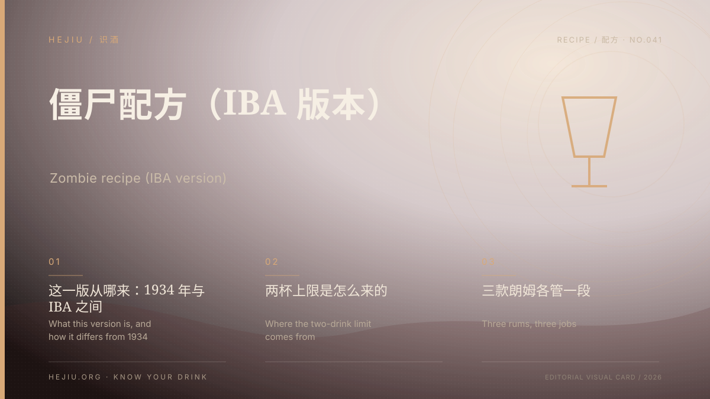

# Zombie recipe (IBA version)

This is one traceable version of the [Zombie](ref:cocktail), filed under the IBA's contemporary classics. It records exactly this build: three rums totalling 120 ml, 20 ml lime juice, 15 ml falernum, 15 ml Donn's Mix, 5 ml grenadine, 1 dash Angostura bitters and 6 drops of pastis, shaken with about 170 g of crushed ice and poured unstrained into a highball. Keeping the recipe separate from the cocktail's identity means the 1934 original and the many bar adaptations can later sit side by side instead of overwriting each other.

Figure: thematic illustration for Zombie recipe (IBA version). Image: AI-assisted illustration generated with Doubao Seedream 5.0 (project-owned); not a photograph of the subject.

> **Quick verdict**
> **In one line:** This recipe helps you make Zombie recipe (IBA version), and shows where the method usually fails.
>
> - **Best for:** Anyone who wants to make Zombie recipe (IBA version) step by step and knows where it usually goes wrong.
> - **Not for:** If you want will not measure ingredients or follow the order of steps.
> - **Check first:**
>   - The Zombie is usually traced to 1934 and to Donn Beach, born Ernest Gantt, who ran Don the Beachcomber in Hollywood.
>   - The most famous story about the Zombie is that Don the Beachcomber capped every guest at two.

## What this version is, and how it differs from 1934

The Zombie is usually traced to 1934 and to Donn Beach, born Ernest Gantt, who ran Don the Beachcomber in Hollywood. The date is consistent across tiki research, but it behaves more like a frequently repeated starting point than a documented launch date. The early recipe hid its ingredients behind numbers on a private list, so that even the men mixing the drinks were simply reaching for bottles by number. Jeff "Beachbum" Berry's later reconstruction is what turned those numbers back into something a bartender could pour.

The IBA entry is a contemporary classic rather than a transcript of the original. It replaces the high-strength demerara rum of 1934 with three widely available rums, turns the mysterious Mixer No. 4 into a reproducible Donn's Mix, and changes the method from a bar blender to a short, hard treatment with crushed ice. The quantities here are taken from the IBA entry, checked on 7 November 2026. If you have seen a Zombie built from rum, pineapple juice, grenadine and cinnamon, that is a different version; the difference is set out below.

## Where the two-drink limit comes from

The most famous story about the Zombie is that Don the Beachcomber capped every guest at two. One telling has a hung-over customer declaring that the drink had turned him into a zombie for the rest of the day, which is supposed to explain the name. Another has the owner simply writing a house rule because he knew exactly how strong the drink was. Both are anecdotes without a verifiable primary document, so this recipe treats them as legend rather than archive.

The arithmetic behind the limit, however, is real. The three rums total 120 ml; at a typical 40% to 43% alcohol by volume that is roughly 48 to 52 ml of pure alcohol before any dilution. Shaking and the ice in the glass add another 20% to 30%, which still leaves the serve at about three to four standard drinks. Yet it tastes of fruit and syrup, with the bitterness and the alcoholic bite pushed far into the background, and that is precisely what makes it dangerous to drink quickly. The two-drink rule is less a prohibition than a warning that this drink will not announce its strength.

## Three rums, three jobs

Jamaican dark rum, 45 ml, is the bass line. [Rum](ref:rum) styles are most audible here: Jamaican distilleries are known for high ester counts, so molasses, ripe banana, resin and a little wild funk all arrive from this one measure. It does not need to be expensive, but it does need to taste of something. Swap it for a neutral rum and the drink collapses into sweetened fruit juice.

Gold Puerto Rican rum, 45 ml, is the frame. It is usually cleaner and lighter, with cane sweetness and a suggestion of vanilla and coconut, and its job is to open up the weight of the dark rum so the drink has a middle. Many people assume darker means more authentic and replace this measure with another dark rum. The result is a solid block of molasses with the acid and the aromatics buried underneath.

Demerara rum, 30 ml, supplies weight and toast. Distilled from Guyanese demerara molasses, it brings wood, caramel, cocoa and spice, a thick body and a long finish. It is only a quarter of the total, yet it stops the sweetness of the other two from floating away. The split is 45 to 45 to 30, or three to three to two, and the imbalance is deliberate: 75 ml of dark-side rum against 45 ml of lighter rum.

## Overproof: strength is not more rum

The 1934 original used a 151-proof demerara rum, roughly 75.5% alcohol by US proof, where a small measure is enough to lift the whole frame. The current IBA entry contains no overproof rum and uses 30 ml of regular demerara instead. That is a version difference, not an error by either side.

Overproof is not there for a hotter flavour; it is there for penetration. High alcohol pushes aroma upward so that syrup and juice cannot smother the rum. The cost is straightforward: 15 ml of a 75.5% spirit adds about 11 ml of pure alcohol, which lifts the whole serve by another notch. The sensible use is to replace 15 ml of the regular rum with overproof, not to add a further 15 ml on top of 120 ml. The second approach is a different version and should be labelled as one.

A related misunderstanding is that overproof earns you more sugar. The opposite tends to happen: high alcohol magnifies both sweetness and heat, so how much syrup to cut can only be settled by tasting, not by arithmetic. A recipe supplies a starting point; strength is part of the outcome.

## Donn's Mix, and why pineapple is missing

The IBA lists Donn's Mix as two parts fresh yellow grapefruit juice to one part cinnamon syrup. At 15 ml of the mix, that works out to 10 ml of grapefruit juice and 5 ml of cinnamon syrup. Grapefruit gives a longer, faintly bitter acidity, while lime gives the sharp leading edge, so the two acids do different work. Cinnamon syrup adds warmth and stitches the caramel of the dark rum to the lime.

There is a genuine dispute here. Beachbum Berry's reconstruction explained the secret Mixer No. 4 as white grapefruit juice plus cinnamon syrup, and that explanation travelled widely. More recent work in Don Beach's archives argues that cinnamon was a separate numbered flavouring and that No. 4 was something else entirely. Grapefruit plus cinnamon is therefore a working approximation that happens to taste close, not the 1934 liquid itself. The IBA uses it because it can be reproduced, not because it has been proved identical.

As for pineapple juice: it appears in many bar and online versions because it adds foam, pulp and a softer acidity. It also adds water and sugar, which thins the frame built by 120 ml of rum. This version has none, so adding 30 ml of pineapple juice to the quantities here produces a lighter, sweeter drink. That is a variation, not a correction. Pineapple is better kept in the garnish, or added only when you deliberately cut the grenadine back.

## Lime, grenadine and the two aromatic accents

The lime juice is only 20 ml, low for a sour, because the grapefruit has already supplied part of the acid. Lime is responsible for the sharp front and the fresh aroma; too little and the drink closes up, too much and it flattens the cinnamon and the molasses. Use fresh juice. Bottled lime loses most of its aroma by the time the shaker is empty.

The grenadine is 5 ml, the IBA's one teaspoon. It does more than colour the drink: the red-fruit sweetness and faint tannin add a layer through the middle and give the bitters somewhere to land. It should not be pushed to 15 ml. At that level the drink tilts towards candy and the funk of the rum disappears.

One dash of Angostura brings clove, cinnamon and a little bitterness, confirming the direction of the cinnamon syrup. Six drops of pastis is the most underrated part of the recipe. It changes no sweetness and no acidity; it changes the shape of the aroma, making the first sip seem taller and brighter. Six drops means six drops. Poured as 6 ml it produces a glass of liquorice water. If you distrust your hand, rinse the glass with pastis and tip the rest out.

## Shake, crushed ice and the pour

The IBA method puts everything into an electric blender with 170 g of cracked ice and pulses it for a few seconds before pouring into a tall glass. The point is not to turn the ice into slush but to bring ice, syrup and juice together in a very short time while folding in air, leaving a cloudy suspension of fine ice.

This recipe records the method as [shaking](ref:shaking) for reproducibility. Without a blender, 170 g of crushed ice in a shaker and 10 to 12 seconds of hard shaking gets very close to the same temperature, dilution and aeration; tiki bartenders call the technique a whip shake. The difference is that a blender is easier to overrun. Blend too long and every piece of ice collapses, the foam falls, and the drink becomes thin fruit juice.

The choice between crushed and cubed ice follows from that. Crushed ice chills fast and dilutes fast, which suits a long drink that is meant to be finished quickly. Cubes chill slowly and keep the body tighter, but the aroma never opens the same way. Shaking time can be trimmed or extended with the ice load; the target is a frosted tin and a distinctly cold hand, not a count of shakes. For more on ice shape and temperature, see [Ice and temperature](ref:ice).

## The glass: what a highball has to hold

The IBA specifies a tall tumbler, which maps to the [highball](ref:vessel) here, usually 300 to 400 ml depending on the product. The glass needs height so the crushed ice can mound above the rim. Too small a glass and the ice reaches the top, the first mouthful is meltwater and the drink is pushed underneath.

A tiki mug is the most common alternative for this style. Thick ceramic holds the cold well and the shape fits the aesthetic, but the library has no entry for that vessel, so the glass reference here stays with the highball. Two cautions apply with a mug: thick walls make the capacity easy to underestimate, so more drink goes in than it appears, and a narrow mouth makes it awkward to pack crushed ice, which leaves the aroma closed.

Chill both the glass and the ice beforehand. If the ice is not cold enough, the shaken drink warms up again in the glass and loses its aroma and its lift together.

## Garnish: slap the mint, add fruit last

The IBA lists mint only. This recipe records mint and fruit together because that is the common presentation: one mint sprig supplies a cool aromatic top note, while the fruit, a pineapple wedge or a lime wheel, supplies visual recognition and a little peel aroma. Fruit is not measured, not part of the build and does not change the sweet-sour balance.

Do not muddle the mint. A slap is enough to break the cells and release the oil; muddling draws out chlorophyll bitterness that turns grassy within minutes. Sit the sprig on top of the ice rather than burying it. The same applies to fruit: a thick wedge takes up the rim, and a slice left sitting turns sour on the surface. Cut it fresh, place it last and leave it alone.

## Where this recipe fails

First, under-shaking. The syrup has not fully dissolved, so the sweetness arrives in steps and the drink is not cold enough.

Second, using cubed ice but shaking for crushed-ice timings. The drink never chills properly, the aroma stays shut and it tastes like watered rum syrup.

Third, adding pineapple juice while keeping the full 5 ml of grenadine. Sweetness doubles, the acid cannot keep up and the result is cloying.

Fourth, pouring 6 ml of pastis instead of 6 drops. Liquorice wipes out the cinnamon, the bitters and every detail of the rum.

Fifth, using a dark rum coloured only with caramel. The colour is there, the molasses and esters are not, and the drink tastes of nothing but sugar.

Sixth, batching four serves at once. A shaker cannot hold more than 480 ml of liquid plus ice, so it cannot be shaken properly and both dilution and temperature run away. Shake in two batches, or switch to a larger vessel and blend.

## Variations and the version question

The 1934 original turns on overproof demerara rum and a numbered mixer, and it is both stronger and wilder in aroma than the IBA version. Three modern adjustments are common: float 15 ml of overproof on top; replace the gold Puerto Rican rum with an agricultural rhum for a sharper, grassier acidity; or add 20 to 30 ml of pineapple juice for a longer, easier drink.

All three can still be called a Zombie, but each should be recorded with what it replaced. To judge whether a change works, do not ask whether it seems authentic. Ask three things: is the rum still in front, has the sugar buried the acid, and is there any structure left after the ice has melted. For a general account of how a cocktail holds together, see [Cocktail basics](ref:basics). Compared with the [Mai Tai](ref:mai-tai), the Zombie carries more rum, less juice and more alcohol, and the two balance in quite different ways.

## See also

- [Zombie](ref:cocktail): the identity, the name and the style.
- [Rum](ref:rum): how Jamaican, Puerto Rican and demerara styles differ.
- [Shaking](ref:shaking): motion, timing and control of dilution.
- [Highball](ref:vessel): long-drink glassware and the ice it must hold.
- [Ice and temperature](ref:ice): crushed ice, cubes and chilling speed.
