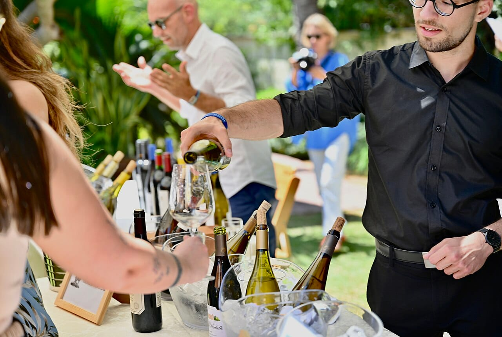

# Blind Tasting

Blind tasting judges a drink without seeing its label, using aroma, palate, structure and finish to infer type, origin, age and quality. The aim is not to guess right but to observe in order: to break a subjective impression into dimensions that can be compared. Aroma is one of the strongest clues; for detail, see [aroma](ref:aroma).

It needs a method. Look at colour, smell, taste, judge structure, record each step and only then check the label. Without a method it is a guessing game; with one it is training.

Figure: A tasting event. Image: U.S. Embassy Jerusalem, CC BY 2.0, via Wikimedia Commons ([source page](https://commons.wikimedia.org/wiki/File:California_wine_tasting_event_in_cooperation_with_the_U.S._Foreign_Agricultural_Service_held_in_Israel_on_12_June_2023_-_8.jpg)).

## Principle and bias

The core of blind tasting is removing label bias. A label pulls the taster toward region, price and brand; blind tasting removes the visual cue and returns the judgment to aroma and palate.

But it is not fully objective. Colour, glass, temperature, pour order and even room smell all shape the judgment; blind tasting removes one bias and may add another. Understanding the variables matters more than an absolute answer.

It does not replace everyday drinking. In daily life the label and the story are part of the experience; blind tasting is a training tool for sensitivity and accurate description.

## History and settings

Blind tasting grew from wine trade, competition and regional assessment. Merchants needed to judge quality and origin without a label; competitions needed fair comparison; sommelier training needed repetition.

Today it appears at tastings, exams, restaurant training and friends' gatherings. It can be formal, with timing, scores and notes, or relaxed, guessing region and age. The rules differ, the method does not.

It is not only for wine. Beer, whisky, sake and coffee can be tasted blind; the dimensions differ, but the order of observe, describe and judge stays the same. For beer, see [beer tasting](ref:beer-tasting).

## What it suits

Blind tasting suits drinks with clear styles: wine, beer, whisky and sake. They have comparable dimensions such as colour, aroma, acidity, bitterness, body and finish; the clearer the style, the more useful the training. For wine, see [wine](ref:wine).

It does not suit a completely unfamiliar drink. Without a reference, blind tasting can describe but not judge; build a set of standard samples first.

It does not suit excess. Blind tasting needs focus, and alcohol dulls judgment; limit the number of samples and rest between them.

## Method and order

First, look. Note clarity, depth and rim colour; colour hints at age, variety and technique, but is not proof.

Second, smell. Smell still, then swirl gently; separate fruit, flower, spice, wood, mineral and fermentation notes. For nosing, see [nosing](ref:nosing).

Third, taste. Take a small sip and let it cover the tongue; note acidity, sweetness, bitterness, tannin, body and finish. Do not swallow at once; feel the structure.

Fourth, judge. Combine the dimensions into type, origin, age and quality; give a range first, then narrow it, rather than naming a producer at once.

Fifth, check the label. Only then look, and record why you were right or wrong; a wrong guess teaches more than a right one.

## Notes and training

Notes should be specific. Not "good" or "bad" but "high acid, fine tannin, long finish, blackberry and cedar"; the more specific, the easier to compare. Write the note before discussion, so other tasters' words do not overwrite your own.

Start with comparative tastings: one variety across regions, one region across vintages, one wine at different temperatures. Comparison magnifies difference and builds reference.

Frequency beats intensity. Once a week with three to five wines beats ten in one sitting; keep the notes and review them later to see your blind spots.

Description needs practice. Start with scales such as light, medium and heavy, short, medium and long, then add specific words: red fruit or black, fresh flowers or dried, vanilla or smoke in the wood. The more specific the vocabulary, the stronger the judgment and the easier the comparison.

Blind tasting can also be a game. Pour several wines into identical glasses, number them, let each person write notes and compare at the end; keep price and region hidden to avoid the "expensive is better" bias. A game lowers the pressure and encourages beginners to describe. Keep the scoring simple: aroma, palate, finish, and one line of evidence for each.

It is not an exam. An exam demands an answer within a time limit; training asks for observation without pressure. Do not treat a hit rate as the whole value of blind tasting; practice should allow slow work, wrong guesses and repeated comparison.

## Common mistakes

First, chasing the right answer. Blind tasting is observation and description, not a quiz; a wrong guess still teaches.

Second, ignoring temperature and glass. Both change aroma and palate; keep conditions constant or the variables interfere.

Third, drinking too much. Alcohol dulls judgment and tires the palate; limit the number and rest between samples.

Fourth, reading the label first. Check it after tasting to compare, not to prove yourself right; the label is not the answer, observation is. For tasting glasses, see [tasting glass](ref:glass); for the first sip, see [first tasting](ref:first).

**In brief:** Judging a drink without seeing its label, using aroma, palate, structure and finish to infer type, origin, age and quality. Method matters more than guessing right. 

Start with the timing and temperature. From there, consider the equipment, then the scale it is practised at. That is how a practical judgment about Blind Tasting is built.

The usual confusion is to treat Blind Tasting as a tool. Check what it is first, then what the method changes; the two need not agree.

Start with “Principle and bias”, then read “History and settings”. The first establishes object; the second turns to key action. Skipping the first makes Blind Tasting easier to confuse with a tool.

A practical setup uses neutral glasses, coded samples and a fixed scoresheet; record observations before guessing, and change one variable at a time.

The scoresheet should separate aroma, palate, structure and finish, and a second taster helps catch drift.

**Key facts.**

| Item | Detail |
| --- | --- |
| In one line | Judging a drink without seeing its label, using aroma, palate, structure and finish to infer type, origin, age and quality. Method matters more than guessing right. |
| Applies to | Wine、Tasting glass |

**Sources and limits.** The key claims about Blind Tasting are checked against the following sources: Oxford University Press (Used to check blind tasting and sensory assessment background), Encyclopaedia Britannica (Used to check wine sensory and regional background), Wine Folly (Used to check tasting glass and sensory training advice) and 5 sources in total. Prices, batches and status change; the body is project-written and does not reproduce source text.

For Blind Tasting, this technique was last checked in 2026; prices, batches and availability change, so confirm them against the sources below.
