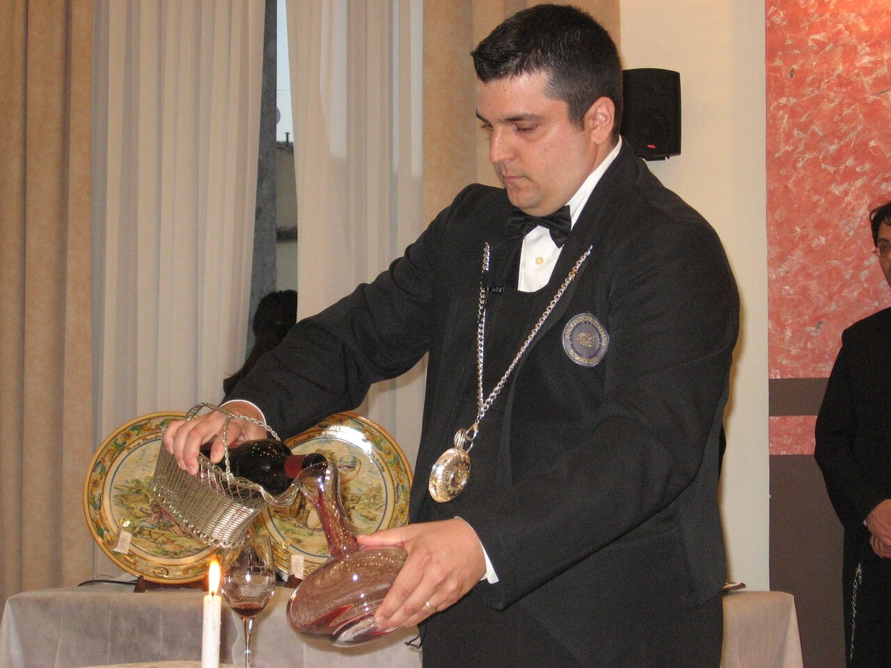

# Decanting

Decanting is a serving technique in which the liquid is slowly poured from its original bottle into another vessel, separating the drink from sediment at the bottom and letting it contact air. It has two purposes: removing sediment and opening up aroma and palate. The two do not always apply at once, so whether to decant, and for how long, depends on the drink type, age and current condition.

Figure: A sommelier decanting wine. Image: Fabio Ingrosso, CC BY 2.0, via Wikimedia Commons ([source page](https://commons.wikimedia.org/wiki/File:Sommelier_decanting_and_serving_wine_at_a_restaurant.jpg)).

## Definition and scope

The usual subjects for decanting are [red wine](ref:red-wine), vintage Port and other [fortified wines](ref:fortified), and some aged [brandy](ref:brandy).

After ageing in bottle these drinks may develop sediment formed from pigment, tannin and tartaric acid; sediment is not harmful in itself but makes the palate feel coarse and spoils the look. Standing the bottle upright before decanting concentrates the sediment so it can be avoided when pouring.

Decanting is not a fixed ritual for every wine. Young reds with tight tannin may benefit from brief air contact; old wines may lose aroma within minutes. Sparkling wines and most fresh white wines usually do not need decanting, because bubbles and fresh aromas are lost through excessive air contact.

## Why decant

The first reason is separating sediment. Stand the bottle upright for a period so sediment sinks to the bottom, then pour slowly to keep it out of the glass. The second is promoting oxidation. After contact with air, some reductive aromas disperse and tannin and pigment change slightly, and the palate may feel softer.

The third is presentation and ritual. Decanting in front of guests lets them see the condition of the wine and confirm there is no obvious fault. The ritual has value but is not a technical necessity; if the wine does not need it, forcing a decant can harm its performance.

## When not to decant

Old wine is the classic example. A wine aged for decades is very fragile in bottle, and long air contact can make delicate aromas fade quickly. Decanting old wine is usually mainly about separating sediment: the action should be gentle, the time short, and sometimes the bottle is only left standing briefly before serving.

Another unsuitable group is wine whose aroma volatilises easily, such as some old Champagnes or light whites. Excessive decanting disperses fruit and floral notes and leaves the body hollow. The criterion is the condition of the wine, not the price or the vintage label.

## Decanters and equipment

Common decanters have a wide base and a narrow neck; the wide base increases the contact area between liquid and air, while the narrow neck reduces aroma loss. There are also wider-mouthed "waterfall" decanters that give more air contact and suit young, tannic wines. Shape affects the speed of oxidation, so this is not merely decorative. For shapes and cleaning, see [decanter](ref:decanter).

Besides the decanter, a light source, a clean funnel or pourer, and a stable tray are useful. The light is used to watch the sediment and avoid pouring it into the decanter. A funnel and strainer can catch larger sediment, but they may also hide fine changes in the wine, so their use involves a trade-off.

## Procedure

First, stand the bottle upright in advance so sediment collects at the bottom; the time depends on age and the amount of sediment and may range from a few hours to a day. Second, open the bottle under a light without shaking it. Third, hold the neck near the decanter and pour steadily, continuously and slowly. For the pouring action, see [pouring](ref:pouring).

Fourth, watch the sediment at the shoulder of the bottle and stop when it approaches the neck, leaving a little wine rather than carrying sediment over. Fifth, let the wine rest in the decanter and then taste it, deciding from aroma and palate whether to wait longer. Avoid sharp temperature changes throughout.

## Timing

There is no universal formula for decanting time. Young, tannic reds may need longer; old wines may need only a few minutes to a quarter of an hour. The method is repeated tasting: if the aroma is closed and tannin prominent, wait; if the aroma starts to fade and the body thins, serve immediately.

Room temperature also affects the speed of oxidation. Warmth speeds change, cold slows it. Restaurants usually keep the decanter near serving temperature rather than beside a radiator. Timing is dynamic and cannot be reduced to a fixed statement such as "decant for half an hour".

## Relationship to tasting

Decanting changes the presentation of the wine, so tasting notes should record whether it was decanted, for how long and in what shape of vessel. The same bottle can show completely different aroma and structure just after opening and after decanting; if the conditions are not recorded, comparisons lose meaning.

Decanting can also mask faults. Excessive oxidation may temporarily soften some off-flavours but does not remove the fault. Professional tasting usually records before and after decanting to separate "the wine changing" from "the wine having a problem". This is why decanting as a technique needs to be documented.

## Common misconceptions

First, all red wine should be decanted. Fresh, easy-drinking reds may not need it, and excessive decanting costs fruit aroma.

Second, the longer the decant, the better. Too long disperses aroma and thins the body, and old wine is especially fragile.

Third, decanting removes all faults. It can only separate sediment and promote oxidation; it cannot repair problems such as cork taint.

Fourth, the more expensive the decanter, the better. Shape and contact area matter more than price, and the right shape serves the condition of the wine.

Fifth, the more vigorous the pour, the better. Vigorous pouring stirs up sediment and volatilises aroma excessively; keep the pour steady and slow.

For Decanting, begin with the timing and temperature. Then look at the equipment, and finally ask the scale it is practised at. The answers point to different choices, not to a single score.

[Red wine](ref:red-wine) and [Brandy](ref:brandy) are the two useful reference points for Decanting. [Red wine](ref:red-wine) sets out object; [Brandy](ref:brandy) brings in key action. Read them together.

**In brief:** A serving technique that separates wine from sediment and exposes it to air; whether to decant depends on the drink type, age and condition, and not every wine benefits from long decanting.

**Key facts.**

| Item | Detail |
| --- | --- |
| In one line | A serving technique that separates wine from sediment and exposes it to air; whether to decant depends on the drink type, age and condition, and not every wine benefits from long decanting. |
| Applies to | Red wine、Fortified wine、Brandy |

**Sources and limits.** The key claims about Decanting are checked against the following sources: Oxford University Press (Consulted for entries on decanting, sediment and serving old wines; Migrated from the former reference list at the end of the article; access date not re-verified), OIV (Used to check the definition of wine and the general process framework), Encyclopaedia Britannica (Consulted for entries on winemaking, clarification and ageing) and 5 sources in total. Prices, batches and status change; the body is project-written and does not reproduce source text.

## Further reading

- [Red wine](ref:red-wine): the relationship between tannin, sediment and ageing.
- [Fortified wine](ref:fortified): drinks such as vintage Port that need sediment separated.
- [Brandy](ref:brandy): sediment and serving in aged spirits.
- [Oak ageing](ref:oak): how cask ageing affects sediment, tannin and aroma.
