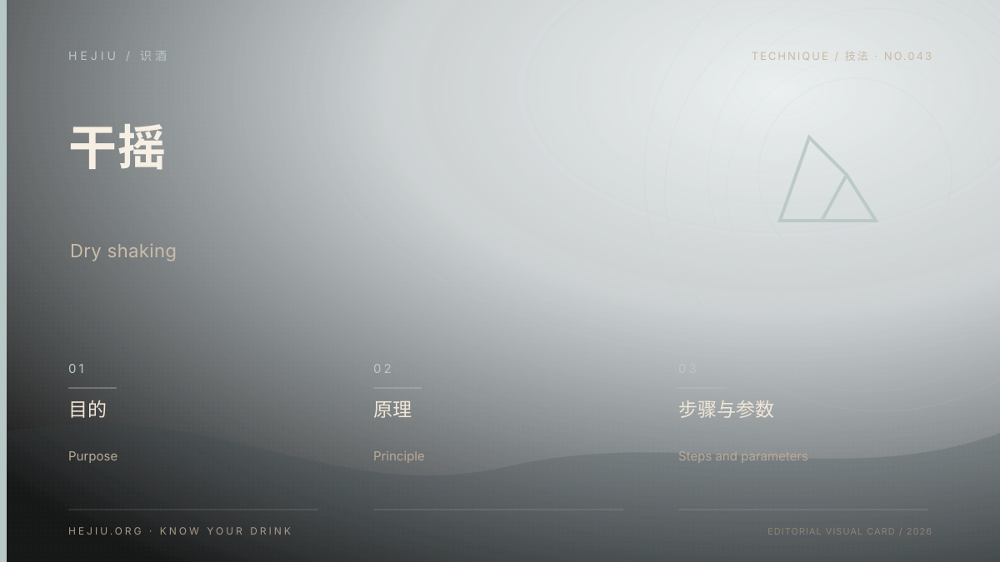

# Dry shaking

Dry shaking means shaking without ice first and then shaking with ice in a second stage. The word "dry" refers to the absence of ice in the shaker, not to the absence of liquid. It is mainly used for recipes containing egg white, cream or plant protein: the first stage lets the protein and air form a foam, and the second stage, with ice, chills and dilutes the drink.

Figure: thematic illustration for Dry shaking. Image: AI-assisted illustration generated with Doubao Seedream 5.0 (project-owned); not a photograph of the subject.

## Purpose

The most direct purpose is a fine, stable foam layer. If an egg-white cocktail is shaken with ice from the start, foam still forms, but the melting ice dilutes the drink at the same time and the thickness and structure of the foam can suffer. A dry shake lets the foam establish itself before dilution.

The second purpose is emulsification. Cream, coconut milk or oily ingredients do not mix easily with spirits, and hard shaking breaks the fat into small droplets so that the texture becomes smoother and the drink does not split.

The third is texture. Foam affects not only appearance but also the mouthfeel and the way aroma is carried. A fine foam can make acidity feel softer and give the body more layers. For the basic idea of body, see [body](ref:body).

## Principle

Proteins in egg white unfold when agitated and trap air, forming a foam network; acid and sugar affect how stable that foam is, while the force and duration of shaking determine bubble size. Plant proteins such as aquafaba can provide similar foaming ability and are often used as an egg-free alternative.

There is no ice in the dry-shake stage, so there is little dilution and the temperature does not drop much. Friction from shaking warms the liquid slightly, and protein foams more readily when warm, but pressure inside the shaker also rises. When ice is added for the wet shake, the temperature drops quickly and some of the foam shrinks or collapses, so the foam built in the dry stage must be stable enough to survive the second stage.

Pressure is the physical factor to watch most carefully. Liquid and air expand in a sealed vessel as they warm, and the lid can spray when opened, especially if the seal is incomplete or the shaker is overfilled.

## Steps and parameters

First, put the liquid, acid, sugar and egg white or cream into the shaker as the recipe directs. Do not add ice yet.

Second, check the lid and seal. Without ice resistance, liquid leaks more easily through gaps, so the lid must be fully seated and the shaker must not be overfilled.

Third, shake hard. There is no universal duration for a dry shake; it depends on the recipe, the amount of egg white and the type of shaker. If the recipe gives a time or a description of the feel, follow it. A common sign is a clearly foaming liquid and increased resistance.

Fourth, open carefully. Release the pressure slightly first, then open fully, so that foam does not spray out.

Fifth, add ice and perform the wet shake to chill and dilute. The wet-shake time should also follow the recipe and the target temperature.

Sixth, strain into the glass. Egg-white recipes are usually single strained to keep the foam; a fine mesh will destroy part of it.

Raw egg involves food safety. Use fresh, properly refrigerated eggs, or processed egg products as local rules allow; clean the shaker, work surface and hands promptly, and do not leave a drink containing raw egg standing for a long time.

## Where it applies and alternatives

Dry shaking suits recipes with egg white, cream, coconut milk or plant protein. In a [Whiskey Sour](ref:sour), the common approach after adding egg white is a dry shake followed by a wet shake; the [Pisco Sour](ref:pisco) is also known for its fine foam, and the exact steps should follow the recipe.

It does not suit clear recipes built around bubbles or delicate aroma. Dry shaking introduces a lot of air and makes the liquid cloudy; carbonated ingredients should never be dry shaken, because rising pressure and escaping gas make opening dangerous.

Alternatives include a wet shake only, with a longer shake to build foam, which usually gives a slightly thinner structure; a "reverse dry shake", in which the drink is shaken with ice first, strained, and then shaken without ice, which can give a tighter foam but adds steps; aquafaba instead of egg white for a vegan option; and blending or homogenising when cream or coconut milk is involved. The choice should serve the recipe, not the number of steps.

## Common failure points

First, a loose lid. Pressure and liquid escape through the gap during a dry shake and the lid can even fly off.

Second, overfilling. With no room for expansion, foam sprays out when the lid opens, wasting ingredients and dirtying the work surface.

Third, shaking too briefly. The protein does not unfold enough and the foam is thin and short-lived.

Fourth, shaking too long. The foam can become dry and stiff, like soap bubbles, and the egg-white flavour becomes more obvious.

Fifth, adding ice first. Ice chills and dilutes, changing the conditions for foam formation and removing the point of the dry shake.

Sixth, using stale egg white. Foaming ability drops and the risk of off-flavours rises.

Seventh, neglecting hygiene. Tools and surfaces touched by raw egg should be cleaned promptly to avoid cross-contamination.

Eighth, straining badly. Filtering an egg-white drink through a fine mesh removes the foam that was just built.

## Practice

Practise with egg white, lemon juice and syrup, without alcohol, to keep the cost low. First record the foam height and how quickly it fades with a wet shake only, then make a dry-shake-plus-wet-shake version and compare. Watch the fineness of the foam, how it coats the glass and how it changes after a few minutes.

Practise opening: after the dry shake, crack the lid slightly, listen and check for liquid, then open fully. Making this a fixed habit reduces accidents in service.

Finally, practise reproduction: make the same recipe three times, controlling the rhythm of the dry and wet shakes, and compare foam thickness. Consistency matters more than occasionally producing a very tall foam.

## Common misconceptions

First, "dry shaking sterilises". Shaking cannot replace food-safety handling; storage and cleaning for raw egg must follow the rules.

Second, "the longer the dry shake the better". Foam has an optimal state, and over-shaking makes it stiff and the flavour worse.

Third, "every cocktail needs a dry shake". Only recipes that need foam or emulsification do; clear short drinks only become cloudy.

Fourth, "a dry-shaken drink is ready to serve". The dry shake has not chilled or diluted the drink, so a wet shake is still needed.

Fifth, "taller foam is better". Foam should work with the body, acidity and aroma; too much can feel hollow.

Sixth, "carbonated ingredients can be dry shaken". Pressure rises quickly in a sealed shaker and opening is dangerous.

## See also

- [Shaking](ref:shaking): the parent technique and the overall motion.
- [Cocktail shaker](ref:shaker): sealing, capacity and opening.
- [Whiskey Sour](ref:sour): a classic sour recipe with egg white.
- [Pisco Sour](ref:pisco): a South American classic known for its foam.
- [Body](ref:body): how foam and texture affect the overall mouthfeel.

To read Dry shaking, start with the timing and temperature, then the equipment, then the scale it is practised at; no single check settles it.