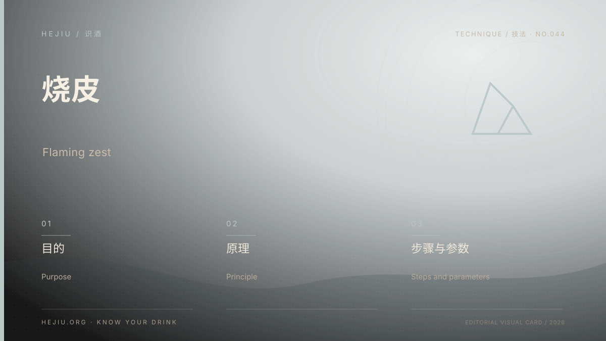

# Flaming zest

Flaming zest means pointing the outer layer of a citrus peel at a flame, squeezing the peel so that the oil sprays through the flame and falls into the glass. The oil mist burns briefly, bringing out toasted and charred notes, and the aroma settles on the surface of the drink. It appears in upgraded versions of classic cocktails and is often used as a bar flourish; but an open flame combined with high-strength alcohol makes it one of the riskiest garnish techniques.

Figure: thematic illustration for Flaming zest. Image: AI-assisted illustration generated with Doubao Seedream 5.0 (project-owned); not a photograph of the subject.

## Purpose

The first purpose is to change the aroma. The outer layer of citrus peel is rich in volatile oils, and simply squeezing it, known as expressing the peel, already gives fresh citrus aroma. Passing the oil through a flame heats and briefly burns part of it, creating toasted, caramelised and lightly smoky notes, so the aroma shifts from bright to warm.

The second purpose is to change where the aroma lands. Oil mist burned above the rim settles on the surface of the drink and around the rim, so the first thing a drinker meets is that layer. For the layers of aroma, see [aroma](ref:aroma) and [nosing](ref:nosing).

The third purpose is presentation. The flame is brief and visually striking, which suits occasions that need a sense of theatre. But presentation must never outrank safety; where open flames are prohibited, the technique should not be used.

## Principle

The outer layer of citrus peel contains a large amount of volatile essential oil, much of it flammable. When the peel is squeezed, oil leaves as a fine mist; on contact with a flame it vaporises and burns quickly, producing a brief flash. The burn does not last, because the amount of oil is small and the droplets are fine.

The effect on aroma is twofold. Moderate heating makes some aroma compounds more volatile and adds a lightly toasted note; excessive burning turns the oil into tar and soot, which smell harsh and bitter and damage the aroma when they land in the drink. The white pith contains almost no oil, so pressing into the pith only adds bitterness and water.

Moisture also matters. A peel that has just been washed and still has water on the surface produces steam and splatter in the flame, giving an uneven oil mist and a greater risk of burning the hand. The peel should be dried before use.

## Steps and parameters

First, choose clean citrus. The skin should be intact and free of rot, and should be washed and dried as needed. Waxed peel may produce unpleasant smoke when burned, so check the condition of the skin before use.

Second, cut the peel. Take a strip of moderate width, keeping mostly the outer oil layer and limiting the white pith. Too narrow a strip gives little oil; too wide a strip presses into the pith.

Third, prepare the flame and the working position. Use a stable match or a long-nozzle lighter, and keep away from flammable materials, bottles, paper, curtains and low ceilings; the surface should be heatproof, and open bottles of high-strength spirit should not be nearby.

Fourth, hold the peel above the rim with the oil layer facing the glass and the flame between the peel and the glass. Squeeze the peel so that the oil mist passes through the flame towards the rim. The action should be short and controlled rather than a long, hard squeeze.

Fifth, as soon as the flame goes out, move the peel and the flame source away, confirm that nothing is still burning, and then place the peel in the glass as a garnish or discard it. Do not leave a burning peel resting on the rim.

Sixth, serve promptly. The toasted aroma fades and smoke can accumulate.

There are no universal distances, angles or squeeze durations, because oil content, flame size and glass shape all differ. The principle is short, steady and low: a short action, a steady flame and a low position, so that oil does not spray widely. If the venue prohibits open flames, switch directly to expressing the peel without fire.

## Where it applies and alternatives

Flaming zest suits short drinks with a structured aroma and a relatively high alcohol content. In the [Old Fashioned](ref:old-fashioned), orange peel is a common garnish, and expressing or flaming it reinforces the citrus-and-sugar interplay; whisky-based drinks with a heavier body can also carry toasted aroma.

It does not suit recipes with a delicate, floral or fresh-citrus aroma. Smoke and char will cover the finer notes and make the drink feel heavy. Drinks with a lot of carbonation are also poor candidates for a flame at the rim.

Alternatives include expressing the peel without fire, which is safe and gives a clear aroma; using a dehydrated citrus wheel or dried peel as a garnish; using a lightly smoked element such as a smoked rim or spice instead; and using a dedicated smoking tool when smoke is wanted, rather than playing with fire at the glass. Where local rules or venue policy prohibit open flames, they must be followed without exception.

## Common failure points

First, burning the white pith. The pith has little oil and much water, and burning it brings bitterness and a charred smell.

Second, squeezing too hard. Too much oil mist makes the flame large and turns the aroma into harsh smoke.

Third, a wet peel. Water splatters in the flame, which can burn the hand and makes the oil mist uneven.

Fourth, the wrong flame position. Too close to the rim and the rim or garnish may burn; too far and the oil mist never passes through the flame.

Fifth, open high-strength spirit nearby. Vapour can ignite, and the risk is far greater than the garnish is worth.

Sixth, hair, sleeves or apron near the flame. A large movement can set them alight.

Seventh, a burning peel falling into the glass. Tar and soot go straight into the drink and ruin the aroma.

Eighth, working in a poorly ventilated or low space. Smoke accumulates and fire risk rises.

## Practice

First practise squeezing over a heatproof tray or a bowl of water without lighting anything: watch the direction, spread and force of the oil mist and confirm that you can control where it lands. Then practise lighting the flame in a supervised place away from flammable materials, using a long-nozzle lighter and keeping the arm steady.

You can practise with water instead of a drink and simply observe the shape of the flame and the oil mist without consuming anything. Squeeze once, briefly, each time rather than spraying repeatedly. After practice, check the surface for oil residue and any remaining flame.

More important is practising when to stop: if the setting is unsuitable, switch immediately to expressing the peel without fire. Safety habits matter more than technical polish.

## Common misconceptions

First, "the bigger the flame the better". A larger flame means more smoke and char and a higher risk.

Second, "flaming zest raises the alcohol content". What burns is a small amount of peel oil, not the drink; it changes aroma, not alcohol strength.

Third, "all citrus is the same". Different varieties differ in oil content, aroma and skin thickness, so results vary.

Fourth, "you can do this anywhere". Low ceilings, poor ventilation and nearby flammable materials are all unsuitable, and where open flames are prohibited the technique should not be attempted.

Fifth, "the burned peel can stay in the glass". A burned peel keeps releasing charred notes and should be removed or discarded promptly.

Sixth, "high-strength spirit makes ignition easier". Pouring spirit into the glass and lighting it creates an uncontrollable flame and should never be used as a shortcut for flaming zest.

## See also

- [Old Fashioned](ref:old-fashioned): the classic setting for an orange peel garnish.
- [Aroma](ref:aroma): citrus peel oil and volatile aroma.
- [Nosing](ref:nosing): how to assess the aroma change from flaming.
- [Cocktail basics](ref:basics): where garnish and service sit in the overall process.

[Old Fashioned](ref:old-fashioned) and [Nosing](ref:nosing) answer different questions about Flaming zest: object and key action. Read them as a pair rather than as alternatives.
