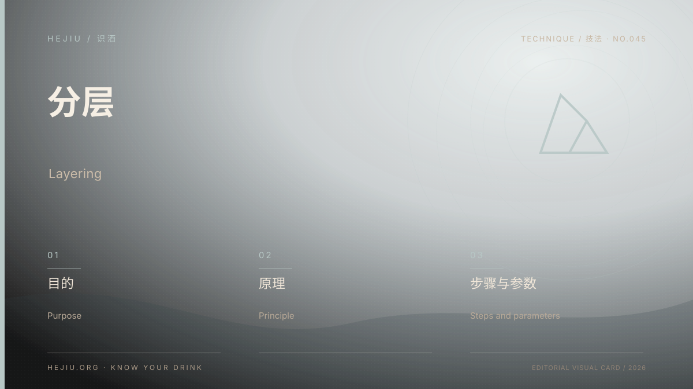

# Layering

Layering is the technique of building a drink so that different ingredients remain visible as separate bands in the glass. It relies on differences in liquid density and on a slow, wall-guided pour that lets heavier liquids settle below lighter ones. It is used in small shooters, dessert-style cocktails and drinks where visual presentation matters, and also to float a layer of aroma or colour on top of a finished drink.

Figure: thematic illustration for Layering. Image: AI-assisted illustration generated with Doubao Seedream 5.0 (project-owned); not a photograph of the subject.

## Purpose

The first purpose is visual: to create a clear separation of colour and transparency, with the boundary itself part of the presentation.

The second is sequential tasting. When a high-strength spirit floats on top, the first sip meets it before the sweeter or fruitier layer below. Layering therefore changes the order in which flavours and aromas arrive, not just the look of the drink.

The third is to float a small amount of an intensely aromatic ingredient on the surface. A liqueur or spirit layer on a long drink can put the aroma ahead of the body. This demands tighter control of quantity and pouring speed, because once the layers mix, they cannot be rebuilt.

## Principle

The physical basis is density. Liquids with more sugar are usually heavier than liquids with less; under the same conditions, liquids with more alcohol are usually lighter than water. Syrups, liqueurs and juices tend to sink, while spirits and sparkling water tend to float. Temperature also matters: colder liquids are usually denser, which is why recipes call for pre-chilled ingredients.

But a density difference is a condition, not a guarantee. Impact during pouring, viscosity, glass shape, surface tension and bubbles can all destroy a layer. Layering is a metastable structure: even without movement, diffusion gradually blurs the boundary. The longer a drink sits, the less distinct the layers become.

What the technique really controls is disturbance at the interface. The slower the pour, the closer the landing point to the glass wall and the colder the liquids, the more stable the boundary; more impact, less temperature difference and higher viscosity make mixing more likely.

## Steps and parameters

First, confirm the order given by the recipe. Which layer goes at the bottom and which on top should come from the recipe, not from guessing by colour. Products differ in sugar and alcohol, and even the same kind of liqueur can vary between brands, so there is no universal order table.

Second, prepare and chill the ingredients as directed. Anything that should be refrigerated should be cold; whether ice is used also depends on the recipe, because ice melts, disturbs the layers and dilutes the drink.

Third, measure each layer with a jigger. Volumes should be reasonably accurate, and space should be left between layers and at the rim.

Fourth, pour the heaviest layer first, which can be done a little faster. For later layers, rest the back of a bar spoon against the glass wall or hold it just above the surface and let the liquid run down the spoon or the wall. The slower the pour, the more complete the interface.

Fifth, watch the boundary after every layer. If the layer below is being pushed up, the pour is too fast, the landing point is too central, or the density difference is too small.

Sixth, do not stir and do not move the glass. Serve promptly and tell the drinker how to enjoy it, either straight or stirred together.

There are no universal pouring heights, flow rates or layer volumes. These depend on the specific products, the glass and the recipe; if a recipe gives an order and quantities, follow it closely.

## Where it applies and alternatives

Layering suits three situations. The first is small layered shooters or dessert-style cocktails where the layers are the point. The second is adding an aromatic layer to a finished drink, such as floating a citrus or herbal spirit on a short drink. The third is presentation-led occasions such as celebrations and displays.

It does not suit recipes meant to be integrated. If the goal is balance, even texture and a consistent sip, stirring or shaking is better; layering makes every sip a different ratio. It also does not suit ingredients with a lot of carbonation, because bubbles keep rising and stirring the interface.

Alternatives include switching to stirring or shaking when integration is wanted; using an expressed peel or a garnish instead of a floated layer when only surface aroma is needed; and pre-mixing the layered ingredients into a syrup or infusion so that a single liquid can be used. Layering is a presentation technique, not the only way to build flavour.

## Common failure points

First, pouring too fast. The liquid shoots into the layer below and the interface collapses.

Second, ingredients at different temperatures. A warm upper layer and a cold lower layer encourage convection and the layers blur quickly.

Third, the wrong order. A heavier liquid poured on top will simply sink and mix.

Fourth, an unstable glass. An uneven base or a wobbling table tilts the surface and breaks the boundary.

Fifth, a jigger with too wide a lip. Flow is hard to control and the landing point drifts away from the wall.

Sixth, filling too full. The last layer has no buffer and a small movement causes overflow or mixing.

Seventh, using ice. Melting ice brings water flow and convection, and layers rarely survive.

Eighth, assuming a layered drink can sit. Even an untouched glass will lose its boundary to diffusion.

## Practice

Practise with water, sugar syrup and food colouring. Pour the syrup first, then add water slowly down the back of a spoon and watch how long the boundary lasts; change the pouring speed and landing point and compare. This uses no alcohol, costs little and shows the effect of density and disturbance directly.

Next, practise the spoon-back method: rest the back of a bar spoon against the glass wall and let the liquid run down it, keeping the wrist steady. Start with one liquid to learn the flow, then move to liquids of different density.

Finally, practise recipe reproduction: make a layered recipe three times and check the thickness of each layer and whether the boundaries are consistent. Reproducibility says more about mastery than a single successful glass.

## Common misconceptions

First, "a bigger density difference makes layering easier". Density helps, but impact and temperature difference matter just as much; small differences can still work with a slow pour.

Second, "layers last a long time". Layering is temporary, and diffusion and temperature change will erase it.

Third, "any drink can be layered". Viscous ingredients, pulpy juice and carbonated drinks are poor choices for a middle layer.

Fourth, "layering needs no measuring". Each volume affects the ratio and the taste, and guessing makes reproduction difficult.

Fifth, "ice makes the layers look better". Ice melts, floats and disturbs the interface, and usually only destroys the layers.

Sixth, "layering is only decoration". It changes the order of flavour and aroma, so it should not be judged on appearance alone.

## See also

- [Bar spoon](ref:spoon): the spoon-back method is the usual guide for layering.
- [Pouring](ref:pouring): flow, landing point and steadiness.
- [Alcohol by volume](ref:abv): the general link between alcohol content and density.
- [Cocktail basics](ref:basics): where layering sits in the overall method.

Further reading: [Blind Tasting](ref:c-extra-1).

**Short definition:** A technique that uses differences in liquid density to build visible layers in a glass; it depends on slow pouring and the order given by the recipe rather than on stirring.
